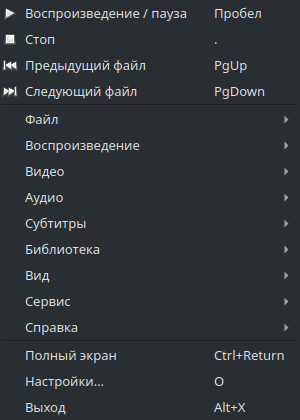

# FoxicMP


FoxicMP — общее название проекта свободных аудио- и видеоплееров.

| Версия | Система и движок | Оформление |
| --- | --- | --- |
| **FoxicMP Classic** | Windows, на основе [MPC-BE](https://github.com/Aleksoid1978/MPC-BE) | Оранжево-синяя лиса, «FoxicMP / Windows Classic / #LiberVixer» |
| **FoxiqMP qt** | Windows, Qt 6 + libmpv | Оранжево-зелёная лиса, «FoxiqMP / Windows QT / #LiberVixer» |
| **FoxiqMP qt** | Linux, Qt 6 + libmpv | Оранжево-зелёная лиса, «FoxiqMP / Linux QT / #LiberVixer» |

[Логотипы, значки и правила совместимости](branding/README.md).
Classic и Qt используют отдельные профили и системную интеграцию.

[Сравнение возможностей трёх редакций](docs/FoxicMPFamilyMatrix.md) ·
[Общий план параллельного развития](docs/FoxicMPFamilyPlan.md).

## Особенности

- Полностью автономный профиль: настройки, история и пользовательские данные хранятся рядом с программой.
- FoxicMP не использует профили MPC-BE или MPC-HC.
- Пункт FoxicMP для всех видеофайлов можно включить в разделе «Форматы»; приложение проверяет правильность пути при запуске.
- Компактная нижняя панель объединяет основные кнопки, состояние воспроизведения, время и громкость.
- Главы показаны тонкими вертикальными линиями на всей высоте шкалы времени; название главы отображается при наведении.
- В комплект входят portable-пакет и установщик для Windows.

## Загрузка

Готовые сборки публикуются на странице [Releases](https://github.com/LiberVixer/FoxicMP/releases). Для большинства 64-разрядных систем Windows используйте пакет x64.

## Qt для Windows и Linux

Разрабатывается нативная **FoxiqMP qt** для Linux Mint 22.x x64: Qt 6 Widgets,
libmpv, автономный `FoxicMPQt.ini`, объединённая панель управления, главы,
аудиодорожки, субтитры, плейлист, историю и избранное. Добавлены OSD, снимки
и превью кадров, параметры субтитров, звука, изображения и окна. Текущее состояние — **0.1.72 development preview**.
Добавлены параметры запуска: позиция, пауза, дорожки, скорость, громкость и окно; команды работающему плееру.
Команды запуска расширены выбором монитора, аудиоустройства, Pan&Scan, случайного порядка и однократного действия после списка.
Добавлено локальное веб-управление из браузера с кодом доступа.
Добавлены ручная проверка обновлений Qt, приоритет при запуске и диагностический отчёт.
Добавлены настройка заголовка окна с шаблонами, выбор постоянного профиля и создание отдельного ярлыка с явным `--profile`.
Профиль можно экспортировать, сохранить в `Backups`, восстановить в новую папку или сбросить настройки с точной резервной копией INI через меню «Настройки → Разное → Управление настройками…».
В плейлисте есть именованные вкладки, поиск, длительность, сортировки,
форматы MPCPL/PLS/ASX/CUE и сохранение дорожек для записей. История получила
поиск и выборочную очистку, избранное — перестановку, выбор позиции и переносимые пути.
Добавлены режимы окна, отдельное управление панелями и параметры полного экрана.
Настраиваются темы, значки, OSD и превью; добавлен английский интерфейс.
Добавлены отдельные действия мыши для окна/полного экрана, команды дорожек
и задержек, ускорение перемотки удержанием и внешнее управление MPRIS.
Регулятор громкости Qt/Linux отрисован в стиле Windows Classic: узкая дорожка,
градиенты, светлый маркер уровня и красная отметка mute.
Добавлены Pan&Scan, кадрирование, отражения, пресеты и преобразование упакованного 3D.
Добавлены редактор/синхронизация текстовых субтитров, папки поиска, кодировки и перечитывание файлов.
Добавлены размещение, интервалы, цвета/прозрачность и тень субтитров; ASS-копии поддерживают масштабы X/Y и поворот.
Добавлены настройки рендера/совместимости субтитров, шрифтов и графических DVD/PGS.
Добавлены обработка звука, стереобаланс, ReplayGain, параметры нормализации и микшер каналов.
Добавлены автопоиск/приоритет внешнего аудио и дублирование PCM на два выхода PulseAudio/PipeWire.
Добавлены редактор аудиофильтров FFmpeg, свои пресеты и их импорт/экспорт в JSON.
Добавлены форматы/частоты PCM, bitstream AC-3/DTS/DTS-HD/E-AC-3/TrueHD и параметры декодера.
Добавлены масштабирование Software/OpenGL, деинтерлейсинг и аппаратное декодирование по кодекам.
Добавлены оттенок/гамма, точность кадра Software 8/16 бит и параметры цвета OpenGL.
Добавлены переносимые ICC-профили и настройки синхронизации видео/Qt VSync.
Добавлены GLSL-редактор с цепочкой до/после масштаба, статистика вывода и визуальный Qt-тест разрывов.
Автоматический ICC в X11 через colord следует за экраном окна; ручной профиль сохраняется.
Добавлены свойства текущего источника, снимки/буфер/область, лист миниатюр и копирование локального файла.
В 0.1.55 меню, контекстные меню и дерево настроек приближены к Classic.
Внутреннее расположение всех полей пока не совпадает 1:1;
[постраничный список](docs/LinuxClassicInterfaceChecklist.md).

В 0.1.56 перенесены режимы и компоновка страницы «Логотип», оригинальное прозрачное изображение Classic, четыре пары ползунок/число коррекции цвета и сброс черновика. Сверка остальных страниц продолжается.

В 0.1.57 страница «Размер окна» получила группы и переключатели Classic,
отдельный стандартный размер и кнопку текущего размера окна/видеообласти.

В 0.1.58 страница «Интерфейс» получила компактные группы Classic: яркость/RGB темы,
цвета громкости, размер кнопок, время/превью, метки глав и масштаб шрифта плейлиста.
Дополнительные параметры оформления раскрываются отдельно.

В 0.1.59 окно настроек следует теме плеера: тёмные страницы, дерево, поля и кнопки.
Переключение темы применяется к открытому окну кнопкой «Применить».

В 0.1.60 настройки распределены по 10 категориям и 40 вкладкам. Общий поиск
находит отдельные параметры и раскрывает дополнительные блоки. Изменения
сохраняются через «Применить» или OK; текущий профиль сохраняется при обновлении.


В 0.1.61 слева сохранено раскрываемое дерево категорий и страниц, справа —
вкладки. Окно настроек появляется сразу и показывает индикатор загрузки,
пока создаются страницы; загрузку можно отменить.

В 0.1.64 заголовок и нижняя строка повторяют поведение Classic: название
с версией плеера, значки ▶/⏸, скорость, текущая глава, таймер с приоритетом
по ширине и сокращение длинного текста. После закрытия файла таймер пуст.

В 0.1.62 верхнее меню и правая кнопка используют общую структуру:
Файл, Воспроизведение, Видео, Аудио, Субтитры, Библиотека, Вид, Сервис,
Справка. Порядок одинаков в оконном и полноэкранном режимах.
Частые команды вынесены в начало и конец контекстного меню;
все остальные распределены по назначению без раздела «Дополнительно».




Сборка Classic Windows сохраняется отдельно.

[Сборка, запуск и проверки Linux-версии](qt/README.md).
[Состояние согласованного плана](docs/LinuxQt.md).
[План сближения с Classic и порядок этапов](docs/LinuxParityPlan.md).

## Системные требования

- Windows 7, 8, 8.1, 10 или 11.
- Процессор с поддержкой SSE2.
- Видеокарта с поддержкой DirectX 9.0c и Pixel Shader 3.0.

## Сборка

Инструкция находится в [docs/Compilation.txt](docs/Compilation.txt). Основная команда для создания пакетов:

```bat
build.bat Build x64 Packages NoWait
```

В рабочей ветке добавлен экспериментальный режим чтения локальных дорожек
Harvester во время загрузки. Интеграция интерфейса Harvester отключена;
режим проверен отдельным загрузчиком на выбранных YouTube/Rutube/VK
(fMP4/HLS) и не входит в стабильный релиз. Программные замеры A/V уложились
в 100 мс с учётом неопределённости.
[Протокол, запуск и ограничения](docs/HarvesterProgressive.md).
Самостоятельный командный адаптер и его тесты: [tools/harvester-preview](tools/harvester-preview).
Описание предварительного выпуска: [progressive.1](docs/ReleaseNotes-1.9.1.75-progressive.1.md).

## Происхождение и лицензия

FoxicMP основан на MPC-BE и сохраняет историю исходного проекта и сведения об авторах. Изменения FoxicMP впервые опубликованы в 2026 году. Исходный код распространяется на условиях [GNU GPL v3](LICENSE.txt). Список авторов и используемых компонентов находится в каталоге [docs](docs).

---

FoxicMP is a free and open-source audio and video player for Windows based on [MPC-BE](https://github.com/Aleksoid1978/MPC-BE). It is an independent modification with its own application identity, portable profile, and Windows integration.

Settings and user data are stored next to the executable. Release packages and source code are distributed under the [GNU GPL v3](LICENSE.txt). Build instructions are available in [docs/Compilation.txt](docs/Compilation.txt).

Linux 0.1.44: открытие из буфера через CLI, временный веб-порт и сброс закрытого профиля с резервной копией.

Linux 0.1.45: несколько внешних аудиодорожек/субтитров и задержка внешнего звука через CLI.
Linux 0.1.46: устранены дубликаты при быстрых повторных подключениях внешних дорожек; команды выполняются последовательно.

Linux 0.1.47: одноразовый медиапоток из stdin (`--stdin` или `-`) без перемотки и сохранения в библиотеку.

Linux 0.1.48: веб-пульт в доверенной локальной сети с явным выбором частного IPv4,
кодом доступа и сохранением локального режима по умолчанию.

Linux 0.1.50: выбор/удаление записей и страницы очереди в веб-пульте, открытие
файла на компьютере плеера или URL, добавление в проигрываемую очередь.
