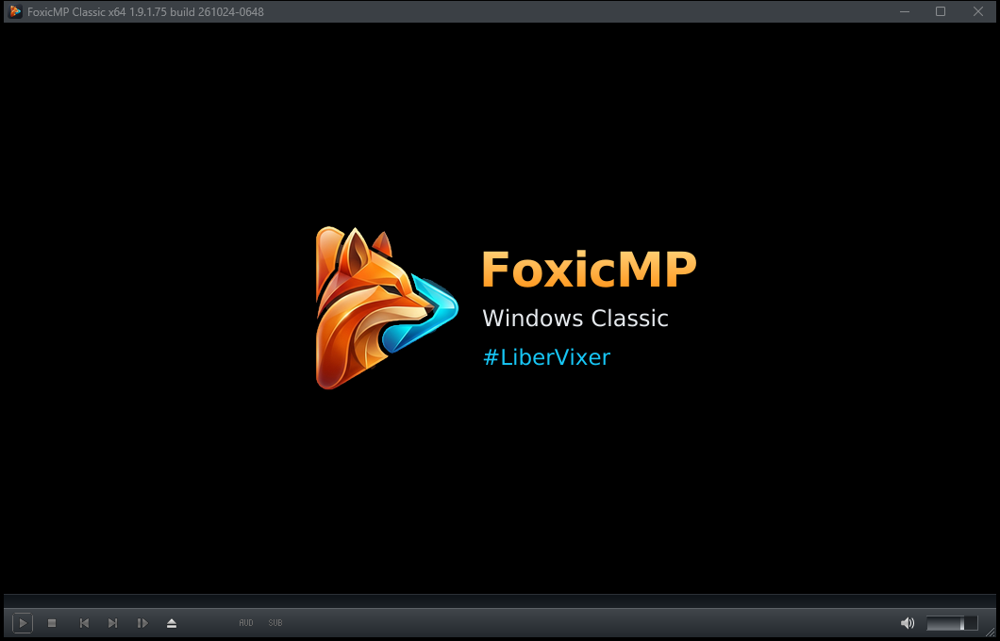
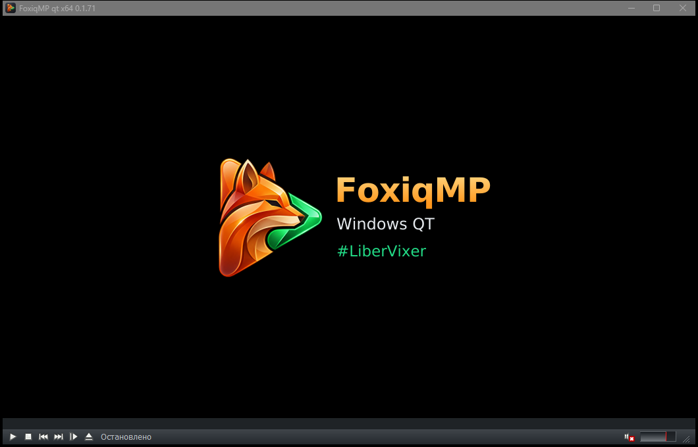
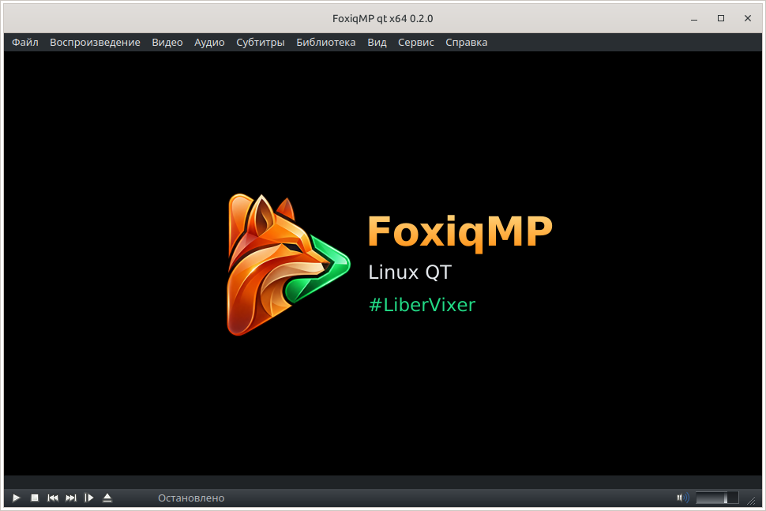

# FoxicMP 0.2.0

FoxicMP — свободный аудио- и видеоплеер в трёх самостоятельных редакциях.
Windows Classic сохраняет MFC/DirectShow и основу [MPC-BE](https://github.com/Aleksoid1978/MPC-BE).
Обе Qt-редакции используют общий код Qt 6 Widgets + libmpv.

| Редакция | Система | Запуск | Профиль |
| --- | --- | --- | --- |
| **FoxicMP Classic** | Windows x64 | `FoxicMP64.exe` | `FoxicMP64.ini` |
| **FoxiqMP qt — Windows QT** | Windows x64 | `FoxicMPq.exe` | `FoxicMPQt.ini` |
| **FoxiqMP qt — Linux QT** | Linux Mint 22.x x64 | `./foxicmp-qt` | `FoxicMPQt.ini` |

Classic использует оранжево-синюю лису, Qt — оранжево-зелёную. Логотип каждой
редакции содержит её платформу и подпись **#LiberVixer**.
Имена EXE и INI сохранены для совместимости. [Правила оформления](branding/README.md).

## Скачать 0.2.0

| Редакция | Установщики | Portable |
| --- | --- | --- |
| Windows Classic | [EXE](https://github.com/LiberVixer/FoxicMP/releases/download/v0.2.0-installers.1/FoxicMPClassic-0.2.0-windows-x64-setup.exe) · [MSI](https://github.com/LiberVixer/FoxicMP/releases/download/v0.2.0-installers.1/FoxicMPClassic-0.2.0-windows-x64.msi) | [ZIP, x64](https://github.com/LiberVixer/FoxicMP/releases/download/v0.2.0-installers.1/FoxicMPClassic-0.2.0-windows-x64.zip) |
| Windows Qt | [EXE](https://github.com/LiberVixer/FoxicMP/releases/download/v0.2.0-installers.1/FoxicMPQt-0.2.0-windows-x64-setup.exe) · [MSI](https://github.com/LiberVixer/FoxicMP/releases/download/v0.2.0-installers.1/FoxicMPQt-0.2.0-windows-x64.msi) | [ZIP, x64](https://github.com/LiberVixer/FoxicMP/releases/download/v0.2.0-installers.1/FoxicMPQt-0.2.0-windows-x64.zip) |
| Linux Qt | [DEB, amd64](https://github.com/LiberVixer/FoxicMP/releases/download/v0.2.0-installers.1/foxiqmp-qt_0.2.0-1_amd64.deb) | [TAR.GZ, x64](https://github.com/LiberVixer/FoxicMP/releases/download/v0.2.0-installers.1/FoxicMPQt-0.2.0-linux-x64.tar.gz) |

Для Windows выберите MSI **или** EXE своей редакции: EXE содержит тот же MSI.
[SHA-256 установщиков](https://github.com/LiberVixer/FoxicMP/releases/download/v0.2.0-installers.1/SHA256SUMS-installers.txt).
Рядом с portable-архивами опубликованы их индивидуальные файлы `.sha256`.

[Страница выпуска](https://github.com/LiberVixer/FoxicMP/releases/tag/v0.2.0) ·
[Заметки и результаты проверки](docs/ReleaseNotes-0.2.0.md) ·
[Манифест сборок](https://github.com/LiberVixer/FoxicMP/releases/download/v0.2.0/release-manifest.json).

**0.2.0 — версия общего выпуска.** Qt показывает 0.2.0; Classic сохраняет
номер движка **1.9.1.75**, сборка выпуска — `261025-1303`.

## Установка и обновление

Windows MSI/EXE по умолчанию устанавливает отдельную доступную для записи папку
в `%LOCALAPPDATA%\Programs\FoxicMPClassic` или `FoxiqMPqt` и ярлык в меню «Пуск».
Существующий INI сохраняется при установке, ремонте и удалении.
[Устройство Windows-установщиков](packaging/windows/README.md).

Для Linux Mint 22.x можно установить `.deb` вместе с зависимостями:

```sh
sudo apt install ./foxiqmp-qt_0.2.0-1_amd64.deb
```

Запуск — из меню или командой `foxiqmp-qt`. При первом запуске создаётся
пользовательская папка программы `~/.local/opt/FoxiqMP-qt`; в ней рядом находятся
бинарник и профиль. Обновление системного пакета сохраняет личные файлы.
[Подробности DEB](qt/packaging/debian/README.md).

Для portable-варианта распакуйте архив в доступную для записи папку и запустите EXE
или `foxicmp-qt`. Настройки, история, плейлисты и избранное хранятся рядом с
программой; редакции не используют профили друг друга, MPC-HC или MPC-BE.
Для Qt отдельную папку профиля можно выбрать через `--profile ПУТЬ`.

**Перед обновлением сохраните папку настроек. При обновлении Classic не
заменяйте свой `FoxicMP64.ini` файлом из архива:** в поставке находится заводской
профиль для новой установки. В Qt-архивах пользовательского INI нет.

Windows Classic включает языковые DLL, шейдеры, логотипы и необходимые DirectX
DLL. Windows Qt включает Qt/libmpv, FFmpeg, yt-dlp и лицензии зависимостей;
MSYS2 и отдельный пакет кодеков для него устанавливать не требуется.
Windows Qt проверен на Windows 11 x64; Classic сохраняет собственные системные
требования и движок.

Linux Qt использует библиотеки дистрибутива. Для Linux Mint 22.x:

```sh
sudo apt install libmpv2 liblcms2-2 libqt6dbus6 libqt6widgets6 libqt6openglwidgets6 qt6-qpa-plugins mint-meta-codecs ffmpeg yt-dlp
```

Регистрация в меню запуска, пункт контекстного меню и ассоциации доступны в
настройках соответствующей редакции. Изменяйте их из установленной копии.

## Возможности

- Локальное видео и аудио, сетевые источники, дорожки, субтитры и главы.
- Компактная нижняя панель, тонкие метки глав, регулятор громкости в стиле Classic.
- Плейлисты, история, избранное, повторы, скорость, перемотка и покадровый шаг.
- Светлая и тёмная темы, настройка управления, окна, звука, видео и субтитров.
- Для новых профилей: OSD выключено, положение окна запоминается, ограничение
  пропорций окна по видеокадру выключено. Сохранённые предпочтения имеют приоритет.
- В Qt: 9 разделов меню; дерево настроек слева, вкладки справа, поиск параметров
  и индикация загрузки. Classic сохраняет штатные страницы, переводы и оформление;
  согласуется их порядок, без замены страниц Qt-элементами.
- Локальный progressive API v1 для просмотра растущих MP4/M4A-дорожек:
  Unix socket в Linux Qt, named pipe в Windows Qt и Classic.
- Два PCM-выхода: собственный тракт Classic, WASAPI/libmpv в Windows Qt,
  PulseAudio/PipeWire в Linux Qt. Физическая задержка между устройствами
  требует отдельного измерения.

Поддержка контейнеров и кодеков определяется движком и доступными декодерами.
[Матрица возможностей](docs/FoxicMPFamilyMatrix.md) описывает различия трёх редакций.

### Просмотр во время скачивания

Загрузчик передаёт плееру пути, подтверждённые байтовые префиксы, обновления и
состояние сессии. Поддержанный сценарий — отдельные H.264/AAC дорожки fast-start
MP4/M4A и fMP4. Это API плеера; YouTubeHarvester в выпуске не изменялся.

[Контракт API и Python-клиент](docs/LinuxProgressiveApi.md) ·
[SDK и локальный writer-стенд](docs/ProgressiveSdk.md) ·
[Предыдущий provider-протокол Classic](docs/HarvesterProgressive.md).
Предварительный [SDK 1.84](https://github.com/LiberVixer/FoxicMP/releases/tag/progressive-api-v1.84)
добавляет [явный continuous MP4/H.264 + AAC-LC профиль](docs/ProgressiveContinuousAacApi.md)
для трёх редакций и исправляет гонку completed seek в Classic. В поставке —
Windows portable Classic/Qt, Linux tar/`.deb` и SDK. Проверены 107 финальных
пакетных сценариев, ещё 90 повторов Classic и 4 controlled-index-lag сценария;
[все семь файлов скачаны обратно и сверены по SHA-256](docs/ProgressiveContinuousAacDeliveryValidation-2026-11-06.json).
Linux обновлён с сохранением профиля. Полная progressive-ТЗ-приёмка остаётся открытой.
Дополнительно [проверены 99 AAC waiting/replacement/crash-сценариев трёх редакций](docs/ProgressiveContinuousAacResilience.md), включая настоящие паузы записи 10/30/60 секунд.

Предыдущий [SDK 1.83](https://github.com/LiberVixer/FoxicMP/releases/tag/progressive-api-v1.83)
предназначен для интеграционных проверок с новыми сборками плеера.
Он добавляет [явный continuous H.264 профиль с B-frames](docs/ProgressiveReorderedSdk.md)
для всех трёх редакций; прежний no-B default и SDK 1.82 совместимы. В релизе есть
Windows portable Classic/Qt, Linux tar/`.deb` и SDK; [проверки пакетов и установки](docs/ProgressiveReorderedSdkPackagesValidation-2026-11-05.json).
Дополнительно [проверены дробные частоты и VFR через SDK и обычные окна](docs/ProgressiveReorderedSdkTiming.md)
всех трёх редакций, включая паузу, перемотку и подтверждённый конец файла.
SDK 1.54–1.55 добавляют обычный растущий MP4 H.264/AAC-LC с индексом в начале
или в конце файла: [контракт tail-index и advisory ranges](docs/ProgressiveTailMp4.md),
[проверки трёх редакций](docs/ProgressiveTailMp4Validation-2026-11-01.md).
SDK 1.56 добавляет [перемотку после complete с сохранением состояния](docs/ProgressiveCompletedSeek.md)
и диагностику скорости/громкости/mute.
SDK 1.57 добавляет [самостоятельное AAC-LC аудио или H.264 видео в fMP4](docs/ProgressiveStandalone.md), без фиктивной второй дорожки.
SDK 1.58 расширяет его [отдельным Opus mono/stereo в fMP4](docs/ProgressiveStandaloneOpus.md); Harvester не изменён.
SDK 1.59 добавляет [отдельное аудио WebM/Opus/Vorbis mono/stereo](docs/ProgressiveStandaloneWebm.md), проверенное в трёх редакциях.
SDK 1.60 добавляет [отдельное WebM-видео VP8/VP9/AV1](docs/ProgressiveStandaloneWebmVideo.md), включая проверенные 10-bit и дробные частоты кадров.
SDK 1.61 расширяет standalone fMP4 [видео HEVC/AV1/VP9](docs/ProgressiveStandaloneFmp4Video.md), включая проверенные 8/10-bit и дробные частоты кадров.
SDK 1.62 добавляет [FLAC-аудио в растущем fMP4](docs/ProgressiveStandaloneFlac.md): mono/stereo, 16/24 bit, 44.1/48 kHz и проверку сохранности PCM.
SDK 1.63 добавляет [отдельный растущий `.flac`](docs/ProgressiveRawFlac.md): проверку границ кадров и CRC, виртуальный MP4 без перекодирования и тот же API.
SDK 1.64 добавляет [растущий ADTS AAC-LC](docs/ProgressiveAdts.md): mono/stereo, 44,1/48 кГц, подтверждённые кадры и виртуальный MP4 без перекодирования.
SDK 1.65 добавляет [растущий MPEG-1 Layer III MP3](docs/ProgressiveMp3.md): CBR/VBR, mono/stereo, 44,1/48 кГц, ID3 и preroll для перемотки.
SDK 1.66 добавляет [MP3 с Xing/Info/VBRI](docs/ProgressiveMp3Indexed.md) отдельным профилем: проверенные counters, сохранённые delay/padding metadata, encoded-sample timeline; gapless trim пока не применяется.
SDK 1.67 добавляет [проверку LAME Info Tag CRC и расчёт границ PCM](docs/ProgressiveMp3Tag.md): повреждённые метаданные не дают разрешения на trim; существующее воспроизведение остаётся по encoded timeline.
SDK 1.68 добавляет [gapless MP3 в Qt](docs/ProgressiveMp3Gapless.md): полезную звуковую шкалу, точный trim/seek и проверку растущего хвоста. Classic сохраняет прежние MP3-профили; его gapless output adapter остаётся открытым. [Проверки](docs/ProgressiveMp3GaplessValidation-2026-11-02.md).
SDK 1.69 добавляет [тот же gapless-профиль в Classic](docs/ProgressiveClassicMp3Gapless.md): проверенный внутренний декодер, фактический статус PCM trim и сохранение reader при управлении воспроизведением. Клиент согласует поддержку каждой редакции по capabilities EXE.
SDK 1.70 добавляет [растущий WAV/PCM16](docs/ProgressiveWav.md) для всех трёх редакций: mono/stereo 44.1/48 kHz, без перекодирования, с ожиданием неполных блоков и подтверждённого конца файла.
SDK 1.71 добавляет [растущий Ogg Opus](docs/ProgressiveOggOpus.md) для трёх редакций: CRC страниц, продолжения пакетов, сохранение pre-skip/gain и конечной обрезки без перекодирования. Ogg Vorbis остаётся отдельным этапом.
SDK 1.72 добавляет [растущий Ogg Vorbis](docs/ProgressiveOggVorbis.md) для трёх редакций: mono/stereo 48 kHz, расчёт перекрывающихся окон, CRC/continued packets и конечная обрезка без перекодирования.
SDK 1.73 добавляет [растущий AC-3](docs/ProgressiveAc3.md) для трёх редакций: mono/stereo 48 kHz, обе CRC и сохранение исходных кадров без перекодирования. SDK 1.74 добавляет отдельный [растущий E-AC-3](docs/ProgressiveEac3.md): независимый mono/stereo substream, шесть проверенных битрейтов и CRC. Дополнительные layouts, dependent substreams и JOC остаются вне профиля.
SDK 1.75 добавляет [растущий WAV PCM24](docs/ProgressiveWav24.md): mono/stereo 44.1/48 kHz, побайтное сохранение PCM и отдельный профиль, совместимый с прежним PCM16. RF64/extensible/float остаются вне этого профиля.
SDK 1.76 добавляет [растущий WAVEFORMATEXTENSIBLE PCM24](docs/ProgressiveWavExtensible24.md): mono/stereo 44.1/48 kHz, проверенные PCM GUID, valid bits и маски каналов. Legacy PCM16/24 сохраняют свои профили; RF64/float и остальные layouts открыты.
SDK 1.77 добавляет [растущий RF64 PCM16/PCM24](docs/ProgressiveRf64.md): ds64, 64-битные размеры, mono/stereo 44.1/48 kHz и восемь growing profiles трёх редакций. Адресация за 4 GiB проверена синтетически; playback физических больших RF64 остаётся в приёмке. Справка API Qt выдаётся компактным JSON в прежнем лимите клиента.
SDK 1.78 добавляет [внешние SHA-256 индексы](docs/ProgressiveExternalIntegrity.md) для RF64 и исправляет дальнюю перемотку Qt. [Физические файлы больше 4 GiB](docs/ProgressiveLargeRf64.md), PCM16/PCM24 stereo 48 kHz, проверены в трёх редакциях; лимит команд 64 KiB сохранён. [Отчёт](docs/ProgressiveLargeRf64Validation-2026-11-03.json).
SDK 1.79 добавляет [публикацию RF64 ranges вне порядка](docs/ProgressiveRf64Ranges.md): плеер ждёт дыры и продолжает тот же reader после их заполнения. Воспроизводится только непрерывный префикс, seek в отдельные островки остаётся отдельным этапом. [Проверки трёх редакций](docs/ProgressiveRf64RangesValidation-2026-11-03.json).
SDK 1.80 добавляет [диагностическую карту RF64 PCM-пакетов](docs/ProgressiveRf64RangeMap.md): точные границы подтверждённых интервалов без чтения payload, с явным усечением длинного списка. Это подготовка к island seek, который пока остаётся запрещён. [Проверки](docs/ProgressiveRf64RangeMapValidation-2026-11-03.json).
SDK 1.81 добавляет [явный sparse RF64 PCM16/24 playback](docs/ProgressiveRf64Sparse.md): переход в подтверждённый островок через незаписанную дыру и обратно, ожидание на его границе и продолжение после публикации новых данных. Старые RF64 hints сохраняют prefix-gated поведение. [Проверки трёх редакций](docs/ProgressiveRf64SparseValidation-2026-11-03.json).
[Дополнительная проверка тех же EXE](docs/ProgressiveLargeSparseRf64.md) подтверждает физические sparse RF64 PCM16/24 stereo 48 kHz больше 4 GiB во всех трёх редакциях. Новый fixture находится в исходниках; опубликованный ZIP SDK 1.81 сохранён.
[Проверки пределов RF64](docs/ProgressiveRf64Limits.md): 250000 packets  / 16 GiB, восемь native profiles на ОС, 100 циклов ядра и воспроизведение двух предельных профилей в каждой редакции.
В текущих исходниках проверены [100 циклов настоящего плеера в каждой редакции](docs/ProgressivePlayerLifecycle.md) и исправлены две Windows handle leaks. Это maintenance-изменения после SDK 1.81; опубликованные бинарные assets ими ещё не обновлены.
[Проверка нескольких readers](docs/ProgressiveMultiReaderPlayback.md): два playback endpoints одного файла, изолированные Stop/cancel/reopen и исправление временной конкуренции I/O-проверки с запросами readers.
[Проверка crash/restart](docs/ProgressivePlayerCrashRecovery.md): сохранённые readers восстанавливаются по подтверждённому выходу процесса ОС; второй плеер продолжает работать, старые команды изолированы от нового reader. Проверены самостоятельные процессы всех трёх редакций.
[Отказы writer](docs/ProgressiveWriterFailures.md): неполный неопубликованный кадр, исчезновение heartbeat и инъекция ENOSPC проверены отдельно во всех трёх редакциях; настоящий disk-full остаётся открытым.
[Переход к итоговому файлу](docs/ProgressiveFinalFileTransition.md): active rename, защита от подмены старого пути, естественный EOF и открытие итогового имени проверены для RF64 во всех трёх редакциях.
[Десятиминутный прогон](docs/ProgressiveSoakPlayback.md): два растущих RF64 на редакцию, паузы загрузчика 10/30/60 s и заранее заданные бюджеты ресурсов; измерения и графики опубликованы.
[Длительное видео и remux-регрессия](docs/ProgressiveVideoSoakPlayback.md): десять минут fMP4/MPEG-TS во всех редакциях; исправлен отказ при 129 inline SHA-блоках, сохранены исходные лимиты безопасности и бюджеты.
[Непрерывный remux — внутренние компоненты](docs/ProgressiveContinuousRemux.md): incremental fMP4, управляющий слой, ограниченный cache с SHA/reader leases и восстановление по ownership journal проверены на Windows/Linux. Внутренний поток подключён к Qt Player и настоящему Classic DirectShow graph; 600 кадров Classic совпали с независимым декодированием оригинала. Общий фоновый controller принимает внутренние команды подготовки, запуска, статуса и управления просмотром через обычный IPC всех трёх редакций. Узкий H.264 video-only профиль проверен с pause/append, complete seek, EOF, Stop/заменой и закрытием окна. Публичные capability/SDK, поставка worker и интеграция Harvester остаются отдельным этапом.
ZIP содержит SDK без EXE/установщиков. Общий remux, произвольные sparse media
и оставшаяся приёмка перечислены в [чеклисте](docs/ProgressiveCompletionChecklist.md).
SDK 1.38 добавляет [сегменты WebM VP8/VP9/AV1 с Opus](docs/ProgressiveWebmSegments.md), включая постраничный каталог, в трёх редакциях. Требуются новые EXE; SDK содержит клиент и документацию.
SDK 1.39 добавляет [сегментный MPEG-TS H.264/AAC](docs/ProgressiveTsPlayback.md): отдельные подтверждённые дорожки, SHA-256, inline или постраничный каталог, общий виртуальный MP4 без перекодирования. Harvester не изменяется.
SDK 1.40 добавляет [совместные TS-сегменты H.264/AAC](docs/ProgressiveMuxedTsPlayback.md): один физический ресурс с обеими дорожками и две логические проекции для декодеров, включая отдельный постраничный каталог. SDK 1.41 добавляет [один растущий TS AVC/AAC файл](docs/ProgressiveGrowingTs.md): частичные пакеты/PES и закрытые GOP ждут новые байты, обе дорожки читаются из одного SHA-защищённого ресурса через виртуальный MP4. [Проверки трёх редакций](docs/ProgressiveGrowingTsValidation-2026-10-31.md).
Добавлена [выбранная недокачанная аудиодорожка](docs/ProgressivePartialAudio.md)
с буферизацией, дозагрузкой и возвратом на основную во всех трёх редакциях.
SDK 1.29 добавляет [изоляцию обнаруженных ошибок активной дополнительной audio](docs/ProgressiveActiveAudioErrors.md)
с автоматическим переходом на обязательную дорожку.
SDK 1.30 добавляет [SHA-256 проверку подтверждённых блоков](docs/ProgressiveIntegrity.md):
защищённый блок проверяется до передачи декодеру, а optional-ошибка изолируется
по уже действующим правилам. [Отчёт проверки 30 октября](docs/ProgressiveIntegrityValidation-2026-10-30.md).
SDK 1.31 добавляет [проверку сегментного timeline](docs/ProgressiveSegments.md)
для подготовки HLS/DASH: sequence, timestamp offset, discontinuity и движение
live-окна. [Отчёт проверки](docs/ProgressiveSegmentsValidation-2026-10-30.md).
SDK 1.36 добавляет [сегментные VP9 8/10-bit и Opus mono/stereo](docs/ProgressiveSegmentVp9Opus.md). SDK 1.35 добавляет [сегментный AV1 Main 8/10-bit с AAC-LC](docs/ProgressiveSegmentAv1.md). SDK 1.34 добавляет [сегментное HEVC Main/Main10 с AAC-LC](docs/ProgressiveSegmentHevc.md) в трёх редакциях. SDK 1.33 добавляет [ограниченное воспроизведение цепочки fMP4 H.264/AAC-LC](docs/ProgressiveSegmentPlayback.md) в трёх редакциях. TS, live и смена codec/init пока не поддерживаются. SDK 1.32 добавил [staging и индекс одного fMP4-сегмента](docs/ProgressiveSegmentStaging.md) через диагностический API без замены текущего воспроизведения.

SDK 1.37 добавляет [воспроизведение постраничного fMP4-каталога](docs/ProgressiveCatalogPlayback.md) во всех трёх редакциях: отдельная capability, SHA-256, до 8192 metadata-ресурсов и не более восьми открытых медиафайлов. Проверены 182–183 ресурса с паузой, перемоткой, обновлениями и повторным открытием. Для новых API нужны новые сборки приложений; многочасовые записи и длительная A/V sync ещё требуют приёмки. Harvester не менялся.
В текущих исходниках исправлена совместимость v1, добавлены SDK, подтверждение
освобождения файлов и Windows Qt legacy/provider. Добавлен общий для трёх редакций
[валидатор метаданных v2](docs/ProgressiveManifestV2.md): ресурсы, диапазоны,
сегменты и поздние главы. Сам validate не открывает файлы.
Player-owned v1 получил [reader leases и recovery](docs/ProgressiveReaderLeases.md):
учёт реальных файлов, независимые reader IDs и восстановление после crash.
Добавлены [подтверждённые диапазоны v2 и асинхронная I/O-проверка](docs/ProgressiveResourceIo.md)
без замены текущего просмотра. Добавлен [медиапрофиль v2](docs/ProgressiveMediaV2.md):
две отдельные fMP4 H.264/AAC-LC дорожки, реальное чтение декодера через ResourceSource.
SDK 1.14 добавляет [HEVC Main/Main10 + AAC-LC в отдельных fMP4](docs/ProgressiveHevc.md).
SDK 1.15 — [AV1 Main 8/10-bit + AAC-LC fMP4](docs/ProgressiveAv1.md),
SDK 1.16 — [VP9 Profile 0/2 8/10-bit + AAC-LC fMP4](docs/ProgressiveVp9.md),
SDK 1.17 — [Opus mono/stereo + все четыре видеокодека в fMP4](docs/ProgressiveOpus.md).
SDK 1.18 — [отдельные WebM VP9 8/10-bit и Opus дорожки](docs/ProgressiveWebM.md).
SDK 1.19 — [AV1 Main 8/10-bit + Opus в WebM](docs/ProgressiveWebMAv1.md). SDK 1.20 — [смешанные пары fMP4/WebM](docs/ProgressiveMixedContainers.md) в обоих направлениях. SDK 1.21 — [VP8 и Vorbis mono/stereo в WebM](docs/ProgressiveVp8Vorbis.md). SDK 1.22 — [несколько аудиодорожек и поздние полные UTF-8 SRT](docs/ProgressiveMultiTrack.md). SDK 1.23 — [перемотка Qt внутри подтверждённого участка](docs/ProgressiveSeek.md) без прежнего лимита 10 секунд. SDK 1.24 — [изоляция ошибок optional SRT](docs/ProgressiveOptionalSrt.md) в трёх редакциях.
Другие WebM/MKV-варианты, multichannel Opus, remux, metadata и live ещё не подключены.
[Первичная подготовка probe/start](docs/ProgressivePreparation.md) выполняется вне UI
и защищена от позднего запуска после Stop/Close. [Update/complete](docs/ProgressivePublication.md)
также вынесены в worker; I/O опубликованного источника отделён от metadata mutex UI.
[Реестр читателей и уничтожение Source](docs/ProgressiveRetirement.md) также вынесены
из UI: очередь ограничена 32 источниками и двумя cleanup-workers, release
подтверждается после закрытия файлов. [Открытие legacy/provider](docs/ProgressiveLegacyOpening.md)
тоже готовится вне UI и не применяется после отмены/таймаута.
[Проверки файлов и доиндексация legacy-сеанса](docs/ProgressiveLegacyMaintenance.md)
не удерживают metadata mutex UI; снимок и доступная граница применяются вместе.
[Qt native teardown](docs/ProgressiveEngineShutdown.md) вынесен в ограниченную
очередь с сохранением callback/stream lifetime. GL free сохраняет поток владельца;
Classic получил [асинхронное закрытие progressive STA-графа](docs/ProgressiveClassicClose.md),
с отложенным start/exit и отменой ожидающего открытия. Обычные/UI-owned Classic графы
и пределы больших индексов ещё требуют работы.
Выполняется
[план нового ТЗ интеграции](docs/ProgressiveIntegrationPlan.md).
Расширенная матрица форматов/дорожек ещё не реализована; ожидание полной
загрузки не считается поддержкой progressive. Эти изменения исходников не
означают обновление уже опубликованных установщиков 0.2.0.
Дисковые меню, аналоговое ТВ и специальное оборудование отложены; Wayland
исключён из текущих проверок.

## Скриншоты интерфейса

### FoxicMP Classic — Windows



### FoxiqMP qt — Windows QT



### FoxiqMP qt — Linux QT



## Исходники и сборка

Все три редакции находятся в этом репозитории. Windows Qt и Linux Qt собираются
из одного `qt/` с адаптерами платформ; исходники Classic находятся отдельно.

| Редакция | Исходники | Инструкция |
| --- | --- | --- |
| Windows Classic | [src/apps/mplayerc](src/apps/mplayerc), [src/DSUtil](src/DSUtil), [include/Version.h](include/Version.h) | [Classic: код и сборка](src/apps/mplayerc/README.md), [полная инструкция](docs/Compilation.txt) |
| Windows Qt | [qt/src](qt/src), адаптеры `*_win.cpp` | [Windows Qt](qt/packaging/windows/README.ru.md) |
| Linux Qt | [qt/src](qt/src), Linux-адаптеры | [Qt: сборка и тесты](qt/README.md), [Linux-пакет](qt/packaging/README.ru.md) |
| Общие контракты | [shared](shared) | [Команды](docs/FoxicMPFamilyCommands.json), [границы платформ](docs/FoxicMPFamilyCapabilities.json) |

Исходники первоначальных portable-бинарников закреплены тегом
[`v0.2.0`](https://github.com/LiberVixer/FoxicMP/tree/v0.2.0), коммит
[`235282412`](https://github.com/LiberVixer/FoxicMP/commit/2352824127a85d7e6eeef241c8a88701477dd850).
[ZIP исходников всех трёх редакций](https://github.com/LiberVixer/FoxicMP/archive/refs/tags/v0.2.0.zip).
Установщики и исправленный заголовок Qt собраны из дополнения
[`v0.2.0-installers.1`](https://github.com/LiberVixer/FoxicMP/tree/v0.2.0-installers.1).
Его исходники содержат упаковщики MSI/EXE/DEB и новый снимок Linux.
`main` содержит актуальную документацию и последующие изменения; первоначальный
тег `v0.2.0` сохранён без переписывания истории.

Для полного дерева Classic со сторонними компонентами используйте Git:

```sh
git clone --recurse-submodules https://github.com/LiberVixer/FoxicMP.git
cd FoxicMP
```

[План параллельной разработки](docs/FoxicMPFamilyPlan.md) ·
[История этапов Linux](docs/LinuxParityPlan.md).

## Проверки выпуска

Все три сборки завершились с кодом **0**. Полный Windows Qt тест в интерактивном
сеансе: **22 passed, 0 failed, exit 0**. Progressive API и audio-mirror на Windows
и Linux: по **2/2 набора тестов, exit 0**. Контрольные суммы всех архивов сверены
с GitHub. Это не подтверждает физические устройства, HDR или задержку между
аудиовыходами.

## Происхождение и лицензия

FoxicMP Classic основан на MPC-BE и сохраняет историю исходного проекта и
сведения об авторах. Qt-редакции используют Qt и libmpv. Проект распространяется
под [GNU GPL v3](LICENSE.txt); сведения об авторах находятся в [docs](docs),
лицензии компонентов — также в пакетах поставки.

FoxicMP is a free and open-source player family: Windows Classic (MFC/DirectShow,
based on MPC-BE), Windows Qt and Linux Qt (shared Qt 6/libmpv code). Each edition
keeps an independent portable profile. Release 0.2.0 provides x64 portable builds
for all three editions, with source code under GNU GPL v3.

SDK 1.42 добавляет [один растущий fMP4 H.264/AAC](docs/ProgressiveMuxedFmp4.md)
с двумя виртуальными дорожками общего mdat, SHA-256 и ожиданием целого
фрагмента. [Проверки всех трёх редакций](docs/ProgressiveMuxedFmp4Validation-2026-10-31.md).

SDK 1.43 добавляет [один растущий WebM VP9/Opus](docs/ProgressiveMuxedWebm.md)
с двумя virtual track views, общим SHA/lease и ожиданием полного Cluster.
[Проверки трёх редакций](docs/ProgressiveMuxedWebmValidation-2026-10-31.md).

SDK 1.44 добавляет [AV1 Main 8/10-bit + Opus в растущем WebM](docs/ProgressiveMuxedWebmAv1.md)
с отдельной capability, без перекодирования; режим VP9 сохранён.
[Проверки трёх редакций](docs/ProgressiveMuxedWebmAv1Validation-2026-10-31.md).

SDK 1.45 добавляет [VP8 + Opus в растущем WebM](docs/ProgressiveMuxedWebmVp8.md)
с отдельной capability, без перекодирования; VP9/AV1 сохранены.
[Проверки трёх редакций](docs/ProgressiveMuxedWebmVp8Validation-2026-10-31.md).

SDK 1.46 добавляет [Vorbis с VP8/VP9/AV1 в растущем WebM](docs/ProgressiveMuxedWebmVorbis.md),
без перекодирования, с отдельным согласованием пары; Opus сохранён.
[Проверки трёх редакций](docs/ProgressiveMuxedWebmVorbisValidation-2026-10-31.md).

[Чеклист завершения progressive-ТЗ](docs/ProgressiveCompletionChecklist.md).

SDK 1.47: [HEVC Main/Main10 + AAC-LC в одном растущем fMP4](docs/ProgressiveMuxedFmp4Hevc.md),
Classic и обе Qt-редакции; [проверки](docs/ProgressiveMuxedFmp4HevcValidation-2026-10-31.md).
SDK ZIP содержит клиент и документацию; установщики 0.2.0 выше этот новый профиль не включают.

SDK 1.48: [AV1 Main 8/10-bit + AAC-LC в одном растущем fMP4](docs/ProgressiveMuxedFmp4Av1.md),
Classic и обе Qt-редакции; [проверки](docs/ProgressiveMuxedFmp4Av1Validation-2026-10-31.md).
SDK ZIP содержит клиент и документацию; установщики 0.2.0 выше этот профиль не включают.

SDK 1.49: [VP9 Profile 0/2 8/10-bit + AAC-LC в одном растущем fMP4](docs/ProgressiveMuxedFmp4Vp9.md),
Classic и обе Qt-редакции; [проверки](docs/ProgressiveMuxedFmp4Vp9Validation-2026-10-31.md).
SDK ZIP содержит клиент и документацию; установщики 0.2.0 выше этот профиль не включают.

SDK 1.50: [Opus mono/stereo с H.264/HEVC/AV1/VP9 в одном растущем fMP4](docs/ProgressiveMuxedFmp4Opus.md),
Classic и обе Qt-редакции; [проверки](docs/ProgressiveMuxedFmp4OpusValidation-2026-10-31.md).
SDK ZIP содержит клиент и документацию; установщики 0.2.0 выше эти профили не включают.

SDK 1.51: [backend demux через подтверждённые ranges](docs/ProgressiveBackendDemux.md),
Classic и обе Qt-редакции; [проверки](docs/ProgressiveBackendDemuxValidation-2026-10-31.md).
Первый этап общей локальной подготовки: анализ дорожек/пакетов, без нового playback/remux.
SDK ZIP содержит клиент и документацию; установщики 0.2.0 этот этап не включают.

SDK 1.52: [copy-remux ограниченного MP4-фрагмента](docs/ProgressiveRemuxStage.md),
общая локальная подготовка H.264/AAC-LC в памяти трёх редакций;
[проверки](docs/ProgressiveRemuxStageValidation-2026-10-31.md).
Без перекодирования и изменения оригиналов; новый playback adapter ещё не подключён.
SDK ZIP содержит клиент/документы; установщики 0.2.0 этот этап не включают.
