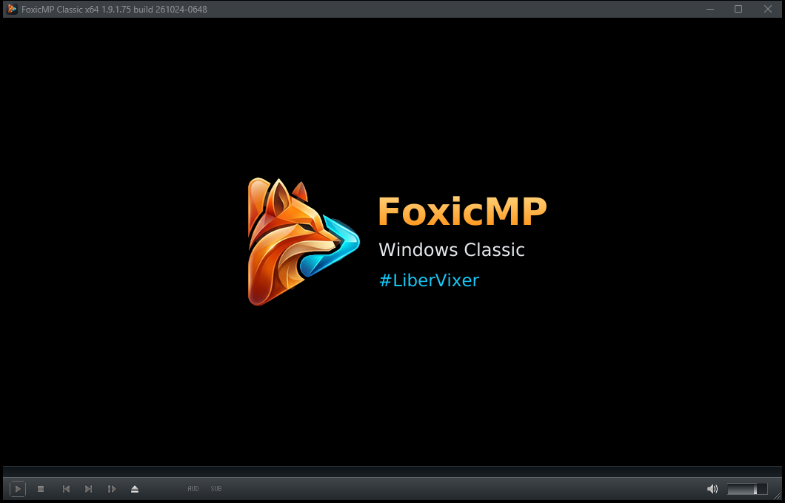
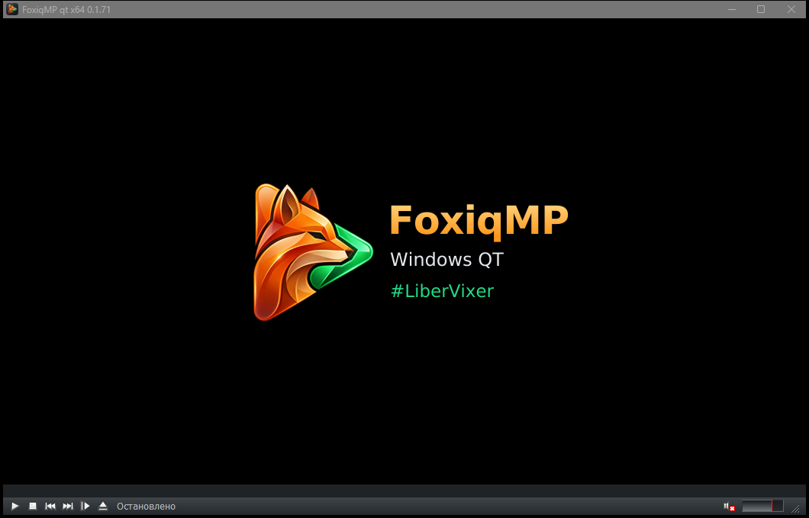
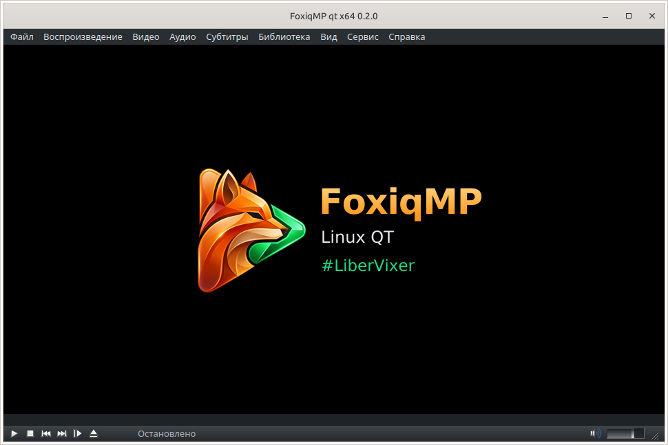

# FoxicMP 0.2.0

FoxicMP — свободный аудио- и видеоплеер в трёх самостоятельных редакциях.
Windows Classic сохраняет MFC/DirectShow и основу [MPC-BE](https://github.com/Aleksoid1978/MPC-BE).
Обе Qt-редакции используют общий код Qt 6 Widgets + libmpv.

| Редакция | Система | Запуск | Профиль |
| --- | --- | --- | --- |
| **FoxicMP Classic** | Windows x64 | `FoxicMP64.exe` | `FoxicMP64.ini` |
| **FoxiqMP qt — Windows QT** | Windows x64 | `FoxicMPq.exe` | `FoxicMPQt.ini` |
| **FoxiqMP qt — Linux QT** | Linux Mint 22.x x64 | `./foxicmp-qt` | `FoxicMPQt.ini` |

Classic использует оранжево-синюю лису, Qt — оранжево-зелёную. Логотип каждой
редакции содержит её платформу и подпись **#LiberVixer**.
Имена EXE и INI сохранены для совместимости. [Правила оформления](branding/README.md).

## Скачать 0.2.0

| Редакция | Установщики | Portable |
| --- | --- | --- |
| Windows Classic | [EXE](https://github.com/LiberVixer/FoxicMP/releases/download/v0.2.0-installers.1/FoxicMPClassic-0.2.0-windows-x64-setup.exe) · [MSI](https://github.com/LiberVixer/FoxicMP/releases/download/v0.2.0-installers.1/FoxicMPClassic-0.2.0-windows-x64.msi) | [ZIP, x64](https://github.com/LiberVixer/FoxicMP/releases/download/v0.2.0-installers.1/FoxicMPClassic-0.2.0-windows-x64.zip) |
| Windows Qt | [EXE](https://github.com/LiberVixer/FoxicMP/releases/download/v0.2.0-installers.1/FoxicMPQt-0.2.0-windows-x64-setup.exe) · [MSI](https://github.com/LiberVixer/FoxicMP/releases/download/v0.2.0-installers.1/FoxicMPQt-0.2.0-windows-x64.msi) | [ZIP, x64](https://github.com/LiberVixer/FoxicMP/releases/download/v0.2.0-installers.1/FoxicMPQt-0.2.0-windows-x64.zip) |
| Linux Qt | [DEB, amd64](https://github.com/LiberVixer/FoxicMP/releases/download/v0.2.0-installers.1/foxiqmp-qt_0.2.0-1_amd64.deb) | [TAR.GZ, x64](https://github.com/LiberVixer/FoxicMP/releases/download/v0.2.0-installers.1/FoxicMPQt-0.2.0-linux-x64.tar.gz) |

Для Windows выберите MSI **или** EXE своей редакции: EXE содержит тот же MSI.
[SHA-256 установщиков](https://github.com/LiberVixer/FoxicMP/releases/download/v0.2.0-installers.1/SHA256SUMS-installers.txt).
Рядом с portable-архивами опубликованы их индивидуальные файлы `.sha256`.

[Страница выпуска](https://github.com/LiberVixer/FoxicMP/releases/tag/v0.2.0) ·
[Заметки и результаты проверки](docs/ReleaseNotes-0.2.0.md) ·
[Манифест сборок](https://github.com/LiberVixer/FoxicMP/releases/download/v0.2.0/release-manifest.json).

**0.2.0 — версия общего выпуска.** Qt показывает 0.2.0; Classic сохраняет
номер движка **1.9.1.75**, сборка выпуска — `261025-1303`.

## Установка и обновление

Windows MSI/EXE по умолчанию устанавливает отдельную доступную для записи папку
в `%LOCALAPPDATA%\Programs\FoxicMPClassic` или `FoxiqMPqt` и ярлык в меню «Пуск».
Существующий INI сохраняется при установке, ремонте и удалении.
[Устройство Windows-установщиков](packaging/windows/README.md).

Для Linux Mint 22.x можно установить `.deb` вместе с зависимостями:

```sh
sudo apt install ./foxiqmp-qt_0.2.0-1_amd64.deb
```

Запуск — из меню или командой `foxiqmp-qt`. При первом запуске создаётся
пользовательская папка программы `~/.local/opt/FoxiqMP-qt`; в ней рядом находятся
бинарник и профиль. Обновление системного пакета сохраняет личные файлы.
[Подробности DEB](qt/packaging/debian/README.md).

Для portable-варианта распакуйте архив в доступную для записи папку и запустите EXE
или `foxicmp-qt`. Настройки, история, плейлисты и избранное хранятся рядом с
программой; редакции не используют профили друг друга, MPC-HC или MPC-BE.
Для Qt отдельную папку профиля можно выбрать через `--profile ПУТЬ`.

**Перед обновлением сохраните папку настроек. При обновлении Classic не
заменяйте свой `FoxicMP64.ini` файлом из архива:** в поставке находится заводской
профиль для новой установки. В Qt-архивах пользовательского INI нет.

Windows Classic включает языковые DLL, шейдеры, логотипы и необходимые DirectX
DLL. Windows Qt включает Qt/libmpv, FFmpeg, yt-dlp и лицензии зависимостей;
MSYS2 и отдельный пакет кодеков для него устанавливать не требуется.
Windows Qt проверен на Windows 11 x64; Classic сохраняет собственные системные
требования и движок.

Linux Qt использует библиотеки дистрибутива. Для Linux Mint 22.x:

```sh
sudo apt install libmpv2 liblcms2-2 libqt6dbus6 libqt6widgets6 libqt6openglwidgets6 qt6-qpa-plugins mint-meta-codecs ffmpeg yt-dlp
```

Регистрация в меню запуска, пункт контекстного меню и ассоциации доступны в
настройках соответствующей редакции. Изменяйте их из установленной копии.

## Возможности

- Локальное видео и аудио, сетевые источники, дорожки, субтитры и главы.
- Компактная нижняя панель, тонкие метки глав, регулятор громкости в стиле Classic.
- Плейлисты, история, избранное, повторы, скорость, перемотка и покадровый шаг.
- Светлая и тёмная темы, настройка управления, окна, звука, видео и субтитров.
- Для новых профилей: OSD выключено, положение окна запоминается, ограничение
  пропорций окна по видеокадру выключено. Сохранённые предпочтения имеют приоритет.
- В Qt: 9 разделов меню; дерево настроек слева, вкладки справа, поиск параметров
  и индикация загрузки. Classic сохраняет штатные страницы, переводы и оформление;
  согласуется их порядок, без замены страниц Qt-элементами.
- Локальный progressive API v1 для просмотра растущих MP4/M4A-дорожек:
  Unix socket в Linux Qt, named pipe в Windows Qt и Classic.
- Два PCM-выхода: собственный тракт Classic, WASAPI/libmpv в Windows Qt,
  PulseAudio/PipeWire в Linux Qt. Физическая задержка между устройствами
  требует отдельного измерения.

Поддержка контейнеров и кодеков определяется движком и доступными декодерами.
[Матрица возможностей](docs/FoxicMPFamilyMatrix.md) описывает различия трёх редакций.

### Просмотр во время скачивания

Загрузчик передаёт плееру пути, подтверждённые байтовые префиксы, обновления и
состояние сессии. Поддержанный сценарий — отдельные H.264/AAC дорожки fast-start
MP4/M4A и fMP4. Это API плеера; YouTubeHarvester в выпуске не изменялся.

[Контракт API и Python-клиент](docs/LinuxProgressiveApi.md) ·
[SDK и локальный writer-стенд](docs/ProgressiveSdk.md) ·
[Предыдущий provider-протокол Classic](docs/HarvesterProgressive.md).
Предварительный [SDK 1.5](https://github.com/LiberVixer/FoxicMP/releases/tag/progressive-api-v1.5)
предназначен для интеграционных проверок с новыми сборками плеера.
В текущих исходниках исправлена совместимость v1, добавлены SDK, подтверждение
освобождения файлов и Windows Qt legacy/provider. Добавлен общий для трёх редакций
[валидатор метаданных v2](docs/ProgressiveManifestV2.md): ресурсы, диапазоны,
сегменты и поздние главы. Он не открывает файлы; воспроизведение остаётся v1.
Player-owned v1 получил [reader leases и recovery](docs/ProgressiveReaderLeases.md):
учёт реальных файлов, независимые reader IDs и восстановление после crash.
Добавлены [подтверждённые диапазоны v2 и асинхронная I/O-проверка](docs/ProgressiveResourceIo.md)
без замены текущего просмотра. Это подготовка файлов, а не поддержка новых кодеков.
Выполняется
[план нового ТЗ интеграции](docs/ProgressiveIntegrationPlan.md).
Расширенная матрица форматов/дорожек ещё не реализована; ожидание полной
загрузки не считается поддержкой progressive. Эти изменения исходников не
означают обновление уже опубликованных установщиков 0.2.0.
Дисковые меню, аналоговое ТВ и специальное оборудование отложены; Wayland
исключён из текущих проверок.

## Скриншоты интерфейса

### FoxicMP Classic — Windows



### FoxiqMP qt — Windows QT



### FoxiqMP qt — Linux QT



## Исходники и сборка

Все три редакции находятся в этом репозитории. Windows Qt и Linux Qt собираются
из одного `qt/` с адаптерами платформ; исходники Classic находятся отдельно.

| Редакция | Исходники | Инструкция |
| --- | --- | --- |
| Windows Classic | [src/apps/mplayerc](src/apps/mplayerc), [src/DSUtil](src/DSUtil), [include/Version.h](include/Version.h) | [Classic: код и сборка](src/apps/mplayerc/README.md), [полная инструкция](docs/Compilation.txt) |
| Windows Qt | [qt/src](qt/src), адаптеры `*_win.cpp` | [Windows Qt](qt/packaging/windows/README.ru.md) |
| Linux Qt | [qt/src](qt/src), Linux-адаптеры | [Qt: сборка и тесты](qt/README.md), [Linux-пакет](qt/packaging/README.ru.md) |
| Общие контракты | [shared](shared) | [Команды](docs/FoxicMPFamilyCommands.json), [границы платформ](docs/FoxicMPFamilyCapabilities.json) |

Исходники первоначальных portable-бинарников закреплены тегом
[`v0.2.0`](https://github.com/LiberVixer/FoxicMP/tree/v0.2.0), коммит
[`235282412`](https://github.com/LiberVixer/FoxicMP/commit/2352824127a85d7e6eeef241c8a88701477dd850).
[ZIP исходников всех трёх редакций](https://github.com/LiberVixer/FoxicMP/archive/refs/tags/v0.2.0.zip).
Установщики и исправленный заголовок Qt собраны из дополнения
[`v0.2.0-installers.1`](https://github.com/LiberVixer/FoxicMP/tree/v0.2.0-installers.1).
Его исходники содержат упаковщики MSI/EXE/DEB и новый снимок Linux.
`main` содержит актуальную документацию и последующие изменения; первоначальный
тег `v0.2.0` сохранён без переписывания истории.

Для полного дерева Classic со сторонними компонентами используйте Git:

```sh
git clone --recurse-submodules https://github.com/LiberVixer/FoxicMP.git
cd FoxicMP
```

[План параллельной разработки](docs/FoxicMPFamilyPlan.md) ·
[История этапов Linux](docs/LinuxParityPlan.md).

## Проверки выпуска

Все три сборки завершились с кодом **0**. Полный Windows Qt тест в интерактивном
сеансе: **22 passed, 0 failed, exit 0**. Progressive API и audio-mirror на Windows
и Linux: по **2/2 набора тестов, exit 0**. Контрольные суммы всех архивов сверены
с GitHub. Это не подтверждает физические устройства, HDR или задержку между
аудиовыходами.

## Происхождение и лицензия

FoxicMP Classic основан на MPC-BE и сохраняет историю исходного проекта и
сведения об авторах. Qt-редакции используют Qt и libmpv. Проект распространяется
под [GNU GPL v3](LICENSE.txt); сведения об авторах находятся в [docs](docs),
лицензии компонентов — также в пакетах поставки.

FoxicMP is a free and open-source player family: Windows Classic (MFC/DirectShow,
based on MPC-BE), Windows Qt and Linux Qt (shared Qt 6/libmpv code). Each edition
keeps an independent portable profile. Release 0.2.0 provides x64 portable builds
for all three editions, with source code under GNU GPL v3.
