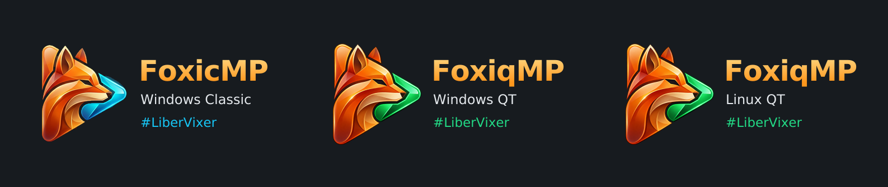

# Оформление FoxicMP

Общее имя проекта — **FoxicMP**. Три приложения имеют отдельное оформление:

| Приложение | Подписи логотипа | Акцент |
| --- | --- | --- |
| FoxicMP Classic | FoxicMP / Windows Classic / #LiberVixer | Синий, исходная иконка |
| FoxiqMP qt для Windows | FoxiqMP / Windows QT / #LiberVixer | Зелёный |
| FoxiqMP qt для Linux | FoxiqMP / Linux QT / #LiberVixer | Зелёный |

[Светлые варианты](preview-light.png).
[Проверка сборок и реальные снимки](../docs/BrandingValidation-2026-10-24.md).

В `logos/` находятся SVG и PNG 505×300, с прозрачным фоном, обычные и светлые.
Надписи преобразованы в векторные контуры DejaVu Sans, чтобы написание и
отображение не зависели от шрифтов на компьютере пользователя.

В `source/` сохранены исходные синие изображения и окончательные зелёные варианты.
Оранжево-синяя иконка Classic не изменяется. Иконка Qt экспортируется в PNG 256×256
и ICO с размерами 16, 24, 32, 48, 64, 128 и 256.

Встроенный логотип Qt выбирает подпись Windows QT / Linux QT. На чёрном
видеополе сохраняется светлая надпись; светлая тема окна настроек использует
вариант с тёмной надписью в превью. Внешние пользовательские логотипы и отключение логотипа сохраняются.
При уменьшении окна логотип уменьшается с сохранением пропорций.

## Совместимость

Меняются отображаемые названия, значки и логотипы. Сохраняются `FoxicMP64.exe`,
`FoxicMPq.exe`, `foxicmp-qt`, `FoxicMPQt.ini`, старые имена файлов интеграции,
ключи регистрации и IPC. Поэтому история, профили, ярлыки с явными параметрами
и Linux API загрузчика продолжают использовать существующие пути.

Qt: версия 0.1.71. Classic: версия движка 1.9.1.75, обновлено оформление.
Новые ярлыки Windows называются «FoxicMP Classic» и «FoxiqMP qt»; пункт меню Linux
показывает «FoxiqMP qt». Иконка Qt также устанавливается как `FoxiqMP.ico`
(Windows) и `foxiqmp-qt.png` (Linux), чтобы обновить отображение в системном меню.

## Получение и сборка графики

Зелёные растровые варианты получены встроенным инструментом **imagegen**.
Использован навык imagegen; внешние API и CLI генерации не применялись.
Оранжево-синий оригинал скопирован из существующих ресурсов проекта.
Окончательные изображения находятся внутри этого репозитория.

Финальные запросы:

1. **Иконка**: “Use case: precise-object-edit. Edit target: original FoxicMP app
   icon attached (150x150, rounded dark graphite square tile). Make the FoxiqMP
   Qt variant. Keep the original EXACT dark rounded square tile, its size,
   silhouette, corner radius, dark gray gradients, border, orange fox, placement,
   proportions, faceted shapes, all highlights, shadows, lighting and padding
   unchanged. Change ONLY the existing cyan/blue accent of the fox's muzzle/lower
   neck arrow ribbon to saturated EMERALD GREEN (green hue around 135 degrees,
   with the same lightness, tonal range and saturation as the current blue).
   Preserve the blue accent's white highlights and dark outlines. Not yellow,
   not lime, not neon yellow-green. No text, no letters, no extra elements or
   redesigned shapes. This is only a controlled blue-to-green color substitution.
   Transparent pixels outside the rounded square stay transparent. Deliver one
   square application icon, ideally at the same 150x150 original resolution.”
2. **Лиса для логотипа**: “Use case: precise-object-edit. Image 1 is the edit
   TARGET: exact original transparent FoxicMP fox mark. Image 2 is ONLY a
   color-reference for the emerald green accent. In image 1 replace ONLY the
   cyan/blue muzzle/neck arrow accent with the matching EMERALD green hue of
   image 2 (green hue around 135 degrees). Preserve the original accent's
   lightness, dark outlines, shading and white highlights. Keep ALL non-blue
   pixels/parts of image 1 and its exact silhouette, faceted anatomy, proportions,
   orientation, centered placement and generous transparent padding unchanged.
   Keep the orange fur unchanged. No neon lime or yellow-green. Do not introduce
   the dark square tile from image 2. Output the isolated fox on genuinely
   transparent background, no text, no frames, no extra design. Preserve image 1
   layout exactly, ideally 256x256.”

Надписи собираются программно в SVG, затем экспортируются в PNG. На Linux с
DejaVu Sans: `python3 -m venv .venv`, установка `requirements.txt`, запуск
`python branding/build_assets.py`. Скрипт не генерирует лису заново и не изменяет
профили плееров. Уведомление DejaVu сохранено в `DejaVu-notice.txt`.
