FoxicMP Qt 0.1.52: Wayland-safe fullscreen/geometry requests and requestActivate fallback; automatic ICC remains X11/colord-only.
# План сближения FoxicMP Qt Linux с FoxicMP Classic Windows

С 24 октября 2026 дальнейшее сближение всех трёх редакций ведётся по
[общему плану FoxicMP](FoxicMPFamilyPlan.md) и
[матрице возможностей](FoxicMPFamilyMatrix.md). Ниже сохранена история
Linux-этапов; их результаты не означают автоматической проверки Windows Qt.

Принят пользователем 14 октября 2026. База сравнения: Qt 0.1.4 и текущие
исходники Classic. Порядок: **5 → 1 → 2 → 3 → 4 → 6 → 7 → 8 → 9 → 10 → 11 → 12 → 13 → 14 → 15 → 16 → 17**.
Каждый пункт включает реализацию, проверку, документацию и пакет.
По указанию пользователя от 17 октября 2026 после каждой новой проверенной версии
обновлять установленный Linux-плеер в `_bin/FoxicMPQt-linux-x64`: предварительно
делать резервную копию, сохранять текущий профиль и остальные личные файлы,
проверять установленную версию и неизменность настроек.
Существующие настройки установленного Windows-плеера не изменять.
Функции libmpv без подключения к интерфейсу/профилю не считать завершёнными.

| № | Этап | Состояние |
|---|---|---|
| 5 | Действия после окончания | Завершён в Qt 0.1.5; 3/3 CTest в двух режимах, архив проверен |
| 1 | Открытие файлов и источников | Завершён в Qt 0.1.6; прямой URL проверен реальным HTTP-потоком |
| 2 | Онлайн-видео и сеть | Программная часть завершена в Qt 0.1.10: 20 A/V-сценариев, YouTube/Rutube/VK, 5/5 CTest в двух режимах |
| 3 | Диски и устройства | Реализованная часть Qt 0.1.11 проверена: 6/6 CTest в двух режимах и архив; меню дисков, аналоговое ТВ и физические устройства отложены пользователем |
| 4 | Управление воспроизведением | Завершён в Qt 0.1.12: A–B, число проходов, шаги перемотки/скорости, пауза при сворачивании; 7/7 CTest в двух режимах, архив проверен |
| 6 | Плейлист — расширенные возможности | Завершён в Qt 0.1.13: вкладки, поиск, длительность, сортировки, папки, буфер, корзина и MediaInfo/FFprobe; все 8 наборов CTest проверены в двух режимах, архив проверен |
| 7 | Форматы и поведение плейлиста | Завершён в Qt 0.1.14: MPCPL/PLS/ASX/CUE, главы CUE, ошибки/пропуск, дорожки и панель; 9/9 CTest в двух режимах, архив проверен |
| 8 | История и избранное | Завершён в Qt 0.1.15: окно истории, поиск/очистка, лимиты, порядок закладок, позиция и относительные пути; 10/10 CTest в двух режимах, архив проверен |
| 9 | Окно и полный экран | Программная часть завершена в Qt 0.1.16: режимы/панели, геометрия, масштаб, монитор, политики полного экрана, X11 режим; 11/11 CTest в двух режимах. Физические мониторы и оконные менеджеры требуют проверки |
| 10 | Оформление, OSD и превью | Программная часть завершена в Qt 0.1.17: темы/активы/шрифты, RU/EN и пакеты, OSD/HUD, размер/HTTP(S)-превью; 12/12 CTest в двух режимах, архив проверен. Сервисные ограничения онлайн-превью ниже |
| 11 | Клавиатура, мышь, внешнее управление | Программная часть реализована в Qt 0.1.18: команды, мышь/модификаторы, два вида удержания, последний файл/boss key, MPRIS и команды D-Bus; 13/13 CTest в двух режимах, архив проверен. Физическая маршрутизация медиаклавиш/пультов требует проверки |
| 12 | Pan&Scan и преобразования | Программная часть реализована в Qt 0.1.19: размеры/смещение, обрезка, отражения/повороты, пресеты, стереораскладки и смена глаз; 14/14 CTest в двух режимах, архив проверен. Физический стереоэкран/GPU требуют проверки |
| 13 | Расширенные субтитры | Программная часть Qt 0.1.20–0.1.22: редактор, файлы, оформление и рендер/совместимость; 17/17 CTest в двух режимах, архив проверен. Кэши автоматические; выбора рендереров/размера очереди Classic в libmpv нет |
| 14 | Расширенный звук | Программная часть Qt 0.1.23–0.1.26: обработка, микшер, внешнее аудио, два выхода, фильтры/пресеты, PCM и bitstream/декодер; 21/21 CTest в двух режимах, PCM/IEC 61937 измерены. Физические HDMI/S/PDIF, ресиверы и A/V требуют проверки |
| 15 | Видеовывод и обработка | Qt 0.1.31: программная часть X11 реализована в описанных границах, включая авто ICC colord; все 25 наборов проверены. Физические проверки, Wayland и расширенный GLSL importer остаются |
| 16 | Свойства, диагностика, сохранение | Qt 0.1.32: свойства/отчёт, кадры/буфер/область/форматы, миниатюры и копия локального файла; 26/26 CTest в двух режимах. Границы ниже |
| 17 | Интеграция, профиль, обслуживание | Qt 0.1.33–0.1.48: экземпляры/трей, MIME/defaults с откатом, экспорт/импорт/копии/сброс, выбор профиля/ярлык, заголовок и обслуживание (обновления Qt, приоритет, отчёт), веб-управление локально и в LAN;  команды запуска, монитор/аудиоустройство/Pan&Scan, shuffle и действие после списка, буфер/веб-порт/сброс, несколько внешних дорожек и задержка, очередь подключений без дубликатов, одноразовый stdin |

## Текущий результат пункта 5

В Qt 0.1.5 добавлено меню постоянных/однократных действий. Настройка
`playback/after` сохраняется в соседнем профиле; однократный выбор живёт
только в текущем запуске. Стоп и ошибки не запускают действие. Срабатывание
на конце прохода плейлиста, до повторения; shuffle учитывает весь обход.
Закрытие файла сохраняет очередь. Обход каталога сортирует имена с числами,
учитывает локальные видео/аудио, повторно использует существующие записи.
Системные действия отправляются через D-Bus с проверкой поддержки logind.
Проверены на подменном исполнителе и частной D-Bus-шине. Реальные сон,
гибернация, выключение, выход и блокировка остаются ручной проверкой на
целевой машине; тесты не вмешивались в рабочий сеанс пользователя.

Программная часть **пункта 13 завершена** с оговорёнными различиями libmpv. Программная часть **пункта 14 реализована** с ограничениями оборудования; программная часть **пункта 15 для X11 реализована** в описанных границах; **пункт 16 реализован** в описанных границах; далее **пункт 17**. Пункты 4, 6, 7, 8 и программные части 9–12 реализованы в Qt 0.1.12–0.1.19.
Оставшаяся часть пункта 3 отложена
по решению пользователя 14 октября 2026: аналоговое ТВ, меню дисков
и физические устройства. Пункт 3 не считать полностью завершённым;
его отложенные задачи не задерживают последующие этапы.
Физическое оборудование и установленные
Ace Stream/TorrServer требуют отдельных внешних проверок.

## 1. Открытие файлов и источников

Открытие папки с формированием списка; диалог URL; ручное подключение внешней
аудиодорожки; переоткрытие текущего файла; открытие из буфера обмена;
закрытие файла без очистки плейлиста. Сетевые адреса в импорте плейлистов.

Завершено в Qt 0.1.6. Папка читается без рекурсии и сортируется естественно;
поддержанные прямые URL сохраняются в профиле, истории, избранном и M3U8.
Проверены внешний звук, возврат на текущую позицию, буфер обмена, сохранение
очереди после закрытия и декодирование по локальному HTTP. Неподдерживаемые
схемы не меняют действующую очередь.

## 2. Онлайн-видео и прогрессивное воспроизведение

Сетевой слой реализован в Qt 0.1.7. yt-dlp: путь, кодек, разрешение, 50/60 FPS, HDR/SDR,
аудиокодек, язык, битрейт, User-Agent и сетевой тайм-аут. Онлайн-плейлист
импортируется асинхронно и не меняет очередь при ошибке. Добавлено преобразование
`acestream://`, magnet и `torrserver://` в настраиваемые локальные HTTP endpoints;
исходные адреса сохраняются в переносимом профиле. Реальный публичный YouTube
открыт через FoxicMP Qt и yt-dlp; преобразователи Ace Stream/TorrServer проверены
автоматически, сами серверы не входят в поставку.

Интерфейс Harvester остаётся отключённым согласно решению пользователя.
В Qt 0.1.8 реализованы Linux provider и reader подтверждённых локальных fMP4
H.264/AAC-дорожек. Проверены два читателя, leases, heartbeat, отмена, общая
буферизация, ограничение seek кэшем, ручная пауза, смена поколения и ожидание
`complete` вместо ложного EOF. В Qt 0.1.9 добавлен обычный fast-start MP4/M4A:
индекс пакетов и ключевых кадров, DTS/PTS, edit list, длительность из видео при
отсутствии её в manifest. Перед открытием файлов требуется подтверждение
сохранённого lease. Метаданные в конце MP4 не поддерживаются. Сверка пакетов с
FFprobe, минутная остановка записи и два полных HTTP-сценария прошли.
[Протокол 0.1.9](QtLinuxIndexedProgressiveValidation-2026-10-14.txt).
В Qt 0.1.10 выполнены 20 сценариев: baseline/progressive, обычный MP4/fMP4,
смещения аудио 0/±70/±240 мс и общий origin +1 секунда для fMP4. Измерены
172 пары вспышка/импульс после старта, буферизации и seek. Максимальный
интервал погрешности программного вывода — 51,82 мс при цели 100 мс.
Убрано блокирующее ожидание кадра в программном выводе Qt.
Публичные YouTube, Rutube HLS и VK прошли просмотр до окончания загрузки,
перемотку в кэше и итоговую сборку. Декодер читает локальные данные.
Программная часть пункта 2 завершена; режим сохраняет экспериментальный статус.
Физический экран/динамики, GPU/Wayland и работа установленных сторонних
Ace Stream/TorrServer не подтверждаются этими испытаниями.
[Протокол 0.1.10](QtLinuxAvSourcesValidation-2026-10-14.txt).

## 3. Диски и устройства

DVD/Blu-ray, ISO, выбор дисковода, Audio CD, захват видео/звука. DVD-меню,
заголовки, сцены, углы, языки и восстановление позиции. Аналоговые устройства,
цифровой ТВ-тюнер, сканирование и каналы. Для каждого режима отдельно
проверить доступность backend; воспроизведение файлов не равно навигации диска.

Qt 0.1.11: диалог дисковода/ISO/папки, DVD-заголовки и угол при открытии,
Blu-ray-плейлист MPLS, главы и дорожки. CLI `--dvd`, `--bluray`, `--cdda`,
`--disc-title`. DVD/Blu-ray из ISO или папки сохраняют позицию отдельно
для каждого заголовка; сменные диски и прямой вход её не сохраняют.
DVD ограничивается длительностью выбранного фильма; навигационные команды
диска не запускают другой фильм или повтор без окончания.
Устройства сохраняются в истории, избранном и M3U8 как структурированные
адреса; неверные параметры или недоступное устройство не заменяют очередь.
Диалог V4L2/PulseAudio/ALSA и отдельного звука для камеры; тестовые сигналы.
DVB: выбор тюнера, импорт VDR/zap, асинхронное сканирование через
`dvbv5-scan`, начальные частоты DVBV5 и атомарное сохранение каналов
в папке программы. Отмена сохраняет прежний список.

По решению пользователя оставшиеся задачи пункта временно отложены.
Пункт не завершён полностью: mpv не предоставляет интерактивное DVD-меню,
Blu-ray-меню не подключено, аналоговая настройка частот не реализована.
Физические диски, защищённые Blu-ray, камера и тюнер отсутствуют на стенде;
их реальное воспроизведение и многоугловые диски не подтверждены.
[Протокол 0.1.11](QtLinuxDevicesValidation-2026-10-14.txt).

## 4. Управление воспроизведением

A–B, число повторов, возврат к началу. Три расстояния перемотки, ключевые кадры.
Шаг изменения скорости, сброс, сохранение скорости на сессию. Пауза при сворачивании.

Завершено в Qt 0.1.12. Отдельная вкладка параметров, меню и клавиши;
A–B с временными отметками, конечным числом проходов и продолжением за B.
Число проходов файла/списка включает первый просмотр; 0 — бесконечно.
Исправлен полный обход каждого нового прохода при shuffle. Явное действие
после просмотра сохраняет приоритет до повторения. Возврат к началу
открывает последний файл на паузе с нулевой позиции.

Три шага (1000/5000/20000 мс), точная или ключевая перемотка, отдельный
переход к соседнему ключевому кадру. Скорость: авто-ряд Classic и сетка
процентов, 1×, сохранение на сессию по выбору. Повтор того же файла
сохраняет скорость; новый процесс начинает с 1×. Пауза при сворачивании
выключена по умолчанию, применяется к видео, сохраняет ручную паузу
и буферизацию; аудиофайл продолжает играть.

Для progressive весь A–B должен помещаться в одном диапазоне кэша;
потеря диапазона отключает повтор. Шаги точные, отдельные ключевые кадры
отключены. Прямые входы не перематываются, не используют A–B или скорость.
Проверены обычные файлы, fMP4/MP4 с загрузкой, естественный EOF, конечный
повтор/shuffle, настройки, сворачивание и распакованный пакет.
[Протокол 0.1.12](QtLinuxPlaybackControlsValidation-2026-10-14.txt).

## 5. Действия после окончания

Закрыть приложение; закрыть файл; закрыть файл и свернуть; следующий файл
в каталоге; циклический обход каталога. Однократно: закрыть приложение,
сон, гибернация, выключение, завершение сеанса, блокировка, отмена действия.
Постоянная настройка и однократное действие разделены. Срабатывание только
при естественном окончании; остановка и ошибка не запускают действия.
Уточнить в интерфейсе поведение при нескольких файлах и повторах.
Проверять системные действия через подмену исполнителя, не выключать рабочую машину тестами.

## 6. Плейлист — расширенные возможности

Именованные вкладки, создание/переименование/удаление, просмотр папок, поиск,
длительность. Сортировки по названию, пути, датам, размеру, обратный порядок,
перемешивание строк и восстановление порядка. Буфер обмена, удаление отсутствующих
записей, отдельная команда удаления с диска, открыть папку, MediaInfo.

Завершено в Qt 0.1.13. Вкладки и их имена сохраняются рядом с программой;
старый одиночный список мигрирует автоматически. Переключение вкладки не
переключает играющую очередь. Записи имеют постоянные ID, включая дубликаты;
сортировка и восстановление исходного порядка сохраняют текущий файл.
Поиск фильтрует отображение, но не меняет очередь автоматического перехода.
Длительность локальных файлов читается через FFprobe в фоне и кэшируется
по размеру/времени изменения. Неполученная длительность обозначается «—»;
URL и устройства автоматически не опрашиваются.

Добавлены сортировки по имени, пути, созданию/изменению, размеру и длительности;
неизвестные значения следуют за известными. Есть обратный порядок, перемешивание
строк и восстановление исходного порядка после перезапуска. Просмотр папок
добавляет выбранные файлы/папки без начала воспроизведения. Ctrl+C/X/V/A в списке,
удаление отсутствующих локальных записей, открытие папки и отчёт MediaInfo;
при отсутствии MediaInfo явно указан FFprobe. Команда удаления с диска
перемещает файлы только в корзину, с подтверждением и перечнем путей;
успешно перемещённые файлы удаляются из всех вкладок, неудачные остаются.
Обычный Delete удаляет только записи.

Проверены миграция, сохранение вкладок/ID/порядка, дубликаты, буфер и поиск,
переход при EOF с открытой другой вкладкой, удаление текущей/другой вкладки,
длительность, просмотр папок, оба backend отчёта, отмена и подтверждение корзины.
[Протокол 0.1.13](QtLinuxPlaylistsValidation-2026-10-15.txt).
Пункты 7 и 8 завершены в Qt 0.1.14/0.1.15; следующий — пункт 12, Pan&Scan и преобразования.

## 7. Форматы и поведение плейлиста

MPCPL/PLS/ASX/CUE, навигация CUE. Настройки перехода при ошибке, пропуска
неверных записей, определения длительности, скрытия на полном экране.
Сохранение дорожек для записи. Меню размещения панели и сохранение её конфигурации.

Завершено в Qt 0.1.14. Импорт локальных M3U/M3U8, MPCPL, PLS, ASX, CUE;
экспорт M3U/M3U8, MPCPL, PLS и ASX. Переносимые относительные пути,
UTF-8, UTF-16 с BOM и Windows-1251 для старых файлов (кроме M3U8).
MPCPL читает внешнее аудио/субтитры в полях Classic. CUE создаёт одну запись
на медиафайл и главы INDEX 01 с точностью 1/75 с; меню глав и Ctrl+PgUp/PgDown.
Главы и выбор дорожек сохраняются в профиле и расширениях экспорта FoxicMP.

Настройки перехода при ошибке и пропуска уже ошибочных строк разделены;
дополнительно есть отдельный пропуск неподдерживаемых адресов при импорте.
Ошибка не выполняет действия после просмотра. Повтор/shuffle не зацикливает
полностью повреждённый список. Ошибочные строки отмечены на текущую сессию;
прямой выбор повторяет попытку, успешное открытие снимает отметку.
Дорожки сохраняются отдельно для каждой записи, включая дубликаты;
внешняя выбранная дорожка определяется по пути файла, а не временному ID.
Панель закрепляется с любой стороны или выносится в окно; положение, размер,
видимость сохраняются рядом с программой. Настраиваются фоновая длительность,
скрытие панели при входе в полный экран и запоминание дорожек/панели.

Повреждённая структура импорта сохраняет текущую очередь. Абсолютные пути
Windows требуют замены путями Linux, устройства DirectShow не преобразуются.
ASX: ENTRY/REF/TITLE/DURATION; альтернативные REF и вложенные ENTRYREF не
разворачиваются. CUE — импорт локального аудио, экспорт в обычный плейлист;
смешанные образы data/audio BIN не декодируются как CDDA. Другие плееры могут
игнорировать дополнительные главы/выбор дорожек FoxicMP в стандартных файлах.
[Протокол 0.1.14](QtLinuxPlaylistFormatsValidation-2026-10-15.txt).
Пункт 8 завершён в Qt 0.1.15; следующий — пункт 12: Pan&Scan и преобразования.

## 8. История и избранное

Окно истории, поиск, колонки пути/названия/позиции, выборочное удаление,
удаление отсутствующих, копирование. Настройка размера истории и меню.
Перестановка избранного, позиция по выбору, переносимые пути, категории DVD/устройств.

Завершено в Qt 0.1.15. Ctrl+H открывает таблицу истории с колонками названия,
пути/адреса и позиции. Поиск без учёта регистра, фильтр категории, открытие
выделенных записей или текущей с начала, копирование источников, выборочное
удаление, удаление отсутствующих локальных файлов, полная очистка. Адреса сети
и физические устройства не проверяются на отсутствие. Удаление очищает позицию,
сохраняет медиафайлы и избранное; фоновое сохранение текущего файла не воссоздаёт
удалённую позицию до повторного открытия.

История 1–10000 записей (50 по умолчанию), меню 0–100 (50 по умолчанию;
0 скрывает только записи меню). Уменьшение лимита сокращает список, позиции
стираются при явном удалении/очистке. Запись истории и автоматическое
продолжение по-прежнему отключаются отдельно.

Менеджер избранного: поиск, категории, редактирование названия/позиции/типа пути,
кнопки перестановки и внутреннее перетаскивание, копирование и удаление.
При фильтре ↑/↓ меняют только видимые элементы на их прежних местах;
перетаскивание доступно без фильтра. Для каждой записи задаётся позиция
или открытие с начала независимо от автоматического продолжения. Относительные
пути — для файлов и образов/папок DVD/Blu-ray. Переносить надо вместе с медиа,
сохраняя расположение папок. DVD/Blu-ray/Audio CD и устройства/ТВ имеют категории
и подменю; прямые/физические входы не используют позицию и относительный путь.
Старые записи читаются без потери порядка, названий и позиции. Все данные
остаются в соседнем FoxicMPQt.ini, личный профиль не включается в архив.

[Протокол 0.1.15](QtLinuxLibraryManagementValidation-2026-10-15.txt).
Программная часть пункта 9 завершена в Qt 0.1.16; следующий — пункт 12. Меню дисков, аналоговое ТВ
и испытания физического оборудования остаются отложенными.

## 9. Окно и полный экран

Минимальный/компактный/обычный режимы, независимое скрытие панелей, варианты рамки.
Поверх окон только при воспроизведении/видео. Прилипание, пропорции по видеокадру,
заданный стартовый размер окна/видеообласти. Автомасштаб при открытии, возврат
геометрии после закрытия, выбор монитора, запуск на полном экране, выход по
окончании/потере фокуса, смена разрешения/частоты, время автоскрытия.

Программная часть завершена в Qt 0.1.16. Меню «Вид» и меню видео содержат
обычный, компактный и минимальный пресеты; меню, кнопки, шкала и состояние
переключаются отдельно. Системная рамка, тонкая без заголовка, отсутствие
рамки. Ctrl+0/правая кнопка сохраняют доступ к командам. Ctrl+T использует
условие всегда / при воспроизведении / при воспроизведении видео; условные
режимы снимают закрепление на паузе и при остановке, не восстанавливая
самопроизвольно свёрнутое окно.

Пропорции по видеокадру отключены по умолчанию, запоминание геометрии включено.
Прилипание к краям рабочей области — 12 логических пикселей. Стартовый размер
сохранённый, заданный размер окна или видеообласти; автомасштаб 50/100/200% с
ограничением доступным экраном и минимальным размером панелей. По выбору
восстановление геометрии до просмотра после закрытия файла.

Монитор полного экрана сохраняется в профиле; при отключении временно
используется текущий. Запуск на полном экране, выход в конце очереди / по
потере фокуса, панели и задержка автоскрытия 0–60000 мс (0 отключает, по
умолчанию 2500). Диалоги плеера и открытые меню не вызывают выход по фокусу.
Переход к следующей записи и повтор сохраняют полный экран, стоп/ошибка
не считаются окончанием. Выход возвращает геометрию, максимизацию и плейлист;
закрытие из полного экрана сохраняет предыдущую оконную геометрию.

X11: существующие режимы разрешения/частоты активного монитора через xrandr,
с возвратом исходного при выходе/обычном закрытии и попыткой отката при ошибке.
Режимы не создаются, выходы не включаются; повёрнутые/отражённые исключены.
Wayland — настройка дисплеев рабочего стола. Физические многомониторные
конфигурации, переключение частот, HiDPI/Wayland и поведение рамки/закрепления
в разных оконных менеджерах остаются проверкой на оборудовании. Аварийное
завершение или отключение питания не выполняет обычный возврат режима.
[Протокол 0.1.16](QtLinuxWindowValidation-2026-10-15.txt).
Программная часть пункта 10 завершена в Qt 0.1.17; следующий — пункт 12.

## 10. Оформление, OSD и превью

Внешний логотип/панель кнопок; размеры кнопок, шрифт плейлиста, цвета, темы,
языки. OSD: шрифт, цвета, прозрачность, рамка, тень, сглаживание, показ имени
и времени, часы. Размер превью относительно экрана, онлайн-превью.
Визуальная сверка размеров, отступов, значков и меню с Classic.

Программная часть завершена в Qt 0.1.17. Темы тёмная/светлая/системная/свои
цвета, цвет пройденной шкалы, значки 12–48 логических пикселей, шрифт плейлиста.
Внешний логотип и PNG/BMP-панель (10 ячеек FoxicMP или 15/16 Classic),
относительные пути, безопасное ограничение размера и встроенная замена.
Русский/English после перезапуска, внешний JSON-пакет с проверкой подстановок;
663 английских записи, автоматическая проверка покрытия исходных строк.
Пользовательские названия и имена файлов не переводятся.

OSD: шрифт/размер, цвета/непрозрачность, рамка, тень, сглаживание, длительность
сообщений. Отдельные постоянные имя/позиция и часы; общий выключатель сохранён.
Превью 5–50% рабочей области, предел 160–960 логических пикселей, 16 МиБ
кэша; отдельный ffmpeg, отмена и тайм-ауты. Онлайн HTTP(S)/веб-превью включается
явно, по умолчанию выключено; веб-адрес извлекается настроенным yt-dlp.
Повторный hover одного источника не перезапускает незавершённое извлечение.
Пауза и позиция плеера не меняются. Растущие/прямые источники и неизвестная
длительность исключены. Закрытие освобождает и дожидается убитых работников.

Локальный HTTP проверен сравнением пикселей с локальным кадром и неизменностью
основного декодера; публичный VK дал реальный кадр. YouTube потребовал проверку
«не бот», выбранный Rutube не уложился в тайм-аут. Личные cookies не используются,
защита не обходится; универсальная доступность сервисов не заявляется.
Визуально сравнены реальный Classic screenshot и Qt с 16-пиксельными значками;
общий логотип/нижняя панель сохранены. Системные рамки/шрифты и точные размеры
отличаются между Qt/Windows; полный набор команд/кнопок остаётся пунктом 11,
HiDPI/Wayland и реальное оборудование — отдельной проверкой.
[Протокол 0.1.17](QtLinuxAppearanceValidation-2026-10-15.txt).
Следующий — пункт 11: клавиатура, мышь и внешнее управление.

## 11. Клавиатура, мышь, внешнее управление

Полный набор команд, быстрые дорожки, субтитры, задержки, Pan&Scan, информация.
Глобальные медиаклавиши, WinLIRC/uICE или аналоги, произвольные действия мыши,
раздельные режимы окна/полного экрана, боковые кнопки. Ускорение удержанием,
открытие последнего файла щелчком, boss key, настройки перемещения за видео.

Результат Qt 0.1.18: зарегистрированные команды доступны в переназначении
клавиш; добавлены дорожки/субтитры/задержки, быстрые меню, информация и базовый
сдвиг/сброс изображения. Мышь: пять кнопок, одинарные/двойные, две оси колеса,
отдельные окно/полный экран и без/Ctrl/Shift/Ctrl+Shift. Старые переключатели
поддержаны. Есть отменяемое перетаскивание за видео, последний файл по щелчку,
пауза/сворачивание B без автоматического возобновления. Удержание левой временно
выбирает 2–8× и возвращает прежнюю скорость; отдельная опция ускоряет шаги
удерживаемой клавиши перемотки. Оба ускорения по умолчанию выключены.
MPRIS и org.foxicmp.Control1 работают через сеансовую D-Bus; служба включена
по умолчанию, отключается без перезапуска. Проверены частная шина, отсутствие
соединения/повтор, несколько экземпляров, свойства/сигналы и команды.
Системные сочетания не менялись. Медиаклавиши вне окна направляет среда;
физические клавиши/пульты и маршрутизацию Cinnamon/Wayland ещё надо проверить.
WinLIRC/uICE TCP не перенесены: используются клавиатурные пульты или D-Bus.
Необязательные интерфейсы MPRIS TrackList/Playlists не экспортируются.
13/13 CTest в software и requested OpenGL (фактически Software fallback),
архив распакован и проверен, включая MPRIS самого приложения через gdbus.
Установленный профиль не менялся. Следующий — пункт 12.
[Протокол](QtLinuxInputValidation-2026-10-15.txt),
[манифест пакета](QtLinuxPackage-0.1.18-2026-10-15.json).

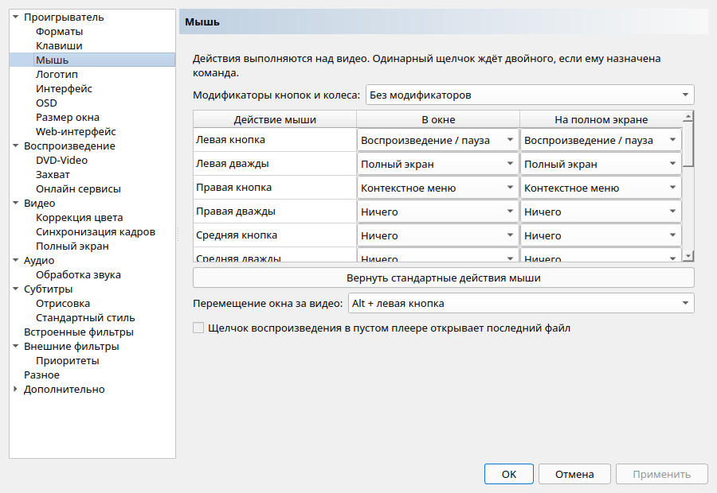
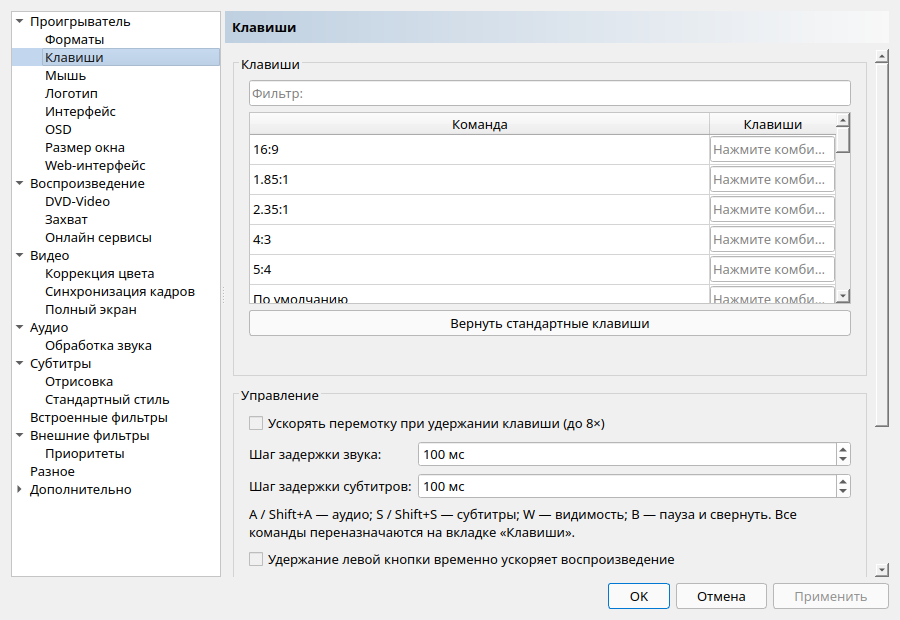

## 12. Pan&Scan и преобразования

Независимые ширина/высота, смещение, центр/сброс, пресеты, запоминание,
отражение, полный набор кадрирования. Стереоскопические 3D-режимы и смена глаз.

Qt 0.1.19: отдельные ширина/высота, pan/zoom/fill, центрирование и сброс,
обрезка краёв/пропорций с SAR, повороты/отражения. Ctrl+Alt+P открывает четыре
страницы; есть меню и переназначаемые команды. До 32 редактируемых пресетов,
запоминание состояния между запусками включается отдельно и по умолчанию выключено.
Стерео: 12 входных и 12 конвертируемых выходных раскладок, выбор/смена глаз,
авто только по метаданным. Обычное 2D не меняется. Превью получает исходные
фильтры без оконного pan/scale/zoom/fill. MVC/Blu-ray 3D, затворные очки
и создание глубины из 2D не реализованы; физический стереоэкран/GPU ещё не проверены.
14/14 CTest в software и requested OpenGL (фактически Software fallback),
архив и внешние команды stripped-приложения проверены. Профиль не менялся.
[Протокол](QtLinuxTransformValidation-2026-10-15.txt),
[манифест пакета](QtLinuxPackage-0.1.19-2026-10-15.json).

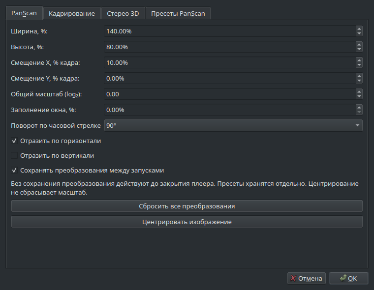
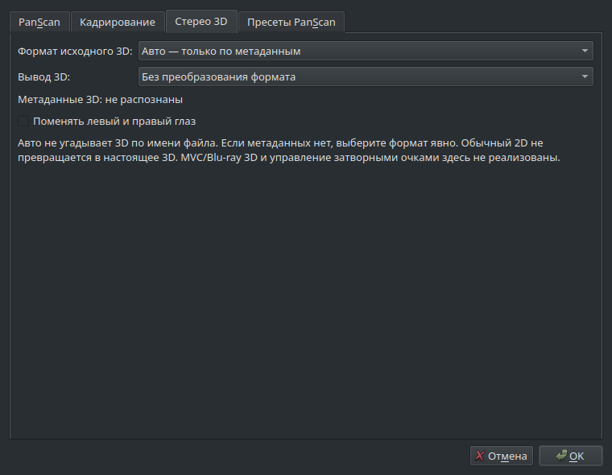

## 13. Расширенные субтитры

Subresync, переход по репликам, привязка ко времени, сохранение исправлений.
Папки поиска, приоритет внешних, запрет встроенных, перечитывание изменений,
редактор, кодировка. Горизонтальная позиция, выравнивание/отступы, интервалы,
масштаб X/Y, угол, тень, вторичный цвет/прозрачность. Буфер обмена, рендер/буферизация.

Qt 0.1.20 реализует первую часть пункта: Ctrl+Alt+R — таблица реплик,
правка текста/времени, поиск, переход, общий сдвиг и две точки синхронизации.
SRT, ASS/SSA с сохранением полей/стилей, простой VTT; применяемая копия
хранится в Subtitles/Edits рядом с программой. Из локальной встроенной
текстовой дорожки FFmpeg извлекает SRT без оформления. Кодировки, папки поиска,
приоритет внешних/запрет встроенных, ручное и автоматическое перечитывание,
внешний редактор, реплика в буфер и переназначаемые команды добавлены.
15/15 CTest в двух режимах и архив проверены. Полное оформление, независимые
масштабы/угол, цвета/прозрачность/тень, рендер/буферизация ещё остаются.
[Протокол](QtLinuxSubtitleValidation-2026-10-15.txt),
[манифест](QtLinuxPackage-0.1.20-2026-10-15.json).

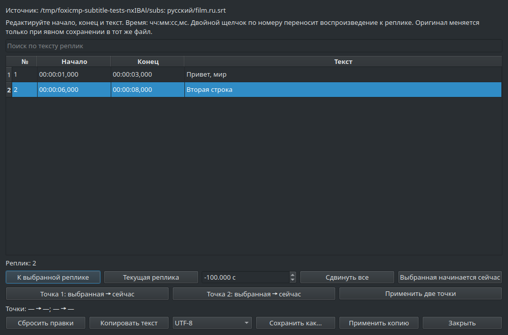
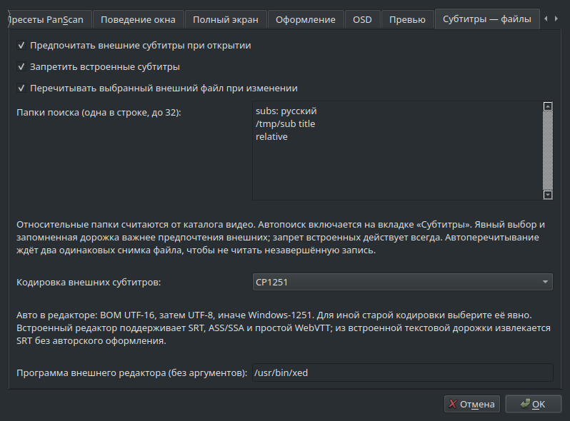

Qt 0.1.21 добавляет Ctrl+Alt+T: выравнивание, отступы, интервалы,
цвета/альфа, тень/фон/размытие, жирный/курсив. Дополнительный стиль выключен
по умолчанию. Масштабы X/Y, угол и точная позиция X для SRT доступны через
явное применение ASS-копии в редакторе; она хранится рядом с программой и
обновляется при изменении стиля. Авторский ASS сохраняется без override,
его inline-теги могут иметь приоритет. Геометрия и цвета проверены по пикселям.
16/16 CTest в двух режимах, архив проверен. Остались рендер/буферизация.
[Протокол оформления](QtLinuxSubtitleStyleValidation-2026-10-15.txt),
[манифест 0.1.21](QtLinuxPackage-0.1.21-2026-10-15.json).

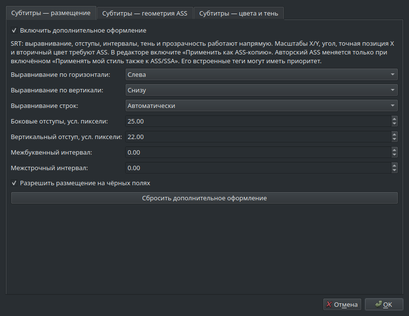
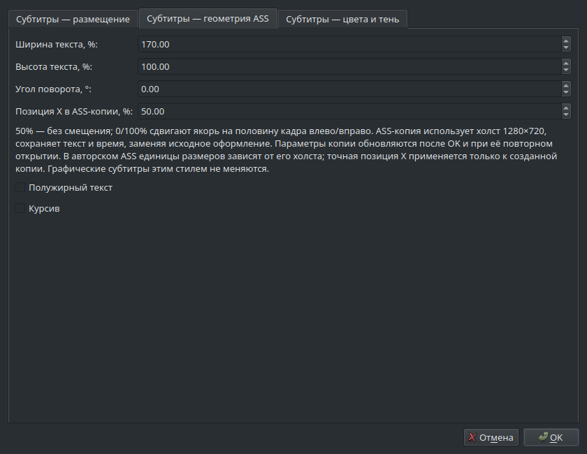
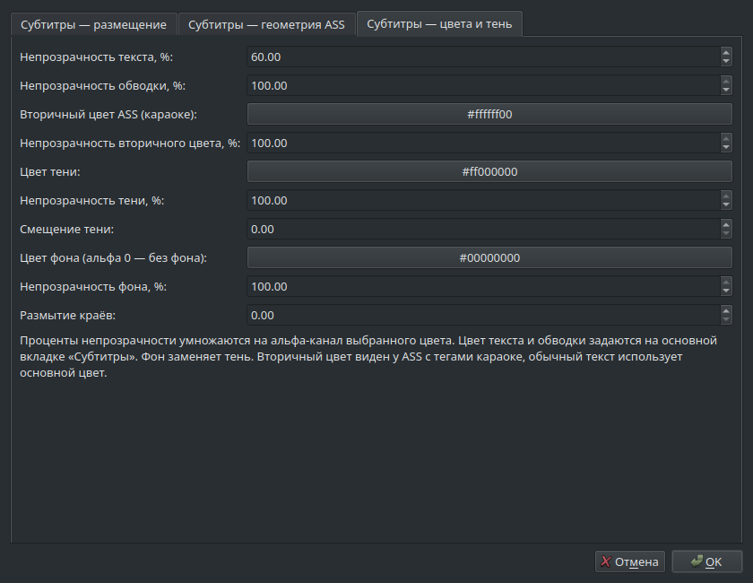

Qt 0.1.22 завершает программную часть пункта 13: Ctrl+Alt+T теперь содержит
рендер и совместимость — хинтинг, формирование текста, вложенные шрифты,
масштаб по окну, VSFilter, коррекцию времени, очистку текстовых реплик при
перемотке и графические DVD/PGS. Кэши шрифтов/отрисовки автоматические;
размер очереди и рендереры Classic публичный API libmpv не предоставляет.
Очистка при перемотке по умолчанию выключена и предназначена для проблемных
MKV ReadOrder, это не выключатель кэшей шрифтов/видео. Короткие разрывы
требуют замены стиля ASS; продление реплик работает у SRT, не авторского ASS.
Показ на паузе/после перемотки, обе внешние дорожки и PGS grayscale проверены
реальными пикселями. 17/17 CTest в двух режимах, фактически Software fallback;
архив проверен, установленный профиль не менялся. GPU/Wayland и сложные
реальные ASS остаются проверкой на целевых машинах. Следующий — пункт 14.
[Протокол рендера](QtLinuxSubtitleRenderValidation-2026-10-15.txt),
[манифест 0.1.22](QtLinuxPackage-0.1.22-2026-10-15.json).

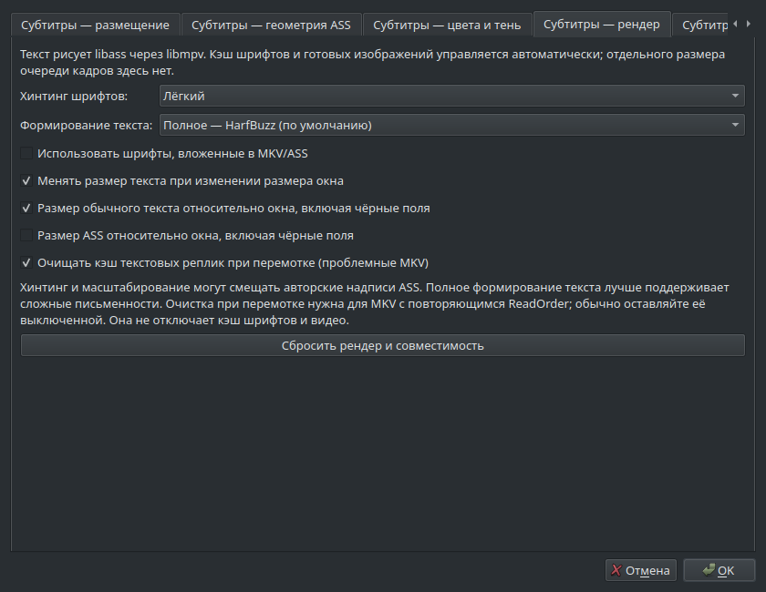
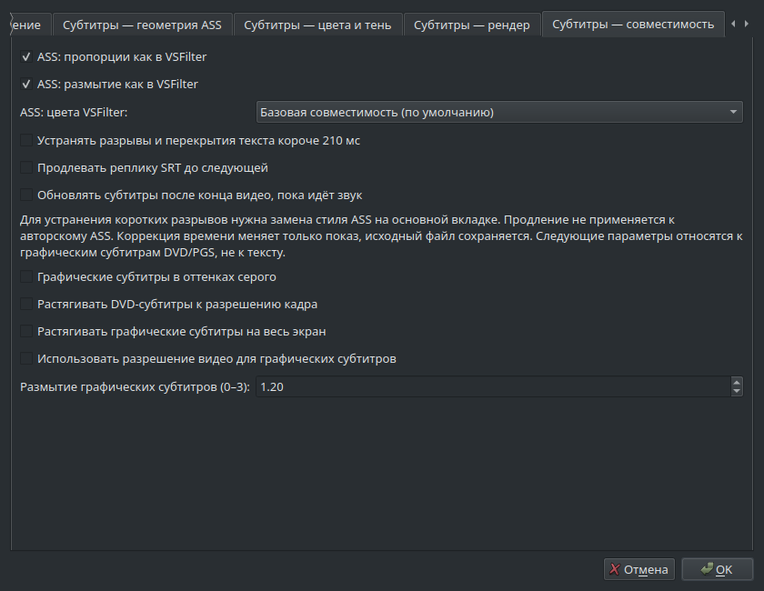

## 14. Расширенный звук

Баланс, второй выход, автопоиск/приоритет внешнего аудио, свойства вывода.
Усиление, параметры нормализации, центральный канал/LFE, 4.0/5.0,
правила микширования. Редактор FFmpeg-фильтров/пресетов, Int16/24/32/Float,
passthrough/bitstream, параметры декодера.

Qt 0.1.23 реализует обработку и микшер: Ctrl+Alt+A, усиление/стереобаланс,
порядок каналов, normalizer с параметрами, limiter и ReplayGain track/album.
FFmpeg-микшер с раскладками, центром/тылами/LFE и нормированием матрицы.
Уровни относятся к сведению, а не отдельной громкости сохранённых колонок;
баланс/специальные режимы включают stereo. Системный сервер может свести ещё раз.
Новые параметры нейтральны по умолчанию; прежняя audio/normalize сохранена.
18/18 CTest в двух режимах (фактически Software fallback), реальный float PCM
из libmpv проверен по RMS/пикам/частотам, архив проверен, профиль не менялся.
По итогам 0.1.23 оставались второй выход, поиск/приоритет внешнего аудио, редактор
фильтров/пресеты, Int16/24/32/Float, passthrough и декодер. Физический тракт
и полная матрица A/V-задержек с DSP требуют проверки.
[Протокол обработки](QtLinuxAudioProcessingValidation-2026-10-15.txt),
[манифест 0.1.23](QtLinuxPackage-0.1.23-2026-10-15.json).

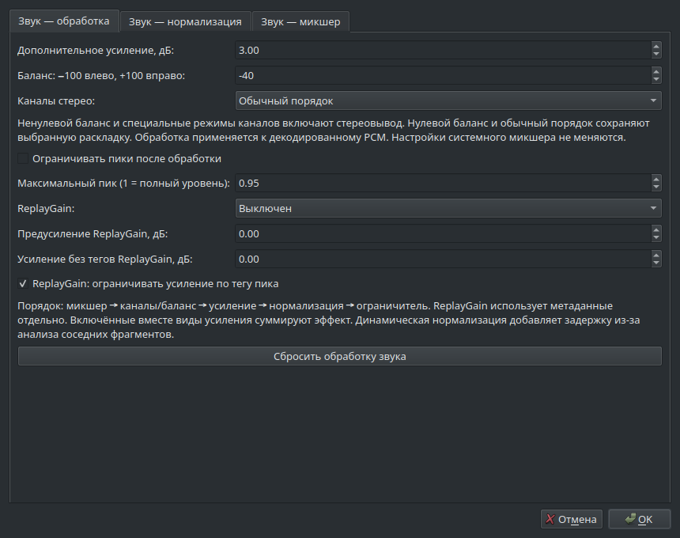
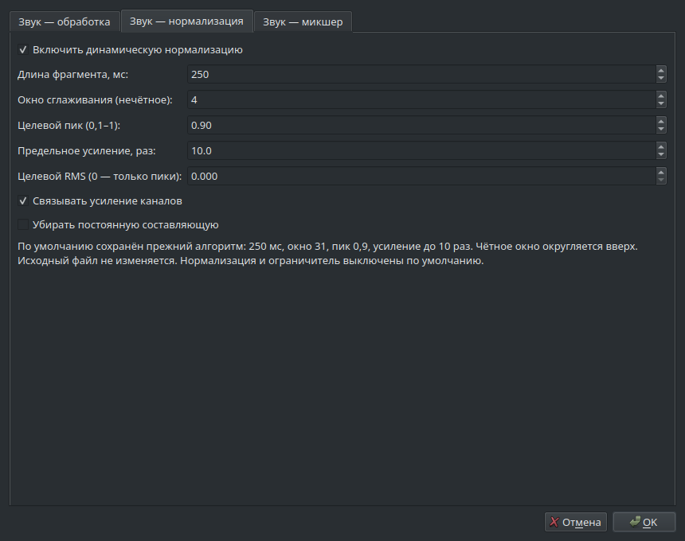
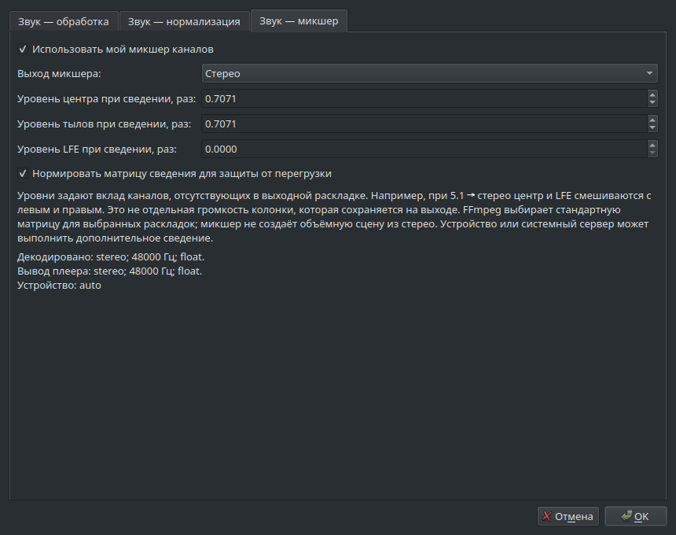

Qt 0.1.24 добавляет поиск/приоритет внешнего аудио и второе PCM-устройство
на странице «Звук — файлы и выходы» (Ctrl+Alt+A). Ручной и запомненный выбор
важнее приоритета, уже загруженные файлы не дублируются. Два pulse/ выхода
получают один декодированный сигнал через временный объединённый маршрут.
По умолчанию поиск/дублирование выключены. Потеря/возврат устройства,
выключение/закрытие/гибель родителя помощника и очистка своего модуля проверены.
20/20 CTest в двух режимах, фактически Software fallback, архив проверен.
Сигнал измерен на двух null-sink мониторах PipeWire; физический тракт и
синхронизация Bluetooth/USB/HDMI ещё требуют проверки. Профиль не менялся.
По итогам 0.1.24 оставались редактор фильтров/пресеты, PCM форматы и bitstream/декодер.
[Протокол маршрутизации](QtLinuxAudioRoutingValidation-2026-10-15.txt),
[манифест 0.1.24](QtLinuxPackage-0.1.24-2026-10-15.json).

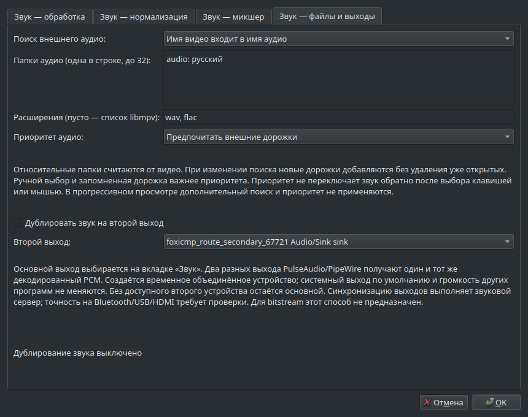

Qt 0.1.25 добавляет редактор цепочки FFmpeg и свои пресеты через Ctrl+Alt+A
→ «Звук — фильтры», также в общих настройках. Цепочка перед limiter, по умолчанию
выключена. Встроенные пресеты, до 64 своих, импорт/экспорт JSON, Cancel/OK,
проверка FFmpeg с deadline 3 с. Ошибочная включённая цепочка из INI пропускается,
ошибка видна на вкладке. Реальные PCM измерения, 11 аудиопроверок в каждом режиме;
20/20 CTest в software и requested OpenGL (фактически Software fallback).
Архив проверен, установленный профиль не менялся. Далее — форматы PCM и
bitstream/декодер. Работа всех пользовательских графов с другими раскладками и
физическая A/V-задержка ещё требуют проверки.
[Протокол фильтров](QtLinuxAudioFiltersValidation-2026-10-15.txt),
[манифест 0.1.25](QtLinuxPackage-0.1.25-2026-10-15.json).

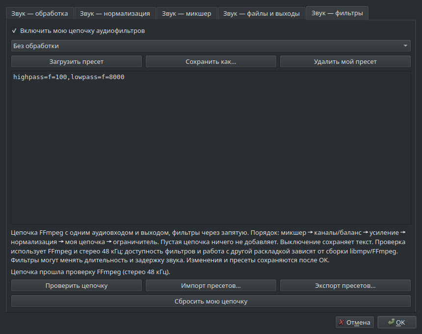

Qt 0.1.26 реализует PCM/частоты, bitstream и параметры декодера: Ctrl+Alt+A
→ «Звук — формат и декодер». Auto/Int16/Int24 в Int32/Int32/Float32,
32–192 кГц, потоки, AC-3 DRC, decoder downmix и preferred decoder с резервом.
Bitstream off по умолчанию, AC-3/DTS/DTS-HD/E-AC-3/TrueHD; при DSP/ReplayGain,
раскладке/dual/скорости/DRC/downmix временно PCM. Реальные PCM/IEC 61937 измерены:
Int24 low bytes нулевые, AC-3 payload совпадает с исходником, runtime/Cancel/OK/
Reset проверены. 21/21 CTest в двух режимах, фактически Software fallback,
архив проверен, установленный профиль не менялся. Это завершает программные
настройки пункта 14; физический HDMI/S/PDIF/ресиверы, DRC на метаданных и
A/V-задержки с DSP/двумя выходами остаются отдельными испытаниями. Далее пункт 15.
[Протокол формата и декодера](QtLinuxAudioEncodingValidation-2026-10-16.txt),
[манифест 0.1.26](QtLinuxPackage-0.1.26-2026-10-16.json).

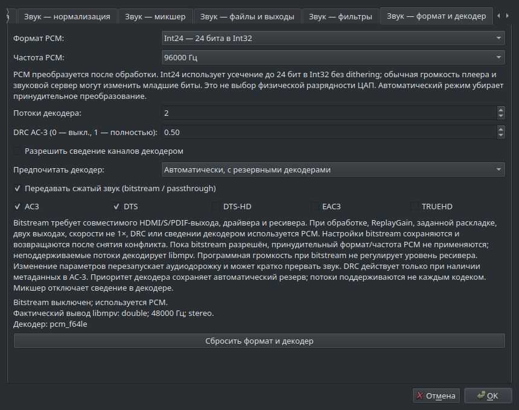

## 15. Видеовывод и обработка

Алгоритмы масштабирования, диапазон/точность вывода, текстуры, управление
цветом/оттенок. Декодер, деинтерлейсинг, аппаратное декодирование по форматам,
синхронизация с дисплеем, VSync/время кадра. Шейдеры до/после масштаба,
редактор, тест разрывов, статистика/сброс. Linux-аналоги EVR/MPC VR/madVR.

Qt 0.1.27 начинает пункт 15: Ctrl+Alt+V — Software kernel, GPU scale/dscale/
cscale, явный deinterlace, auto/VA-API/NVDEC/VDPAU copy, native/custom codec list,
потоки и CPU fallback. Defaults сохраняют прежнее поведение; старый master
ускорения синхронизирован с новой страницей. Реальные software pixels,
interlaced source, пауза/продолжение, сброс/Cancel/OK проверены. 22/22 CTest
в двух режимах, фактически Software fallback; GPU/ускорители физически не
проверены. Установленная 0.1.26 и профиль не менялись. Далее в пункте 15 —
диапазон/точность/цвет, синхронизация/VSync, шейдеры и расширенная статистика.
[Протокол вывода](QtLinuxVideoOutputValidation-2026-10-16.txt),
[манифест 0.1.27](QtLinuxPackage-0.1.27-2026-10-16.json).

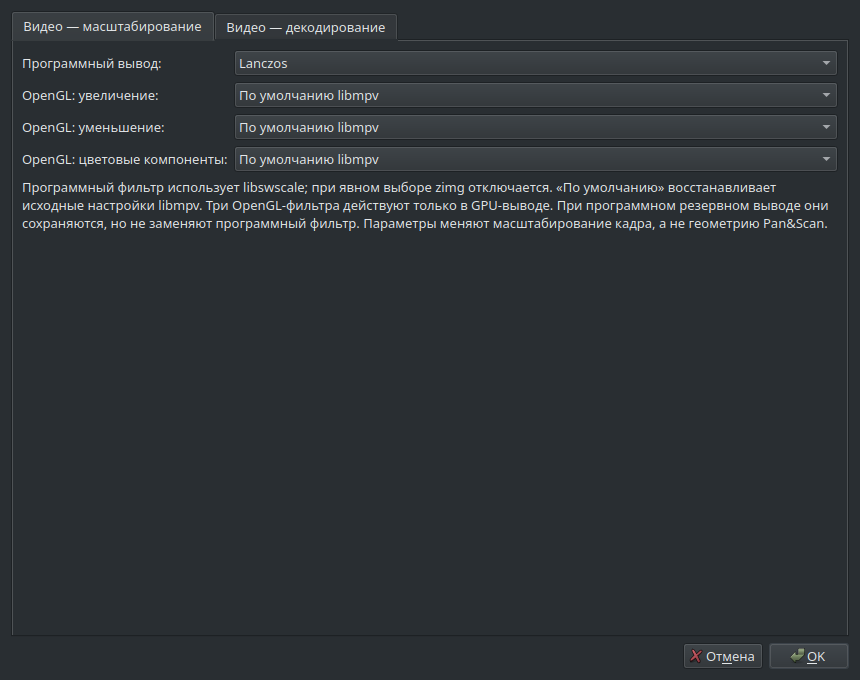
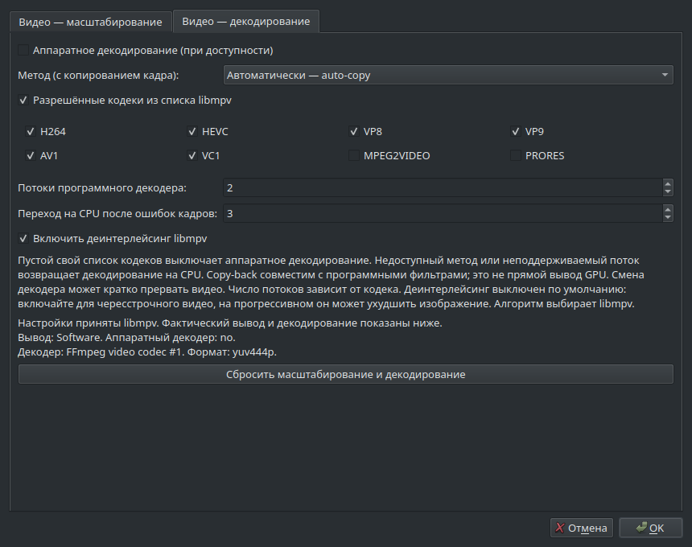

0.1.28 продолжает пункт 15: Ctrl+Alt+V → «Видео — цвет и точность».
Software RGBX 8/16 бит, OpenGL range/FBO/dither/primaries/transfer/tone mapping,
общие оттенок/гамма для изображения и превью. Новые значения по умолчанию
сохраняют прежнее поведение. Проверены реальные уровни 10-битного градиента,
цветные/серые патчи против FFmpeg, Cancel/OK/независимые сбросы и сохранение
настроек. 22/22 CTest в двух режимах (фактически Software fallback), архив
проверен. Принятие GPU-настроек не подтверждает цвет на физическом GPU.
16 бит — точность буфера Software, не монитора; конечная OpenGL surface RGBA8.
Установленную 0.1.26 не обновляли, пользовательский INI не перезаписывали;
параллельно открытый плеер сохранял свой профиль. Далее ICC, синхронизация/VSync,
шейдеры/редактор и расширенная статистика.
[Протокол цвета](QtLinuxColorValidation-2026-10-16.txt),
[манифест и SHA-256 0.1.28](QtLinuxPackage-0.1.28-2026-10-16.json).

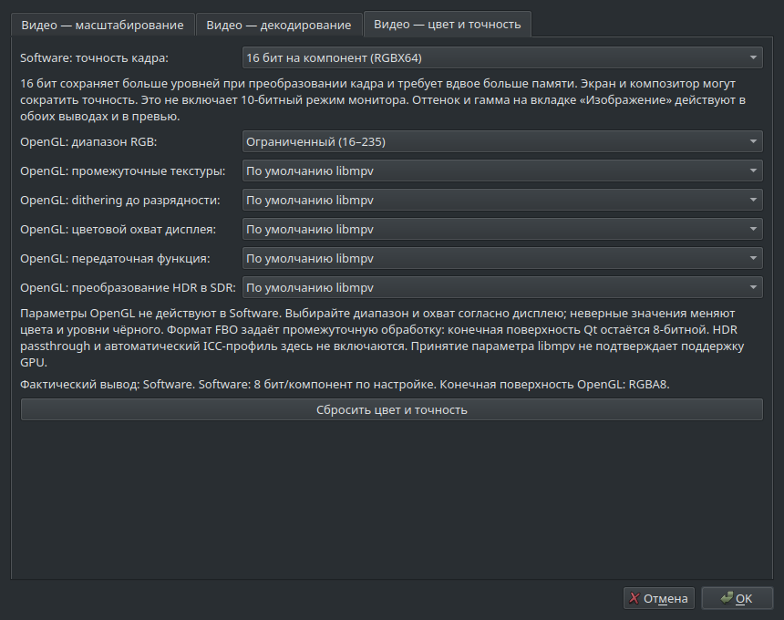

0.1.29 продолжает пункт 15: Ctrl+Alt+V → «Видео — ICC-профиль» и
«Видео — синхронизация». Ручной RGB ICC импортируется после OK в переносимую
папку ColorProfiles, четыре intent, LUT disk cache выключен. Display-resample/
tempo/vdrop, Qt VSync после перезапуска, частота из Qt/вручную, пределы
коррекции и temporal interpolation. При Software, сворачивании, VSync0 или
bitstream временно audio без потери выбора. По умолчанию ICC off/audio/VSync1.
23/23 CTest в двух режимах, actual Software fallback, ICC portable/cancel/reset
и native A/V clock проверены; физический GPU/ICC/VBlank не подтверждены.
Установленную 0.1.26 и личный INI эта задача не перезаписывала.
Автопрофиль ОС/per-monitor остаётся. Далее шейдеры/редактор и статистика.
[Протокол ICC/синхронизации](QtLinuxDisplayValidation-2026-10-16.txt),
[манифест 0.1.29](QtLinuxPackage-0.1.29-2026-10-16.json).

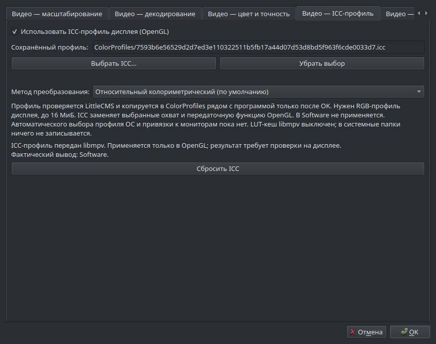
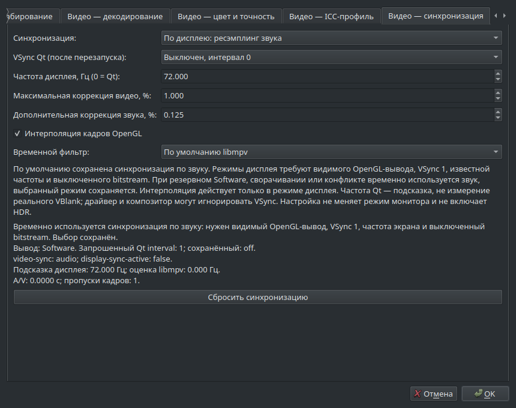

0.1.30 продолжает пункт 15: Ctrl+Alt+V → управляемая GLSL-цепочка,
редактор, порядок, галочки, MAIN до масштаба и SCALED после. До 16 × 64 КиБ,
четыре шаблона, отдельная проверка компиляции GL3.3, переносимые файлы и отмена.
Ctrl+Alt+G → nonmodal статистика Qt render/native passes, JSON/reset baselines,
визуальный moving-line Qt pattern без остановки видео. 24/24 CTest в обоих
режимах, actual Software fallback; GLSL pixels отдельно проверены offscreen
Mesa llvmpipe. Native GPU shader/VSync/tearing этим не подтверждены. Редактор
одного hook не поддерживает произвольные multi-pass/compute/HLSL файлы.
Установленная 0.1.26 и личный INI не перезаписывались. Автовыбор ICC для мониторов и
физические GPU/экранные проверки остаются.
[Протокол шейдеров/статистики](QtLinuxShadersValidation-2026-10-16.txt),
[манифест 0.1.30](QtLinuxPackage-0.1.30-2026-10-16.json).

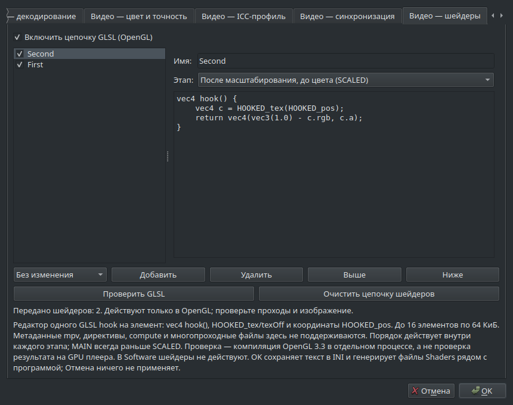
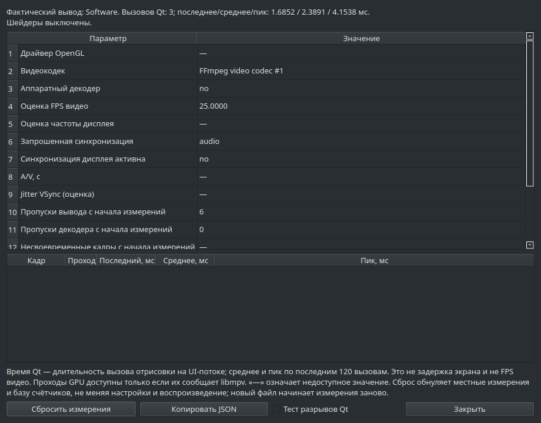
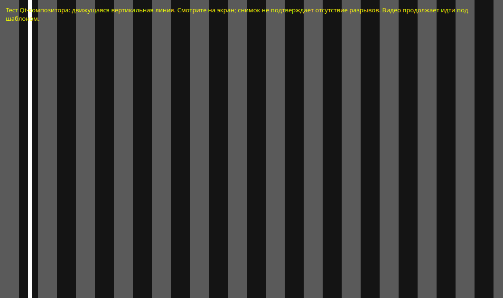

0.1.31 добавляет автоматический ICC текущего экрана в X11 через colord.
Ctrl+Alt+V → «Видео — ICC-профиль» → источник «Автоматически». Точное имя
экрана, действующий профиль по умолчанию с учётом калибровки, асинхронные
запросы с дедлайном и отбрасыванием старых ответов. Смена экрана/назначения/
содержимого обновляет профиль; отсутствие снимает ICC. Копии переносимы,
ручной путь сохраняется. Defaults по-прежнему ICC off/manual. Все 25 наборов проверены
в двух режимах (ICC повторно после исправления baseline теста), actual Software fallback; два ICC, Qt screen lookup, 5-sec
polling, Cancel/reset/timeout/pause проверены. Установленную 0.1.26 не обновляли.
Для X11 программная часть пункта 15 реализована в описанных границах;
физический GPU/мониторы, Wayland и расширенный GLSL importer остаются.
Далее пункт 16 — свойства, диагностика и сохранение.
[Протокол автоматического ICC](QtLinuxSystemIccValidation-2026-10-16.txt),
[манифест 0.1.31](QtLinuxPackage-0.1.31-2026-10-16.json).


## 16. Свойства, диагностика, сохранение

Свойства: контейнер, дорожки, кодеки, теги, разрешение/FPS/битрейт, MediaInfo.
Панели информации/статистики. Лист миниатюр, кадр в буфер, снимок без диалога,
снимок отображаемой области, формат/качество, сохранить копию медиа.

0.1.32 реализует пункт 16 для поддержанных источников: Ctrl+Alt+I → свойства
текущего источника, таблица дорожек, теги/JSON/диагностика и MediaInfo/FFprobe.
Ctrl+S/F12/Alt+C — снимок с диалогом/быстро/в буфер, отдельная область с OSD.
Формат/качество, настройки и лист миниатюр выбранной внутренней дорожки,
побайтовая копия файла с прогрессом/отменой и атомарной записью. Миниатюры и
копирование — только готовые локальные файлы; сетевые/диски/progressive
исключены. Пауза и позиция не меняются. 26/26 CTest в обоих режимах, actual
Software fallback. Физический GPU/ICC/HDR и Wayland этим не подтверждены.
Установленная 0.1.26 и личный INI не перезаписывались. Далее пункт 17.
[Протокол свойств/сохранения](QtLinuxMediaExportsValidation-2026-10-16.txt),
[манифест 0.1.32](QtLinuxPackage-0.1.32-2026-10-16.json).


## 17. Интеграция, профиль, обслуживание

0.1.34 продолжает пункт 17: **форматы и ассоциации Linux**.
Меню «Вид» → «Форматы и ассоциации Linux…», также кнопка в общих настройках.
Поиск по MIME/расширениям, наборы «Все видео», «Всё аудио», «Плейлисты».
Типы берутся из MIME-базы системы; один MIME может охватывать несколько
расширений. Это регистрация типов, а не обещание декодировать любой кодек.

«Зарегистрировать плеер» обновляет «Открыть с помощью» для текущей программы
и папки профиля, включая `--profile`; само по себе не назначает плеер основным.
«Назначить отмеченные» меняет только выбранные пользовательские defaults в
`$XDG_CONFIG_HOME/mimeapps.list` (обычно `~/.config/mimeapps.list`). Остальные
типы и разделы сохраняются; существующие приложения остаются в списке
fallback. Удаляется запрет именно FoxicMP из Removed Associations выбранного
типа. Изменения по кнопкам применяются сразу, закрытие окна их не отменяет.

«Откатить мои назначения» использует журнал в профиле FoxicMP и возвращает
прежние значения только там, где с момента назначения они не менялись.
Переезд профиля к другому пользователю/файлу ассоциаций блокирует такой откат.
Откат не удаляет ярлык плеера. Удаление пункта Nemo сохраняет ярлык, если
найдены ссылки на него в ассоциациях. Регистрация текущей копии заменяет
одноимённый глобальный пункт FoxicMP другой копии; независимых глобальных
ассоциаций на каждую папку профиля пока нет.

Таблица показывает первый пункт пользовательского файла. Desktop-specific
настройки могут иметь приоритет: «Проверить в системе» запрашивает действующее
назначение выделенной строки через `gio mime`, не открывая медиафайл.
Проверка асинхронна, с пределом 3 секунды и выводом до 64 КиБ. Требуется
`gio` из `libglib2.0-bin`. Системные ассоциации меняются только по кнопке,
проверка меню при старте исправляет пути, но не переназначает defaults.
Папки, URL-схемы, автозапуск/меню дисков не перехватываются.
Реальные Nemo/Cinnamon/Wayland требуют проверки на целевом рабочем столе.
Установленный плеер 0.1.26 и его профиль не обновляются.


0.1.33 начинает пункт 17: **запуск, передача файлов и системный трей**.
В меню «Вид» → «Запуск и системный трей…» включаются повторное использование
первого окна текущего профиля, активация при передаче, значок, скрытие при
закрытии/сворачивании. По умолчанию сохраняются отдельные окна, трей выключен.
Ctrl+Q и «Выход», включая MPRIS, всегда завершают приложение. При отсутствии
или исчезновении трея окно остаётся доступным либо возвращается на экран.

CLI: `--reuse-instance` передаёт запрос первому зарегистрированному окну,
`--enqueue` добавляет файлы без смены воспроизведения (подразумевает reuse),
`--new-instance` открывает отдельное окно; `--no-activate` не показывает
существующее окно. Относительные пути вычисляются в каталоге отправителя.
`--profile <каталог>` выбирает папку настроек/истории/плейлистов; по умолчанию
они по-прежнему находятся рядом с программой. Разные папки профиля независимы,
символические ссылки на одну папку считаются одним профилем. Независимые окна
одного профиля используют общие настройки. При закрытии первого окна прочие
автоматически не становятся получателями: следующий запуск регистрирует новое.
Служебные сокет и блокировка временные, в runtime-каталоге пользователя;
личные настройки там не сохраняются. Help/version не создают профиль.

Это первая часть пункта 17. Ассоциации/плеер по умолчанию, экспорт/сброс
профиля, обслуживание, веб-управление и остальные CLI-команды ещё впереди.
Физический трей и ограничения активации окон в Cinnamon/Wayland требуют
проверки на рабочем столе. Установленная версия 0.1.26 не заменяется.


Один экземпляр/передача файлов, правила новых процессов, трей, системные
медиакоманды Linux. Расширения/ассоциации, плеер по умолчанию, папки/автозапуск
дисков. Сброс/экспорт/место профиля, заголовок, обновления, приоритет/отчёт о сбое.
Веб-управление: порт, локальный доступ, превью, страницы/CGI.
Широкий набор CLI-команд Classic.

## Платформенные различия и итоговые проверки

DirectShow/Direct3D/DXVA/WASAPI/BDA/таскбар Windows не переносить буквально:
определить нужные Linux-аналоги. Не обещать равенство всех кодеков без медиаматрицы.
Отдельно проверить GPU, Wayland, мониторы/DPI/HDR, физическую A/V-задержку,
многочасовые сеансы. Программный десятиминутный тест 0.1.4 уже пройден.


Проверка 0.1.33: OpenGL-запрос **27/27** (actual Software fallback);
Software **26/27**, повтор audio-encoding **1/1 успешно**.
Непостоянный сбой AC3/PCM на паузе зафиксирован в протоколе.
[Протокол запуска и трея](QtLinuxDesktopValidation-2026-10-16.txt),
[манифест 0.1.33](QtLinuxPackage-0.1.33-2026-10-16.json).


Проверка 0.1.34: **28/28 Software**; OpenGL-запрос **27/28** (actual Software fallback).
Повторы аудионабора: Software 4 успешных и 1 сбой, второй режим 5 успешных.
Непостоянный переход AC3/PCM на паузе остаётся нерешённым;
AssociationsTest **11/11** каждый. [Протокол](QtLinuxAssociationsValidation-2026-10-16.txt),
[манифест 0.1.34](QtLinuxPackage-0.1.34-2026-10-16.json).

## Исправление аудио — 0.1.35

0.1.35 исправляет перезапуск аудиодекодера при смене AC3 bitstream ↔ PCM
и параметров декодирования на паузе. Раньше дорожка выключалась и включалась
двумя отдельными обращениями, а фильтры применялись уже после перезапуска.
Повторные переключения могли оставлять декодер без выходных параметров;
новый тест также обнаружил сдвиг позиции 0,672 → 0,736 секунды на паузе.

Теперь все параметры фильтров/выхода устанавливаются до перезапуска.
Возврат выбранной дорожки выполняется одной последовательностью команд
libmpv; для источника с перемоткой восстанавливается запомненная позиция.
Пауза не снимается, выбранная дорожка/файл сохраняются. Уже выключенное аудио
не включается. Отложенных Qt-таймеров для перезапуска нет, поэтому смена
файла не получает запоздалый seek от предыдущего источника. Время команды
записывается десятичным числом: парсер mpv не принимает экспоненциальный вид.

Добавлена проверка повторных циклов для отдельного AC3 и MKV с видео/AC3,
сохранения позиции/паузы, быстрых последовательных настроек, смены файла и
выключенного аудио. Сравнение позиции допускает один AC3-пакет: менее 40 мс.
Это проверка программного перехода и данных IEC 61937; физический ресивер,
HDMI/S/PDIF, фактическая задержка и бесшовность вывода требуют проверки
на оборудовании. Для неперематываемого потока восстановить прошлую позицию
невозможно; точность позиции в live-источнике этим тестом не подтверждена.
Установленная версия 0.1.26 и личный профиль не обновляются.


Проверка 0.1.35: **28/28 CTest в обоих режимах**, actual Software fallback.
Аудионабор — **10 последовательных прогонов на режим**, всего **4000 переходов**
AC3/PCM с сохранением paused position <40 мс. [Протокол](QtLinuxAudioRestartValidation-2026-10-16.txt),
[манифест 0.1.35](QtLinuxPackage-0.1.35-2026-10-16.json).

## Профиль и резервные копии — 0.1.36

0.1.36 добавляет «Вид → Профиль и резервные копии…»: экспорт в
`.foxicmp-profile`, копии в `Backups` текущего профиля и импорт в новую папку.
Можно открыть восстановленный профиль отдельным окном; для постоянного запуска
используйте `--profile /путь/к/профилю` в ярлыке. Импорт не заменяет текущий INI.

Сохраняются типы настроек Qt, плейлисты/вкладки, история, позиции и избранное.
Выбранные изображения, внешний перевод и ручной ICC копируются в `Assets`;
`Subtitles/Edits` переносится с сохранением структуры; ссылки на эти правки
в плейлистах перепривязываются к новой папке. Внешние субтитры сохраняют прежние
пути. Отсутствующий выбранный
ресурс останавливает экспорт с указанием пути. Медиа, снимки, извлечённые
субтитры, кэш, генерируемые GLSL, программы и старые копии не входят в архив.
Пути к медиа остаются прежними: относительные пути требуют такой же структуры
медиа рядом с новым профилем. Системные MIME-ассоциации и их журнал отката не
переносятся; автоматическая регистрация импортированного профиля выключена.

Формат JSON версии 1: SHA-256 каждого файла, строгая проверка относительных путей,
до 2048 файлов, 8 МиБ на файл и 32 МиБ данных (архив до 48 МиБ).
Контрольные суммы обнаруживают повреждение, но не подтверждают автора архива.
Импорт проверяет весь архив до записи, собирает профиль во временной папке
и атомарно создаёт конечную папку без замены существующего пути. Символические
ссылки в переносимых пользовательских файлах отклоняются. Резервные копии
создаются вручную и автоматически не удаляются. Архив содержит историю,
избранное и сохранённые URL; передавайте его только осознанно.

Пункт 17 продолжается: сброс профиля, оформление заголовка, обслуживание, веб и CLI ещё впереди.


Проверка 0.1.36: **29/29 CTest в обоих режимах**, actual Software fallback.
ProfileArchiveTest: **20/20 каждый**. [Протокол](QtLinuxProfileValidation-2026-10-16.txt),
[манифест 0.1.36](QtLinuxPackage-0.1.36-2026-10-16.json).

## Сброс настроек — 0.1.37

В «Вид → Профиль и резервные копии…» добавлен «Сброс настроек…».
После подтверждения окно закрывается штатно: сохраняются текущее положение и
плейлисты, прекращается воспроизведение. Затем создаётся точная копия INI в
`Backups/before-reset-*.ini`, а настройки атомарно заменяются значениями по
умолчанию. Плеер следует открыть снова. Кнопка по умолчанию — «Отмена».

По умолчанию сохраняются плейлисты/вкладки, история, позиции и избранное.
Снятая галочка очищает эти записи в новом INI. Медиа, изображения, ICC,
правки субтитров и старые копии не удаляются. Системные ассоциации не меняются,
их журнал отката остаётся; проверка регистрации при запуске выключается.
Исчезнувший внешний ресурс не мешает сбросу, поскольку копируется INI,
а ресурсы не переносятся и не удаляются.

Для возврата точных прежних настроек закройте все окна данного профиля и
скопируйте нужный `before-reset-*.ini` на место `FoxicMPQt.ini`. Это обычный
INI, не архив `.foxicmp-profile`; он относится к прежней папке ресурсов.
Копия содержит сохранённые URL/историю и не шифруется.

Экземпляры 0.1.37 держат общую блокировку профиля; сброс требует исключительной.
Другие окна того же профиля (включая канонический путь через ссылку) препятствуют
сбросу. Новое окно не открывается во время замены INI. Старые версии такой
блокировки не знают: перед сбросом закройте и их. Временный lease находится
рядом с IPC в runtime-каталоге; настройки остаются в папке профиля.
Недоступная копия, INI-ссылка/спецфайл или слишком большой INI отменяют сброс.
Для файлов запрашиваются права0600; фактические права зависят от файловой системы.

Пункт17 продолжается: постоянное место/ярлык профиля, оформление заголовка,
обслуживание, веб и оставшиеся CLI. Физические устройства/дисковые меню/ТВ отложены.


[Протокол сброса](QtLinuxProfileResetValidation-2026-10-16.txt).

Проверка0.1.37:Software29/29; requested OpenGL24+5/5послеперезапускаXvfb (исходный сбой сохранён); профиль30/30каждый; actual Software fallback. [Манифест](QtLinuxPackage-0.1.37-2026-10-16.json).

## Постоянный профиль и ярлык — 0.1.38

В «Вид → Профиль и резервные копии…» есть раздел «Профиль при запуске».
Выберите существующую папку (допускается пустая), затем нажмите
«Использовать при обычном запуске». Текущее воспроизведение и INI не меняются:
новый выбор действует при следующем запуске без явного `--profile`.
«Профиль рядом с программой» возвращает обычный переносимый запуск.

Рядом с исполняемым файлом хранится только `FoxicMPQt.launch.json` версии1;
сам профиль остаётся в выбранной папке. Вложенный в папку программы профиль
записывается относительным путём и переносится вместе с программой; внешняя
папка — абсолютным. `--profile /папка` имеет приоритет; `--portable` игнорирует
сохранённый выбор. Эти параметры нельзя сочетать. `--help`/`--version` не
создают профиль и работают даже при повреждённом файле выбора.

Если выбранная папка исчезла или JSON повреждён, запуск останавливается с
понятным сообщением; папка не создаётся заново и другой INI не подставляется.
Для исправления запустите с `--portable` или `--profile` и сохраните новый выбор.
Выбор не переносит и не копирует старые настройки. Для переноса используйте
экспорт/импорт профиля; файл выбора запуска в такой архив не входит.

«Создать ярлык…» сохраняет отдельный `.desktop` с явным `--profile`.
Файл создаётся по новому имени без замены существующего файла/ссылки.
MIME/defaults/Nemo/старый системный ярлык эта кнопка не меняет. Расположение
ярлыка выбирается пользователем; файловый менеджер может потребовать разрешить
его запуск. В ярлыке абсолютные пути: после переноса программы или внешней
папки создайте его заново. Команда использует экранирование Desktop Entry,
а не оболочку, и поддерживает пробелы/Unicode/$/%/кавычки/обратные кавычки.

Пункт17 продолжается: заголовок окна, обслуживание/обновления/приоритет,
веб-управление и оставшиеся команды. Меню дисков/физические устройства/ТВ отложены.


[Проверки запуска профиля](QtLinuxProfileLaunchValidation-2026-10-16.txt).

Проверка0.1.38:30группвкаждомрежиме с повторами (Software19+1+10, OpenGL15+15; исходные сбои сохранены), запускпрофиля18/18, архив/reset30/30каждый; actual Software fallback. [Манифест](QtLinuxPackage-0.1.38-2026-10-16.json).

## Заголовок окна — 0.1.39

Откройте **Настройки плеера → Заголовок окна**. Доступны название ролика из
метаданных, имя файла, полный путь, только название плеера и собственный
шаблон. Для готовых вариантов отдельно включаются состояние и позиция с
длительностью. По умолчанию остаётся название ролика с суффиксом FoxicMP Qt.
При отсутствии метаданных используется имя файла; после остановки и закрытия
показываются название и версия плеера.

Шаблон поддерживает `{name}`, `{path}`, `{title}`, `{state}`, `{position}`,
`{duration}` и `{app}`. Пример:
`{title} [{state}] [{position} / {duration}] — {app}`.
В режиме шаблона флажки состояния и времени не применяются: размещение
этих полей задаёт сам шаблон. `{{` и `}}` выводят фигурные скобки;
неизвестные поля остаются текстом. Скобки и `%1` внутри названия ролика
не интерпретируются как команды шаблона. Пустой результат возвращает
обычный заголовок; длина ограничена 2048 символами, управляющие символы
заменяются пробелами.

Предпросмотр показывает текущий ролик на момент открытия настроек или
пример, если воспроизведение остановлено. OK применяет изменения сразу,
Cancel сохраняет прежний заголовок и настройки. Ключи `ui/titleMode`,
`ui/titleTemplate`, `ui/titleState`, `ui/titlePosition` хранятся в текущем
`FoxicMPQt.ini`, переносятся обычным экспортом профиля и удаляются при
сбросе настроек. Положение и размер окна эта вкладка не меняет.

Для сетевого `{path}` скрыты учётные данные, строка запроса и фрагмент URL.
Без известной длительности выводится `—`. Состояние переводится на выбранный
язык интерфейса. Системный заголовок виден при обычной рамке; режим без рамки
и полный экран сохраняют свои настройки.

Пункт 17 продолжается: обслуживание, проверка обновлений, приоритет процесса,
отчёт об ошибках, веб-управление и оставшиеся команды запуска. Дисковые меню,
аналоговое ТВ и физические устройства остаются отложенными.

Проверка 0.1.39: 31/31 групп Software, 8/8 затронутых групп при запросе OpenGL;
новые тесты заголовка 7/7 в обоих режимах, архив и настоящий X11-заголовок проверены.
[Манифест](QtLinuxPackage-0.1.39-2026-10-16.json), [проверка](QtLinuxWindowTitleValidation-2026-10-16.txt).

## Обслуживание и диагностика — 0.1.40

**Справка → Обслуживание и диагностика…** открывает отдельное окно.
**Справка → Проверить обновления Linux/Qt…** открывает его и сразу запускает
проверку. Обычное открытие окна и запуск плеера сеть не опрашивают.

Проверка вручную читает последние 100 выпусков официального репозитория
`LiberVixer/FoxicMP` через GitHub API. Подходящим считается опубликованный
пакет `FoxicMPQt-X.Y.Z-linux-x64.tar.gz`; Windows-пакеты и черновики
исключены. Предварительные Qt-выпуски включены по умолчанию; флажок можно
сохранить в профиле. Версии сравниваются численно. Если Linux-пакетов нет,
плеер сообщает об этом отдельно, а не объявляет текущую версию последней.
Проверка ограничена 2 МиБ и 15 секундами; ошибки HTTP, сети и некорректный
ответ отображаются явно. Перенаправления не выполняются. Кнопка страницы
выпуска доступна только для более новой Qt-сборки и открывает проверенную
HTTPS-страницу этого репозитория в браузере. Автоматической загрузки,
установки, фоновой проверки и передачи отчётов нет.

Приоритет: обычный `nice 0`, выше обычного `nice -5`, ниже обычного `nice 5`.
Кнопка «Сохранить параметры обслуживания» записывает выбор в текущий профиль;
приоритет применяется со следующего запуска к уже созданным потокам Qt
перед созданием потоков libmpv, которые наследуют его. Права администратора не запрашиваются. Без разрешения
на уменьшение nice Linux может отказать повышению или возврату к обычному
приоритету у процесса, запущенного с пониженным приоритетом. Окно показывает
текущее значение и ошибку начального применения. Действующий процесс из окна
настроек не перенастраивается; закрытие без сохранения оставляет профиль прежним.

Диагностический JSON содержит версию приложения/Qt/libmpv/FFmpeg/libass,
систему и backend Qt, запрошенный/фактический видеовывод, статистику рендера,
кодеки, параметры видео/аудио, текущую позицию/паузу и приоритет. Неизвестные
свойства libmpv остаются `null`. Снимок отчёта обновляется по кнопке;
воспроизведение и пауза не меняются. Доступны просмотр, копирование и
атомарное сохранение JSON в выбранный файл; по умолчанию предлагается папка
профиля. Символические ссылки и специальные файлы как цель отклоняются.

По умолчанию исключены путь источника/профиля, имена аудиоустройств,
последняя ошибка и исходный текст сообщений. Флажок «Включить пути, имена
устройств и последние сообщения движка» добавляет эти поля для подробного
отчёта. Перед отправкой можно просмотреть весь текст. Журнал содержит до
100 предупреждений/ошибок libmpv и ошибок команды, каждое до 2048 символов,
только в памяти текущего запуска. Это отчёт работающего плеера; перехвата
аварийного завершения, дампов и восстановления журнала после падения нет.
Полный отладочный вывод `FOXICMP_MPV_LOG` остаётся отдельной возможностью.

Ключи `maintenance/priority` и `maintenance/updatePreviews` находятся в
`FoxicMPQt.ini`; экспорт профиля переносит их, сброс возвращает defaults.
Установленная Linux-копия и её профиль не обновлялись. Windows-плеер и
отключённая интеграция Harvester не изменялись.

Пункт 17 продолжается: веб-управление и оставшиеся команды запуска.
Автоматические обновления/установка и crash dump не реализованы.
Дисковые меню, аналоговое ТВ и физические устройства остаются отложенными.


Проверка 0.1.40: 32/32 групп Software, 9/9 затронутых групп при запросе OpenGL;
обслуживание 8/8 в каждом режиме, настоящий GitHub, архив и nice потоков проверены.
[Манифест](QtLinuxPackage-0.1.40-2026-10-17.json), [протокол](QtLinuxMaintenanceValidation-2026-10-17.txt).

## Веб-управление — 0.1.41

**Настройки → Веб-управление…** открывает управление локальным HTTP-сервером.
По умолчанию он выключен. Выберите свободный порт 1024–65535 (стандартно
13579) и нажмите «Включить и сохранить». Затем откройте страницу кнопкой
«Открыть в браузере» или скопируйте ссылку. Сервер работает только на
`127.0.0.1`: управление с телефона/другого компьютера по сети пока не включено.

Пульт показывает название, состояние, позицию/длительность и очередь
(первые 500 записей). Доступны play/pause/stop, предыдущий/следующий файл,
абсолютная перемотка, громкость, mute и скорость. Применяются действующие
правила плеера, в том числе ограничения live/progressive и сохранение паузы
при переходах. Очередь показана для текущего проигрываемого списка; выбора
произвольной записи, удаления, открытия файлов/URL и команд завершения системы
в этом API нет. Страница на русском/английском обновляет состояние раз в секунду.

Для каждого запуска сервера создаётся случайный код 256 бит. Он передаётся
в браузер фрагментом ссылки `#код`, затем удаляется из адресной строки;
страница держит его только в памяти и отправляет API через Authorization Bearer.
Перезагрузка страницы требует заново открыть ссылку или ввести код из окна
плеера. Код не пишется в профиль, localStorage или cookie. При перезапуске
сервера/плеера старый код перестаёт работать. Кнопка «Выключить и сохранить»
закрывает сервер и активные соединения, отключая автозапуск с этим профилем.
Другие окна/профили требуют другого порта; занятый порт не перехватывается.
Закрытие диалога оставляет текущее состояние сервера, изменение числа порта
без кнопки включения в профиль не записывается.

HTTP API: `GET /api/state`, `POST /api/command` с JSON `{"command":"pause"}`;
для `seek`, `volume`, `rate` — числовое поле `value`. Ответ команды подтверждает
её принятие; состояние воспроизведения меняется асинхронно. Ошибки: 403 —
код/Host/Origin, 400 — формат/команда/значение, 409 — действие недоступно,
413 — слишком большой запрос. Разрешён только ограниченный список команд.
Проверяются Host и Origin, API требует код; CORS не включён. Лимит запроса
16 КиБ, одновременно до 8 соединений, время соединения 3 секунды. Chunked,
повторные заголовки, pipelining и путь к произвольному файлу не поддерживаются.
HTML/JS/CSS встроены в программу, внешние ресурсы не загружаются; текст
ролика/очереди вставляется через textContent. Ответы имеют no-store, nosniff,
Referrer-Policy и CSP. HTTP не предназначен для публикации через внешний прокси.

Профиль содержит только `web/enabled` и `web/port`. Экспорт переносит эти
параметры; сброс отключает сервер при следующем запуске. Отключённый MPRIS
не мешает веб-управлению. Установленная 0.1.40 и личный INI не заменяются.
Далее по пункту 17 — оставшиеся команды запуска. Дисковые меню, аналоговое
ТВ и физические устройства остаются отложенными.


Проверка 0.1.41: все 33 группы Software проверены с повтором window-title
(исходно 32/33 PASS; повтор 7/7), 10/10 групп при запросе OpenGL;
веб-тесты 9/9 в каждом режиме, браузер и архив проверены.
[Манифест](QtLinuxPackage-0.1.41-2026-10-17.json), [протокол](QtLinuxWebControlValidation-2026-10-17.txt).

## Расширенные команды запуска — 0.1.42

`--start` задаёт секунды или `ЧЧ:ММ:СС[.доли]` (также `ММ:СС`),
`--pause` открывает на паузе. Начальная позиция 0–604800 секунд;
нулевая позиция отменяет сохранённое продолжение для этого открытия.
`--volume 0..100`, `--rate 0.125..16`, `--audio-track ID` и
`--subtitle-track ID` выбирают параметры воспроизведения; ID 0 отключает
соответствующую дорожку. ID берётся из меню дорожек, а не из её номера в файле.
`--audio-file` / `--subtitle-file` подключают и выбирают читаемый локальный файл;
путь разрешается относительно папки вызывающей команды. Файл и ID одной
дорожки одновременно не допускаются. Ограничения прямых входов, кэша
прогрессивного просмотра и блокировки встроенных субтитров сохраняются.

`--fullscreen`, `--minimized`, `--normal` задают состояние окна (взаимоисключающие).
`--window-size 960x540` задаёт размер обычного окна с интерфейсом, а не видеокадра;
допустимо 320×200–16384×16384, фактический минимум ограничивает Qt.
`--window-position=-10,40` задаёт абсолютные координаты Qt, включая отрицательные.
Оконный менеджер/Wayland может ограничивать положение окна. Размер и положение
устанавливаются перед выбранным состоянием окна и повторяются после
автоматического размера по видео. Отдельные ключи запуска не сохраняются;
громкость, геометрия и выбор дорожек запоминаются обычными правилами профиля.
Скорость также переходит к следующему файлу, если в профиле включено
сохранение скорости между файлами; в остальных случаях она сбрасывается.

Примеры:

```sh
./foxicmp-qt --pause --start 00:01:30.5 --rate 1.25 --fullscreen "фильм.mkv"
./foxicmp-qt --reuse-instance --audio-file "звук.mka" --subtitle-file "текст.srt" "фильм.mkv"
./foxicmp-qt --profile /путь/к/профилю --command pause
./foxicmp-qt --profile /путь/к/профилю --start 120 --volume 35
```

`--command play|pause|toggle|stop|next|previous|mute` направляется первому
работающему окну выбранного профиля без активации. `mute` переключает звук.
Команда не объединяется с источниками или другими новыми параметрами.
Параметры воспроизведения без источника также направляются работающему окну;
при отсутствии окна команда завершается ошибкой без создания нового профиля.
Код 0 подтверждает доставку запроса, а не доступность операции: например,
следующего файла может не быть, а запрошенная позиция может отсутствовать в кэше.

С файлами, URL, папкой или плейлистом параметры относятся к первому открытому
источнику. Загрузка на паузе и начальная позиция передаются в libmpv до открытия;
остальные параметры применяются после загрузки дорожек. Следующий файл не
наследует разовые ключи. `--enqueue` не объединяется с новыми параметрами;
параметры воспроизведения при `--dvd` / `--bluray` / `--cdda` /
`--harvester-session` не принимаются (параметры окна допустимы).
Некорректные диапазоны, повторённые значения и несовместимые ключи
отклоняются до создания профиля и отправки запроса.

Это очередная часть пункта 17. Полного соответствия всех ключей Classic нет;
отдельные проверки оборудования, Wayland и длительных сеансов остаются.
Меню дисков, аналоговое ТВ и физические устройства отложены пользователем.

Остаток CLI после 0.1.42 (сверка с `CAppSettings::ParseCommandLine` Classic):
действие после окончания, выбор монитора, пресет Pan&Scan, аудиоустройство,
перемешивание, открытие из буфера, временный веб-порт и запуск сброса профиля.
Внешнее аудио с заданной задержкой и несколько внешних файлов требуют отдельной
проработки; stdin также не реализован. DirectShow-фильтры, HWND slave,
D3D fullscreen и Windows minidump не переносить буквально; для управления уже
есть Linux IPC/D-Bus. Ключ `--start` Qt принимает секунды; Classic `/start`
принимает миллисекунды — это разные интерфейсы командной строки.

Проверка 0.1.42: 34/34 группы CTest Software и 11/11 затронутых групп
при запросе OpenGL; новые тесты 7/7 в каждом режиме, архив проверен.
[Манифест](QtLinuxPackage-0.1.42-2026-10-17.json), [протокол](QtLinuxLaunchOptionsValidation-2026-10-17.txt).

Установленная Linux-копия обновлена до 0.1.42 по постоянному указанию
пользователя; INI и личные файлы сохранены, резервная копия создана.

## Дополнительные команды запуска — 0.1.43

`--monitor primary`, `--monitor 1` или `--monitor "имя"` выбирают экран
для текущего окна. Номера начинаются с 1, имена и геометрия доступны через
`--list-monitors`. Выбор сохраняется на время жизни окна и используется при
последующем входе в полный экран; постоянная настройка монитора в INI
не заменяется. При переносе обычное окно центрируется на выбранном экране;
явные `--window-position` / `--window-size` применяются после выбора экрана.
Wayland и оконный менеджер могут ограничить позиционирование.

`--audio-device auto` или точное имя из `--list-audio-devices` выбирают
основное устройство libmpv. Выбор сохраняется как при выборе через меню,
а настройки второго выхода остаются прежними. Внутренние временные устройства
`pulse/foxicmp_dual_*` не принимаются и не перечисляются.

`--panscan fit|fill|wide|crop169|crop235` выбирает встроенный пресет,
`--panscan "saved:Кино"` — сохранённый пресет текущего профиля с точным именем.
Преобразования сохраняются по обычному флагу «Запоминать преобразования».
`--shuffle` / `--no-shuffle` включают/выключают случайный порядок обхода списка
и сохраняются по правилам соответствующего пункта меню. Это режим обхода,
а не физическая перестановка строк плейлиста.

`--after none|exit|close|minimize|nextDirectory|loopDirectory|suspend|hibernate|shutdown|logout|lock`
задаёт **одно** действие при естественном окончании прохода списка.
Постоянный `playback/after` не меняется. `none` подавляет постоянное действие
на один проход, после чего постоянное правило снова действует. Стоп и ошибка
не расходуют назначенное действие. Системные действия используют существующую
проверку возможностей Linux и D-Bus; в тестах исполнитель подменяется.
В меню однократных действий теперь доступны также закрытие файла/сворачивание
и переход по каталогу.

Имена монитора, устройства и пресета проверяются получающим окном до изменения
очереди, громкости и настроек. Если ресурс недоступен, запрос не применяется;
причина видна в OSD и диагностическом отчёте. Код 0 при передаче означает приём
запроса, а не успешное применение всех ресурсов. Формат, диапазоны,
неизвестные действия и несовместимые ключи проверяются до открытия профиля.
При отсутствии файлов новые параметры воспроизведения направляются работающему
окну выбранного профиля; для параметра монитора одного используйте
`--reuse-instance`, если нужно выбрать уже открытое окно.
Ограничения 0.1.42 на `--enqueue` и запуск дискового/прогрессивного сеанса
с параметрами воспроизведения сохраняются.

`--list-monitors` и `--list-audio-devices` возвращают JSON. Их можно объединить
друг с другом и с `--profile` / `--portable`; профиль при этом не создаётся
и не изменяется. Файлы и управляющие ключи с запросом списка не объединяются.
Пример:

```sh
./foxicmp-qt --list-monitors --list-audio-devices
./foxicmp-qt --monitor 1 --fullscreen --panscan crop169 --shuffle --after close "фильм.mkv"
./foxicmp-qt --profile /путь/к/профилю --audio-device auto --no-shuffle
```

Пункт 17 остаётся частично открытым: буфер обмена, временный веб-порт,
сброс из CLI, внешняя аудиодорожка с задержкой, несколько внешних файлов
и stdin. Физические мониторы/GPU/аудиоустройства и Wayland требуют отдельной
проверки. Меню дисков, аналоговое ТВ и физические устройства отложены.

Проверка 0.1.43: 34/34 группы CTest Software и 14/14 затронутых групп
при запросе OpenGL; тесты команд запуска 10/10 в каждом режиме, архив проверен.
[Манифест](QtLinuxPackage-0.1.43-2026-10-17.json), [протокол](QtLinuxLaunchExtrasValidation-2026-10-17.txt).

Установленная Linux-копия обновлена до **0.1.43**; INI и ярлык сохранены,
предыдущая версия скопирована в резервную папку рядом с установленной.

Актуальный сводный [список оставшихся работ после 0.1.49](LinuxRemainingWork.md)
отделяет разработку, испытания и отложенные пользователем задачи от истории версий.

## Буфер обмена, временный веб-порт и сброс из CLI — 0.1.44

`--clipboard` читает обычный буфер обмена вызывающего процесса: список URI
или текст с одним существующим файлом/папкой либо поддержанным URL на строку.
До открытия профиля проверяется весь список; пустой/неверный список отвергается
целиком. Максимум 256 записей и общий лимит запроса IPC 256 КиБ. Содержимое
превращается в обычный список источников до передачи другому окну: получатель
не перечитывает свой буфер. Можно сочетать с `--reuse-instance`, `--enqueue`
и допустимыми параметрами открытия. Как и для обычных файлов, при `--enqueue`
другие параметры окна/воспроизведения не принимаются. С позиционными источниками, дисковыми/
прогрессивными сеансами, `--command` и запросами списков не объединяется.

`--web-port 13580` включает существующий локальный веб-пульт на указанном
порту 1024–65535 для текущего окна. В новом окне заменяет сохранённый порт
ещё при создании сервера; `web/enabled` и `web/port` не меняются. Через
`--reuse-instance` меняет сервер работающего окна. При занятом порте сохраняются
старый сервер, его код доступа и воспроизведение; остальные параметры запроса
не применяются. При успешной смене порта старый сервер закрывается, код
обновляется. Повтор того же действующего порта сохраняет код и подключения.
Доступ по-прежнему только через 127.0.0.1; ссылка с кодом доступна в окне
«Веб-управление», где временный режим подписан. Кнопки «… и сохранить»
по-прежнему явно меняют профиль. Следующий запуск использует сохранённые настройки.
Код 0 при IPC подтверждает приём, а не успешное включение занятого порта;
причина отказа показывается в OSD/диагностике.

`--reset-settings` работает только с существующим закрытым профилем, сохраняет
точную резервную копию INI в `Backups/before-reset-*.ini`, сбрасывает настройки
и завершает процесс без открытия окна. Печатает JSON с `reset`, `profile`,
`backup`, `keptLibrary`. По умолчанию сохраняет историю, избранное, позиции и
плейлисты. Дополнительный `--reset-library` очищает также эти данные.
Файлы медиа, внешние активы и журнал отката системных ассоциаций не удаляются;
автопроверка интеграции отключается. Выбор папки профиля/ярлыки не сбрасываются.

Для сброса допустимы только `--profile` или `--portable` и `--reset-library`;
без явного пути действует сохранённый выбор профиля. Сброс не передаётся по
IPC: эксклюзивная lease-блокировка проверяется до чтения настроек. При открытом
окне того же профиля (включая другой путь через символьную ссылку), отсутствии
INI, повреждении INI, ссылке/FIFO вместо INI или невозможности резервной копии
команда завершается с ошибкой, не заменяя настройки. При запуске без дисплея
нужно задать `QT_QPA_PLATFORM=offscreen`; чтение системного буфера таким режимом
не проверялось. Отсутствующая папка
профиля не создаётся. GUI-сброс использует тот же механизм замены/резервирования.

```sh
./foxicmp-qt --clipboard --pause
./foxicmp-qt --reuse-instance --clipboard
./foxicmp-qt --web-port 13580 "фильм.mkv"
./foxicmp-qt --profile /путь/к/закрытому/профилю --reset-settings
```

Следующий остаток CLI: задержка внешнего аудио, несколько внешних дорожек/
субтитров и stdin. Расширения веб-пульта/LAN, GLSL и Wayland остаются в плане.
Меню дисков, аналоговое ТВ и физические устройства по-прежнему отложены.

Проверка 0.1.44: 34/34 групп Software, 7/7 затронутых групп при запросе OpenGL; архив проверен.
[Манифест](QtLinuxPackage-0.1.44-2026-10-17.json), [протокол](QtLinuxCliRecoveryValidation-2026-10-17.txt).

Установленная Linux-копия обновлена до **0.1.44**; INI и ярлык сохранены,
предыдущая версия скопирована в резервную папку рядом с установленной.

## Несколько внешних дорожек и задержка звука — 0.1.45

`--audio-file` и `--subtitle-file` теперь можно повторять до 32 раз для
каждого вида дорожек. Все файлы подключаются к первому открытому источнику;
последний указанный файл каждого вида выбирается для воспроизведения.
Это набор альтернативных дорожек, а не смешивание нескольких аудиофайлов
или одновременный показ всех субтитров. Файлы доступны в обычном меню дорожек.
Повтор одного абсолютного пути не создаёт дубликат: учитывается его последнее
упоминание. Уже подключённые дорожки повторно выбираются без дублирования.
Пути разрешаются относительно текущего каталога вызывающего процесса;
пробелы, запятые, кавычки и другие символы в имени передаются отдельным
аргументом, а не списком через запятую.

До создания профиля/передачи IPC проверяются все пути: только читаемые
существующие обычные локальные файлы, до 8192 байт на путь. Если хотя бы один
путь неверен, весь запрос отклоняется. Формат/декодирование файла проверяет
libmpv при открытии: наличие файла не гарантирует подходящую аудио/субтитровую
дорожку. Лимит всего IPC-запроса остаётся 256 КиБ. `--audio-track` несовместим
с `--audio-file`, `--subtitle-track` — с `--subtitle-file`. Старые одиночные
строковые поля IPC по-прежнему принимаются.

`--audio-delay -0.250` задаёт задержку звука в секундах, диапазон **−30…30**.
Ключ принимается только вместе с `--audio-file`; при нескольких внешних
аудиофайлах это одна задержка звука текущего источника, а не отдельная задержка
каждой дорожки. Положительное значение задерживает звук, отрицательное — видео.
При новом открытии задержка передаётся как file-local option до загрузки,
при команде существующему окну — применяется к текущему источнику. После
закрытия/смены/переоткрытия источника восстанавливается предыдущее значение
libmpv; задержка CLI не записывается в INI или плейлист.
[Семантика задержки и локальных параметров mpv](https://mpv.io/manual/stable/).

Подключения и выбор внешнего файла сохраняются по существующей настройке
«Запоминать дорожки» для записи плейлиста. При её отключении CLI не записывает
эти подключения в запись; следующий файл не наследует список внешних файлов.
При открытии папки/плейлиста параметры относятся к первой воспроизводимой
записи. Без источника они направляются работающему окну выбранного профиля.
Прежние ограничения `--enqueue`, начального дискового/progressive-сеанса,
закрытого/остановленного источника и кодов подтверждения IPC сохраняются.

```sh
./foxicmp-qt --audio-file "English.mka" --audio-file "Русский.mka" \
  --subtitle-file "English.srt" --subtitle-file "Русский.ass" \
  --audio-delay=-0.250 --pause "фильм.mkv"
./foxicmp-qt --profile /путь/к/профилю --audio-file "Дубляж.mka" --audio-delay 0.120
```

Следующий пункт списка — чтение медиапотока из stdin. LAN/расширенный веб-пульт,
GLSL и Wayland остаются в плане; меню дисков, аналоговое ТВ и физические
устройства по-прежнему отложены.

Проверка 0.1.45: 34/34 групп Software, 7/7 затронутых групп при запросе OpenGL; архив проверен.
[Манифест](QtLinuxPackage-0.1.45-2026-10-18.json), [протокол](QtLinuxExternalCliValidation-2026-10-18.txt).

Установленная Linux-копия обновлена до **0.1.45**; INI и ярлык сохранены,
предыдущая версия скопирована в резервную папку рядом с установленной.

## Последовательное подключение внешних дорожек — 0.1.46

Исправлена гонка быстрых повторных подключений: пока libmpv ещё открывал файл,
проверка `track-list` могла его не увидеть и отправить повторный `audio-add` или
`sub-add`. На прежнем коде 40 быстрых запросов дали 21 внешнюю аудиодорожку
вместо одной. В 0.1.46 подключение следующего файла ждёт ответа libmpv;
загруженная дорожка используется повторно. Последний запрос определяет выбор.

Очередь общая для восстановления плейлиста, CLI и ручного подключения.
Ошибка формата не блокирует следующие файлы. Открытие другого источника,
остановка и конец файла отменяют ожидающие подключения; запоздалый ответ
старой команды не двигает новую очередь. Очередь ограничена 256 запросами.
Все операции остаются асинхронными, интерфейс не ждёт чтения медиафайла.

Тест проверяет быстрые повторы аудио и субтитров, ошибку формата, конечный выбор,
отмену активной/ожидающей команды и отсутствие переноса в следующее видео.
Сценарий M3U8 из 0.1.45 остаётся в проверке: это воспроизведение связанной гонки,
а не отдельное доказательство точной последовательности прежнего единичного сбоя.
Поддержка stdin остаётся следующим самостоятельным пунктом плана.

Проверка 0.1.46: 34/34 групп Software, 8/8 при запросе OpenGL; пакет проверен.
[Манифест](QtLinuxPackage-0.1.46-2026-10-18.json), [протокол](QtLinuxExternalQueueValidation-2026-10-18.txt).

Установленная Linux-копия обновлена до **0.1.46**, INI и ярлык сохранены;
предыдущая версия скопирована в резервную папку рядом с установленной.

## Медиапоток из stdin — 0.1.47

```sh
cat '/путь/к/видео.mkv' | ./foxicmp-qt --stdin
ffmpeg -i '/путь/к/видео.mp4' -c copy -f matroska pipe:1 | ./foxicmp-qt -
./foxicmp-qt --stdin --after exit < '/путь/к/видео.mkv'
```

`--stdin` или единственный аргумент `-` открывает одноразовый поток в новом
окне, даже если профиль настроен на повторное использование окна. Канал stdin
не передаётся другому процессу через IPC; `--reuse-instance` не принимается.
Для файла с буквальным именем `-` используйте `./-`.

Поток не становится записью плейлиста, истории, позиций или избранного;
существующие списки сохраняются. Работают пауза, громкость, скорость,
полный экран и управление текущим окном. CLI принимает `--pause`, `--volume`,
`--rate`, `--after none|exit|close|minimize`, параметры размера/положения/режима
окна и выбора профиля. Окончание stdin не запускает сохранённый плейлист
или повтор; `--after exit` закрывает плеер после нормального EOF.

Ограничения первой реализации: перемотка, A–B, шаг назад, повтор и повторное
открытие отключены, в том числе при `< file`. Для нового просмотра нужно снова
запустить передающую программу. `--start`, `--enqueue`, `--clipboard`, команды
существующему окну, диски/прогрессивный сеанс, дополнительные позиционные
файлы и CLI-подключение внешних дорожек с этим режимом несовместимы.
Для длительного просмотра источник должен быть пригоден для последовательного
чтения: например Matroska, MPEG-TS, MP4 с заголовком в начале или fMP4.
MP4 с moov в конце и контейнеры, требующие byte-seek, могут не открыться.
libmpv определяет формат по заголовку; raw-потоки без описания формата не обещаются.

Принимаются читаемый обычный файл, pipe/FIFO или потоковый сокет, но не терминал
и не произвольное символьное/блочное устройство. Передачи в tmp-файл нет.
Чтение выполняется в callbacks libmpv; ожидание новых данных не блокирует Qt
и не считается EOF. Отмена проверяется каждые 100 мс. Закрытие, стоп и смена
источника освобождают канал, даже если передающая программа ещё не завершилась.
Считывание ограничено блоками 64 КиБ, demux-буфер — 16 МиБ; пауза может
приостановить отправителя за счёт обычного backpressure канала.
Пустой/повреждённый поток показывает ошибку; окно можно закрыть или открыть файл.

Проверка 0.1.47: 35/35 групп Software, 9/9 при запросе OpenGL; пакет проверен.
[Манифест](QtLinuxPackage-0.1.47-2026-10-18.json), [протокол](QtLinuxStdinValidation-2026-10-18.txt).

Установленная Linux-копия обновлена до **0.1.47**, INI и ярлык сохранены;
предыдущая версия скопирована в резервную папку рядом с установленной.

## Управление из локальной сети — 0.1.48

В **Настройки → Веб-управление…** включите «Разрешить управление из локальной
сети», выберите IPv4-адрес нужного сетевого интерфейса и нажмите
«Применить и сохранить». Откройте скопированную ссылку на другом компьютере
или телефоне в этой сети. Сервер привязывается к одному выбранному адресу;
доступ через 127.0.0.1 в этом режиме не включается дополнительно.
По умолчанию сетевой доступ выключен; обновление не включает его в вашем профиле.

Поддерживаются частные IPv4 10/8, 172.16/12, 192.168/16 и link-local 169.254/16
на активном интерфейсе. Публичные адреса, wildcard 0.0.0.0 и IPv6 не используются.
Входящие сетевые подключения принимаются только с частных IPv4 или loopback.
Плеер не изменяет брандмауэр или маршрутизатор. HTTP не шифрует соединение:
этот режим предназначен для доверенной локальной сети.

Ссылка содержит случайный код доступа: API требует Bearer-код, проверяет Host
и Origin. Код хранится только в памяти и меняется после перезапуска сервера;
в INI и ответе страницы его нет. Код передаётся браузеру во фрагменте ссылки,
после чего страница убирает его из адресной строки. Не передавайте эту ссылку
людям, которым не хотите давать управление текущим окном.

Неудачная смена порта/адреса оставляет работающий сервер, его код и сохранённые
настройки прежними. Если сохранённого адреса нет при запуске, сервер остаётся
выключенным и сообщает причину, не выбирая другой интерфейс автоматически.
После смены адреса DHCP обновите список адресов, выберите нужный и примените
настройки: автоматического переноса работающего сервера на новый IP нет.
Закрытие окна настроек без применения не сохраняет правки.

`--web-port PORT` по-прежнему включает временный сервер только на 127.0.0.1,
включая запуск с сохранённым сетевым профилем. Сохранённый LAN-режим возвращается
при следующем обычном запуске. Набор команд пульта прежний; изменение очереди,
открытие файлов/URL, TLS, CGI и пользовательские страницы сюда не входят.

Проверка 0.1.48: 35/35 групп Software, 10/10 при запросе OpenGL;
LAN-клиент Windows и упакованный сервер проверены.
[Манифест](QtLinuxPackage-0.1.48-2026-10-18.json), [протокол](QtLinuxLanWebValidation-2026-10-18.txt).

Установленная Linux-копия обновлена до **0.1.48**, INI и ярлык сохранены;
предыдущая версия скопирована в резервную папку рядом с установленной.

## Очередь и открытие источников в веб-пульте — 0.1.49

Нажмите название записи, чтобы воспроизвести её; пауза при переходе сохраняется.
«Удалить» убирает только запись из очереди. Удаление проигрываемой записи закрывает
её воспроизведение, как в панели плеера; сам медиафайл остаётся на диске.
Пульт управляет проигрываемой очередью, даже если в GUI открыта другая вкладка.
Команды используют ID списка и записи: сортировка и смещение строк не подменяют
выбранный файл. Удалённая запись или прежняя очередь возвращают отказ 409.

В поле источника укажите один абсолютный путь **на компьютере с плеером** или
поддерживаемый сетевой URL. «Открыть и заменить очередь» заменяет проигрываемый
список одним источником и запускает его. «В очередь» добавляет источник в конец
проигрываемого списка, сохраняя текущий файл и паузу; пустая очередь не запускается
автоматически. Переключение вкладки в GUI не перенаправляет эти действия в другой
список. Файлы с телефона/компьютера браузера не загружаются на сервер.

Принимаются доступные обычные файлы, включая file:/// с локальным хостом,
и сетевые схемы существующего движка. Относительные пути, каталоги, устройства,
FIFO и локальные файлы плейлистов через это поле не принимаются. Локальные
плейлисты/папки по-прежнему открываются в GUI. Нет файлового браузера или выдачи
содержимого файлов через HTTP. Ответ 200 означает принятие команды: доступность
сети, формат и декодирование проверяются движком асинхронно.

Очередь разбита на страницы по 500 записей. Кнопки предыдущей/следующей страницы
позволяют добраться до остальных записей. После удаления последней страницы
сервер возвращает существующую страницу. Новые действия требуют того же кода
доступа и проверок Host/Origin, что и управление воспроизведением; LAN по умолчанию
выключен. Во время stdin выбор/удаление старой очереди и добавление отключены;
явное открытие обычного файла завершает stdin и возвращает обычный режим.

API: GET /api/state?offset=500 возвращает queueList, queueOffset, queueLimit,
queueTotal и элементы queue с id/title/current. Без offset возвращается начало.
POST /api/command: queuePlay и queueRemove принимают value={"list":"ID списка",
"id":"ID записи"}; open и enqueue — строковое value с одним путём/URL.
Размер источника до 4096 символов, управляющие символы не допускаются.
Неверная структура/тип/параметр — 400, нет кода — 403, устаревшая запись,
отклонённый источник или недоступное действие — 409. Лимит запроса остаётся 16 КиБ.

Проверка 0.1.49: 35/35 групп Software, 10/10 при запросе OpenGL;
веб-тесты 24/24, браузер и пакет проверены.
[Манифест](QtLinuxPackage-0.1.49-2026-10-18.json), [протокол](QtLinuxWebQueueValidation-2026-10-18.txt).

Установленная Linux-копия обновлена до **0.1.49**, INI и ярлык сохранены;
предыдущая версия скопирована в резервную папку рядом с установленной.

## Совместимость Classic Web — 0.1.50

Добавлен авторизованный JPEG-снимок текущего кадра через /api/snapshot.jpg; превью обновляется в браузере вместе с состоянием. Classic HTML, внешний webroot и CGI не копируются: они завязаны на Win32 MainFrame либо запускают внешние процессы/выдают файлы. Linux использует встроенные страницы, CSP и Bearer-код.
[Матрица совместимости](QtLinuxWebCompatibility-2026-10-18.txt).

Проверка 0.1.50: 35/35 групп Software, 10/10 при запросе OpenGL; WebControlTest 25/25; snapshot preview и Classic Web scope проверены.
[Манифест](QtLinuxPackage-0.1.50-2026-10-18.json), [матрица](QtLinuxWebCompatibility-2026-10-18.txt).

Установленная Linux-копия обновлена до **0.1.50**, INI и ярлык сохранены;
предыдущая версия скопирована в резервную папку рядом с установленной.


Пункт 10 реализован в Qt 0.1.51: импорт независимых mpv-GLSL проходов MAIN/SCALED с безопасным отказом от SAVE/WHEN/COMPUTE и прочих неподдерживаемых директив.

Установленная Linux-копия обновлена до **0.1.51** после проверки импорта многопроходных GLSL; INI и ярлык сохранены.


0.1.53: базовая медиаматрица Linux/Classic и указанный пользователем MKV проверены; точный seek MPEG-PS/TS исправлен. Нативные испытания Wayland исключены из обязательного плана по решению пользователя 19 октября 2026.
[Протокол медиаматрицы](QtLinuxMediaMatrixValidation-2026-10-19.txt).

Установленная Linux-копия обновлена до **0.1.53**: 35/35 CTest Software, 10/10 при запросе OpenGL, пакет и медиаматрица проверены. Текущий INI, лог и ярлык сохранены; прежняя копия находится в резервной папке.

Решение пользователя от 19 октября 2026: Wayland не проверяем. Нативные испытания Wayland не являются условием завершения плана или выпуска; проверенная поддержка Wayland не заявляется. Следующая обязательная задача — пункт 13 списка оставшихся работ (физические GPU).

Дополнительная проверка 0.1.53 на основном X11-дисплее VirtualBox: фактический
OpenGL/SVGA3D, GLSL/масштабирование/восстановление окна, 20 decoder/codec-сочетаний,
29 образцов и пользовательский MKV прошли проверку. Аппаратное декодирование
не подтверждено (hwdec-current=no); пункт 13 остаётся открытым.
[Протокол OpenGL](QtLinuxGpuValidation-2026-10-19.txt),
[измерения](QtLinuxGpuValidation-2026-10-19.json).
Установленная 0.1.53 и профиль не изменены; добавлены тесты и документация.


20 октября 2026, Qt 0.1.54: дополнительные испытания мониторов и HiDPI в X11.
Исправлены уход окна за рабочую область после RandR и полноэкранная ширина
на вертикальном экране при 200%. Проверены 18 сочетаний виртуальных экранов,
масштаба и запрошенного вывода, а также 4 состояния окна при уменьшении разрешения.
Текущий GLX — llvmpipe, фактический вывод Software; нового подтверждения OpenGL
или физического GPU эти испытания не дают. Пункт испытаний мониторов остаётся
частично открытым для физического hotplug/смешанных DPI/частот и других WM.
[Протокол](QtLinuxMonitorValidation-2026-10-20.txt).
