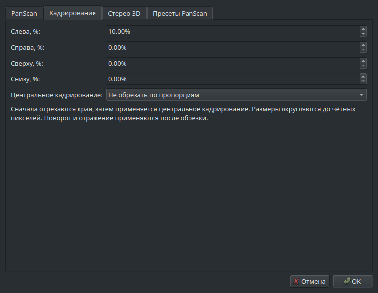
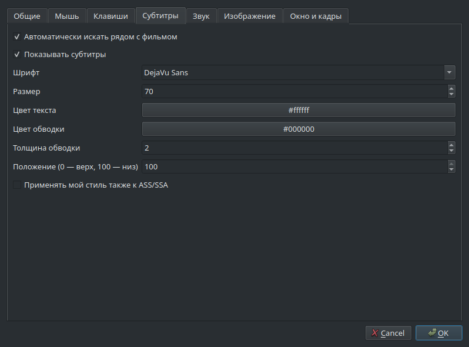
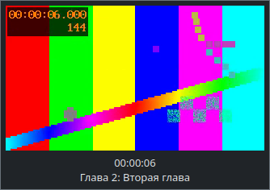

FoxicMP Qt 0.1.52: Wayland-safe fullscreen/geometry requests and requestActivate fallback; automatic ICC remains X11/colord-only.
# FoxicMP Qt Linux: состояние разработки

Текущая нативная сборка: **0.1.64 development preview**, Linux Mint 22.x x64.

0.1.48 добавляет веб-пульт в доверенной локальной сети: явное включение,
выбор частного IPv4-адреса, код доступа и проверка Host/Origin.
Включается в «Настройки → Проигрыватель → Web-интерфейс»; сетевой доступ по умолчанию выключен.

0.1.46 устраняет воспроизведённую гонку быстрых повторных подключений
внешних дорожек: команды выполняются последовательно, уже загруженные файлы
используются повторно. Ошибка файла освобождает очередь, смена источника
отменяет ожидающие подключения. Сценарий сохранённого M3U8 проверяется отдельно.

0.1.37 добавляет сброс настроек с копией INI и выбором сохранения библиотеки (подробности в конце).

0.1.36 добавляет «Настройки → Разное → Управление настройками…»: экспорт в
`.foxicmp-profile`, копии в `Backups` текущего профиля и импорт в новую папку.
Можно открыть восстановленный профиль отдельным окном; для постоянного запуска
используйте `--profile /путь/к/профилю` в ярлыке. Импорт не заменяет текущий INI.

Сохраняются типы настроек Qt, плейлисты/вкладки, история, позиции и избранное.
Выбранные изображения, внешний перевод и ручной ICC копируются в `Assets`;
`Subtitles/Edits` переносится с сохранением структуры; ссылки на эти правки
в плейлистах перепривязываются к новой папке. Внешние субтитры сохраняют прежние
пути. Отсутствующий выбранный
ресурс останавливает экспорт с указанием пути. Медиа, снимки, извлечённые
субтитры, кэш, генерируемые GLSL, программы и старые копии не входят в архив.
Пути к медиа остаются прежними: относительные пути требуют такой же структуры
медиа рядом с новым профилем. Системные MIME-ассоциации и их журнал отката не
переносятся; автоматическая регистрация импортированного профиля выключена.

Формат JSON версии 1: SHA-256 каждого файла, строгая проверка относительных путей,
до 2048 файлов, 8 МиБ на файл и 32 МиБ данных (архив до 48 МиБ).
Контрольные суммы обнаруживают повреждение, но не подтверждают автора архива.
Импорт проверяет весь архив до записи, собирает профиль во временной папке
и атомарно создаёт конечную папку без замены существующего пути. Символические
ссылки в переносимых пользовательских файлах отклоняются. Резервные копии
создаются вручную и автоматически не удаляются. Архив содержит историю,
избранное и сохранённые URL; передавайте его только осознанно.

0.1.35 исправляет перезапуск аудиодекодера при смене AC3 bitstream ↔ PCM
и параметров декодирования на паузе. Раньше дорожка выключалась и включалась
двумя отдельными обращениями, а фильтры применялись уже после перезапуска.
Повторные переключения могли оставлять декодер без выходных параметров;
новый тест также обнаружил сдвиг позиции 0,672 → 0,736 секунды на паузе.

Теперь все параметры фильтров/выхода устанавливаются до перезапуска.
Возврат выбранной дорожки выполняется одной последовательностью команд
libmpv; для источника с перемоткой восстанавливается запомненная позиция.
Пауза не снимается, выбранная дорожка/файл сохраняются. Уже выключенное аудио
не включается. Отложенных Qt-таймеров для перезапуска нет, поэтому смена
файла не получает запоздалый seek от предыдущего источника. Время команды
записывается десятичным числом: парсер mpv не принимает экспоненциальный вид.

Добавлена проверка повторных циклов для отдельного AC3 и MKV с видео/AC3,
сохранения позиции/паузы, быстрых последовательных настроек, смены файла и
выключенного аудио. Сравнение позиции допускает один AC3-пакет: менее 40 мс.
Это проверка программного перехода и данных IEC 61937; физический ресивер,
HDMI/S/PDIF, фактическая задержка и бесшовность вывода требуют проверки
на оборудовании. Для неперематываемого потока восстановить прошлую позицию
невозможно; точность позиции в live-источнике этим тестом не подтверждена.
Установленная версия 0.1.26 и личный профиль не обновляются.

0.1.34 продолжает пункт 17: **форматы и ассоциации Linux**.
Меню «Вид» → «Форматы и ассоциации Linux…», также кнопка в общих настройках.
Поиск по MIME/расширениям, наборы «Все видео», «Всё аудио», «Плейлисты».
Типы берутся из MIME-базы системы; один MIME может охватывать несколько
расширений. Это регистрация типов, а не обещание декодировать любой кодек.

«Зарегистрировать плеер» обновляет «Открыть с помощью» для текущей программы
и папки профиля, включая `--profile`; само по себе не назначает плеер основным.
«Назначить отмеченные» меняет только выбранные пользовательские defaults в
`$XDG_CONFIG_HOME/mimeapps.list` (обычно `~/.config/mimeapps.list`). Остальные
типы и разделы сохраняются; существующие приложения остаются в списке
fallback. Удаляется запрет именно FoxicMP из Removed Associations выбранного
типа. Изменения по кнопкам применяются сразу, закрытие окна их не отменяет.

«Откатить мои назначения» использует журнал в профиле FoxicMP и возвращает
прежние значения только там, где с момента назначения они не менялись.
Переезд профиля к другому пользователю/файлу ассоциаций блокирует такой откат.
Откат не удаляет ярлык плеера. Удаление пункта Nemo сохраняет ярлык, если
найдены ссылки на него в ассоциациях. Регистрация текущей копии заменяет
одноимённый глобальный пункт FoxicMP другой копии; независимых глобальных
ассоциаций на каждую папку профиля пока нет.

Таблица показывает первый пункт пользовательского файла. Desktop-specific
настройки могут иметь приоритет: «Проверить в системе» запрашивает действующее
назначение выделенной строки через `gio mime`, не открывая медиафайл.
Проверка асинхронна, с пределом 3 секунды и выводом до 64 КиБ. Требуется
`gio` из `libglib2.0-bin`. Системные ассоциации меняются только по кнопке,
проверка меню при старте исправляет пути, но не переназначает defaults.
Папки, URL-схемы, автозапуск/меню дисков не перехватываются.
Реальные Nemo/Cinnamon/Wayland требуют проверки на целевом рабочем столе.
Установленный плеер 0.1.26 и его профиль не обновляются.

0.1.33 начинает пункт 17: **запуск, передача файлов и системный трей**.
В меню «Вид» → «Запуск и системный трей…» включаются повторное использование
первого окна текущего профиля, активация при передаче, значок, скрытие при
закрытии/сворачивании. По умолчанию сохраняются отдельные окна, трей выключен.
Alt+X и «Выход», включая MPRIS, всегда завершают приложение. При отсутствии
или исчезновении трея окно остаётся доступным либо возвращается на экран.

CLI: `--reuse-instance` передаёт запрос первому зарегистрированному окну,
`--enqueue` добавляет файлы без смены воспроизведения (подразумевает reuse),
`--new-instance` открывает отдельное окно; `--no-activate` не показывает
существующее окно. Относительные пути вычисляются в каталоге отправителя.
`--profile <каталог>` выбирает папку настроек/истории/плейлистов; по умолчанию
они по-прежнему находятся рядом с программой. Разные папки профиля независимы,
символические ссылки на одну папку считаются одним профилем. Независимые окна
одного профиля используют общие настройки. При закрытии первого окна прочие
автоматически не становятся получателями: следующий запуск регистрирует новое.
Служебные сокет и блокировка временные, в runtime-каталоге пользователя;
личные настройки там не сохраняются. Help/version не создают профиль.

Это первая часть пункта 17. Ассоциации/плеер по умолчанию, экспорт/сброс
профиля, обслуживание, веб-управление и остальные CLI-команды ещё впереди.
Физический трей и ограничения активации окон в Cinnamon/Wayland требуют
проверки на рабочем столе. Установленная версия 0.1.26 не заменяется.

0.1.32 реализует пункт 16 для поддержанных источников: Ctrl+Alt+I → свойства
текущего источника, таблица дорожек, теги/JSON/диагностика и MediaInfo/FFprobe.
Ctrl+F5/F5/команда копирования — снимок с диалогом/быстро/в буфер, отдельная область с OSD.
Формат/качество, настройки и лист миниатюр выбранной внутренней дорожки,
побайтовая копия файла с прогрессом/отменой и атомарной записью. Миниатюры и
копирование — только готовые локальные файлы; сетевые/диски/progressive
исключены. Пауза и позиция не меняются. 26/26 CTest в обоих режимах, actual
Software fallback. Физический GPU/ICC/HDR и Wayland этим не подтверждены.
Установленная 0.1.26 и личный INI не перезаписывались. Далее пункт 17.
[Протокол свойств/сохранения](QtLinuxMediaExportsValidation-2026-10-16.txt),
[манифест 0.1.32](QtLinuxPackage-0.1.32-2026-10-16.json).


0.1.31 добавляет автоматический ICC текущего экрана в X11 через colord.
Ctrl+Alt+V → «Видео — ICC-профиль» → источник «Автоматически». Точное имя
экрана, действующий профиль по умолчанию с учётом калибровки, асинхронные
запросы с дедлайном и отбрасыванием старых ответов. Смена экрана/назначения/
содержимого обновляет профиль; отсутствие снимает ICC. Копии переносимы,
ручной путь сохраняется. Defaults по-прежнему ICC off/manual. Все 25 наборов проверены
в двух режимах (ICC повторно после исправления baseline теста), actual Software fallback; два ICC, Qt screen lookup, 5-sec
polling, Cancel/reset/timeout/pause проверены. Установленную 0.1.26 не обновляли.
Для X11 программная часть пункта 15 реализована в описанных границах;
физический GPU/мониторы, Wayland и расширенный GLSL importer остаются.
Далее пункт 16 — свойства, диагностика и сохранение.
[Протокол автоматического ICC](QtLinuxSystemIccValidation-2026-10-16.txt),
[манифест 0.1.31](QtLinuxPackage-0.1.31-2026-10-16.json).


0.1.30 продолжает пункт 15: Ctrl+Alt+V → управляемая GLSL-цепочка,
редактор, порядок, галочки, MAIN до масштаба и SCALED после. До 16 × 64 КиБ,
четыре шаблона, отдельная проверка компиляции GL3.3, переносимые файлы и отмена.
Ctrl+Alt+G → nonmodal статистика Qt render/native passes, JSON/reset baselines,
визуальный moving-line Qt pattern без остановки видео. 24/24 CTest в обоих
режимах, actual Software fallback; GLSL pixels отдельно проверены offscreen
Mesa llvmpipe. Native GPU shader/VSync/tearing этим не подтверждены. Редактор
одного hook не поддерживает произвольные multi-pass/compute/HLSL файлы.
Установленная 0.1.26 и личный INI не перезаписывались. Автовыбор ICC для мониторов и
физические GPU/экранные проверки остаются.
[Протокол шейдеров/статистики](QtLinuxShadersValidation-2026-10-16.txt),
[манифест 0.1.30](QtLinuxPackage-0.1.30-2026-10-16.json).


0.1.29 продолжает пункт 15: Ctrl+Alt+V → «Видео — ICC-профиль» и
«Видео — синхронизация». Ручной RGB ICC импортируется после OK в переносимую
папку ColorProfiles, четыре intent, LUT disk cache выключен. Display-resample/
tempo/vdrop, Qt VSync после перезапуска, частота из Qt/вручную, пределы
коррекции и temporal interpolation. При Software, сворачивании, VSync0 или
bitstream временно audio без потери выбора. По умолчанию ICC off/audio/VSync1.
23/23 CTest в двух режимах, actual Software fallback, ICC portable/cancel/reset
и native A/V clock проверены; физический GPU/ICC/VBlank не подтверждены.
Установленную 0.1.26 и личный INI эта задача не перезаписывала.
Автопрофиль ОС/per-monitor остаётся. Далее шейдеры/редактор и статистика.
[Протокол ICC/синхронизации](QtLinuxDisplayValidation-2026-10-16.txt),
[манифест 0.1.29](QtLinuxPackage-0.1.29-2026-10-16.json).


0.1.28 продолжает пункт 15: Ctrl+Alt+V → «Видео — цвет и точность».
Software RGBX 8/16 бит, OpenGL range/FBO/dither/primaries/transfer/tone mapping,
общие оттенок/гамма для изображения и превью. Новые значения по умолчанию
сохраняют прежнее поведение. Проверены реальные уровни 10-битного градиента,
цветные/серые патчи против FFmpeg, Cancel/OK/независимые сбросы и сохранение
настроек. 22/22 CTest в двух режимах (фактически Software fallback), архив
проверен. Принятие GPU-настроек не подтверждает цвет на физическом GPU.
16 бит — точность буфера Software, не монитора; конечная OpenGL surface RGBA8.
Установленную 0.1.26 не обновляли, пользовательский INI не перезаписывали;
параллельно открытый плеер сохранял свой профиль. Далее ICC, синхронизация/VSync,
шейдеры/редактор и расширенная статистика.
[Протокол цвета](QtLinuxColorValidation-2026-10-16.txt),
[манифест и SHA-256 0.1.28](QtLinuxPackage-0.1.28-2026-10-16.json).


0.1.27 начинает пункт 15: Ctrl+Alt+V → масштабирование Software/OpenGL,
деинтерлейсинг, аппаратное декодирование по кодекам и параметры CPU-декодера.
Defaults сохраняют прежнее поведение; master ускорения синхронизирован с
общими настройками. Проверены реальные software pixels и чересстрочный
источник, Cancel/OK/Reset, пауза/продолжение. 22/22 CTest в двух режимах,
фактически Software fallback, архив проверен; GPU и ускорители ещё требуют
физической проверки. Установленная 0.1.26 и профиль не менялись. Остались
цвет/точность, синхронизация, шейдеры и расширенная статистика пункта 15.
[Протокол 0.1.27](QtLinuxVideoOutputValidation-2026-10-16.txt),
[манифест и SHA-256](QtLinuxPackage-0.1.27-2026-10-16.json).

0.1.26 реализует оставшиеся программные настройки пункта 14: Ctrl+Alt+A
→ «Звук — формат и декодер». PCM/частоты, Int24 в Int32, AC-3/DTS/DTS-HD/
E-AC-3/TrueHD passthrough, потоки/DRC/downmix/preferred decoder. DSP/dual/скорость
временно включают PCM, сохраняя bitstream-настройки. Проверены WAV-сэмплы,
IEC 61937 с исходным AC-3 payload, сброс/пауза/резерв/Cancel/OK.
21/21 CTest в двух режимах (фактически Software fallback), архив проверен,
установленный профиль не менялся. Физические HDMI/S/PDIF, ресиверы, DRC на
метаданных и A/V-задержки требуют проверки. Следующий — пункт 15, видеовывод.
[Протокол 0.1.26](QtLinuxAudioEncodingValidation-2026-10-16.txt),
[манифест и SHA-256](QtLinuxPackage-0.1.26-2026-10-16.json).

0.1.25 продолжает пункт 14: Ctrl+Alt+A → «Звук — фильтры», цепочка FFmpeg
перед limiter, встроенные/свои пресеты, импорт/экспорт JSON, проверка ошибок.
По умолчанию выключена, Cancel не сохраняет изменения, ошибочный включённый
граф из INI пропускается. Проверены реальные PCM, применение на паузе, оба
диалога, пресеты и JSON. 20/20 CTest в двух режимах (фактически Software
fallback), архив проверен; установленный профиль не менялся. Остались форматы
PCM и bitstream/декодер, физическая A/V-задержка требует проверки.
[Протокол 0.1.25](QtLinuxAudioFiltersValidation-2026-10-15.txt),
[манифест и SHA-256](QtLinuxPackage-0.1.25-2026-10-15.json).

0.1.24 продолжает пункт 14: внешний звук — поиск по имени/папкам/расширениям,
приоритет с сохранением ручного и запомненного выбора; два выхода PCM через
PulseAudio/PipeWire. Ctrl+Alt+A → «Звук — файлы и выходы». По умолчанию новые
функции выключены. Проверены сигнал на двух мониторах, потеря/возврат и очистка
временного маршрута. 20/20 CTest в двух режимах, фактически Software fallback,
архив проверен, установленный профиль не менялся. Остались фильтры/пресеты,
форматы PCM и bitstream/декодер; физическая синхронизация ещё не проверена.
[Протокол 0.1.24](QtLinuxAudioRoutingValidation-2026-10-15.txt),
[манифест и SHA-256](QtLinuxPackage-0.1.24-2026-10-15.json).

0.1.23 начинает пункт 14: Ctrl+Alt+A — обработка, нормализация и микшер
звука. Усиление/стереобаланс, маршрутизация, limiter и ReplayGain; параметры
normalizer, вклады центра/тылов/LFE и раскладки. Измерены реальные float PCM
сэмплы libmpv; 18/18 CTest в двух режимах, фактически Software fallback,
архив проверен. Новые настройки нейтральны по умолчанию, профиль не менялся.
По итогам 0.1.23 оставались второй выход, внешнее аудио, фильтры/пресеты,
форматы PCM и bitstream/декодер; физический тракт/A/V с DSP требуют проверки.
[Протокол 0.1.23](QtLinuxAudioProcessingValidation-2026-10-15.txt),
[манифест и SHA-256](QtLinuxPackage-0.1.23-2026-10-15.json).

0.1.22 завершает программную часть пункта 13: рендер и совместимость
субтитров через Ctrl+Alt+T. Шрифты, формирование текста, масштаб по окну,
VSFilter, коррекция времени и DVD/PGS. Кэши автоматические; очистка текстовых
реплик при перемотке для проблемных MKV выключена по умолчанию. Размера
очереди/рендереров Classic в API libmpv нет. Проверены реальные пиксели,
пауза/перемотки и обе внешние дорожки; 17/17 CTest в двух режимах (фактически
Software fallback), архив проверен. Установленный профиль не менялся.
Следующий пункт 14 — расширенный звук.
[Протокол 0.1.22](QtLinuxSubtitleRenderValidation-2026-10-15.txt),
[манифест и SHA-256](QtLinuxPackage-0.1.22-2026-10-15.json).

0.1.21 продолжает пункт 13: Ctrl+Alt+T — размещение и оформление субтитров.
Выравнивание, отступы, интервалы, тень/фон, цвета/прозрачность, жирный/курсив;
масштабы X/Y, угол и точная позиция X для SRT через явную ASS-копию в редакторе.
Авторский ASS сохраняется без включённой замены стиля. Параметры копии
обновляются после OK; исходник не меняется. 16/16 CTest в двух режимах,
геометрия/цвета проверены по пикселям, архив проверен. Установленный профиль
не менялся. Далее в пункте 13 — настройки рендера и буферизации субтитров.
[Протокол 0.1.21](QtLinuxSubtitleStyleValidation-2026-10-15.txt),
[манифест пакета и SHA-256](QtLinuxPackage-0.1.21-2026-10-15.json).


0.1.20 начинает пункт 13: редактор реплик и синхронизация по двум точкам,
SRT/ASS/SSA/простой VTT, применение исправленной копии, поиск и перечитывание
файлов, кодировки, предпочтение внешних/запрет встроенных, реплика в буфер.
Ctrl+Alt+R открывает редактор выбранной текстовой дорожки; Ctrl+Alt+PgUp/PgDown
переходит по репликам. Встроенный текст локального файла извлекается FFmpeg
в SRT без оформления. 15/15 CTest в двух режимах, архив проверен.
Установленный профиль не менялся. Далее в пункте 13 — расширенное оформление
и рендер/буферизация субтитров; пункт 14 ещё не начинался.
[Протокол 0.1.20](QtLinuxSubtitleValidation-2026-10-15.txt),
[манифест пакета и SHA-256](QtLinuxPackage-0.1.20-2026-10-15.json).


0.1.19 реализует программную часть пункта 12: независимые размеры и смещение,
обрезка краёв/пропорций, повороты/отражения, пресеты и стереораскладки со сменой
глаз. Ctrl+Alt+P открывает настройки. Запоминание между запусками включается
отдельно. 14/14 CTest в двух режимах; архив и команды stripped-плеера проверены.
Физический стереоэкран/GPU/Wayland требуют проверки; MVC и затворные очки
не реализованы. Установленный профиль не менялся. Далее — пункт 13, субтитры.
[Протокол 0.1.19](QtLinuxTransformValidation-2026-10-15.txt),
[манифест пакета и SHA-256](QtLinuxPackage-0.1.19-2026-10-15.json).





0.1.18 реализует программную часть пункта 11: команды дорожек/субтитров/
задержек и информации, отдельные назначения мыши для окна/полного экрана,
Ctrl/Shift, удержание левой с возвратом скорости и ускорение перемотки клавишей.
Есть последний файл по щелчку, boss key и MPRIS/команды сеансовой D-Bus.
13/13 CTest в двух режимах; архив и внешние команды stripped-приложения проверены.
Медиаклавиши вне окна направляет рабочий стол; физическая маршрутизация
пультов/клавиш, Cinnamon/Wayland и GPU остаётся проверкой на целевой машине.
Установленный профиль не менялся. Далее — пункт 12, Pan&Scan и преобразования.
[Протокол 0.1.18](QtLinuxInputValidation-2026-10-15.txt),
[манифест пакета и SHA-256](QtLinuxPackage-0.1.18-2026-10-15.json).


0.1.17 реализует программную часть пункта 10: темы, свои цвета, размер значков,
внешние логотип/PNG/BMP-панель и шрифт плейлиста. Включены русский/English и
внешние JSON-пакеты, язык применяется после перезапуска. OSD настраивает
шрифт/цвета/прозрачность/рамку/тень/сглаживание; имя, позиция и часы включаются
отдельно. Размер превью зависит от экрана, кэш ограничен 16 МиБ; онлайн-превью
HTTP(S)/веб-видео включается явно и не перематывает основной плеер.
Локальный HTTP и публичный VK проверены; текущий YouTube потребовал проверку
«не бот», выбранный Rutube не ответил вовремя. Такие ошибки оставляют обычное
воспроизведение неизменным. Настройки установленной пользовательской копии
не менялись. Полный набор команд и быстрых переключателей — следующий пункт 11.
[Протокол 0.1.17](QtLinuxAppearanceValidation-2026-10-15.txt),
[манифест пакета и SHA-256](QtLinuxPackage-0.1.17-2026-10-15.json).


0.1.16 реализует программную часть пункта 9: обычный/компактный/минимальный
режимы, отдельные панели, условия «поверх окон», рамки, прилипание и пропорции
окна. Стартовый размер окна/видеообласти, автомасштаб и возврат геометрии после
закрытия файла. Полный экран: монитор, старт, выход в конце очереди/по фокусу,
панели и задержка автоскрытия; восстановление геометрии и плейлиста. В X11
доступны объявленные xrandr режимы разрешения/частоты с возвратом исходного.
Физические мониторы, частоты, Wayland и разные оконные менеджеры требуют
отдельной проверки. Пропорции окна по видеокадру по умолчанию отключены,
сохранение размера и положения включено. Профиль установленной копии не менялся.
[Протокол 0.1.16](QtLinuxWindowValidation-2026-10-15.txt),
[манифест пакета и SHA-256](QtLinuxPackage-0.1.16-2026-10-15.json).


0.1.15 завершает пункт 8: отдельное окно истории Ctrl+H, поиск и категории,
название/путь/позиция, копирование, выборочное удаление и очистка отсутствующих
локальных источников. Избранное получило порядок, редактирование позиции,
открытие с начала и относительные пути файлов/образов/папок DVD/Blu-ray.
Добавлена вкладка параметров «История и избранное» с размерами истории/меню
и начальными параметрами новых закладок. Сохранены старые записи профиля;
удаление истории не удаляет файлы или избранное. Удалённая текущая позиция
не восстанавливается фоновым таймером до повторного открытия файла.
[Протокол 0.1.15](QtLinuxLibraryManagementValidation-2026-10-15.txt),
[манифест пакета и SHA-256](QtLinuxPackage-0.1.15-2026-10-15.json).


0.1.14 реализует пункт 7: локальные MPCPL/PLS/ASX/CUE, главы CUE и переходы
по ним, сохранение дорожек отдельно для каждой строки. Отдельные настройки
перехода при ошибке, пропуска уже ошибочных строк и неверных адресов импорта;
повреждённая очередь не зацикливается. Новая вкладка параметров «Плейлист»
управляет длительностью, полным экраном, дорожками и сохранением панели.
Панель закрепляется с четырёх сторон или выносится в окно. UTF-8/UTF-16,
Windows-1251, переносимые пути и атомарный импорт. Экспорт сохраняет обычные
поля и дополнительные данные FoxicMP; абсолютные пути Windows надо заменить
путями Linux. CUE импортирует локальные медиафайлы с главами, без CDDA-декодирования
смешанных BIN-образов. Настройки установленного плеера не менялись.
[Протокол 0.1.14](QtLinuxPlaylistFormatsValidation-2026-10-15.txt),
[манифест пакета и SHA-256](QtLinuxPackage-0.1.14-2026-10-15.json).


0.1.13 реализует пункт 6: именованные вкладки, просмотр папок, поиск,
длительность строк и видимой части списка. Сортировки по названию, пути,
датам, размеру и длительности; обратный порядок, перемешивание строк и
восстановление исходного порядка после перезапуска. Переключение вкладки
сохраняет воспроизведение и автопереход в прежней очереди. Есть буфер обмена,
удаление отсутствующих записей, открытие папки и отдельная команда корзины
с подтверждением. MediaInfo используется при наличии, иначе окно явно
показывает FFprobe. Длительность локальных файлов читается асинхронно;
сетевые источники и устройства автоматически не опрашиваются.
[Протокол 0.1.13](QtLinuxPlaylistsValidation-2026-10-15.txt),
[манифест пакета и SHA-256](QtLinuxPackage-0.1.13-2026-10-15.json).


0.1.12 добавляет управление пунктом 4: A–B с точками на таймлайне и числом
проходов, ограниченный повтор файла/списка, возврат к началу на паузе,
шаги перемотки 1/5/20 секунд, ключевые кадры, шаги скорости и её сохранение
на текущую сессию. Пауза при сворачивании применяется к видео и сохраняет
ручную паузу. Отрезки progressive ограничены одним доступным диапазоном кэша;
для них шаги перемотки остаются точными. Настройки — в отдельной вкладке
«Воспроизведение», рядом с программой.
[Протокол 0.1.12](QtLinuxPlaybackControlsValidation-2026-10-14.txt),
[манифест текущего пакета и SHA-256](QtLinuxPackage-0.1.12-2026-10-14.json).

В 0.1.11 добавлены DVD/Blu-ray/Audio CD и выбор ISO/папки/дисковода,
заголовки и угол DVD, главы, адаптеры V4L2/PulseAudio/ALSA и цифровое ТВ.
Поиск DVB-каналов через `dvbv5-scan` выполняется без блокировки интерфейса;
списки и начальные частоты хранятся рядом с программой. DVD-папка и ISO
проверяются созданными медиадисками, аудиовход — отдельным виртуальным
монитором PipeWire. DVD-меню движок не поддерживает; Blu-ray-меню и настройка
аналоговых частот не реализованы. Физические диски, камеры и тюнеры
остаются отдельной проверкой. Оставшаяся часть пункта 3 (меню дисков,
аналоговое ТВ и физические устройства) временно отложена пользователем;
пункты 4, 6, 7, 8 и программные части 9/10 завершены в 0.1.12–0.1.17; следующий — клавиатура, мышь и внешнее управление (пункт 11).
[Протокол дисков и устройств](QtLinuxDevicesValidation-2026-10-14.txt),
[манифест пакета дисков и устройств](QtLinuxPackage-0.1.11-2026-10-14.json).

В 0.1.7 реализован сетевой слой второго пункта плана. Веб-адреса открываются через yt-dlp/libmpv;
настраиваются качество, кодеки, HDR/SDR, язык, битрейт, User-Agent и тайм-аут.
Онлайн-плейлист загружается асинхронно и не меняет очередь при ошибке.
Ace Stream, magnet и TorrServer преобразуются в запросы к настраиваемым локальным
сервисам, а исходный адрес остаётся в профиле. Реальный публичный YouTube-ролик
успешно воспроизведён. Интерфейс Harvester остаётся отключён по принятому ранее
решению. В 0.1.8 добавлены Linux provider и экспериментальный reader локальных
fMP4 H.264/AAC: подтверждённые байты, общая буферизация, ограничение seek кэшем,
heartbeat, leases и отмена. В 0.1.9 добавлен обычный fast-start MP4/M4A с
индексом пакетов, времён и ключевых кадров; перед открытием файлов требуется
подтверждение сохранённого lease. В 0.1.10 выполнена программная матрица
временных смещений и A/V, испытаны публичные YouTube, Rutube HLS и VK.
Classic Windows и его настройки не изменяются. Исходники Qt находятся в `qt/`.

| Этап согласованного плана | Реализовано | Следующая проверка |
|---|---|---|
| Каркас | C++17, Qt 6 Widgets, CMake; общий логотип, тёмная тема | Визуальная проверка разных DPI и соответствия Classic |
| Воспроизведение | libmpv Render API; файлы, drag-and-drop, пауза, стоп, seek, громкость, mute, полный экран | Реальное аппаратное декодирование, длительные сеансы |
| Элементы FoxicMP | Общая нижняя панель, линии глав RGB(94,99,104), подсказки/переходы, дорожки, SRT/ASS, задержки, скорость, плейлист | Дополнительные настройки Classic и пользовательские сценарии |
| Автономный профиль | FoxicMPQt.ini рядом с программой; громкость/тема из упакованного профиля Classic; позиции, плейлист, окно, языки | Выборочное расширение соответствий настроек |
| Mint | Предложение при первом запуске; desktop/Nemo, MIME-типы и расширения, проверка пути после перемещения | Ручная проверка меню Nemo на разных версиях Cinnamon |
| Проверки/пакет | Генератор медиа, QtTest, portable tar.gz, SHA-256; workflow Linux | Выполнение workflow на GitHub, реальное оборудование, Wayland/HiDPI |

## Принятый дальнейший план

[Полный план сближения с Classic](LinuxParityPlan.md). Порядок пользователя:
5 → 1 → 2 → 3 → 4 → 6–17. Пункты 5 и 1, программная часть пункта 2 завершены.
Пункты 4, 6, 7, 8 и программные части 9/10 завершены в 0.1.12–0.1.17; следующий — пункт 11, клавиатура, мышь и внешнее управление.
Остаток пункта 3 отложен.
Проверка физического оборудования
и установленных Ace Stream/TorrServer остаётся отдельной внешней задачей.

## Субтитры, кадры, звук и окно 0.1.4

Добавлены автопоиск соседних субтитров, шрифт, размер, цвет текста и обводки,
толщина обводки, положение, видимость и явное переопределение ASS/SSA.
По умолчанию авторские стили ASS/SSA сохраняются.

OSD показывает паузу, громкость/mute, скорость, позицию после перемотки
и результат снимка. Ctrl+F5 сохраняет PNG в разрешении исходного видео,
с субтитрами или без них. Превью локального файла на таймлайне извлекается
отдельным ffmpeg-процессом: задержка 180 мс, ограничение декодирования 3,5 с,
кэш 32 кадров в памяти. Новое наведение отменяет устаревший запрос;
основное воспроизведение не перематывается. Нужен установленный ffmpeg.

Ctrl+T переключает режим поверх окон, Ctrl+B — рамку. Без рамки окно
перемещается через Alt + левую кнопку по видео. Сохранение геометрии,
оставшееся время, OSD и превью включаются независимо. Добавлены выбор
аудиоустройства, mono/stereo/5.1/7.1, динамическая нормализация, яркость,
контраст, насыщенность и поворот 0/90/180/270°. Профиль хранится рядом
с программой; настройки Classic не изменяются.





## Плейлист, история и избранное 0.1.3

Плейлист поддерживает добавление без замены, множественное удаление, кнопки
перестановки и drag-and-drop; текущий файл отслеживается по идентификатору
записи, а не по старому номеру строки. Enter запускает выделенный файл,
Delete удаляет записи из списка, стрелки выбирают строки. Файлы на диске
не удаляются. При удалении текущей записи воспроизведение останавливается.
Список и текущая строка сохраняются; при запуске воспроизведение не начинается.

Есть повтор текущего файла/всего списка и случайный обход без повторов внутри
цикла. Кнопка «Назад» возвращает по истории случайного обхода. Изменение
состава списка начинает новый обход. M3U8 сохраняется атомарно с относительными
путями; импорт UTF-8 M3U/M3U8 поддерживает локальные пути и file://, отклоняет
онлайн-адреса. Ошибка импорта не заменяет текущий список.

История содержит до 50 успешно открытых файлов; неудачные открытия не добавляются.
Запись истории и восстановление позиции включаются независимо. Очистка истории
удаляет сохранённые позиции, сохраняя избранное и параметры записи.

Команда «Добавить в избранное…» добавляет именованную закладку с позицией. Избранное открывается с этой
позиции независимо от настройки обычного восстановления; существующий плейлист
сохраняется. Менеджер позволяет открыть, переименовать и удалить закладку.
История и избранное хранятся только в профиле рядом с программой.

## Интерфейс и управление 0.1.2

Кнопки используют рисованные значки с вариантами для HiDPI; объединённая
нижняя панель получила градиент, логотип отображается на чёрном фоне.
Главное меню по умолчанию скрыто, как в сохранённом профиле Classic;
Ctrl+0 и контекстное меню возвращают его. Настройка сохраняется в профиле Qt.

Команды панели, меню, правой кнопки и клавиатуры используют одни QAction.
Добавлены Ctrl+G (секунды, ММ:СС, ЧЧ:ММ:СС.мс с проверкой длительности),
Ctrl+←/→ (покадровый просмотр), Alt+1/2/3 (размер окна), Alt+4 (вписать),
масштаб изображения, заполнение с обрезкой и пропорции исходные/4:3/16:9/2.35:1.
Размер окна ограничивается доступным экраном и минимальным размером интерфейса.

В параметрах появились вкладки клавиш и мыши. Привязки сохраняются рядом
с программой, конфликты и неоднозначные префиксы сочетаний отклоняются;
есть возврат стандартных клавиш. Щелчок ставит паузу, двойной щелчок
переключает полный экран без лишней паузы, колесо меняет громкость.
Эти действия мыши можно отключить по отдельности.

Полноэкранная панель и курсор скрываются через 2,5 секунды бездействия;
движение мыши возвращает их. Открытые меню, диалоги и наведение на панель
удерживают её видимой. При выходе восстанавливается панель, главное меню
в соответствии с профилем и видимость плейлиста до входа.

## Вывод изображения

Программный Render API остаётся режимом по умолчанию. В 0.1.1 добавлен
выбираемый **экспериментальный OpenGL-вывод** (Настройки → Параметры → Вывод изображения;
применяется при следующем запуске).

libmpv рисует в своём OpenGL-контексте и отдельной текстуре. Qt получает
готовую текстуру через собственный blitter; состояние движка отделено от
состояния композиции интерфейса. Запросы перерисовки объединяются таймером
16 мс, чтобы повторные события не перегружали очередь Qt. Если инициализация
OpenGL недоступна или контекст не появляется за 2,5 секунды, плеер переходит на программный режим и сохраняет
запрошенное открытие файла. Выбранная настройка при этом не переписывается.

Чтобы рендер не блокировал интерфейс ожиданием момента презентации,
OpenGL использует `video-timing-offset=0` и отключённое ожидание целевого
времени Render API. Физическая задержка и точность A/V на этом пути ещё не
измерены. С Mesa llvmpipe/softpipe выявлены повторяющиеся чёрные кадры, поэтому
на этих драйверах плеер автоматически использует программный вывод. Проверка
с запрошенным OpenGL здесь подтверждает переход на Software, а не работу GPU.
На физических видеокартах этот экспериментальный путь пока не проверен.

Аппаратное декодирование запрашивается через `hwdec=auto-copy` и может быть
отключено в настройках. Прямой импорт GPU-поверхностей, Wayland и физическая
видеокарта требуют отдельной проверки. Высокие разрешения/частоты кадров
пока не заявляются как проверенные.

## Границы первого выпуска

Это работающий предварительный плеер для локальных медиафайлов и сетевых источников,
а не полное соответствие всем возможностям Classic. DVD/Blu-ray-меню,
захват, сложные шейдеры и Windows-пакет Qt относятся к следующим этапам.
Прогрессивный режим Qt 0.1.10 экспериментальный и поддерживает локальные
раздельные fMP4 H.264/AAC и обычный fast-start MP4/M4A с известной длиной.
Метаданные в конце MP4 не поддерживаются; измерение A/V ещё не завершено.
Отключённая интеграция интерфейса Harvester сохраняется по принятому решению.

Qt и libmpv поставляются системой. `mint-meta-codecs` указан в инструкции
Mint как дополнительный набор системных кодеков, а не как подключаемый
напрямую к libmpv пакет.

## Проверка 0.1.10 — A/V и публичные progressive-источники

Прошли 20 сценариев с обычным MP4 и fMP4: baseline/progressive, смещения звука
0/±70/±240 мс, общий origin +1 секунда. Измерены 172 пары вспышка/импульс
после старта, пополнения буфера и перемотки. Максимальный консервативный
интервал ошибки программного вывода — **51,82 мс**, цель 100 мс. Из программного
renderer убрано блокирующее ожидание кадра на UI-потоке.

Публичные YouTube, Rutube HLS и VK прошли реальную загрузку, просмотр до complete,
seek в удержанном кэше и сборку FFmpeg. Финальная сборка дополнительно прошла
YouTube и удаление временных дорожек после закрытия последнего reader.
Оба CTest-прогона — 5/5; GitHub workflow дополнен A/V-проверками.

Это завершает программную часть пункта 2. Физический экран/динамики,
GPU/Wayland и установленные Ace Stream/TorrServer требуют внешних испытаний.
[Подробный протокол](QtLinuxAvSourcesValidation-2026-10-14.txt),
[манифест архива и SHA-256](QtLinuxPackage-0.1.10-2026-10-14.json).

## Проверка 0.1.9 — обычный MP4 и защита временных файлов

Добавлен progressive-reader обычного fast-start MP4/M4A. Его индекс сверён с
FFprobe по 500 видеопакетам и 939 аудиопакетам: смещения, размеры и ключевые
кадры совпали точно, DTS/PTS и длительности — с допуском менее 2 мкс.
Проверены повреждённые индексы, неполный первый пакет, получение длительности
из видео и подтверждение сохранённого lease до открытия файлов.

Полный CTest прошёл 5/5 в обоих режимах вывода, Qt progressive — 19 проверок,
adapter/provider — 24 теста. Отдельная остановка записи обычного MP4 на минуту
прошла без ложного EOF. Для fMP4 и обычного MP4 отдельно проверены медленный
HTTP, начало просмотра до окончания загрузки и сборка FFmpeg при активном плеере.
Распакованный пакет воспроизвёл локальный файл и сохранил переносимый профиль.

Остаются полная матрица временных смещений, публичные progressive-источники и
измерение A/V. Пункт 2 продолжает выполняться.
[Протокол проверок](QtLinuxIndexedProgressiveValidation-2026-10-14.txt),
[манифест архива и SHA-256](QtLinuxPackage-0.1.9-2026-10-14.json).

## Проверка 0.1.8 — сеть и экспериментальный Linux progressive

Оба полных CTest-прогона прошли: 5/5 наборов в программном режиме и 5/5
при запросе OpenGL с переходом на Software в Mesa. С закреплённым yt-dlp
2026.08.19 прошли 23 теста adapter/provider и 9 проверок Qt progressive.
Отдельная 60-секундная остановка записи прошла без ложного EOF; после дописывания
просмотр возобновился. Полный локальный HTTP-путь подтвердил начало просмотра
до окончания загрузки, один запрос на дорожку и успешную сборку FFmpeg при
активном плеере. Распакованный бинарник воспроизвёл публичный YouTube-ролик
и сохранил 14 секунд позиции в соседнем профиле.

В архив включён отдельный командный adapter. Обычный MP4, матрица временных
смещений, реальные публичные progressive-источники и измерение A/V ещё требуют
работы. Пункт 2 остаётся активным.
[Протокол проверок](QtLinuxOnlineProgressiveValidation-2026-10-14.txt),
[манифест архива и SHA-256](QtLinuxPackage-0.1.8-2026-10-14.json).

## Проверка 0.1.4 — субтитры, кадры, звук и окно

Оба набора CTest после последних исправлений прошли: основной QtTest —
24 успешных проверки, отдельный тест интерфейса — 3; ошибок нет. Обычный
набор пропускает длительный прогон, который запускается отдельно.
Проверены реальная загрузка соседнего SRT и отключение поиска, стиль,
снимки в разрешении видео с субтитрами/без них и ошибка сохранения,
обесцвечивание кадра, аудиофильтр и выбор каналов, недоступное устройство,
отмена/кэш/поворот превью, неизменность позиции основного фильма,
отображение превью через таймлайн и его отключение, отмена настроек,
OSD/его выключение, оставшееся время, флаги и геометрия окна.

Три локальных фрагмента YouTube/Rutube/VK снова прошли проверки управления
и декодирования (5 проверок). Синтетический H.264 3840×2160/30 fps прошёл
открытие, вывод кадра и управление (3 проверки); плавность 4K на конкретной
видеокарте этим не подтверждена. Повторный запуск интерфейса с запрошенным
OpenGL подтверждает переход на Software в Mesa; работа физического GPU
по-прежнему не проверена.

Непрерывное воспроизведение 600 секунд прошло: 3 проверки без ошибок;
таймер интерфейса сработал 11974 раза, сворачивание не остановило позицию,
после восстановления появился цветной кадр. Внутренний `avsync` libmpv:
2028 выборок, максимальное абсолютное значение **4,80 мс**; аудиовывод
PipeWire. Это показатель часов движка, не измерение физической задержки
динамиков/экрана. Счётчик потерь декодера в последнем цикле — 0;
многочасовая стабильность и физическое оборудование остаются непроверенными.
Первый длинный прогон остановил штатный пятиминутный лимит QtTest;
повторный завершился с увеличенным лимитом.

Архив распакован отдельно: версия, четырёхсекундный запуск видео,
история в соседнем профиле и сохранение выбранных параметров проверены.
Профиль пользователя и история в архив не включены.
[Полный протокол](QtLinuxToolsValidation-2026-10-09.txt),
[манифест пакета](QtLinuxPackage-0.1.4-2026-10-09.json).

## Проверка 0.1.3 — плейлист, история и избранное

В изолированном Xvfb-дисплее на Mint 22.3: **21 проверка прошла, ошибок нет**.
Новые проверки покрывают добавление без замены, перестановку текущей записи,
удаление, Enter/Delete/стрелки, внешнее перетаскивание, повтор файла и списка
при EOF, случайный обход и возврат, восстановление текущей строки,
M3U8 с относительными путями после перемещения папки, BOM/CRLF/file://,
сохранение старого файла при ошибке экспорта, историю 50 файлов,
отсутствие ошибочных открытий в истории, открытие закладок при отключённом
восстановлении, переименование/удаление и независимую очистку истории.
[Протокол](QtLinuxLibraryValidation-2026-10-09.txt).
Интерфейс с запрошенным OpenGL и переходом на Software также проверен.
Архив после распаковки открыл M3U8 и сохранил успешно загруженный файл в
истории соседнего профиля; пользовательские данные в архив не включены.
[Пакет 0.1.3 и SHA-256](QtLinuxPackage-0.1.3-2026-10-09.json).
[Реальный скриншот плейлиста](images/foxicmp-qt-playlist.png).

## Проверка 0.1.2 — интерфейс и управление

В изолированном Xvfb-дисплее на Mint 22.3: **16 проверок прошли, ошибок нет**.
Проверены одиночный/двойной щелчок, колесо, отключение действий мыши,
покадровый просмотр, точный переход и отклонение времени вне файла,
масштаб, контекстное меню, размер окна, автоскрытие и восстановление панели,
конфликты клавиш, применение и восстановление привязки после перезапуска.
Минутный тест не повторялся: движок вывода не изменён в 0.1.2.
[Протокол](QtLinuxInterfaceValidation-2026-10-09.txt).
Интерфейс с запрошенным OpenGL и переходом на Software также проверен;
архив после распаковки прошёл проверку версии и четырёхсекундный запуск.
[Пакет 0.1.2 и SHA-256](QtLinuxPackage-0.1.2-2026-10-09.json).

## Проверка 0.1.1 — 9 октября 2026

Обычный программный вывод: **14 проверок прошли, ошибок нет**.
Запрошенный OpenGL с автоматическим переходом на Software: **14 проверок
прошли, ошибок нет**. В каждом наборе минутный тест пропущен и запускается
отдельно. Проверена загрузка файла, запрошенная до готовности рендера,
с переходом на Software через 2,5 секунды.
Минутный тест программного вывода также прошёл: воспроизведение, таймер
интерфейса и восстановление кадра после сворачивания. Повторная проверка
трёх локальных фрагментов YouTube/Rutube/VK: 5 тестов прошли, ошибок нет.
[Протокол вывода и запуска архива](QtLinuxOutputValidation-2026-10-09.txt).
[Пакет 0.1.1 и SHA-256](QtLinuxPackage-0.1.1-2026-10-09.json).

## Предыдущая проверка 0.1.0 — 9 октября 2026

Mint 22.3 x64, Qt 6.4.2, libmpv 0.37.0: **13 проверок прошли**, ошибок нет.
Проверены MP4/MKV/MOV/AVI/WebM, H.264/HEVC/VP9/AV1/MPEG-4,
AAC/MP3/Opus; пауза, seek, volume/mute/speed, восстановление после ошибки
открытия, главы и их цвет на всех строках таймлайна, две дорожки, SRT/ASS,
полный экран с реальным кадром после возврата, следующий файл,
сохранение профиля, перемещение пути интеграции и запуск desktop-ярлыка
с пробелами/кириллицей/специальными символами.

Также прошли проверки трёх локальных фрагментов ранее загруженных реальных
источников YouTube, Rutube и VK: видеокадр, декодирование звука, пауза,
перемотка и повторное открытие. Онлайн-сайты и прогрессивный протокол
этими проверками не проверялись.

[Протокол QtTest](QtLinuxValidation-2026-10-09.txt),
[реальные источники](QtLinuxRealSources-2026-10-09.txt).

Непрерывный цикл воспроизведения 60 секунд прошёл без ошибок движка.
Таймер интерфейса продолжал работать; сворачивание не остановило позицию,
после восстановления окна появился кадр.
[Протокол](QtLinuxContinuous-2026-10-09.txt). Это короткая проверка,
а не подтверждение многочасовой стабильности.
[Сборка и управление](../qt/README.md).

Основа API: [libmpv Render API](https://github.com/mpv-player/mpv/blob/v0.37.0/libmpv/render.h),
[пример и правила Nemo](https://github.com/linuxmint/nemo/blob/master/files/usr/share/nemo/actions/sample.nemo_action),
[Desktop Entry Exec](https://specifications.freedesktop.org/desktop-entry/latest/exec-variables.html).

Пакет после распаковки прошёл проверку версии и запуск с локальным видео.
Профиль и история в архив не включены.
[Манифест пакета и SHA-256](QtLinuxPackage-2026-10-09.json).


Проверка 0.1.33: OpenGL-запрос **27/27** (actual Software fallback);
Software **26/27**, повтор audio-encoding **1/1 успешно**.
Непостоянный сбой AC3/PCM на паузе зафиксирован в протоколе.
[Протокол запуска и трея](QtLinuxDesktopValidation-2026-10-16.txt),
[манифест 0.1.33](QtLinuxPackage-0.1.33-2026-10-16.json).


Проверка 0.1.34: **28/28 Software**; OpenGL-запрос **27/28** (actual Software fallback).
Повторы аудионабора: Software 4 успешных и 1 сбой, второй режим 5 успешных.
Непостоянный переход AC3/PCM на паузе остаётся нерешённым;
AssociationsTest **11/11** каждый. [Протокол](QtLinuxAssociationsValidation-2026-10-16.txt),
[манифест 0.1.34](QtLinuxPackage-0.1.34-2026-10-16.json).

Проверка 0.1.35: **28/28 CTest в обоих режимах**, actual Software fallback.
Аудионабор — **10 последовательных прогонов на режим**, всего **4000 переходов**
AC3/PCM с сохранением paused position <40 мс. [Протокол](QtLinuxAudioRestartValidation-2026-10-16.txt),
[манифест 0.1.35](QtLinuxPackage-0.1.35-2026-10-16.json).


Проверка 0.1.36: **29/29 CTest в обоих режимах**, actual Software fallback.
ProfileArchiveTest: **20/20 каждый**. [Протокол](QtLinuxProfileValidation-2026-10-16.txt),
[манифест 0.1.36](QtLinuxPackage-0.1.36-2026-10-16.json).

## Сброс настроек — 0.1.37

В «Настройки → Разное → Управление настройками…» добавлен «Сброс настроек…».
После подтверждения окно закрывается штатно: сохраняются текущее положение и
плейлисты, прекращается воспроизведение. Затем создаётся точная копия INI в
`Backups/before-reset-*.ini`, а настройки атомарно заменяются значениями по
умолчанию. Плеер следует открыть снова. Кнопка по умолчанию — «Отмена».

По умолчанию сохраняются плейлисты/вкладки, история, позиции и избранное.
Снятая галочка очищает эти записи в новом INI. Медиа, изображения, ICC,
правки субтитров и старые копии не удаляются. Системные ассоциации не меняются,
их журнал отката остаётся; проверка регистрации при запуске выключается.
Исчезнувший внешний ресурс не мешает сбросу, поскольку копируется INI,
а ресурсы не переносятся и не удаляются.

Для возврата точных прежних настроек закройте все окна данного профиля и
скопируйте нужный `before-reset-*.ini` на место `FoxicMPQt.ini`. Это обычный
INI, не архив `.foxicmp-profile`; он относится к прежней папке ресурсов.
Копия содержит сохранённые URL/историю и не шифруется.

Экземпляры 0.1.37 держат общую блокировку профиля; сброс требует исключительной.
Другие окна того же профиля (включая канонический путь через ссылку) препятствуют
сбросу. Новое окно не открывается во время замены INI. Старые версии такой
блокировки не знают: перед сбросом закройте и их. Временный lease находится
рядом с IPC в runtime-каталоге; настройки остаются в папке профиля.
Недоступная копия, INI-ссылка/спецфайл или слишком большой INI отменяют сброс.
Для файлов запрашиваются права0600; фактические права зависят от файловой системы.

Пункт17 продолжается: постоянное место/ярлык профиля, оформление заголовка,
обслуживание, веб и оставшиеся CLI. Физические устройства/дисковые меню/ТВ отложены.


Проверка0.1.37:Software29/29; requested OpenGL24+5/5послеперезапускаXvfb (исходный сбой сохранён); профиль30/30каждый; actual Software fallback. [Манифест](QtLinuxPackage-0.1.37-2026-10-16.json).

## Постоянный профиль и ярлык — 0.1.38

В «Настройки → Разное → Управление настройками…» есть раздел «Профиль при запуске».
Выберите существующую папку (допускается пустая), затем нажмите
«Использовать при обычном запуске». Текущее воспроизведение и INI не меняются:
новый выбор действует при следующем запуске без явного `--profile`.
«Профиль рядом с программой» возвращает обычный переносимый запуск.

Рядом с исполняемым файлом хранится только `FoxicMPQt.launch.json` версии1;
сам профиль остаётся в выбранной папке. Вложенный в папку программы профиль
записывается относительным путём и переносится вместе с программой; внешняя
папка — абсолютным. `--profile /папка` имеет приоритет; `--portable` игнорирует
сохранённый выбор. Эти параметры нельзя сочетать. `--help`/`--version` не
создают профиль и работают даже при повреждённом файле выбора.

Если выбранная папка исчезла или JSON повреждён, запуск останавливается с
понятным сообщением; папка не создаётся заново и другой INI не подставляется.
Для исправления запустите с `--portable` или `--profile` и сохраните новый выбор.
Выбор не переносит и не копирует старые настройки. Для переноса используйте
экспорт/импорт профиля; файл выбора запуска в такой архив не входит.

«Создать ярлык…» сохраняет отдельный `.desktop` с явным `--profile`.
Файл создаётся по новому имени без замены существующего файла/ссылки.
MIME/defaults/Nemo/старый системный ярлык эта кнопка не меняет. Расположение
ярлыка выбирается пользователем; файловый менеджер может потребовать разрешить
его запуск. В ярлыке абсолютные пути: после переноса программы или внешней
папки создайте его заново. Команда использует экранирование Desktop Entry,
а не оболочку, и поддерживает пробелы/Unicode/$/%/кавычки/обратные кавычки.

Пункт17 продолжается: заголовок окна, обслуживание/обновления/приоритет,
веб-управление и оставшиеся команды. Меню дисков/физические устройства/ТВ отложены.


[Проверки запуска профиля](QtLinuxProfileLaunchValidation-2026-10-16.txt).

Проверка0.1.38:30группвкаждомрежиме с повторами (Software19+1+10, OpenGL15+15; исходные сбои сохранены), запускпрофиля18/18, архив/reset30/30каждый; actual Software fallback. [Манифест](QtLinuxPackage-0.1.38-2026-10-16.json).

## Заголовок окна — 0.1.39

Откройте **Настройки плеера → Заголовок окна**. Доступны название ролика из
метаданных, имя файла, полный путь, только название плеера и собственный
шаблон. Для готовых вариантов отдельно включаются состояние и позиция с
длительностью. По умолчанию остаётся название ролика с суффиксом FoxicMP Qt.
При отсутствии метаданных используется имя файла; после остановки и закрытия
показываются название и версия плеера.

Шаблон поддерживает `{name}`, `{path}`, `{title}`, `{state}`, `{position}`,
`{duration}` и `{app}`. Пример:
`{title} [{state}] [{position} / {duration}] — {app}`.
В режиме шаблона флажки состояния и времени не применяются: размещение
этих полей задаёт сам шаблон. `{{` и `}}` выводят фигурные скобки;
неизвестные поля остаются текстом. Скобки и `%1` внутри названия ролика
не интерпретируются как команды шаблона. Пустой результат возвращает
обычный заголовок; длина ограничена 2048 символами, управляющие символы
заменяются пробелами.

Предпросмотр показывает текущий ролик на момент открытия настроек или
пример, если воспроизведение остановлено. OK применяет изменения сразу,
Cancel сохраняет прежний заголовок и настройки. Ключи `ui/titleMode`,
`ui/titleTemplate`, `ui/titleState`, `ui/titlePosition` хранятся в текущем
`FoxicMPQt.ini`, переносятся обычным экспортом профиля и удаляются при
сбросе настроек. Положение и размер окна эта вкладка не меняет.

Для сетевого `{path}` скрыты учётные данные, строка запроса и фрагмент URL.
Без известной длительности выводится `—`. Состояние переводится на выбранный
язык интерфейса. Системный заголовок виден при обычной рамке; режим без рамки
и полный экран сохраняют свои настройки.

Пункт 17 продолжается: обслуживание, проверка обновлений, приоритет процесса,
отчёт об ошибках, веб-управление и оставшиеся команды запуска. Дисковые меню,
аналоговое ТВ и физические устройства остаются отложенными.


Проверка 0.1.39: 31/31 групп Software, 8/8 затронутых групп при запросе OpenGL;
новые тесты заголовка 7/7 в обоих режимах, архив и настоящий X11-заголовок проверены.
[Манифест](QtLinuxPackage-0.1.39-2026-10-16.json), [проверка](QtLinuxWindowTitleValidation-2026-10-16.txt).

## Обслуживание и диагностика — 0.1.40

**Справка → Обслуживание и диагностика…** открывает отдельное окно.
**Справка → Проверить обновления Linux/Qt…** открывает его и сразу запускает
проверку. Обычное открытие окна и запуск плеера сеть не опрашивают.

Проверка вручную читает последние 100 выпусков официального репозитория
`LiberVixer/FoxicMP` через GitHub API. Подходящим считается опубликованный
пакет `FoxicMPQt-X.Y.Z-linux-x64.tar.gz`; Windows-пакеты и черновики
исключены. Предварительные Qt-выпуски включены по умолчанию; флажок можно
сохранить в профиле. Версии сравниваются численно. Если Linux-пакетов нет,
плеер сообщает об этом отдельно, а не объявляет текущую версию последней.
Проверка ограничена 2 МиБ и 15 секундами; ошибки HTTP, сети и некорректный
ответ отображаются явно. Перенаправления не выполняются. Кнопка страницы
выпуска доступна только для более новой Qt-сборки и открывает проверенную
HTTPS-страницу этого репозитория в браузере. Автоматической загрузки,
установки, фоновой проверки и передачи отчётов нет.

Приоритет: обычный `nice 0`, выше обычного `nice -5`, ниже обычного `nice 5`.
Кнопка «Сохранить параметры обслуживания» записывает выбор в текущий профиль;
приоритет применяется со следующего запуска к уже созданным потокам Qt
перед созданием потоков libmpv, которые наследуют его. Права администратора не запрашиваются. Без разрешения
на уменьшение nice Linux может отказать повышению или возврату к обычному
приоритету у процесса, запущенного с пониженным приоритетом. Окно показывает
текущее значение и ошибку начального применения. Действующий процесс из окна
настроек не перенастраивается; закрытие без сохранения оставляет профиль прежним.

Диагностический JSON содержит версию приложения/Qt/libmpv/FFmpeg/libass,
систему и backend Qt, запрошенный/фактический видеовывод, статистику рендера,
кодеки, параметры видео/аудио, текущую позицию/паузу и приоритет. Неизвестные
свойства libmpv остаются `null`. Снимок отчёта обновляется по кнопке;
воспроизведение и пауза не меняются. Доступны просмотр, копирование и
атомарное сохранение JSON в выбранный файл; по умолчанию предлагается папка
профиля. Символические ссылки и специальные файлы как цель отклоняются.

По умолчанию исключены путь источника/профиля, имена аудиоустройств,
последняя ошибка и исходный текст сообщений. Флажок «Включить пути, имена
устройств и последние сообщения движка» добавляет эти поля для подробного
отчёта. Перед отправкой можно просмотреть весь текст. Журнал содержит до
100 предупреждений/ошибок libmpv и ошибок команды, каждое до 2048 символов,
только в памяти текущего запуска. Это отчёт работающего плеера; перехвата
аварийного завершения, дампов и восстановления журнала после падения нет.
Полный отладочный вывод `FOXICMP_MPV_LOG` остаётся отдельной возможностью.

Ключи `maintenance/priority` и `maintenance/updatePreviews` находятся в
`FoxicMPQt.ini`; экспорт профиля переносит их, сброс возвращает defaults.
Установленная Linux-копия и её профиль не обновлялись. Windows-плеер и
отключённая интеграция Harvester не изменялись.

Пункт 17 продолжается: веб-управление и оставшиеся команды запуска.
Автоматические обновления/установка и crash dump не реализованы.
Дисковые меню, аналоговое ТВ и физические устройства остаются отложенными.


Проверка 0.1.40: 32/32 групп Software, 9/9 затронутых групп при запросе OpenGL;
обслуживание 8/8 в каждом режиме, настоящий GitHub, архив и nice потоков проверены.
[Манифест](QtLinuxPackage-0.1.40-2026-10-17.json), [протокол](QtLinuxMaintenanceValidation-2026-10-17.txt).

## Веб-управление — 0.1.41

**Настройки → Веб-управление…** открывает управление локальным HTTP-сервером.
По умолчанию он выключен. Выберите свободный порт 1024–65535 (стандартно
13579) и нажмите «Включить и сохранить». Затем откройте страницу кнопкой
«Открыть в браузере» или скопируйте ссылку. Сервер работает только на
`127.0.0.1`: управление с телефона/другого компьютера по сети пока не включено.

Пульт показывает название, состояние, позицию/длительность и очередь
(первые 500 записей). Доступны play/pause/stop, предыдущий/следующий файл,
абсолютная перемотка, громкость, mute и скорость. Применяются действующие
правила плеера, в том числе ограничения live/progressive и сохранение паузы
при переходах. Очередь показана для текущего проигрываемого списка; выбора
произвольной записи, удаления, открытия файлов/URL и команд завершения системы
в этом API нет. Страница на русском/английском обновляет состояние раз в секунду.

Для каждого запуска сервера создаётся случайный код 256 бит. Он передаётся
в браузер фрагментом ссылки `#код`, затем удаляется из адресной строки;
страница держит его только в памяти и отправляет API через Authorization Bearer.
Перезагрузка страницы требует заново открыть ссылку или ввести код из окна
плеера. Код не пишется в профиль, localStorage или cookie. При перезапуске
сервера/плеера старый код перестаёт работать. Кнопка «Выключить и сохранить»
закрывает сервер и активные соединения, отключая автозапуск с этим профилем.
Другие окна/профили требуют другого порта; занятый порт не перехватывается.
Закрытие диалога оставляет текущее состояние сервера, изменение числа порта
без кнопки включения в профиль не записывается.

HTTP API: `GET /api/state`, `POST /api/command` с JSON `{"command":"pause"}`;
для `seek`, `volume`, `rate` — числовое поле `value`. Ответ команды подтверждает
её принятие; состояние воспроизведения меняется асинхронно. Ошибки: 403 —
код/Host/Origin, 400 — формат/команда/значение, 409 — действие недоступно,
413 — слишком большой запрос. Разрешён только ограниченный список команд.
Проверяются Host и Origin, API требует код; CORS не включён. Лимит запроса
16 КиБ, одновременно до 8 соединений, время соединения 3 секунды. Chunked,
повторные заголовки, pipelining и путь к произвольному файлу не поддерживаются.
HTML/JS/CSS встроены в программу, внешние ресурсы не загружаются; текст
ролика/очереди вставляется через textContent. Ответы имеют no-store, nosniff,
Referrer-Policy и CSP. HTTP не предназначен для публикации через внешний прокси.

Профиль содержит только `web/enabled` и `web/port`. Экспорт переносит эти
параметры; сброс отключает сервер при следующем запуске. Отключённый MPRIS
не мешает веб-управлению. Установленная 0.1.40 и личный INI не заменяются.
Далее по пункту 17 — оставшиеся команды запуска. Дисковые меню, аналоговое
ТВ и физические устройства остаются отложенными.


Проверка 0.1.41: все 33 группы Software проверены с повтором window-title
(исходно 32/33 PASS; повтор 7/7), 10/10 групп при запросе OpenGL;
веб-тесты 9/9 в каждом режиме, браузер и архив проверены.
[Манифест](QtLinuxPackage-0.1.41-2026-10-17.json), [протокол](QtLinuxWebControlValidation-2026-10-17.txt).

## Расширенные команды запуска — 0.1.42

`--start` задаёт секунды или `ЧЧ:ММ:СС[.доли]` (также `ММ:СС`),
`--pause` открывает на паузе. Начальная позиция 0–604800 секунд;
нулевая позиция отменяет сохранённое продолжение для этого открытия.
`--volume 0..100`, `--rate 0.125..16`, `--audio-track ID` и
`--subtitle-track ID` выбирают параметры воспроизведения; ID 0 отключает
соответствующую дорожку. ID берётся из меню дорожек, а не из её номера в файле.
`--audio-file` / `--subtitle-file` подключают и выбирают читаемый локальный файл;
путь разрешается относительно папки вызывающей команды. Файл и ID одной
дорожки одновременно не допускаются. Ограничения прямых входов, кэша
прогрессивного просмотра и блокировки встроенных субтитров сохраняются.

`--fullscreen`, `--minimized`, `--normal` задают состояние окна (взаимоисключающие).
`--window-size 960x540` задаёт размер обычного окна с интерфейсом, а не видеокадра;
допустимо 320×200–16384×16384, фактический минимум ограничивает Qt.
`--window-position=-10,40` задаёт абсолютные координаты Qt, включая отрицательные.
Оконный менеджер/Wayland может ограничивать положение окна. Размер и положение
устанавливаются перед выбранным состоянием окна и повторяются после
автоматического размера по видео. Отдельные ключи запуска не сохраняются;
громкость, геометрия и выбор дорожек запоминаются обычными правилами профиля.
Скорость также переходит к следующему файлу, если в профиле включено
сохранение скорости между файлами; в остальных случаях она сбрасывается.

Примеры:

```sh
./foxicmp-qt --pause --start 00:01:30.5 --rate 1.25 --fullscreen "фильм.mkv"
./foxicmp-qt --reuse-instance --audio-file "звук.mka" --subtitle-file "текст.srt" "фильм.mkv"
./foxicmp-qt --profile /путь/к/профилю --command pause
./foxicmp-qt --profile /путь/к/профилю --start 120 --volume 35
```

`--command play|pause|toggle|stop|next|previous|mute` направляется первому
работающему окну выбранного профиля без активации. `mute` переключает звук.
Команда не объединяется с источниками или другими новыми параметрами.
Параметры воспроизведения без источника также направляются работающему окну;
при отсутствии окна команда завершается ошибкой без создания нового профиля.
Код 0 подтверждает доставку запроса, а не доступность операции: например,
следующего файла может не быть, а запрошенная позиция может отсутствовать в кэше.

С файлами, URL, папкой или плейлистом параметры относятся к первому открытому
источнику. Загрузка на паузе и начальная позиция передаются в libmpv до открытия;
остальные параметры применяются после загрузки дорожек. Следующий файл не
наследует разовые ключи. `--enqueue` не объединяется с новыми параметрами;
параметры воспроизведения при `--dvd` / `--bluray` / `--cdda` /
`--harvester-session` не принимаются (параметры окна допустимы).
Некорректные диапазоны, повторённые значения и несовместимые ключи
отклоняются до создания профиля и отправки запроса.

Это очередная часть пункта 17. Полного соответствия всех ключей Classic нет;
отдельные проверки оборудования, Wayland и длительных сеансов остаются.
Меню дисков, аналоговое ТВ и физические устройства отложены пользователем.

Проверка 0.1.42: 34/34 группы CTest Software и 11/11 затронутых групп
при запросе OpenGL; новые тесты 7/7 в каждом режиме, архив проверен.
[Манифест](QtLinuxPackage-0.1.42-2026-10-17.json), [протокол](QtLinuxLaunchOptionsValidation-2026-10-17.txt).

Установленная Linux-копия обновлена до 0.1.42 по постоянному указанию
пользователя; INI и личные файлы сохранены, резервная копия создана.

## Дополнительные команды запуска — 0.1.43

`--monitor primary`, `--monitor 1` или `--monitor "имя"` выбирают экран
для текущего окна. Номера начинаются с 1, имена и геометрия доступны через
`--list-monitors`. Выбор сохраняется на время жизни окна и используется при
последующем входе в полный экран; постоянная настройка монитора в INI
не заменяется. При переносе обычное окно центрируется на выбранном экране;
явные `--window-position` / `--window-size` применяются после выбора экрана.
Wayland и оконный менеджер могут ограничить позиционирование.

`--audio-device auto` или точное имя из `--list-audio-devices` выбирают
основное устройство libmpv. Выбор сохраняется как при выборе через меню,
а настройки второго выхода остаются прежними. Внутренние временные устройства
`pulse/foxicmp_dual_*` не принимаются и не перечисляются.

`--panscan fit|fill|wide|crop169|crop235` выбирает встроенный пресет,
`--panscan "saved:Кино"` — сохранённый пресет текущего профиля с точным именем.
Преобразования сохраняются по обычному флагу «Запоминать преобразования».
`--shuffle` / `--no-shuffle` включают/выключают случайный порядок обхода списка
и сохраняются по правилам соответствующего пункта меню. Это режим обхода,
а не физическая перестановка строк плейлиста.

`--after none|exit|close|minimize|nextDirectory|loopDirectory|suspend|hibernate|shutdown|logout|lock`
задаёт **одно** действие при естественном окончании прохода списка.
Постоянный `playback/after` не меняется. `none` подавляет постоянное действие
на один проход, после чего постоянное правило снова действует. Стоп и ошибка
не расходуют назначенное действие. Системные действия используют существующую
проверку возможностей Linux и D-Bus; в тестах исполнитель подменяется.
В меню однократных действий теперь доступны также закрытие файла/сворачивание
и переход по каталогу.

Имена монитора, устройства и пресета проверяются получающим окном до изменения
очереди, громкости и настроек. Если ресурс недоступен, запрос не применяется;
причина видна в OSD и диагностическом отчёте. Код 0 при передаче означает приём
запроса, а не успешное применение всех ресурсов. Формат, диапазоны,
неизвестные действия и несовместимые ключи проверяются до открытия профиля.
При отсутствии файлов новые параметры воспроизведения направляются работающему
окну выбранного профиля; для параметра монитора одного используйте
`--reuse-instance`, если нужно выбрать уже открытое окно.
Ограничения 0.1.42 на `--enqueue` и запуск дискового/прогрессивного сеанса
с параметрами воспроизведения сохраняются.

`--list-monitors` и `--list-audio-devices` возвращают JSON. Их можно объединить
друг с другом и с `--profile` / `--portable`; профиль при этом не создаётся
и не изменяется. Файлы и управляющие ключи с запросом списка не объединяются.
Пример:

```sh
./foxicmp-qt --list-monitors --list-audio-devices
./foxicmp-qt --monitor 1 --fullscreen --panscan crop169 --shuffle --after close "фильм.mkv"
./foxicmp-qt --profile /путь/к/профилю --audio-device auto --no-shuffle
```

Пункт 17 остаётся частично открытым: буфер обмена, временный веб-порт,
сброс из CLI, внешняя аудиодорожка с задержкой, несколько внешних файлов
и stdin. Физические мониторы/GPU/аудиоустройства и Wayland требуют отдельной
проверки. Меню дисков, аналоговое ТВ и физические устройства отложены.

Проверка 0.1.43: 34/34 группы CTest Software и 14/14 затронутых групп
при запросе OpenGL; тесты команд запуска 10/10 в каждом режиме, архив проверен.
[Манифест](QtLinuxPackage-0.1.43-2026-10-17.json), [протокол](QtLinuxLaunchExtrasValidation-2026-10-17.txt).

Установленная Linux-копия обновлена до **0.1.43**; INI и ярлык сохранены,
предыдущая версия скопирована в резервную папку рядом с установленной.

## Буфер обмена, временный веб-порт и сброс из CLI — 0.1.44

`--clipboard` читает обычный буфер обмена вызывающего процесса: список URI
или текст с одним существующим файлом/папкой либо поддержанным URL на строку.
До открытия профиля проверяется весь список; пустой/неверный список отвергается
целиком. Максимум 256 записей и общий лимит запроса IPC 256 КиБ. Содержимое
превращается в обычный список источников до передачи другому окну: получатель
не перечитывает свой буфер. Можно сочетать с `--reuse-instance`, `--enqueue`
и допустимыми параметрами открытия. Как и для обычных файлов, при `--enqueue`
другие параметры окна/воспроизведения не принимаются. С позиционными источниками, дисковыми/
прогрессивными сеансами, `--command` и запросами списков не объединяется.

`--web-port 13580` включает существующий локальный веб-пульт на указанном
порту 1024–65535 для текущего окна. В новом окне заменяет сохранённый порт
ещё при создании сервера; `web/enabled` и `web/port` не меняются. Через
`--reuse-instance` меняет сервер работающего окна. При занятом порте сохраняются
старый сервер, его код доступа и воспроизведение; остальные параметры запроса
не применяются. При успешной смене порта старый сервер закрывается, код
обновляется. Повтор того же действующего порта сохраняет код и подключения.
Доступ по-прежнему только через 127.0.0.1; ссылка с кодом доступна в окне
«Веб-управление», где временный режим подписан. Кнопки «… и сохранить»
по-прежнему явно меняют профиль. Следующий запуск использует сохранённые настройки.
Код 0 при IPC подтверждает приём, а не успешное включение занятого порта;
причина отказа показывается в OSD/диагностике.

`--reset-settings` работает только с существующим закрытым профилем, сохраняет
точную резервную копию INI в `Backups/before-reset-*.ini`, сбрасывает настройки
и завершает процесс без открытия окна. Печатает JSON с `reset`, `profile`,
`backup`, `keptLibrary`. По умолчанию сохраняет историю, избранное, позиции и
плейлисты. Дополнительный `--reset-library` очищает также эти данные.
Файлы медиа, внешние активы и журнал отката системных ассоциаций не удаляются;
автопроверка интеграции отключается. Выбор папки профиля/ярлыки не сбрасываются.

Для сброса допустимы только `--profile` или `--portable` и `--reset-library`;
без явного пути действует сохранённый выбор профиля. Сброс не передаётся по
IPC: эксклюзивная lease-блокировка проверяется до чтения настроек. При открытом
окне того же профиля (включая другой путь через символьную ссылку), отсутствии
INI, повреждении INI, ссылке/FIFO вместо INI или невозможности резервной копии
команда завершается с ошибкой, не заменяя настройки. При запуске без дисплея
нужно задать `QT_QPA_PLATFORM=offscreen`; чтение системного буфера таким режимом
не проверялось. Отсутствующая папка
профиля не создаётся. GUI-сброс использует тот же механизм замены/резервирования.

```sh
./foxicmp-qt --clipboard --pause
./foxicmp-qt --reuse-instance --clipboard
./foxicmp-qt --web-port 13580 "фильм.mkv"
./foxicmp-qt --profile /путь/к/закрытому/профилю --reset-settings
```

Следующий остаток CLI: задержка внешнего аудио, несколько внешних дорожек/
субтитров и stdin. Расширения веб-пульта/LAN, GLSL и Wayland остаются в плане.
Меню дисков, аналоговое ТВ и физические устройства по-прежнему отложены.

Проверка 0.1.44: 34/34 групп Software, 7/7 затронутых групп при запросе OpenGL; архив проверен.
[Манифест](QtLinuxPackage-0.1.44-2026-10-17.json), [протокол](QtLinuxCliRecoveryValidation-2026-10-17.txt).

Установленная Linux-копия обновлена до **0.1.44**; INI и ярлык сохранены,
предыдущая версия скопирована в резервную папку рядом с установленной.

## Несколько внешних дорожек и задержка звука — 0.1.45

`--audio-file` и `--subtitle-file` теперь можно повторять до 32 раз для
каждого вида дорожек. Все файлы подключаются к первому открытому источнику;
последний указанный файл каждого вида выбирается для воспроизведения.
Это набор альтернативных дорожек, а не смешивание нескольких аудиофайлов
или одновременный показ всех субтитров. Файлы доступны в обычном меню дорожек.
Повтор одного абсолютного пути не создаёт дубликат: учитывается его последнее
упоминание. Уже подключённые дорожки повторно выбираются без дублирования.
Пути разрешаются относительно текущего каталога вызывающего процесса;
пробелы, запятые, кавычки и другие символы в имени передаются отдельным
аргументом, а не списком через запятую.

До создания профиля/передачи IPC проверяются все пути: только читаемые
существующие обычные локальные файлы, до 8192 байт на путь. Если хотя бы один
путь неверен, весь запрос отклоняется. Формат/декодирование файла проверяет
libmpv при открытии: наличие файла не гарантирует подходящую аудио/субтитровую
дорожку. Лимит всего IPC-запроса остаётся 256 КиБ. `--audio-track` несовместим
с `--audio-file`, `--subtitle-track` — с `--subtitle-file`. Старые одиночные
строковые поля IPC по-прежнему принимаются.

`--audio-delay -0.250` задаёт задержку звука в секундах, диапазон **−30…30**.
Ключ принимается только вместе с `--audio-file`; при нескольких внешних
аудиофайлах это одна задержка звука текущего источника, а не отдельная задержка
каждой дорожки. Положительное значение задерживает звук, отрицательное — видео.
При новом открытии задержка передаётся как file-local option до загрузки,
при команде существующему окну — применяется к текущему источнику. После
закрытия/смены/переоткрытия источника восстанавливается предыдущее значение
libmpv; задержка CLI не записывается в INI или плейлист.
[Семантика задержки и локальных параметров mpv](https://mpv.io/manual/stable/).

Подключения и выбор внешнего файла сохраняются по существующей настройке
«Запоминать дорожки» для записи плейлиста. При её отключении CLI не записывает
эти подключения в запись; следующий файл не наследует список внешних файлов.
При открытии папки/плейлиста параметры относятся к первой воспроизводимой
записи. Без источника они направляются работающему окну выбранного профиля.
Прежние ограничения `--enqueue`, начального дискового/progressive-сеанса,
закрытого/остановленного источника и кодов подтверждения IPC сохраняются.

```sh
./foxicmp-qt --audio-file "English.mka" --audio-file "Русский.mka" \
  --subtitle-file "English.srt" --subtitle-file "Русский.ass" \
  --audio-delay=-0.250 --pause "фильм.mkv"
./foxicmp-qt --profile /путь/к/профилю --audio-file "Дубляж.mka" --audio-delay 0.120
```

Следующий пункт списка — чтение медиапотока из stdin. LAN/расширенный веб-пульт,
GLSL и Wayland остаются в плане; меню дисков, аналоговое ТВ и физические
устройства по-прежнему отложены.

Проверка 0.1.45: 34/34 групп Software, 7/7 затронутых групп при запросе OpenGL; архив проверен.
[Манифест](QtLinuxPackage-0.1.45-2026-10-18.json), [протокол](QtLinuxExternalCliValidation-2026-10-18.txt).

Установленная Linux-копия обновлена до **0.1.45**; INI и ярлык сохранены,
предыдущая версия скопирована в резервную папку рядом с установленной.

## Последовательное подключение внешних дорожек — 0.1.46

Исправлена гонка быстрых повторных подключений: пока libmpv ещё открывал файл,
проверка `track-list` могла его не увидеть и отправить повторный `audio-add` или
`sub-add`. На прежнем коде 40 быстрых запросов дали 21 внешнюю аудиодорожку
вместо одной. В 0.1.46 подключение следующего файла ждёт ответа libmpv;
загруженная дорожка используется повторно. Последний запрос определяет выбор.

Очередь общая для восстановления плейлиста, CLI и ручного подключения.
Ошибка формата не блокирует следующие файлы. Открытие другого источника,
остановка и конец файла отменяют ожидающие подключения; запоздалый ответ
старой команды не двигает новую очередь. Очередь ограничена 256 запросами.
Все операции остаются асинхронными, интерфейс не ждёт чтения медиафайла.

Тест проверяет быстрые повторы аудио и субтитров, ошибку формата, конечный выбор,
отмену активной/ожидающей команды и отсутствие переноса в следующее видео.
Сценарий M3U8 из 0.1.45 остаётся в проверке: это воспроизведение связанной гонки,
а не отдельное доказательство точной последовательности прежнего единичного сбоя.
Поддержка stdin остаётся следующим самостоятельным пунктом плана.

Проверка 0.1.46: 34/34 групп Software, 8/8 при запросе OpenGL; пакет проверен.
[Манифест](QtLinuxPackage-0.1.46-2026-10-18.json), [протокол](QtLinuxExternalQueueValidation-2026-10-18.txt).

Установленная Linux-копия обновлена до **0.1.46**, INI и ярлык сохранены;
предыдущая версия скопирована в резервную папку рядом с установленной.

## Медиапоток из stdin — 0.1.47

```sh
cat '/путь/к/видео.mkv' | ./foxicmp-qt --stdin
ffmpeg -i '/путь/к/видео.mp4' -c copy -f matroska pipe:1 | ./foxicmp-qt -
./foxicmp-qt --stdin --after exit < '/путь/к/видео.mkv'
```

`--stdin` или единственный аргумент `-` открывает одноразовый поток в новом
окне, даже если профиль настроен на повторное использование окна. Канал stdin
не передаётся другому процессу через IPC; `--reuse-instance` не принимается.
Для файла с буквальным именем `-` используйте `./-`.

Поток не становится записью плейлиста, истории, позиций или избранного;
существующие списки сохраняются. Работают пауза, громкость, скорость,
полный экран и управление текущим окном. CLI принимает `--pause`, `--volume`,
`--rate`, `--after none|exit|close|minimize`, параметры размера/положения/режима
окна и выбора профиля. Окончание stdin не запускает сохранённый плейлист
или повтор; `--after exit` закрывает плеер после нормального EOF.

Ограничения первой реализации: перемотка, A–B, шаг назад, повтор и повторное
открытие отключены, в том числе при `< file`. Для нового просмотра нужно снова
запустить передающую программу. `--start`, `--enqueue`, `--clipboard`, команды
существующему окну, диски/прогрессивный сеанс, дополнительные позиционные
файлы и CLI-подключение внешних дорожек с этим режимом несовместимы.
Для длительного просмотра источник должен быть пригоден для последовательного
чтения: например Matroska, MPEG-TS, MP4 с заголовком в начале или fMP4.
MP4 с moov в конце и контейнеры, требующие byte-seek, могут не открыться.
libmpv определяет формат по заголовку; raw-потоки без описания формата не обещаются.

Принимаются читаемый обычный файл, pipe/FIFO или потоковый сокет, но не терминал
и не произвольное символьное/блочное устройство. Передачи в tmp-файл нет.
Чтение выполняется в callbacks libmpv; ожидание новых данных не блокирует Qt
и не считается EOF. Отмена проверяется каждые 100 мс. Закрытие, стоп и смена
источника освобождают канал, даже если передающая программа ещё не завершилась.
Считывание ограничено блоками 64 КиБ, demux-буфер — 16 МиБ; пауза может
приостановить отправителя за счёт обычного backpressure канала.
Пустой/повреждённый поток показывает ошибку; окно можно закрыть или открыть файл.

Проверка 0.1.47: 35/35 групп Software, 9/9 при запросе OpenGL; пакет проверен.
[Манифест](QtLinuxPackage-0.1.47-2026-10-18.json), [протокол](QtLinuxStdinValidation-2026-10-18.txt).

Установленная Linux-копия обновлена до **0.1.47**, INI и ярлык сохранены;
предыдущая версия скопирована в резервную папку рядом с установленной.

## Управление из локальной сети — 0.1.48

В **Настройки → Веб-управление…** включите «Разрешить управление из локальной
сети», выберите IPv4-адрес нужного сетевого интерфейса и нажмите
«Применить и сохранить». Откройте скопированную ссылку на другом компьютере
или телефоне в этой сети. Сервер привязывается к одному выбранному адресу;
доступ через 127.0.0.1 в этом режиме не включается дополнительно.
По умолчанию сетевой доступ выключен; обновление не включает его в вашем профиле.

Поддерживаются частные IPv4 10/8, 172.16/12, 192.168/16 и link-local 169.254/16
на активном интерфейсе. Публичные адреса, wildcard 0.0.0.0 и IPv6 не используются.
Входящие сетевые подключения принимаются только с частных IPv4 или loopback.
Плеер не изменяет брандмауэр или маршрутизатор. HTTP не шифрует соединение:
этот режим предназначен для доверенной локальной сети.

Ссылка содержит случайный код доступа: API требует Bearer-код, проверяет Host
и Origin. Код хранится только в памяти и меняется после перезапуска сервера;
в INI и ответе страницы его нет. Код передаётся браузеру во фрагменте ссылки,
после чего страница убирает его из адресной строки. Не передавайте эту ссылку
людям, которым не хотите давать управление текущим окном.

Неудачная смена порта/адреса оставляет работающий сервер, его код и сохранённые
настройки прежними. Если сохранённого адреса нет при запуске, сервер остаётся
выключенным и сообщает причину, не выбирая другой интерфейс автоматически.
После смены адреса DHCP обновите список адресов, выберите нужный и примените
настройки: автоматического переноса работающего сервера на новый IP нет.
Закрытие окна настроек без применения не сохраняет правки.

`--web-port PORT` по-прежнему включает временный сервер только на 127.0.0.1,
включая запуск с сохранённым сетевым профилем. Сохранённый LAN-режим возвращается
при следующем обычном запуске. Набор команд пульта прежний; изменение очереди,
открытие файлов/URL, TLS, CGI и пользовательские страницы сюда не входят.


Проверка 0.1.48: 35/35 групп Software, 10/10 при запросе OpenGL;
LAN-клиент Windows и упакованный сервер проверены.
[Манифест](QtLinuxPackage-0.1.48-2026-10-18.json), [протокол](QtLinuxLanWebValidation-2026-10-18.txt).

Установленная Linux-копия обновлена до **0.1.48**, INI и ярлык сохранены;
предыдущая версия скопирована в резервную папку рядом с установленной.

## Очередь и открытие источников в веб-пульте — 0.1.50

Нажмите название записи, чтобы воспроизвести её; пауза при переходе сохраняется.
«Удалить» убирает только запись из очереди. Удаление проигрываемой записи закрывает
её воспроизведение, как в панели плеера; сам медиафайл остаётся на диске.
Пульт управляет проигрываемой очередью, даже если в GUI открыта другая вкладка.
Команды используют ID списка и записи: сортировка и смещение строк не подменяют
выбранный файл. Удалённая запись или прежняя очередь возвращают отказ 409.

В поле источника укажите один абсолютный путь **на компьютере с плеером** или
поддерживаемый сетевой URL. «Открыть и заменить очередь» заменяет проигрываемый
список одним источником и запускает его. «В очередь» добавляет источник в конец
проигрываемого списка, сохраняя текущий файл и паузу; пустая очередь не запускается
автоматически. Переключение вкладки в GUI не перенаправляет эти действия в другой
список. Файлы с телефона/компьютера браузера не загружаются на сервер.

Принимаются доступные обычные файлы, включая file:/// с локальным хостом,
и сетевые схемы существующего движка. Относительные пути, каталоги, устройства,
FIFO и локальные файлы плейлистов через это поле не принимаются. Локальные
плейлисты/папки по-прежнему открываются в GUI. Нет файлового браузера или выдачи
содержимого файлов через HTTP. Ответ 200 означает принятие команды: доступность
сети, формат и декодирование проверяются движком асинхронно.

Очередь разбита на страницы по 500 записей. Кнопки предыдущей/следующей страницы
позволяют добраться до остальных записей. После удаления последней страницы
сервер возвращает существующую страницу. Новые действия требуют того же кода
доступа и проверок Host/Origin, что и управление воспроизведением; LAN по умолчанию
выключен. Во время stdin выбор/удаление старой очереди и добавление отключены;
явное открытие обычного файла завершает stdin и возвращает обычный режим.

API: GET /api/state?offset=500 возвращает queueList, queueOffset, queueLimit,
queueTotal и элементы queue с id/title/current. Без offset возвращается начало.
POST /api/command: queuePlay и queueRemove принимают value={"list":"ID списка",
"id":"ID записи"}; open и enqueue — строковое value с одним путём/URL.
Размер источника до 4096 символов, управляющие символы не допускаются.
Неверная структура/тип/параметр — 400, нет кода — 403, устаревшая запись,
отклонённый источник или недоступное действие — 409. Лимит запроса остаётся 16 КиБ.

Проверка 0.1.50: 35/35 групп Software, 10/10 при запросе OpenGL;
веб-тесты 24/24, браузер и пакет проверены.
[Манифест](QtLinuxPackage-0.1.50-2026-10-18.json), [протокол](QtLinuxWebQueueValidation-2026-10-18.txt).

Установленная Linux-копия обновлена до **0.1.50**, INI и ярлык сохранены;
предыдущая версия скопирована в резервную папку рядом с установленной.

## Совместимость Classic Web — 0.1.50

Добавлен авторизованный JPEG-снимок текущего кадра через /api/snapshot.jpg; превью обновляется в браузере вместе с состоянием. Classic HTML, внешний webroot и CGI не копируются: они завязаны на Win32 MainFrame либо запускают внешние процессы/выдают файлы. Linux использует встроенные страницы, CSP и Bearer-код.
[Матрица совместимости](QtLinuxWebCompatibility-2026-10-18.txt).

Проверка 0.1.50: 35/35 групп Software, 10/10 при запросе OpenGL; WebControlTest 25/25; snapshot preview и Classic Web scope проверены.
[Манифест](QtLinuxPackage-0.1.50-2026-10-18.json), [матрица](QtLinuxWebCompatibility-2026-10-18.txt).

Установленная Linux-копия обновлена до **0.1.50**, INI и ярлык сохранены;
предыдущая версия скопирована в резервную папку рядом с установленной.

Установленная Linux-копия обновлена до **0.1.51** после проверки импорта многопроходных GLSL; INI и ярлык сохранены.


0.1.53: точная перемотка MPEG-PS/TS использует одну секунду предварительного декодирования. Параметр действует только до смены источника. Добавлена воспроизводимая медиаматрица кодеков и контейнеров (qt/tests/generate_media_matrix.py, media_matrix_test.cpp); результаты записаны в docs/QtLinuxMediaMatrix-2026-10-19.json.

Установленная Linux-копия обновлена до **0.1.53**: 35/35 CTest Software, 10/10 при запросе OpenGL, пакет и медиаматрица проверены. Текущий INI, лог и ярлык сохранены; прежняя копия находится в резервной папке.

Дополнительная проверка 0.1.53 на основном X11-дисплее VirtualBox: фактический
OpenGL/SVGA3D, GLSL/масштабирование/восстановление окна, 20 decoder/codec-сочетаний,
29 образцов и пользовательский MKV прошли проверку. Аппаратное декодирование
не подтверждено (hwdec-current=no); пункт 13 остаётся открытым.
[Протокол OpenGL](QtLinuxGpuValidation-2026-10-19.txt),
[измерения](QtLinuxGpuValidation-2026-10-19.json).
Установленная 0.1.53 и профиль не изменены; добавлены тесты и документация.


0.1.54: окно X11 возвращается в рабочую область после изменения геометрии или
отключения экрана. Если оно свёрнуто или развёрнуто, проверка положения выполняется
после возврата к обычному окну. Изменения RandR обрабатываются с задержкой 150 мс,
чтобы не использовать промежуточную конфигурацию мониторов.

На узком вертикальном экране в полноэкранном режиме убрано ограничение ширины
560 логических пикселей: при ширине экрана меньше 560 временно скрываются часы
и ползунок громкости. Кнопки воспроизведения и отключения звука остаются;
часы и ползунок возвращаются при выходе из полноэкранного режима.
Обычное окно с видимыми кнопками сохраняет минимальную ширину 560; экран уже
этого значения не вмещает весь обычный интерфейс. Настройки профиля не меняются.

Для повторения испытаний X11/HiDPI добавлены `qt/tests/monitor_test.cpp` и
`qt/tests/run_monitor_validation.py`. Разрешение разрешено менять только на
отдельном вложенном дисплее Xephyr; основной рабочий стол тест не перенастраивает.
Опция `--require-gl` требует фактический OpenGL; без неё в отчёте записывается
фактический рендерер, в том числе предусмотренный переход на Software.

Установленная Linux-копия обновлена до **0.1.54** с сохранением текущего профиля,
лога и ярлыка. 35/35 CTest Software, 2/2 оконных/desktop-группы при запросе
OpenGL (Software fallback), пакет и отдельные испытания мониторов — PASS.
[Протокол мониторов](QtLinuxMonitorValidation-2026-10-20.txt).


## Интерфейс Classic — этап 0.1.55

Шесть основных меню и обе формы контекстного меню строятся из ресурсов
Classic RU/EN. Дерево настроек повторяет порядок его 26 страниц; окно настроек
светлое, с кнопками OK / Отмена / Применить. Изображения кнопок взяты из Classic;
размер по умолчанию 16 px. Личные настройки размера и изображений сохраняются.

Стандартные клавиши приведены к Classic: Ctrl+Q — быстро открыть файл,
Ctrl+O — открыть файл/URL с дубляжом, Ctrl+D — диск/ISO, Ctrl+7 — плейлист,
Ctrl+L — загрузить субтитры, Ctrl+F5 — сохранить кадр, F5 — быстрый кадр,
Ctrl+Enter — полный экран (F11 также работает), Alt+X — выход.
Пользовательские переназначения имеют приоритет.

Ctrl+3 / Ctrl+4 включают информационную панель и статистику. Щелчок по часам
переключает прошедшее/оставшееся время, правая кнопка — миллисекунды.
Время остаётся в общей строке с кнопками воспроизведения.

Сверены реальные снимки 26 страниц Windows. Внутренняя компоновка всех страниц
ещё не совпадает 1:1; [остаток работы](LinuxClassicInterfaceChecklist.md).
Испытания физических GPU, экранов, звука и пультов отменены пользователем.

Ctrl+0 циклически переключает четыре режима Classic: меню скрыто → без заголовка → без рамок → обычный вид. В новых профилях главное меню видно; существующий выбор пользователя сохраняется.

Установленная Linux-копия обновлена до **0.1.55**, с резервной копией и сохранением INI, лога и ярлыка. Проверки: 36/36 CTest Software, 4/4 оконных/UI-группы при запросе OpenGL; Classic UI использует Software. [Протокол интерфейса](QtLinuxClassicInterfaceValidation-2026-10-20.txt), [манифест пакета](QtLinuxPackage-0.1.55-2026-10-20.json).

0.1.56: страница «Логотип» повторяет управление Classic: встроенный/внешний, стрелки выбора, оригинальное прозрачное изображение без увеличения и светлое превью. Старые внешние пути сохраняют приоритет до явного переключения. У коррекции цвета четыре синхронных пары число/ползунок в порядке Classic и сброс черновика. ICC и точность цвета доступны отдельными кнопками. User-Agent по умолчанию следует версии приложения. Полное совпадение всех компоновок ещё не достигнуто.
