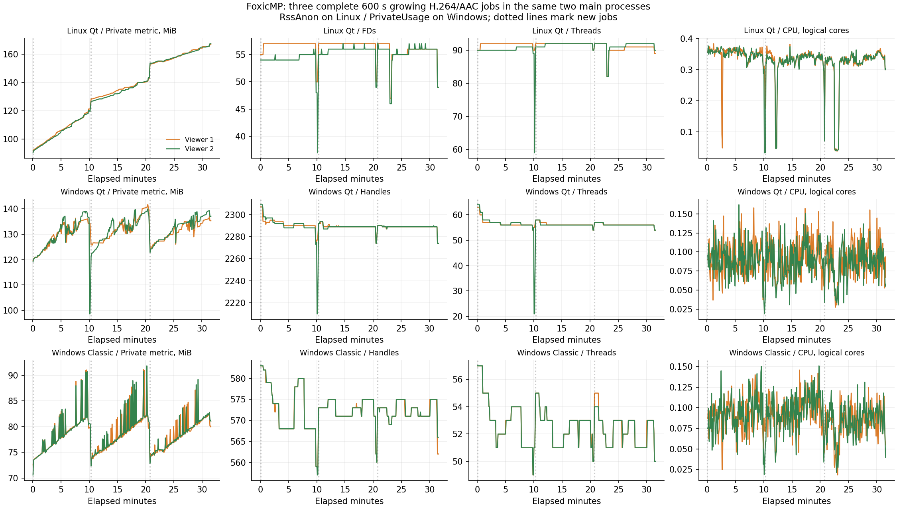

# Длительный continuous A/V-прогон трёх редакций

11 ноября 2026. Обычные Classic, Windows Qt и установленный Linux Qt 0.2.0,
SDK 1.87. Production и пользовательские настройки не меняются.
Цель — не менее 30 минут жизни тех же двух main processes каждой редакции
с фактическим A/V playback, physical writer append, ресурсными и latency gates.
Это программный тест, не измерение физического A/V выхода.
[Полный отчёт, samples, hashes, exit codes и исходные отказы стенда](ProgressiveAvSoak30mValidation-2026-11-11.json).

## Зафиксированный до запуска профиль

Один неизменяемый MP4 fixture: 600 s, H.264 640×360 / 25 fps / BF3 / GOP50,
AAC-LC 48000 Hz stereo / 64 kbit/s, 28 799 863 audible samples.
Video ограничен 100 kbit/s с VBV, чтобы source/cache budget не менялся.
Точный размер — 12 791 847 bytes; 15 000 video +28 126 audio packets.
SHA-256: `2690a26497320fbe5fbebe8e14658722d6e92b1c8729ce0e454b3251a066f130`.
Генератор — `tests/progressive_av_soak_fixture.py`; все редакции читают
один и тот же оригинал, hash которого сверяется до/после.

Continuous contract ограничен 50 000 packets, source 128 MiB и output/shared
cache 64 MiB на job. AAC одного 30-minute job превысил бы packet limit.
Поэтому каждый из двух main processes играет три полных 10-minute jobs
подряд, без перезапуска main и без расширения caps. Между jobs фиксируются
release/forget, выход worker и новый startup. Это не один 30-minute файл
и не обещание непрерывного кадра между отдельными jobs.

## План и бюджеты

Два отдельных endpoints получают один физически дописываемый файл на каждый
job; source не становится complete только от достижения file size. Каждая
публикация имеет SHA/ranges. Начальный prefix до 16 s, далее writer держит
около 14 s подтверждённых данных перед более быстрым viewer.
Один раз на job новые bytes 0.5 s существуют физически без публикации;
maximumReadEnd не должен пересечь прежний prefix.

В трёх jobs writer делает реальные паузы 10/30/60 s с heartbeat. Для 30/60 s
обязательно наблюдение buffering обоих endpoints. Возобновление фиксируется
по playing и продвижению позиции >0.15 s после публикации. В первом job
дополнительно есть ручная пауза первого viewer на 10 s; второй продолжает.
Все jobs завершаются явным writer complete и естественным EOF обеих дорожек.

| Проверка | Порог |
| --- | ---: |
| Каждая IPC request / размер JSON | <2 s / ≤64 KiB |
| Готовый буфер → playing с продвижением позиции | <3 s |
| Writer/manual resume → playing и продвижение | <2 s |
| SDK close + receipts + forget | <2 s |
| Handles / fd, late относительно early | +8 |
| Threads, late относительно early | +2 |
| RSS/private metric, late относительно early | +256 MiB |
| CPU, последнее минутное окно | ≤1 logical core на процесс |
| Cache на endpoint, включая служебные файлы | ≤68 MiB; media cap остаётся 64 MiB |

Early main baseline — 60–90 s первой сессии, late — последняя минута всего
прогона. Workers измеряются отдельно в каждом job теми же окнами их жизни.
Linux private metric=RssAnon, Windows=PrivateUsage, они не равнозначны.
Сохраняются samples каждые 5 s, latency каждого вызова, событийные timestamps
и resource snapshots. Бюджеты не расширяются по результату.

Медиапозиция не может опережать wall clock более чем на 20 s. В full режиме
нет seek для сокращения просмотра: каждый job должен длиться ≥599 s и
дойти до позиции ≥599.5 s, суммарный elapsed ≥1800 s. Smoke с явным флагом
может перейти к концу, но всегда имеет soakAcceptance=false и не заменяет full.

## Доказательства и изоляция

У jobs сохраняются worker/playback/reader identities. Воспроизведение требует
audio=true, применённого PCM window adapter и настоящего playing clock;
producer error, ложный EOF до complete или смена readers без нового job — FAIL.
После complete packet hashes/PTS/DTS video/audio сравниваются с оригиналом;
для video также сравнивается duration. Это не decoded PCM/frame capture.

Close требует положительные files-closed receipts, forget, пустой remux cache
и завершение удерживаемой OS identity worker. Native Windows worker exit
сохраняется; Linux pidfd доказывает завершение без приписанного exit code 0.
Cleanup idle main peers (-9 Linux/1 Windows) отделяется от test driver exit.

Linux запускается через `qt/tests/run_tests.sh` с private X11/D-Bus/PulseAudio.
Windows Qt и Classic — отдельные test profiles/copies; Classic до первого
запуска имеет ContextMenuPrompted=1 и ContextMenuEnabled=0, private null
renderers. Форматы/Apply не открываются. Установки, INI, Harvester, desktop
settings/микшер/дисплеи и scheduler tasks не меняются.

## Подготовительные запуски

Начальный smoke Classic не стартовал с prefix 12 s: при GOP50 доступный
presentation end был 9.92 s, ниже штатного startup buffer 10 s. Это ожидание
данных, не измерение startup после готового буфера. Сохранён отдельный повтор
с trace. В исправленном стенде prefix 16 s и readiness требует indexedEnd≥10;
default Classic и 3 s gate не менялись. Первые прогоны не считаются full PASS.

Итоговый smoke всех трёх редакций прошёл. Максимумы ready→playing: Linux Qt
2.23 s, Windows Qt 1.11 s, Classic 0.47 s. Они относятся только к smoke;
полный прогон оценивается отдельно, включая его последующие старты.

Первые full attempts всех трёх редакций остановились около 163 s на ошибке
самого журнала: manual-resume передал `seconds` вторично в event record.
Прежние failure/exit/logs сохранены, эти попытки не засчитываются. Поле
исправлено на latencySeconds; smoke теперь отдельно проходит ручную паузу
2 s и resume, затем полные прогоны начаты заново в новых каталогах.
Продуктовый код и пороги не менялись. Native Python exit первого Linux
отказа отдельно не записан (известен aggregate CTest 8); у финального
Linux-прогона есть отдельный recorder точного child exit.

## Воспроизведение

```text
python3 tests/progressive_av_soak_fixture.py NEW_FIXTURE_DIRECTORY
python3 -B tests/progressive_aac_package_test.py --edition qt --player /PRIVATE/foxicmp-qt --reader-runner /PRIVATE/reader-tests --sdk-directory /PRIVATE/integration --scenario aac-soak --soak-fixture NEW_FIXTURE_DIRECTORY --expected-audio-output pulse --report-directory NEW_REPORT_DIRECTORY
```

Linux команду регистрируют в private CTest driver и используют изолированный
runner. Windows Qt: expected output wasapi и доступные Qt plugins; Classic:
`--edition classic --classic-null-video --expected-audio-output null`.
`--soak-smoke` включает только preflight; для full он отсутствует.

## Итог полного прогона

Каждая редакция прошла три полных jobs в тех же двух main processes:
18 полных viewer jobs с natural EOF. Все test drivers, включая отдельный
Linux Python child и aggregate CTest, завершились с exit 0.

| Редакция | Реальный elapsed | Max ready→playing | Max resume | Max release | Max RPC |
| --- | ---: | ---: | ---: | ---: | ---: |
| Linux Qt | 1898.73 s | 2.196 s | 0.222 s | 0.083 s | 0.261 s |
| Windows Qt | 1903.23 s | 1.125 s | 0.422 s | 0.063 s | 0.328 s |
| Windows Classic | 1899.92 s | 0.421 s | 0.422 s | 0.094 s | 0.500 s |

Preparation измерена отдельно в JSON; ready здесь означает готовый ≥10 s
presentation prefix, не только старт worker. Resume включает контроль
движения после writer/manual pause; отсутствие starvation при 10 s writer
pause отдельно отражено buffered=false. 30/60 s случаи действительно
исчерпали буфер обоих viewers. Таблица — максимумы этого профиля/ПК,
не универсальная latency гарантия.

Все main и worker resource gates прошли. Максимальный early→late прирост
private metric среди двух main viewers: Linux Qt 72.44 MiB, Windows Qt
16.62 MiB, Classic 8.12 MiB при бюджете +256 MiB. Max CPU последней минуты:
0.337 / 0.087 / 0.087 logical core соответственно, при лимите 1.
В JSON сохранены абсолютные early/late значения каждого процесса.



График воспроизводится:

```text
python3 tools/plot_progressive_av_soak.py docs/ProgressiveAvSoak30mValidation-2026-11-11.json docs/assets/progressive-av-soak30m-2026-11-11.png
```

**Открытое наблюдение:** Linux private-память продолжает расти и после смены
jobs. Наклон последних пяти минут — около 1.32/1.47 MiB в минуту для двух
viewers; плато не установлено. Конечный бюджет пройден, но это не доказательство
отсутствия утечки или ограниченной памяти при многочасовом запуске. Причину
(allocator/cache/ownership) этот прогон не устанавливает; она вынесена в чеклист.

Для каждого completed cache проверены video/audio payload hashes и clocks,
а для video — duration. Все original/partial bytes совпали, files-closed
receipts положительны, все jobs забыты и remux caches пусты. Windows сохранил
12 completed worker exits 0; Linux pidfd доказывает выход без выдуманного
worker exit code. Шесть idle main peers намеренно закрыты cleanup harness
(-9 Linux /1 Windows) отдельно от driver exit 0.

Все 587 защищённых файлов и 158 HKCU entries совпали до/после. Production
не менялся, установленный Linux EXE не заменялся, переустановка не нужна.

## Оставшиеся границы

Один H.264/AAC профиль, три jobs и software/null output не закрывают другие
codec/layouts, multi-hour stress, физический A/V drift, hardware/Wayland и
всю progressive-приёмку. Старые необъяснённые отказы остаются в чеклисте.


## Последующее исправление — 12 ноября 2026

Наблюдение Linux разобрано отдельно: [причина, изменения и новый прогон](ProgressiveLinuxMemory.md), [полный отчёт](ProgressiveLinuxMemoryValidation-2026-11-12.json). В новом обычном EXE память освобождается/переиспользуется между jobs; private growth ≈11.91 MiB за 31 min, а третье/второе одинаковые окна отличаются ≤0.82 MiB. Исходные результаты и бюджеты этой страницы остаются историческими; новая проверка применяет более строгие memory gates.
