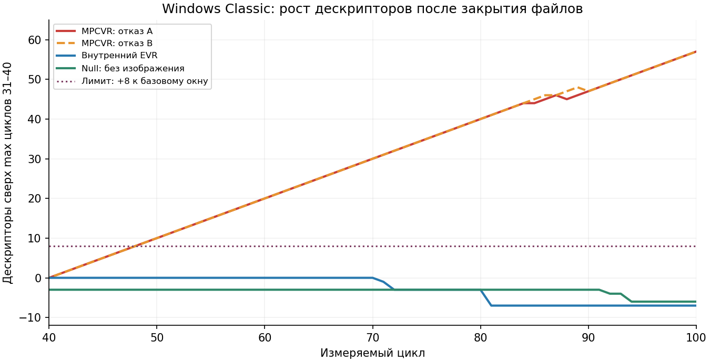

# Continuous SDK: наблюдение за release и ресурсами Classic

5 ноября 2026. Приложение 0.2.0, SDK 1.82. **Production code, EXE и defaults
не менялись. Приёмка остаётся OPEN.**

[Измерения, исходные отказы, источники стенда и точные exit codes](ProgressiveContinuousObservationValidation-2026-11-05.json).
Предыдущий [cyclic stress](ProgressiveContinuousLifecycleStress.md) и его
результаты сохраняются без замены новых/старых отказов успешными повторами.

Дополнение: после этого диагностического среза найден и исправлен конкретный
[рост событий DWM в Classic](ProgressiveDwmEventLifetime.md). Исходные измерения
ниже сохранены; исторический Linux release >2 s этим не закрывается.

## Что установлено в Classic

В двух отдельных сериях со штатным выбором внешнего MPCVR все 100 циклов
дошли до подтверждённого закрытия файлов, но проверка ресурсов завершилась
**exit 1**. Максимум handles основного процесса в циклах 31–40 — 568,
в последних десяти — 625. Прежний предел 568+8=576 превышен на 49.
Наблюдается устойчивый рост примерно на один дескриптор за цикл.

После второго отказа сохранены типы дескрипторов, модули и локальные
диагностические дампы до завершения собственных тестовых процессов.
Доступная типизация показывает **186 Event** в основном процессе и 76 во
втором процессе после его закрытия. Это типизированная часть таблицы;
её сумма не обязана совпадать с GetProcessHandleCount. Различие ролей двух
процессов само по себе не доказывает точное количество утёкших Event.

В загруженных модулях обнаружен внешний `MpcVideoRenderer64.ax` из K-Lite,
версия **0.9.19.2490**, SHA-256
`6751124d5e894d7b8aba0fe19d8e35e1a4f157322b83088392e51bd739a08864`.
Его файл не менялся. В dump также видны повторные выгрузки AMD/Direct3D DLL;
это дополнительный диагностический факт, не доказательство виновности драйвера.

График показывает общее число NT handles относительно максимума циклов 31–40,
а не отдельный счётчик Event. Порог +8 задан до испытаний и не увеличен.

## Контроль пути вывода

Только в отдельных приватных INI до первого запуска указаны другие renderer.
Установленные профили, выбранный пользователем видеовывод и настройки K-Lite
не переключались.

| Сценарий | Измеряемые циклы | Handles, max 31–40 → max последних 10 | Exit |
|---|---:|---:|---:|
| MPCVR, пассивный счётчик, отказ A | 100 | 568 → 625 | 1 |
| MPCVR, захват только после отказа, отказ B | 100 | 568 → 625 | 1 |
| Внутренний EVR, VideoRenderer=3 | 100 | 561 → 554 | 0 |
| Null uncompressed, VideoRenderer=11 | 100 | 523 → 520 | 0 |

Для EVR подтверждён `evr.dll` без MPCVR; для Null отсутствуют оба renderer
модуля. Null — контроль декодирования/вывода, не проверка изображения на экране.
Это сужает подозрение до пути с внешним MPCVR. **Точный создатель Event и
граница ответственности плеера, renderer и драйвера пока не установлены.**
Включение NT handle tracing, дополнительные снимки между циклами и отдельный
повтор с типизацией только после серии дали стабильные счётчики. Эти успехи
не отменяют двух отказов и показывают чувствительность к условиям наблюдения.
40-cycle tracing серии не считаются 100-cycle приёмкой.

Всего выполнено восемь Classic серий: 680 измеряемых и 32 прогревочных цикла.
Heartbeat-фаза в исходной серии не началась из-за отказа budgets; вторичные
диагностические серии намеренно её не выполняли. Результаты не заявляются
как новые 12-expiry conformance проверки Classic. Связь нового роста Event с
историческим отказом на heartbeat 12 ещё не доказана.

## Полная последовательность Linux heartbeat

Проверены две приватные копии: сохранённый EXE исходного случая с SHA
`a778a55088e8c2a1ca6a9565ca4158b4ac7769d4023ffe63013b1e57a13cba42`
и текущий EXE `9f676bfb31dcf2a7ebfd31793b1ffcdbc0eba3793258b017c7d47ed25baaeb6f`.
Используется совместимый текущий worker/runtime; установленный EXE не заменяется.
Это не восстановление всех условий старого рабочего сеанса.

На тех же PID каждой пары дважды выполнены preparation → playing → paused →
renewals → completed-without-heartbeat. Для playing helper дополнительно
проверяет явный повторный просмотр после истечения heartbeat. Так проверяются
переходы, которые не охватывает один изолированный paused-сценарий.

Итого 20 сценариев: 16 реальных expiry и четыре completed-сценария без heartbeat.
Deadline остаётся 30000 ms, часы не подменяются. Обе CTest проверки прошли,
общий CTest exit 0. Наибольший наблюдаемый auto-release: 0,273 s в старом EXE
и 0,221 s в текущем. **Исходный release >2 s не воспроизведён и остаётся OPEN.**
Исправленная ранее гонка IPC/OS наблюдений не объявляется его причиной.

## Стенд и сохранение отказа

`tests/progressive_continuous_observation_probe.py` оборачивает существующие
staged/heartbeat/lifecycle сценарии, сохраняет существующие RPC и замеры budgets.
Пассивный поток каждые 20 ms читает handle/fd counts двух собственных процессов:
Windows GetProcessHandleCount с удержанной identity, Linux /proc/PID/fd.
Дополнительных запросов к плееру и управляющих Stop/Cancel в release path нет.
Само наблюдение может влиять на расписание потоков; это диагностический стенд.

Каталог отчётов должен быть новым. Повтор в занятом каталоге отклоняется **до
запуска плеера**; отдельная проверка подтверждает сохранность старого файла.
До сценариев сохраняется inputs.json с SHA реально запущенных приватных EXE/worker
и исходников стенда. При ошибке сохраняются OS samples, RPC, реальные замеры
и первоначальное исключение.
Windows дополнительно сохраняет queryable handle types и modules. С явным
`--native-failure-dump` создаются локальные minidump собственных копий с thread/
module diagnostics, без full-memory. На этом хосте DbgHelp не включил запрошенный
handle stream; типы handles получены отдельным NT query, это записано в отчётах.
Дампы остаются в `_bin`, в GitHub публикуются только их хеши/размеры и результаты.

Отдельная контролируемая ошибка до открытия медиа проверила сам захват на двух
Classic процессах: исходное исключение не потеряно, dump signature/streams и
SHA проверены. Exit обёртки этой проверки 0 означает успешную проверку
диагностики, а не успешный playback после инъекции ошибки. Сохранение метаданных
и исходной ошибки финальной ревизии также проверено на настоящих приватных Linux
процессах через run_tests.sh. Полные Linux серии выше выполнены в первой ревизии
наблюдателя до добавления Windows failure capture и inputs.json; SHA прежней
ревизии и её точный исходник включены в primary report.

Linux UI/audio — только `qt/tests/run_tests.sh`, частные X11/D-Bus/PulseAudio.
Classic INI заранее содержат ContextMenuPrompted=1 и ContextMenuEnabled=0;
страница «Форматы» не открывалась. Защищённые 14 EXE/INI/SDK/worker файлов и
158 HKCU shell entries совпали до/после. Единственная одноразовая Windows-задача
после всех серий удалена. Harvester, MPC/MPC-BE и установленные профили не менялись.
Операции изменения системных настроек не выполнялись. Нового production build нет: Linux EXE не заменяется.

## Следующий незакрытый шаг

Получить владельца/место создания сохраняющихся Event на пути MPCVR и проверить
исправление тем же пассивным сценарием, без поднятия лимита и без переключения
пользовательского renderer. Отдельно продолжить локализацию исходной Linux
задержки. Общая stress-, audio/B-frames- и полная progressive-ТЗ приёмка открыты.
GPU/HDR, новые устройства и исключённый Wayland этим не принимаются.
