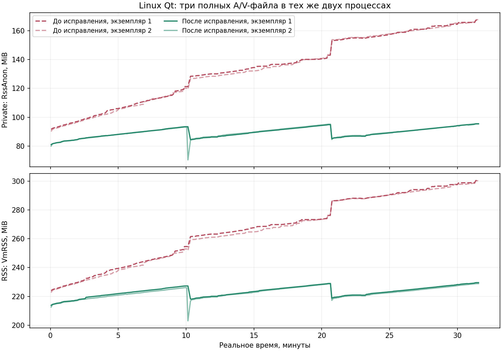

# Linux Qt: ограничение удерживаемой памяти при A/V-воспроизведении

12 ноября 2026. FoxiqMP qt 0.2.0, контракт/SDK 1.87 без изменений.
Проверки — отдельные профили, частные X11/D-Bus/PulseAudio через
`qt/tests/run_tests.sh`; установленный профиль и Harvester не редактируются.

## Причина и проверка гипотез

Первый 31-minute soak дал +72.44 MiB private (Linux RssAnon) без плато.
[Исходный отчёт](ProgressiveAvSoak30m.md) сохраняется без переоценки его порогов.
Контрольный процесс с такими же частыми API-запросами без A/V стабилен.
Heaptrack и mallinfo2 показывают рост индексов текущего файла и свободных
областей в malloc arenas, а не сопоставимый рост живых выделений.
При многократной смене роликов busy оставался около 85 MiB, тогда как
свободные блоки в аренах превышали 130 MiB. Private/RSS включает эти блоки.

Переиспользование буферов индексов уменьшило четырёхминутный прирост
приблизительно с 12 до 7 MiB, но само по себе не решило накопление после
смены файлов: в 100-cycle тесте private достигал примерно 297 MiB.
Этот промежуточный результат не считается окончательным исправлением.
Диагностический опыт с фиксированным mmap threshold снизил память того же
100-cycle сценария примерно до 65 MiB. Итоговый EXE проверяется отдельно,
без профилировщика, LD_PRELOAD и принудительных allocator environment overrides.

## Изменения

- Linux/glibc: до создания QApplication и native threads фиксируется
  `M_MMAP_THRESHOLD=128 KiB`. Крупные освобождённые буферы могут возвращаться
  ОС, вместо удержания в аренах после повышения адаптивного порога.
  Явные `MALLOC_MMAP_THRESHOLD_` и `glibc.malloc.mmap_threshold` пользователя
  сохраняют приоритет. Для других libc и Windows этого вызова нет.
- Декодер переиспользует геометрически растущие sample/span buffers снимка
  индекса. Producer использует повторно буфер транзакции; commit происходит
  после проверки структуры и AAC clocks. Область mutex/terminal-failure gate
  защищает видимый prefix; SHA, leases, packet/cache limits не ослаблены.
- Исправлена гонка native AAC-теста: ожидание проверяется на одной и той же
  границе visible до/после read, а не на устаревшей границе после hashing.

Периодического `malloc_trim`, рестартов процесса, очистки пользовательского
кэша и правок INI нет. Однократный trim применялся только в отдельном
диагностическом процессе и не является частью production/приёмочного прогона.

Описание механизма threshold: [официальная документация glibc](https://sourceware.org/glibc/manual/latest/html_node/Malloc-Tunable-Parameters.html).

## Приёмка

Два обычных процесса final EXE, три полных 600 s H.264/BF3/AAC stereo jobs,
реальные writer pauses 10/30/60 s, ручная пауза, natural EOF, packet/clock
SHA proofs, files-closed receipts и пустой cache после forget.
Фикстура и прежние latency/resource gates совпадают с первым soak.
Дополнительно заранее установлены +32 MiB RSS/private за весь прогон и
+8 MiB при сравнении одинаковых окон 60–90 s третьего и второго jobs.
Исходный результат эти новые пороги не проходит.

`tests/progressive_av_memory_acceptance.py` проверяет полный soak и, с
`--lifecycle`, 100-cycle AAC-тест (late относительно early/steady окон).
Старый 100-cycle результат с одним лишь переиспользованием индексов также
отклоняется новым gate. Smoke не может закрыть эти проверки.

[Полный отчёт, samples, exact exits и сохранность установки](ProgressiveLinuxMemoryValidation-2026-11-12.json).

| Проверка | Итог |
| --- | ---: |
| Реальное время полного final soak / samples | 1897.74 s / 371 |
| Private growth, прежние global early/late окна | ≈11.91 MiB вместо 72.44 MiB |
| Строгий gate: RSS / private growth | ≤12.74 / 11.81 MiB при лимите 32 MiB |
| Третий job относительно второго: RSS / private | ≤1.06 / 0.82 MiB при лимите 8 MiB |
| Ready → playing / resume / release / RPC | ≤2.219 / 0.221 / 0.069 / 0.260 s |
| CPU последней минуты | ≤0.347 logical core |
| 100-cycle final: RSS/private growth early → late | ≤4.29 MiB |
| 100-cycle final: late относительно steady | ≤1.61 MiB |

Индексы текущего файла растут ожидаемо, но память после закрытия
переиспользуется/освобождается: одинаковые окна второй и третьей сессии
отличаются менее чем на 1 MiB private. Исходный и промежуточный index-only
soak проваливают новый gate; финальный проходит его без ослабления порогов.
У index-only soak private growth ещё достигал 52.95 MiB.



Прошли normal Linux AAC (9), queued seek (11), races (36), shutdown (8),
100 lifecycle cycles, native cache (34), corrected native AAC (22) и Window
checks. Windows Qt: те же 64 public cases, 22 native AAC, Window checks и
явный smoke; Classic: 64 public cases и явный smoke на пересобранных private
copies. Windows smoke не называется длительным soak. Итоговые native drivers
и memory gates завершились с exit 0.

Сохранены три ошибки стенда: неверный previous snapshot в первой диагностике,
устаревший visible при native read-проверке и ошибочное требование общего
legacy fullStressAcceptance в первом memory checker. Исправленные проверки
перезапущены; исходные exits 1/8 не переписаны и не засчитаны как PASS.

Обычная CMake-сборка побайтно совпала с испытанным final EXE:
`a7bfe4639a6dffa94e3a0183b559d4587c1f103aa49c2468bca4803dc4e491a3`.
Установленный Linux EXE заменён атомарно с backup, без остановки просмотра;
ещё 9 AAC scenarios прошли уже на установленной копии. INI и личные файлы
не изменены; из 587 защищённых файлов изменён только этот EXE. Все 158
прежних Classic HKCU shell keys/значения совпадают; Windows-установки сохранены.

Воспроизведение memory gate после полного прогона:

```text
python3 -B tests/progressive_av_memory_acceptance.py FULL_SOAK_RESULT.json MEMORY_GATE.json
python3 -B tests/progressive_av_memory_acceptance.py --lifecycle AAC_100_CYCLE_RESULT.json LIFECYCLE_MEMORY_GATE.json
python3 tools/plot_progressive_linux_memory.py BEFORE_RESULT.json AFTER_RESULT.json OUTPUT.png
```


## Границы

Это программные проверки одного длинного A/V-профиля и lifecycle/regression
профилей. Они не доказывают отсутствие любых утечек во всех codec/layouts,
физическую синхронизацию A/V, hardware/Wayland или всю progressive-приёмку.
Windows-проверки относятся к общему переиспользованию индексов; новая
allocator policy применяется только в Linux/glibc. Windows-установки не меняются.
