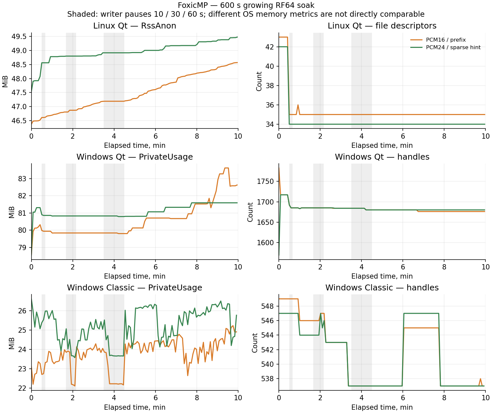

# Progressive: десять минут растущего RF64 в каждой редакции

Проверка от 3 ноября 2026 года: приложение 0.2.0, контракт SDK 1.81.
[Все измерения, бюджеты, SHA-256 и exit codes](ProgressiveSoakValidation-2026-11-03.json).
Этот этап проверяет ресурсы и буферизацию, не физическую A/V синхронизацию.
Harvester не изменяется.

## Реальное время и нагрузка

Каждая редакция выполняет 600 s измеряемой работы в реальном времени,
после начальной подготовки. Два самостоятельных процесса одновременно читают
разные растущие RF64: PCM16 stereo 48 kHz с обычным hint и PCM24 stereo 48 kHz
со sparse hint. Данные публикуются последовательным префиксом; физических
незаписанных дыр в этом прогоне нет.

Скорость воспроизведения остаётся 1. Источники объявлены длиннее прогона,
не переводятся в complete и реально декодируются. Драйвер дописывает новые
данные примерно на 16 s впереди текущего clock, с неравномерными интервалами
публикации. Контролируются readerId, connected, playing/buffering, decoder I/O
и отсутствие физического чтения за подтверждённым префиксом. К концу полного
прогона каждый clock должен пройти не менее 70% измеряемого времени.

Реальные паузы writer 10, 30 и 60 s отсчитываются от входа в состояние paused.
Heartbeat продолжается, пользовательская пауза не включается. Во время длинных
пауз оба плеера должны дойти до buffering, сохранив reader и connected;
после допубликации вернуться к playing. Пауза загрузки не означает EOF,
ошибку или смерть writer.

Для SHA применяются внешние immutable индексы SDK 1.81. Команды остаются
в лимите 64 KiB. Старые sidecars сохраняются до filesClosed по контракту;
их накопление учитывается отдельно от media bytes, а не объявляется утечкой.

## Бюджеты заданы до запуска

Короткий 12-секундный smoke на каждой редакции проверяет только работоспособность
фикстуры. Он помечен soakAcceptance=false и не засчитывается как длительная приёмка.
Полный прогон использует неизменные заранее заданные бюджеты:

| Показатель | Критерий для каждого процесса |
|---|---|
| Handles/fds последних 60 s | Не выше максимума 60–90 s +8 |
| Threads последних 60 s | Не выше максимума 60–90 s +2 |
| RSS и private metric | Рост относительно 60–90 s не более 256 MiB |
| Средний CPU последних около 60 s | Не больше одного логического ядра |
| Media + SHA sidecars одного источника | Менее 512 MiB |
| Максимальный API request | Менее 2 s; JSON не более 64 KiB |
| Release → положительный filesClosed | Менее 2 s |

Измерения каждые около 5 s содержат CPU time, RSS, private metric,
handles/fds, threads, состояние/clock, decoder I/O, подтверждённые bytes,
максимальный прочитанный offset и размер/число sidecars. Linux private metric —
RssAnon, Windows — GetProcessMemoryInfo PrivateUsage; их абсолютные значения
не сравниваются как одна и та же величина. CPU считается из дельты process time,
нормированной на реальное время, а не из загрузки всей машины.

Эти бюджеты выявляют превышение заданных границ в конкретном прогоне.
Они не доказывают отсутствие любых малых утечек или стабильность на часы/сутки.

## Результаты полного прогона

| Редакция | Реальное время, s | Конечный clock PCM16 / PCM24, s | Рост private metric PCM16 / PCM24, MiB | Release max, s |
|---|---:|---:|---:|---:|
| Linux Qt | 600.05 | 538.74 / 538.74 | 1.78 / 0.68 | 0.077 |
| Windows Qt | 600.11 | 538.90 / 536.86 | 3.79 / 0.77 | 0.067 |
| Windows Classic | 600.05 | 537.81 / 537.71 | 1.33 / 0.49 | 0.063 |

Все шесть процессов уложились в исходные бюджеты. Handles/fds и threads
последней минуты не выросли относительно максимума интервала 60–90 s.
Средняя загрузка последней минуты — 0.057–0.077 логического ядра на процесс.
Clock около 537–539 s при 600 s реального времени ожидаем: длинные паузы
исчерпывают буфер, пока writer не возобновит публикацию.

После пауз 30 и 60 s все readers действительно входили в buffering и продолжали
playing с прежним readerId; 10 s покрывались уже опубликованными данными.
Положительный filesClosed получен за 0.062–0.078 s. Драйверы и сборки имеют
exit 0. Полный JSON сохраняет все измерения, квитанции и отдельные exit codes
очистки дочерних процессов.

Для Qt первоначальные 12-секундные smoke подтверждены исходным CTest stdout;
каталоги промежуточных результатов не используются как smoke-доказательство.



График воспроизводится командой:

```text
python3 tools/plot_progressive_soak.py docs/ProgressiveSoakValidation-2026-11-03.json docs/assets/progressive-soak-2026-11-03.png
```

## Завершение и сохранность

После измеряемого интервала сверяется SHA всего реально записанного файла
с независимым rolling hash тестового writer. Исходник всё ещё не complete.
Закрытие инициируется API; требуется положительный filesClosed, затем forget
и пустой реестр. Только после этого удаляются media и все прежние SHA sidecars.
Пустые собственные процессы завершаются при очистке; их exit -9 Linux/1 Windows
отделены от exit 0 тестового драйвера.

Linux работает через `qt/tests/run_tests.sh` с частными X11/D-Bus/PulseAudio,
mute и software output. Classic — две изолированные portable-копии с
ContextMenuPrompted=1/ContextMenuEnabled=0. Перед/после сверяются установленные
EXE/INI и Classic shell entries; временные задачи, процессы и папки удаляются.
Глобальные микшер, мониторы, рабочий стол и настройки Windows не менялись.
Production EXE остались побайтово прежними; установленный Linux уже совпадает
с проверенным бинарником и повторной замены не требует. SDK ZIP 1.81 неизменён.

## Воспроизведение и открытые критерии

Общий тест: `tests/progressive_soak_playback.py`, Qt CTest
`progressive-soak-playback`, timeout 1200 s. Default — 600 s; переменная
FOXICMP_SOAK_SECONDS служит короткому smoke, который в приёмку не входит.

Два RF64-профиля и десять минут не закрывают полную positive/negative matrix,
длительный video/remux/segmented/live stress, все варианты cache/temp,
смешанные редакции, 100 конкурентных циклов или сквозной Harvester.
30-минутный физический A/V drift не измерялся; Wayland и отложенное оборудование
не возобновлялись. Общие пункты [чеклиста](ProgressiveCompletionChecklist.md)
остаются открытыми, отдельный выполненный срез отмечается с точными границами.
