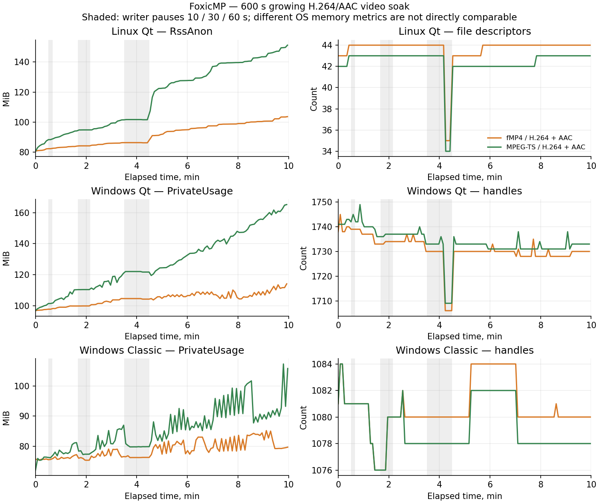

# Progressive: десять минут растущего H.264/AAC

Приложение 0.2.0, SDK 1.81. Этап проверяет две ограниченные видеоконфигурации
в каждой редакции: fMP4 и MPEG-TS, H.264 Main с B-frames, stereo AAC-LC 48 kHz,
25 fps, 160×90. Два самостоятельных процесса читают разные растущие файлы.
Это программное декодирование в изолированных тестовых профилях, без
приёмки GPU/HDR, физического вывода или сквозного Harvester.

## Методика и критерии, заданные до полного запуска

Оба эталонных файла создаются до начала воспроизведения. Из них публикуется
последовательный префикс: сначала 4 s для buffering, затем 16 s для старта.
Измеряемый интервал — 600 s реального времени после начального декодирования.
Скорость остаётся 1; команды обновления чередуют интервалы .35/.75/1.1/.45 s,
подтверждённые bytes добавляются примерно двухсекундными порциями на 16 s
впереди текущего clock. Граница может разрезать fragment/PES/GOP.

SHA передаются inline: нынешний внешний integrity profile поддерживает RF64,
но не эти видеорежимы. Порции по 2 s ограничивают число неизменных SHA blocks
без изменения старых digest/границ. Каждый JSON проверяется на лимит 64 KiB.
Тест не укрупняет порции, чтобы обойти унаследованный лимит массива: см. найденный
дефект и исправление ниже.
Длина известна, исходник длиннее прогона и не переводится в complete.

Writer делает паузы 10/30/60 s с продолжающимся heartbeat. Паузы 30 и 60 s
должны исчерпать буфер обоих плееров; readerId и connected сохраняются,
после публикации продолжается playing. Короткая пауза может покрываться буфером.
Ожидание не должно подменяться EOF. Максимальный физический read offset эти
видеорежимы API не публикуют: в отчёте он явно недоступен/null. Range/SHA
ограничения проверяются отдельно native resource-I/O suite; это не прямой
пофайловый offset trace фактического видеодекодера.
Оба decoder I/O counters должны быть положительными. Это свидетельство
чтения декодерами, а не физический захват изображения/звука.

Через каждые около 5 s записываются CPU time, RSS, private metric, handles/fds,
threads, clock/state, decoder I/O, доступные bytes, decoder I/O и размеры файлов.
Бюджеты те же, что в [предыдущем RF64-прогоне](ProgressiveSoakPlayback.md):

| Показатель | Критерий на процесс |
|---|---|
| Handles/fds последней минуты | Максимум 60–90 s +8 |
| Threads последней минуты | Максимум 60–90 s +2 |
| RSS и private metric | Рост не более 256 MiB |
| CPU последней минуты | Не больше одного логического ядра |
| Media + SHA sidecars | Менее 512 MiB на источник |
| API request | Менее 2 s, JSON не более 64 KiB |
| Release → filesClosed | Менее 2 s |
| Конечный clock | Не менее 420 s, состояние playing |

Linux private metric — RssAnon, Windows — PrivateUsage; абсолютные величины
не равнозначны. CPU — дельта времени процесса / реальное время, не доля всей
машины. Бюджеты не исключают медленные малые утечки ниже своих границ.
Короткий 12 s smoke имеет soakAcceptance=false и не заменяет полный тест.

## Результаты повторного полного прогона

[Все замеры, failure-before-fix, SHA-256 и exit codes](ProgressiveVideoSoakValidation-2026-11-03.json).

| Редакция | Реальное время, s | Конечный clock fMP4 / TS, s | Максимальный рост private metric, MiB | Release max, s | SHA blocks fMP4 / TS |
|---|---:|---:|---:|---:|---:|
| Linux Qt | 600.02 | 537.80 / 530.30 | 57.75 | 0.293 | 254 / 250 |
| Windows Qt | 600.10 | 537.84 / 534.06 | 56.37 | 0.080 | 254 / 251 |
| Windows Classic | 600.03 | 537.79 / 532.64 | 26.62 | 0.234 | 254 / 253 |

Все шесть процессов выдержали исходные бюджеты; каждый действительно перешёл
границу 128 inline SHA-блоков. Паузы 30/60 s исчерпали буфер, а допубликация
возобновила playing с прежним readerId. Clock исключает время ожидания; это
не десять минут непрерывного изображения и не физическая A/V-приёмка.

На Windows и Linux прошли по 13 новых native checks валидатора; те же 13 —
под Linux ASan/UBSan. Resource I/O: 30 Linux / 28 Windows checks, SHA-защита —
по 10, catalog cache — по 15. Совместимые model/segments регрессии прошли
вместе с длительным CTest. Remux на новых EXE: по 24 preparation checks,
20 preview checks/4 profiles каждой редакции, включая восемь быстрых отмен.
Native remux — по 24 checks, worker — по 10 profiles; дополнительно native
prepared-clip lifetime и по 9 SDK unit tests на ОС.



График воспроизводится:

```text
python3 tools/plot_progressive_soak.py docs/ProgressiveVideoSoakValidation-2026-11-03.json docs/assets/progressive-video-soak-2026-11-03.png
```

Первый smoke не засчитан: Qt-драйверы завершились с CTest exit 8 из-за
неподдерживаемого внешнего SHA-профиля для видео; Classic — с exit 1 из-за
отсутствующего FFmpeg в PATH одноразовой задачи. Исправлена только оснастка:
inline SHA, порции по 2 s и частный PATH. Артефакты отказов сохранены; бюджеты
не менялись. Успешный smoke повторён после переноса обоих encode до playback.

## Обнаруженный дефект и повторная проверка

Первый полный прогон остановился примерно на шестой минуте во всех трёх
редакциях: 129 inline SHA-блоков превысили общий legacy array limit 128.
Это реальный дефект проверки schema v2, а не превышение 64 KiB и не ошибка
медиа. Данные отказа и ненулевые exit codes сохранены.

[Исправлен scoped validator](ProgressiveIntegrity.md): только массив
resources[].integrity.blocks schema v2 допускает заявленные 4096 элементов,
с прежним ограничением размера JSON. Остальные массивы, legacy v1, nesting,
duplicate keys и SHA/coverage restrictions сохраняются. Общий код применяется
в Qt API обеих ОС, Classic API, v2-публикации Classic и ResourceProbe.
Новые native-негативные проверки сопровождают повторный полный прогон
с прежними 2 s порциями и неизменными ресурсными бюджетами.

Завершающий наблюдатель первого прогона исправленных EXE ошибочно требовал
RF64-only поле physicalReadMaxEndBytes от видео. После реальных 600 s драйверы
завершились с KeyError, и эти попытки не засчитаны. Это моя ошибка оснастки;
отсутствие поля больше не записывается как нулевой offset или доказательство
границы чтения. Повтор использует фактические video/audio decoder I/O counters,
сохраняет длительность, порции и все ресурсные бюджеты. Прямой video physical
read audit остаётся явно непроверенным.

## Отдельная bounded remux регрессия

`tests/progressive_remux_player_regression.py` проверяет настоящие изолированные
EXE через публичный API. Один процесс выполняет прежнюю preparation conformance,
другой — explicit prepared RAM preview conformance. Используется существующая
проверка range/SHA/wait/update/cancel/forget, доступных H.264/AAC MP4/M4A/MOV
и различия конца фрагмента и незавершённого исходника.

continuousPlayback=false сохраняется. Это не десятиминутный remux soak,
не бесшовное продолжение RAM-фрагментов и не исполнение общего demux/remux
пункта ТЗ. Замеры до/после одного набора — диагностика, не доказательство
отсутствия утечек. Прежние проверки точных encoded/decoded hashes в native
remux suite остаются отдельным свидетельством.

## Завершение и сохранность

В конце сверяются SHA записанного файла, его префикс с исходным fixture и SHA
неизменённого оригинала. После явного API release требуется положительный
filesClosed, forget и пустой реестр, затем удаляются свои исходники/профили.
Exit codes собственных пустых процессов при очистке (-9 Linux/1 Windows)
отделяются от exit codes драйверов.

Linux запускается через `qt/tests/run_tests.sh` в частных X11/D-Bus/PulseAudio.
Classic использует отдельные portable-копии с ContextMenuPrompted=1 и
ContextMenuEnabled=0; регистрация установленного Classic сверяется до/после.
Windows-установки/INI, личные настройки Linux, микшер и рабочий стол не меняются.
Установленный Linux EXE обновлён атомарно с backup;
пользовательский профиль и существующие личные файлы сохраняются.
Одноразовые задачи и тестовые папки удаляются после проверки.

## Повтор запуска

Qt: CTest `progressive-video-soak-playback` (timeout 1200 s),
`progressive-remux-player-regression` и `progressive-inline-integrity`.
Linux UI/audio запускаются через `qt/tests/run_tests.sh`; Windows Qt может
использовать offscreen. Default длительности — 600 s, переменная
`FOXICMP_VIDEO_SOAK_SECONDS=12` включает только smoke.

Общий Python-драйвер принимает `--edition qt|classic`, `--player`,
`--reader-runner`, `--report-directory` и явный `--seconds`. Для Classic
нужны два `--player` с отдельными staged portable-копиями и подготовленным
INI; путь к FFmpeg/ffprobe задаётся в частном PATH тестовой задачи.
Не направляйте тест на установленный пользовательский Classic.
Перед повтором архивируйте прежний report directory и используйте пустой:
артефакты отказов намеренно сохраняются и не затираются успешным итогом.

## Открытые границы

Два короткоразмерных видеопрофиля не заменяют HD/4K, HEVC/AV1/VP9/Opus,
fractional/VFR, segmented/live, sparse islands, разные cache/temp policies,
смешанные редакции и всю positive/negative matrix. Непрерывный remux и
30-минутный физический A/V drift остаются открытыми; Wayland и оборудование
не возобновляются. [Чеклист ТЗ](ProgressiveCompletionChecklist.md) сохраняет
общие пункты открытыми.
