# FoxicMP Qt — Linux

Native Qt 6 Widgets + libmpv player. First target: Linux Mint 22.x x64.
This is a **0.1.66 development preview**, separate from FoxicMP Classic Windows.

0.1.66 makes the default empty volume track continue the toolbar gradient. The
filled track follows the supplied dark gradient, with matching geometry and a
lighter gradient in the light theme. Custom volume colors remain supported.

0.1.65 adds a player-owned Linux progressive API for downloaders. Discover it with
`foxicmp-qt --progressive-api-info`; send confirmed video/audio byte prefixes over
the local Unix socket, without running a downloader-side provider or downloading
the source again. The standard-library Python client and contract are installed
under `integration/`. See [LinuxProgressiveApi.md](../docs/LinuxProgressiveApi.md).
YouTubeHarvester itself remains unchanged.

0.1.48 добавляет веб-пульт в доверенной локальной сети: явное включение,
выбор частного IPv4-адреса, код доступа и проверка Host/Origin.
Включается в «Сервис → Веб-управление…»; сетевой доступ по умолчанию выключен.


0.1.46 serializes external track additions to prevent duplicates from rapid
requests before an earlier add completes. Failed additions advance the queue;
opening another source cancels pending additions. The earlier saved-M3U8
scenario remains part of regression testing.

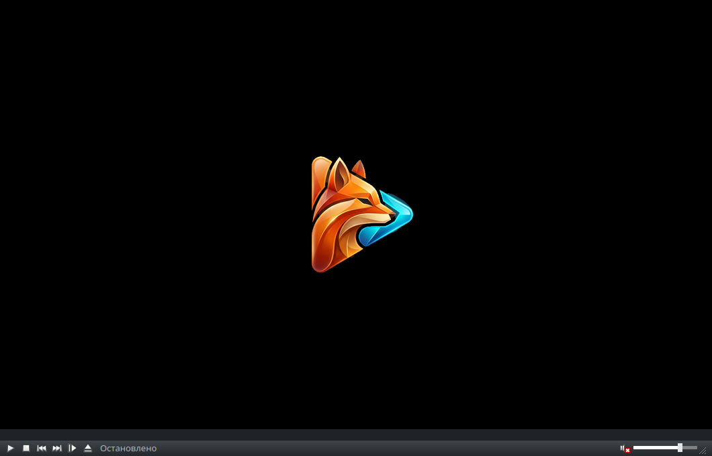

0.1.64 follows Classic's caption and merged toolbar status: media title plus the
versioned player name, play/pause symbols, speed and the current chapter.
The timer keeps priority when space is limited; long status text is elided.
Closing a file clears the clock. Remaining time uses `- `, a click switches the
clock mode, and right-click exposes milliseconds. Hovering chapters temporarily
shows their names. The hardware decoder indicator and resize grip use Classic
resources/drawing. Window decorations remain native to the desktop window manager.
Existing title templates, preferences, history and playlists are retained.

The volume control is a custom-drawn Classic-style track: 16 px dark gradients,
a bright leading marker, a red mute marker, and mouse positioning across the
track. Profile volume colors remain supported.

0.1.62 unifies the menu bar and video context menu into File, Playback, Video,
Audio, Subtitles, Library, View, Tools and Help. Shared menu/action objects keep
their order, shortcuts and state in windowed and fullscreen modes. The popup
adds transport shortcuts at the top and fullscreen/preferences/exit at the bottom.
Linux additions are assigned to their functional sections; there is no catch-all
Additional menu. Unavailable Classic aliases are not shown as menu placeholders.

0.1.61 keeps an expandable category/page tree alongside the category tabs.
Both navigators stay synchronized. Preferences show their window immediately,
with an animated loading indicator while the pages are built on the GUI thread.
Cancel during loading discards the unfinished draft; reopening builds it afresh.

0.1.60 reorganizes preferences into categories and tabs, following the approved
Linux layout. Global search opens individual controls and expands advanced sections.
Navigating/searching does not save drafts. Apply/OK saves them; Cancel discards them.
Existing profile keys and saved legacy page links remain supported.

| Category | Tabs |
|---|---|
| General | Launch and tray; History and favorites; Integration |
| Interface and window | Appearance; Window; Fullscreen; Panels; Timeline; OSD |
| Controls | Keyboard; Mouse; Command steps; Media keys |
| Playback | General; Playlists |
| Video | Output; Decoding; Frame; Color; Synchronization; Shaders |
| Audio | Output; Tracks; Mixer; Normalization; Filters; Format |
| Subtitles | Files and languages; Appearance; Placement; Rendering; ASS and compatibility |
| Online and network | Web video; Streaming services; Web control |
| Screenshots and thumbnails | Screenshots; Thumbnail sheets |
| Maintenance | Profiles and backups; Updates; Diagnostics |

Profiles, update checks and diagnostics open their existing tools through explicit
buttons. System integration buttons still perform their stated actions immediately.
DVD/TV/device settings remain deferred; they have no empty placeholder tabs.
The toolbar and command behavior remain based on Classic; settings and menu
grouping follow the user-approved Linux layout.

0.1.59 makes the preferences dialog follow the player theme, including its tree,
pages, fields, buttons and disabled controls. Applying a theme updates the open
dialog; cancelling an unapplied choice preserves the current theme.

0.1.58 groups the Interface page like Classic: dark theme, brightness/RGB sliders,
volume color swatches, button size, time/preview dependencies, chapter markers
and playlist font percentage. Additional appearance controls remain expandable.
Drafts change the running UI only on Apply/OK. Windows title/taskbar settings and
the floating control bar remain outside this pass.

0.1.57 groups the Window Size page like Classic: four startup choices, explicit
default size, current window/video-area dimensions, and playback scale controls.
Apply/Cancel keeps drafts separate; the existing geometry preference is preserved.
Screen-fit scaling and independent position/size persistence remain to be aligned.

0.1.56 aligns the Logo page with Classic: internal/external modes, original transparent
logo, previous/next selection and preserved external paths. Color controls now have
synchronized sliders and numeric fields, with draft reset and Apply/Cancel support.

0.1.55 adds Classic RU/EN menu resources, four caption/menu modes, the 26-page
settings tree with Apply/Cancel, original toolbar images and status-clock controls.
Settings content layouts are still being aligned; see the
[per-page checklist](../docs/LinuxClassicInterfaceChecklist.md).
Physical equipment trials have been cancelled by the user; Wayland is excluded.

## Run on Mint

Install runtime dependencies:

```sh
sudo apt install libmpv2 liblcms2-2 libqt6dbus6 libqt6widgets6 libqt6openglwidgets6 qt6-qpa-plugins mint-meta-codecs ffmpeg yt-dlp
```

Extract the portable archive into a writable folder (for example `~/Programs/FoxicMPQt`),
then run `./foxicmp-qt` or `./foxicmp-qt '/path/to/video.mkv'`.
All preferences, playlist and saved positions reside in **FoxicMPQt.ini next to the executable**.
An unwritable program folder is rejected; no silent fallback to a home-directory profile.
No Classic/MPC-BE or personal mpv profile is loaded or changed.

Optional desktop integration creates only `foxicmp-qt.desktop` and
`foxicmp-qt.nemo_action` in the user's XDG data folder. It does not replace the default player.
Enable the startup check to repair their executable paths after moving the portable folder.
Disable integration in Preferences to remove the entries.
Nemo matches installed video MIME types plus known extensions; supported playback depends
on the codecs in libmpv/FFmpeg. `mint-meta-codecs` complements desktop codecs, rather than
being a plugin pack loaded directly by this player.

## Profile export and backups

View → Profile and backups exports `.foxicmp-profile` archives, makes manual
copies in the profile's `Backups` folder, and imports into a **new** profile folder.
Open the result in another player window or use `--profile /path/to/profile` in a launcher.
The running profile is never replaced by import. Qt settings types, queues, history,
positions, favorites, selected artwork/translation/manual ICC and subtitle edits travel
together. Media, screenshots, extracted subtitles, generated shaders, caches, executables
and earlier backups are excluded. Playlist references to managed subtitle edits are
rebased to the new folder; external subtitles retain their paths. Media paths remain unchanged; relative media paths
require the same layout beside the new profile. Missing selected assets stop export.
System associations and their undo journal are excluded; startup registration is disabled
in imported profiles. SHA-256 checks detect corruption, not authenticity. Limits: 2048
files, 8 MiB per file, 32 MiB decoded data, 48 MiB archive. Import validates before writing
and atomically publishes a new folder without overwriting existing paths. Archives
contain history and saved URLs. Backups are manual and have no automatic retention.

## Build

```sh
sudo apt install build-essential cmake qt6-base-dev libmpv-dev liblcms2-dev
cmake -S qt -B build/qt -DCMAKE_BUILD_TYPE=Release
cmake --build build/qt --parallel
cmake --install build/qt --prefix "$HOME/Programs/FoxicMPQt"
```

C++17; Qt >= 6.4. Software Render API is the default. Preferences also offers
experimental OpenGL (applied on the next startup). libmpv uses an isolated GL
context sharing only the output texture with Qt. Initialization failure, a
missing context deadline, or Mesa llvmpipe/softpipe selects software automatically.
Repeated black frames were observed with those software GL drivers; physical GPU
OpenGL playback remains unverified. Hardware decoding uses `auto-copy` with CPU fallback. Header and library locations can be overridden with
`-DMPV_INCLUDE_DIR=/path/to/include -DMPV_LIBRARY=/path/to/libmpv.so.2`.

## Controls

| Key | Action |
|---|---|
| Ctrl+O | Open files (replace playlist) |
| Ctrl+Shift+D | Open a folder in natural filename order |
| Ctrl+U / Ctrl+V | Open a network URL / clipboard source |
| Ctrl+Shift+U | Import an online playlist through yt-dlp |
| Ctrl+E / Ctrl+W | Reopen at the current position / close and retain the queue |
| Ctrl+Shift+O | Add files to playlist |
| Ctrl+Shift+L / Ctrl+Shift+S | Open / save M3U8 playlist |
| Ctrl+D | Add a favorite; choose its title, position and portable path |
| Ctrl+H | Search and manage playback history |
| Ctrl+G | Go to time (seconds, MM:SS or HH:MM:SS.mmm) |
| Ctrl+Left / Ctrl+Right | Previous / next frame; leaves playback paused |
| . | Stop |
| Alt+1 / Alt+2 / Alt+3 | Window size: 50 / 100 / 200% of video dimensions |
| Alt+4 | Fit image into window |
| Ctrl++ / Ctrl+- | Zoom image |
| Ctrl+0 | Show / hide menu bar |
| Space | Play / pause |
| Left / Right | Seek 5 seconds |
| Up / Down | Volume, 5% steps |
| M | Mute |
| F11 / double click | Full screen |
| Escape | Leave full screen |
| Ctrl+L | Playlist |
| PageUp / PageDown | Previous / next file |

Right click the video for playback, tracks, chapters, aspect ratio, image zoom and
Preferences. The menu bar starts hidden, matching the Classic profile; Ctrl+0
shows it. Preferences includes keyboard bindings (with conflict checking and
reset) and mouse switches: single click pauses, double click toggles full screen,
wheel adjusts volume. Full screen hides controls and the cursor after inactivity;
mouse movement restores them. Dialogs, open menus and interaction with controls
keep them visible.

Drag local files, folders or network URLs onto the window. The File menu can attach
an external local audio track. The Playback menu provides chapters, audio tracks,
embedded/external subtitles, subtitle/audio delay and speed.
Chapter markers are one logical pixel wide, RGB **94,99,104**, covering the full timeline height.
Completed files restart at the beginning; unfinished files resume from their saved position.

## Subtitles, frames, audio and window

Preferences provides subtitle auto-discovery beside local videos, font, size,
text/outline colors, outline width, vertical position and visibility. ASS/SSA
keeps authored styles by default; an explicit switch applies your style.
OSD shows pause, volume/mute, speed, seek time and saved screenshots.
Ctrl+S exports a PNG at video resolution, optionally including subtitles.
Timeline previews use a debounced separate ffmpeg process, a bounded memory
cache and a decoding timeout; they never seek the playback engine. ffmpeg is
optional for playback and required for previews of local files.

Ctrl+T toggles always on top; Ctrl+B toggles the frame. Alt + left drag moves
an unframed window. Preferences controls saved geometry, remaining time,
OSD, previews and screenshot subtitles. The image/audio dialog provides
brightness, contrast, saturation, clockwise rotation, output device, mono/
stereo/5.1/7.1 layout and dynamic normalization. Unavailable saved audio devices
fall back to automatic selection without forgetting the saved choice.
All options use the adjacent portable profile.

## Playlist, history and favorites

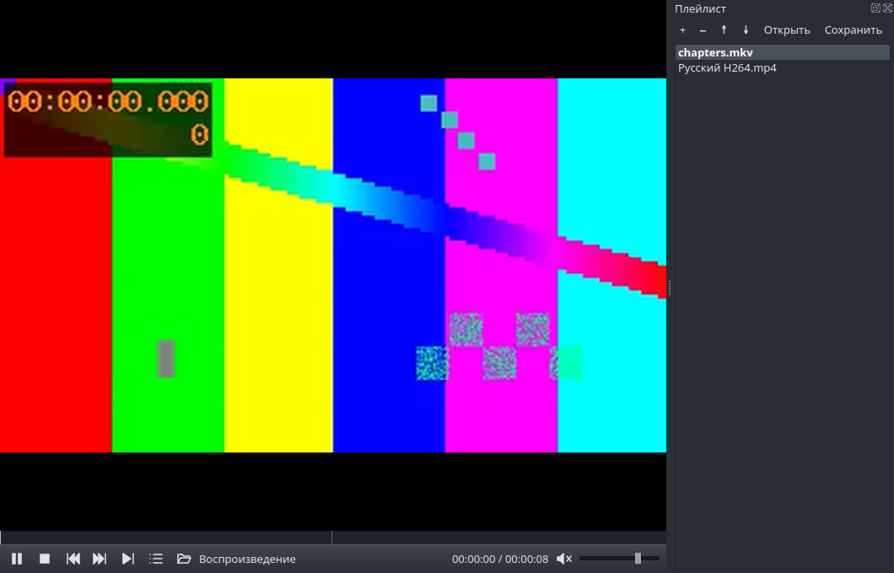

The playlist dock provides add/remove, move up/down, internal drag reorder and
UTF-8 M3U/M3U8 import/export. Dropping local files onto the playlist appends them;
dropping onto video opens a new list. Enter plays the selected row, Delete removes
selected rows; arrows navigate the list without changing volume. Removing the
playing entry stops playback. Remove/Delete only remove list entries; the separate
Move to Trash command requires confirmation and lists the affected local files.
Named tabs and the current row survive restart; startup does not automatically play.
Browsing another tab keeps playback and automatic advance in the original queue.

Choose no repeat, repeat current file, or repeat the whole list. Shuffle visits
all entries once before a new cycle (with list repeat); Previous follows the
shuffle traversal history. Adding/removing entries starts a new shuffle traversal. Sorting preserves entry identity.
M3U8 exports relative local paths so the list and media can move together, while
supported HTTP(S), RTSP, RTMP(S), UDP, TCP, FTP and SRT sources remain URLs.
Malformed imports leave the existing queue intact.

Ctrl+H opens the history window with title, path/address and saved position columns,
case-insensitive search and category filtering. Open selected entries, start the
current entry from the beginning, copy sources, remove selected records, or remove
missing local files. Network streams and physical devices are not probed for absence.
Deletion affects records and saved positions only; media files and favorites remain.
Deleting a currently playing entry also prevents periodic position saving from
recreating it until it is opened again. Only successful opens enter history;
duplicates move to the beginning. The default capacity is 50 entries.

Preferences → History and Favorites sets history capacity (1–10,000), recent-menu
length (0–100; 0 hides entries only), and defaults for new favorites. Reducing the
capacity trims the history list; explicit deletion/clearing also removes positions.
History recording and automatic resume can each be disabled under General.

Ctrl+D adds a named favorite with an optional saved position. A favorite without
that option always opens from the beginning; a favorite with a position uses it
even when automatic resume is disabled. The manager searches, filters, edits,
reorders and removes favorites. Up/down buttons work on the visible subset while
keeping hidden entries in place; drag reorder is available for the complete list.
DVD/Blu-ray/Audio CD and capture/TV sources have separate categories and submenus.

For files and DVD/Blu-ray images/folders, a favorite can store its path relative to
the program folder. Move the program and media together, preserving their folder
structure. Network and live/physical device sources retain their canonical URLs;
live devices do not store playback positions. Existing favorites keep their order,
titles and positions. All library data stays in FoxicMPQt.ini beside the executable;
no personal library is bundled in the archive.

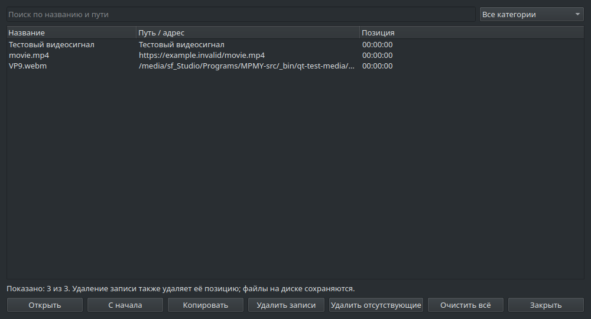
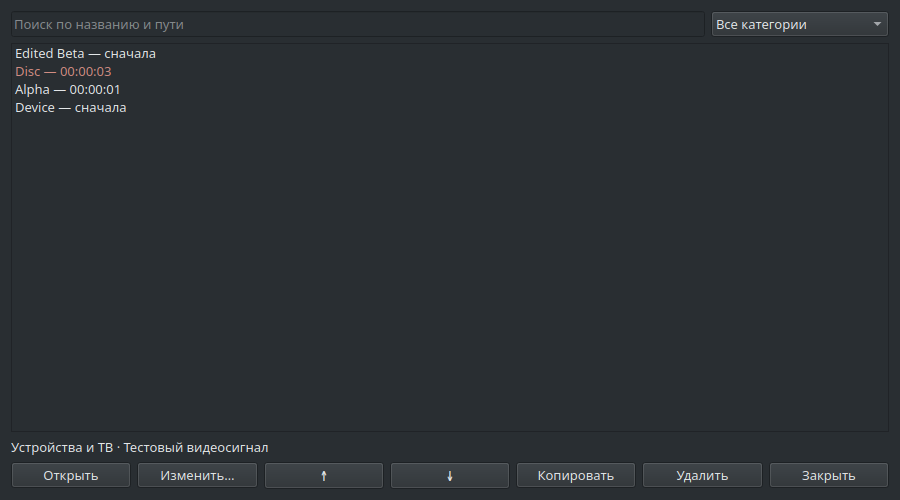

## Online video and network (0.1.7)

When `yt-dlp` is installed, FoxicMP Qt passes extractor-backed web addresses to
libmpv. The Online preferences page selects maximum resolution, frame rate,
video/audio codec, HDR/SDR preference, preferred audio language and maximum
video bitrate. It also stores the extractor path, User-Agent and network timeout
in the portable profile. Engine options take effect after restarting the player.

Ctrl+Shift+U imports up to 500 entries from an online playlist without replacing
the current queue when extraction or JSON validation fails. Titles are retained
in the active list. Direct streams and web addresses remain portable URLs in
history, favorites and M3U8 files.

`acestream://<content-id>` and `magnet:`/`torrserver://` addresses are translated
to configurable local Ace Stream and TorrServer HTTP endpoints at playback time;
the original address stays in the queue and profile. Those services are not
bundled. Their URL conversion is covered by tests; an installed service is needed
for end-to-end playback.

The disabled Harvester UI remains disabled by the user's earlier decision.
Normal website playback uses yt-dlp directly; local progressive sessions use the
separate experimental reader described below.

## Experimental local progressive playback (0.1.10)

The progressive feature below also remains available in 0.1.17.

The archive includes the standalone adapter under `harvester-preview/`. Its Linux
provider uses current-user Unix IPC, heartbeat and persisted process leases.
Run a compatible local session with `./foxicmp-qt --harvester-session /path/session.json`.
No source URL is passed to the decoder in this mode.

Qt accepts initialized single-track H.264 video and M4A/AAC audio in fragmented
MP4 or ordinary fast-start MP4. Ordinary MP4 needs a known byte length and its
complete `moov` before `mdat`; tail metadata is rejected. Its packet index covers
decode/composition times, keyframes, chunks and unit-rate edit lists. A missing
session duration is derived from the indexed video; fMP4 needs a positive session
duration. Both readers use writer-confirmed byte
prefixes; a temporary byte end waits until data or cancellation, and becomes EOF
only after the corresponding track is confirmed complete. One libmpv instance
decodes both streams. Complete packets or fragments determine the shared timeline
boundary. The provider must acknowledge a persisted reader lease before the
player opens either source file.

Start requires 10 seconds of both tracks, except completed short sources. Below
one second of shared data, playback pauses; five seconds permits resume. Manual
pause survives refilling. Growing MP4 opens as a stream, with a bounded packet
cache (128 MiB forward and backward); seeking is limited to confirmed data that
is also present in that cache. Freshly opened completed sessions allow byte seeks.
Stop/Close cancels waits, and the last stream owner closes descriptors before
releasing its reader lease. A generation change closes the old session with an
error instead of silently continuing. Failed sources remain available for diagnosis.

The software validation covers ordinary MP4 and fMP4 with 0/±70/±240 ms audio
offsets, a shared +1 second fMP4 origin, and flash/beep capture after startup,
buffering and cached seeking. Public YouTube, Rutube HLS and VK downloads have
also been played before completion. Hardware speaker/display latency, physical
GPU and Wayland still need separate trials. Harvester's GUI remains disabled.

## Sources (0.1.6)

File and context menus open a naturally sorted non-recursive media folder, direct
network URLs, clipboard file/URL lists and a manually selected external audio
track. Reopen reloads the active source at its current position. Close file stops
decoding and keeps the queue ready for Space or double click. Network URLs are
preserved in the queue, history, favorites, portable profile and M3U8.
Unsupported URL schemes are rejected before the existing queue is changed.
Direct streams are handled by libmpv; extractor-backed web pages use the 0.1.7
online subsystem described above.

## After playback (0.1.5)

Playback and the video context menu expose separate persistent and one-shot
choices. Persistent: exit, close file, close and minimize, next directory media,
loop directory media, or none (default). One-shot: exit, suspend, hibernate,
power off, logout, lock, or cancel the one-shot choice. One-shot selections are
never saved to the profile and are consumed before dispatch, including failure.
An explicit action runs at natural EOF of the last item of a playlist pass,
before repeating; shuffle waits until its full pass ends. Stop and load errors
do not dispatch actions. Closing a file retains the queue. Directory traversal
uses natural filename ordering of local audio/video files, reuses queue entries,
and does not loop a directory containing only the current media file.

Linux power actions use asynchronous logind D-Bus calls after capability checks;
logout uses the Cinnamon/GNOME session manager, locking uses a desktop screensaver
service. Unsupported/denied actions report an error; OS authorization and session
inhibitors are respected. Tests inject an executor and never suspend/power off
or log out the actual workstation. Physical system transitions remain a manual
check. Runtime now also requires Qt6 DBus (`libqt6dbus6`).

The accepted feature plan and order are in [LinuxParityPlan.md](../docs/LinuxParityPlan.md).

## Verify

```sh
python3 qt/tests/generate_media.py build/media
python3 qt/tests/generate_dvd.py build/media/devices # needs dvdauthor/genisoimage
python3 qt/tests/check_environment.py --media build/media --devices build/media/devices
bash qt/tests/run_tests.sh build/qt build/media
```

The preflight command is intentional: CTest expects the generated corpus and
reports missing media as test failures otherwise. Add `--display` and
`--audio` when running the corresponding groups directly outside CI.

The runner requires `xvfb`, `xauth`, `dbus-daemon`, `pulseaudio-utils` and a
PulseAudio-compatible server. It creates a virtual X11 display, a private D-Bus
session and a temporary audio sink, which it removes on exit. This also prevents
desktop window placement, clipboard and monitor changes from affecting results.
Extra arguments are passed to CTest (for example `-R system-icc`).
Set `FOXICMP_TEST_OUTPUT=opengl` to request OpenGL. On Mesa software drivers this
verifies automatic fallback, not GPU rendering. Tests report the actual output.
Fixtures cover MP4, MKV, MOV, AVI, WebM; H.264, HEVC, VP9, AV1, MPEG-4;
AAC, MP3, Opus; chapters, two audio tracks, SRT/ASS, Russian file names.
Optional ten-minute playback/responsiveness/minimize check with internal A/V statistics:

```sh
QTEST_FUNCTION_TIMEOUT=650000 FOXICMP_TEST_MEDIA="$PWD/build/media" \
  FOXICMP_TEST_SOAK_SECONDS=600 \
  build/qt/foxicmp-tests continuousPlayback
```

For long runs, raise QtTest's [per-function timeout](https://doc.qt.io/qt-6/qtest-overview.html#increasing-test-function-timeout).
Internal `avsync` statistics do not measure physical speaker/display latency.
Do not run UI tests against a personal program/profile folder.

Flash/beep capture with preserved audio offsets (0, ±70 and ±240 ms):

```sh
python3 tests/harvester/make_fixtures.py --work build/av-media \
  --audio-offset-ms 70 -70 240 -240 --fragmented
FOXICMP_TEST_AV_MEDIA="$PWD/build/av-media" \
  FOXICMP_TEST_AV_RESULTS="$PWD/build/av-results" QTEST_FUNCTION_TIMEOUT=900000 \
  build/qt/foxicmp-av-tests
```

This explicit test requires PulseAudio or PipeWire's PulseAudio server, `pactl`
and `libpulse-simple.so.0`. Each case creates its own null sink and captures only
that sink's monitor, then removes it. It compares rendered flashes with captured
audio using monotonic timestamps and reported record latency. It saves levels
and timestamps, never raw audio. A conservative 100 ms error interval must pass
after startup, buffering and seeking. The last 800 ms of the common capture
interval are excluded because Stop can truncate a flash/beep pair. This measures
the software output path; the monitor and speakers still need a hardware test.

Public-source tests are separate from offline CTest. Supply a freshly extracted
yt-dlp info JSON with a selected H.264/AAC pair (or supported HLS), and a new
output directory:

```sh
FOXICMP_PUBLIC_INFO=/absolute/path/source-info.json \
  FOXICMP_PUBLIC_WORK=/absolute/path/new-test-output QTEST_FUNCTION_TIMEOUT=650000 \
  build/qt/foxicmp-public-tests
```

The test downloads through the adapter, starts local playback before completion,
checks changing frames, cached seeking, decoder clocks and the final merge.
Session files use a private local temporary directory, including when the final
output is on a shared filesystem. Keep extracted network URLs/headers out of
published reports; the result JSON records only the public page and test metrics.

## Discs and devices (0.1.11)

File → Open disc or ISO (Ctrl+Shift+I) selects DVD, Blu-ray or Audio CD.
DVD/BD sources can be an optical drive, ISO or disc folder. DVD titles start at
1; 0 selects the longest. Blu-ray uses the MPLS number, with 0 reserved for
longest selection. The DVD angle is selected when opening. Playback provides
chapter/track/language menus and a disc title selector; Ctrl+PageUp/PageDown
steps chapters. DVD/BD ISO and folder positions are stored per title. Physical
disc positions are not resumed across disc changes. For example:
`./foxicmp-qt --dvd /path/film.iso --disc-title 2`.
DVD playback ends at the selected title's reported duration, preventing disc VM
commands from chaining/restarting films. The end limit resets on source close.

File → Capture device (Ctrl+Shift+C) opens V4L2 video, PulseAudio/PipeWire,
ALSA or generated test signals. A video source can have a separate audio input.
Live inputs disable seeking/frame steps and do not trigger after-playback actions.
File → Digital TV selects a DVB adapter/channel, imports UTF-8 VDR/zap lists or
runs `dvbv5-scan` asynchronously from a DVBV5 initial tuning file. Install
`dvb-tools dtv-scan-tables` for scanning. Lists and tuning files are saved beside
the binary; cancelling a scan preserves existing channels.

Device entries use `foxicmp-device://` addresses in the portable profile,
history, favorites and M3U8. Unavailable inputs are rejected before replacing
the queue. Offline tests author two DVD titles with chapters, verify real MPEG-2/
AC-3 decoding from folder and ISO, resume/title switching, live video/audio and
scanner cancellation. Set `FOXICMP_TEST_PULSE_SOURCE` to an explicitly created
private monitor source to also test PulseAudio input, without reading a microphone.

Interactive DVD menus are unsupported by the mpv backend. Blu-ray menus and
analog tuner frequency controls are not implemented. Physical CD/DVD, protected
Blu-ray, multi-angle discs, cameras and DVB hardware still need device trials.

## Playback controls (0.1.12)

Playback menus and Preferences → Playback provide A–B looping, finite repeat
counts, rewind at end, three configurable seek distances, keyframe seeks, speed
steps/session policy and pause video on minimize. Preferences are stored beside
the binary. Default seek distances match Classic: 1000/5000/20000 ms. Arrows use
the medium distance, Shift+arrows the small distance, Ctrl+Alt+arrows the large
distance. Alt+arrows seek adjacent keyframes using the demuxer's directional seek.
Home returns to the beginning. Progressive step seeks remain exact; directional
keyframe commands are disabled for progressive streams to respect their cache.

`[` sets A, `]` sets B and starts looping; Backspace clears the range.
Ctrl+Shift+B opens exact endpoints and total play count. 0 means unlimited;
a finite number includes the first traversal, after which playback continues
past B. Loop points are transient and marked on the timeline. A progressive
range must fit within one confirmed seekable cache range; losing that range
clears the loop. File changes, stop/close and source termination clear A–B.

Playlist repeat counts also mean total file plays or whole playlist passes,
including shuffle. 0 preserves the existing unlimited repeat mode. Explicit
after-playback actions retain their priority before repetition. Rewind at final
end reloads the last file at zero on pause, unless an explicit action ran.

Ctrl+Up/Down changes speed; Ctrl+R resets 1×. Auto follows Classic's positive
rates from 0.125× to 16×; percentage steps use a grid. Speed resets on a file
change unless session retention is enabled. Repeating the same file preserves
its speed. No runtime speed is persisted across launches. Minimize pause is
off by default, applies to selected video tracks, resumes only its own pause,
and respects manual pause and progressive buffering. Audio-only playback
continues while minimized. Live input seeking/looping/speed controls are disabled.

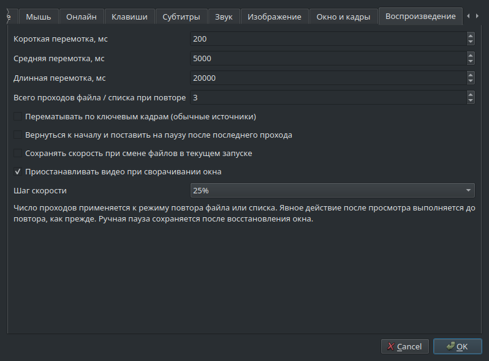

## Extended playlists (0.1.13)

The playlist's ⋯ menu and its context menu provide named tabs (new, rename,
remove), a folder browser, case-insensitive search by title/path, and sorting by
name, full path, creation/modification date, size and duration. Numeric names sort
naturally (2 before 10); unavailable metadata follows known values. Reverse,
shuffle rows and restore original insertion order are independent of shuffled
playback. Original order and stable entry IDs survive restart, including duplicates.
Removing a tab keeps its files. Removing the playing tab stops playback.

Search filters the view; automatic advance still includes the entire playing tab.
Each row shows duration; the footer totals visible known durations and counts
unknown entries. A bounded asynchronous FFprobe process probes local regular files
only, with a five-second timeout. Network protocols are disabled for these probes.
Duration metadata is cached against file size/modification time in the adjacent INI.
No automatic requests are made to URLs or devices. Playback works without FFprobe;
unknown duration is shown as a dash.

Inside the list, Ctrl+C/X copies/cuts selected source entries, Ctrl+V appends, Ctrl+A
selects visible rows and Delete removes rows. Outside the list, Ctrl+V retains the
existing open-from-clipboard action. Copy also supplies file/URL MIME data. Remove
missing ignores URLs/devices. Open folder uses the file manager. Move to Trash is a
separate confirmed command; successful files are removed from all tabs, while failed
moves leave their entries intact. It never falls back to permanent deletion.

MediaInfo opens an asynchronous local file report when `mediainfo` is installed.
Otherwise the dialog explicitly identifies its FFprobe fallback. Reports can be
copied; requests are bounded to ten seconds/1 MiB and cancelled on closing.
New menu commands are available for shortcut remapping. Legacy single-list
profiles migrate automatically without changing history, favorites or playback options.
MPCPL/PLS/ASX/CUE and additional queue policy remain the next plan item (7).

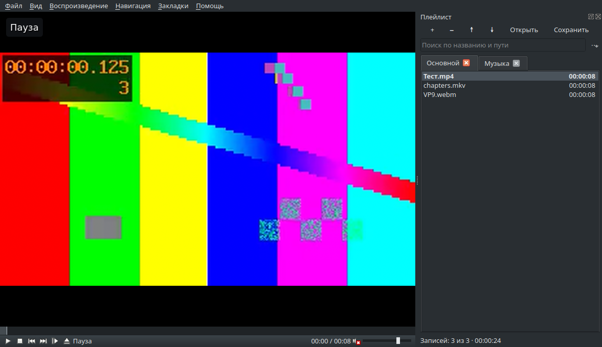

## Playlist formats and policy (0.1.14)

Import local M3U/M3U8, MPCPL, PLS, ASX and CUE files; export M3U/M3U8, MPCPL,
PLS and ASX. CUE imports each media file once and supplies its named INDEX 01
tracks as timeline chapters. Chapter menu and Ctrl+PgUp/PgDown navigate by time,
including 1/75-second CUE fractions. Multi-file CUE keeps separate chapter lists.
CUE is an import format; export an ordinary playlist to retain its chapters.

UTF-8 and BOM-marked UTF-16 input are supported; legacy non-M3U8 text falls back
to Windows-1251. Relative paths resolve beside the playlist, with Windows relative
separators accepted. Absolute Windows drive/UNC paths require mapping to a Linux
path. DirectShow device entries cannot be imported as Linux capture devices.
MPCPL's repeated filename/subtitle fields load external audio/subtitles. ASX reads
ENTRY/REF/TITLE; alternate references, nested ENTRYREF and scripts are not expanded.
Malformed structure fails atomically and preserves the playing queue. Limits are
4 MiB and 10,000 entries. XML DTDs are rejected.

Export retains titles, durations, selected audio/subtitle IDs, external track files
and CUE chapters using optional FoxicMP metadata, alongside standard format fields.
Other players can read ordinary entries but may ignore those extra fields. Track
IDs refer to a file's track list and need revisiting if the media itself changes.
Selected external tracks are also identified by filename because their numeric
IDs can change with asynchronous loading order.

Preferences → Playlist controls advance on playback failure (default off), skipping
already failed rows during later transitions (default on), skipping unsupported
source addresses during import (default off), background duration
(default on), hiding the panel on fullscreen (default on), remembering track choices
per row (default on), and panel placement persistence (default on). Corrupt playlist
structure always aborts import. Playback failures never trigger after-playback
system actions; one failure traversal is bounded even with repeat/shuffle enabled.
A manual stop or replacement invalidates a queued error advance. Failed rows are
marked for the current session; direct selection retries them, and successful
playback clears the mark. Failure marks are not persisted across restarts.

The playlist menu offers left/right/top/bottom docking and a floating window.
Placement, size and visibility are saved beside the executable. The existing
named tabs retain their independent contents and playback ownership.

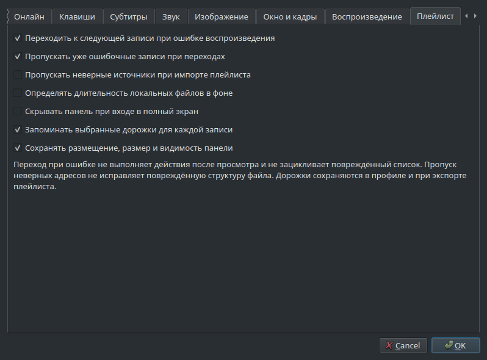

## Window and fullscreen (0.1.16)

View → Interface mode (also in the video context menu) provides Normal, Compact
and Minimal presets. Normal shows the menu, controls, timeline and status with a
system frame. Compact hides the menu/status and uses a thin frame without title;
Minimal shows just video without a frame. Individual menu/control/timeline/status
switches remain independent. Ctrl+0 and the context menu restore access to commands.
The playlist dock retains its own visibility and fullscreen preference.

Preferences → Window behavior controls the condition for Ctrl+T's always-on-top
switch: always, while playing, or while playing video (excluding cover art).
Conditional modes release the flag during pause/stop. Window decorations and
activation are ultimately managed by the desktop environment.

Optional edge snapping uses a 12 logical-pixel threshold at the current screen's
work area. Keep window aspect by video frame is **off by default**. When enabled,
resizing follows the display dimensions/aspect, with space for panels/docks.
Startup size can use saved geometry, a chosen window size, or a chosen video-area
size in logical pixels. Auto-scale at video open offers 50/100/200%; large sizes
fit the available screen. An optional switch restores the geometry from before
playback when closing a file. Remember geometry remains on by default; closing
from fullscreen saves the preceding window geometry.

Preferences → Fullscreen chooses a monitor; a disconnected saved monitor falls
back to the current monitor without forgetting the selection. Startup fullscreen,
exit after the final queue entry, and exit on focus loss are optional. Moving from
one file to the next does not exit fullscreen. Playback repeats continue fullscreen;
manual stop/error does not count as a natural end. Own modal dialogs and open menus
do not trigger the focus-loss policy. Controls/timeline can be shown separately
in fullscreen. Auto-hide defaults to 2500 ms; 0 disables automatic hiding. Mouse
movement restores enabled panels and the cursor. Exit restores window geometry,
maximized state and playlist visibility.

An optional X11 mode switch uses installed `xrandr` to choose an advertised active
output resolution and refresh rate. It never creates modelines or enables outputs.
The previous mode is restored on fullscreen exit and normal application close;
a failed apply also attempts rollback. Disconnected, disabled, rotated/reflected
outputs are excluded from mode selection. Failure leaves playback usable and
reports an error. On Wayland use desktop display settings. Physical multi-monitor,
refresh switching and WM-specific behavior still require hardware validation;
a process crash or power loss cannot execute the normal restoration path.

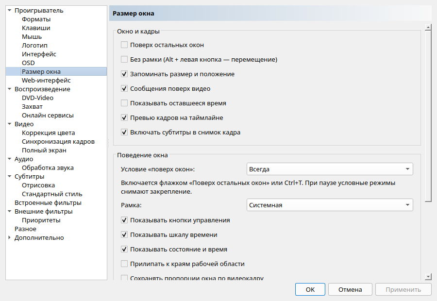
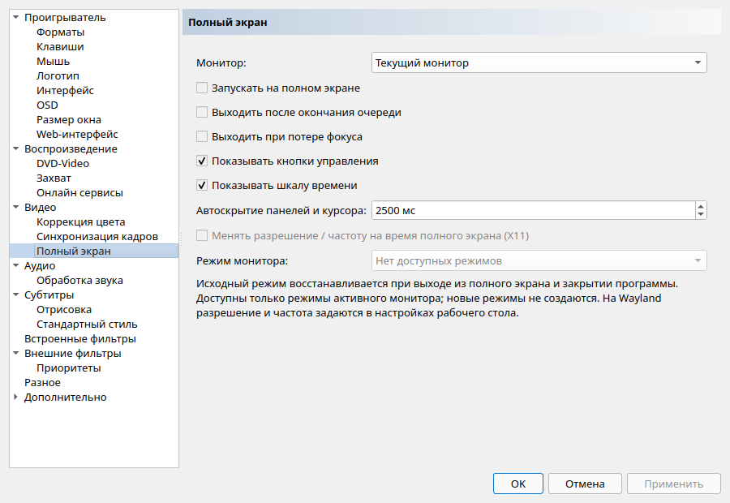

## Appearance, OSD and previews (0.1.17)

Preferences → Appearance offers FoxicMP dark, Light, System and Custom colors.
Custom background/text/selection colors, timeline progress color, 12–48 logical
pixel icons and playlist font/size apply immediately. Chapter lines retain the
requested RGB(94,99,104) default and one logical-pixel width. The logo can use a
local image. Empty, unavailable, oversized or invalid assets fall back to built-ins.
Asset paths resolve relative to the program folder; keep that structure when moving.

A PNG/BMP toolbar strip may contain ten square cells in this order:
play, pause, stop, previous, next, frame, playlist, open, volume, mute.
Classic strips with 15/16 cells are also supported; their existing indices are
mapped to the matching actions, while missing icons use built-ins. BMP magenta
and classic gray backgrounds are treated as transparent. Image loading is bounded
at 4096 pixels per dimension and 16 million pixels. SVG themes and arbitrary
Classic skin packages are not imported.

Russian and English are included; language changes apply after restart. A custom
JSON language pack has a `translations` object mapping original Russian strings
to translations. Use the bundled `translations/en.json` as a complete example.
Placeholders such as `%1` must match; invalid or unavailable packs fall back to
Russian. User file names, titles and named playlist tabs are data and are not
translated. Standard Qt dialogs depend on the installed Qt translation package.
`python3 qt/tools/check_translations.py` verifies source coverage and placeholders.

Preferences → OSD sets font, pixel size, text/background/border colors, background
opacity (0–255), border width, shadow, antialiasing and message duration. Optional
persistent file name, position/duration and wall clock are independent of temporary
messages. The existing On-screen messages switch is the master switch. Name/time
appear while a source is open; the clock can remain visible while idle. These are
Qt overlays, separate from libmpv's screenshot/subtitle rendering.

Preferences → Preview sets width as 5–50% of the current screen work area, bounded
to 160–960 logical pixels. The actual decoded aspect ratio is preserved; rotation
and image filters are applied. A separate ffmpeg worker, debounce, cancellation,
per-stage timeouts and a 16 MiB memory cache keep playback position untouched.
Online HTTP(S) and web-video previews are an explicit opt-in, off by default;
website extraction uses the configured yt-dlp, then a separate HTTP(S) decoder.
Requests select modest video quality for the preview size, preferring H.264.
Moving along one source shares an in-flight extractor request and decodes only
the latest position. Cache/settings/source changes invalidate stale work.

Live inputs, unknown durations, progressive sources and unsupported protocols do
not request previews. Direct streams/pages can deny requests, require login or
expire their media URLs. Protected content is not bypassed. Public VK and local
HTTP range playback were tested; YouTube required bot verification in the current
anonymous run, and the selected Rutube source timed out. These service failures
leave ordinary playback untouched and show an unavailable-preview message.
The timeout setting applies separately to extraction and frame decoding.

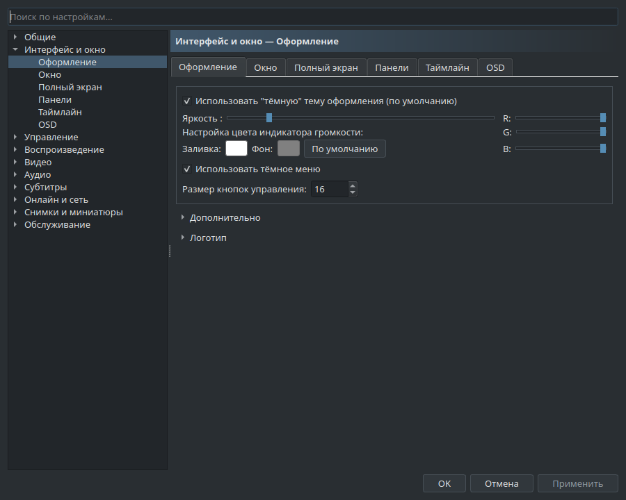
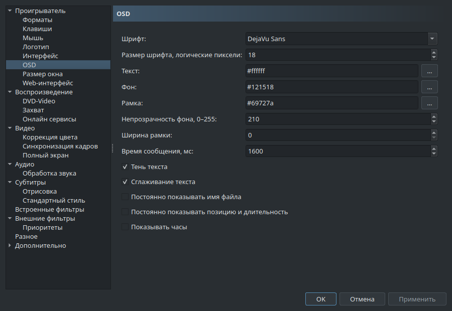
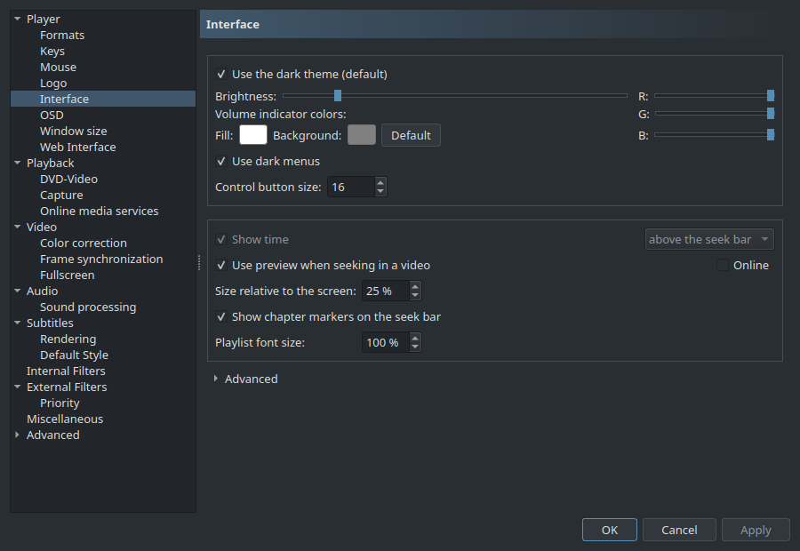

## Scope and remaining work

Classic Windows sources remain independent. Qt Windows packaging, hardware-specific
acceleration validation, long playback, physical A/V latency, DVD/Blu-ray menus,
physical capture/DVB validation and advanced Classic renderer options require further work.
Harvester progressive playback is experimental and limited to local fast-start
MP4/fMP4 H.264/AAC sessions.
GPL v3: see LICENSE.txt. Qt and libmpv runtime libraries are supplied by the OS.

## Keyboard, mouse and remote control (0.1.18)

`Preferences → Mouse` assigns any registered command to single/double clicks of
five mouse buttons and vertical/horizontal wheels, with separate assignments for
no modifiers, Ctrl, Shift and Ctrl+Shift. Separate
columns apply in a window and fullscreen. Legacy `mouse/clickPause`,
`mouse/doubleClickFullscreen` and `mouse/wheelVolume` remain the defaults until
explicit bindings are saved. Single clicks wait for the double-click interval
only when a double-click command is assigned. Dragging beyond the system
threshold cancels the click; video dragging can be disabled, use Alt+left
(default), or use plain left. It is disabled in fullscreen.

The optional empty-player click opens the first history entry only when the
queue is empty; it is off by default. `Ctrl+Shift+E` opens that entry directly.
`B` pauses and minimizes the player; restoring the window keeps playback paused.
Neither operation changes the Classic Windows profile.

New assignable commands include audio/subtitle cycling in both directions,
subtitle visibility, quick track menus, external subtitle loading, audio/subtitle
delay steps and reset, playback information, and video pan/reset. Defaults:

| Keys | Action |
| --- | --- |
| A / Shift+A | Next / previous audio track |
| S / Shift+S | Next / previous subtitle, including disabled |
| W | Subtitle visibility |
| Alt+A / Alt+S | Quick audio / subtitle menu |
| Ctrl+Alt+S | Load subtitles |
| Ctrl+Shift+Left / Right | Audio delay − / + |
| F1 / F2 | Subtitle delay − / + |
| Ctrl+Shift+R | Reset both delays |
| Ctrl+I | Playback information |
| Alt+Backspace | Reset video pan, zoom and fill |
| O | Preferences |

Delay steps default to 100 ms and can be set to 1–10000 ms on the Controls tab.
Optional held-key seeking uses 2× steps after 750 ms, 4× after 1500 ms and 8×
after 3000 ms; it is off by default. Release and focus loss reset acceleration.
Optional left-button holding temporarily selects a playback speed from 2× to 8×
(default 2×), after a delay of 100–2000 ms (default 300 ms). It is off by default
and only starts during playing, non-live media. Release, dragging, focus loss,
other commands and source changes restore the previous rate and suppress the
click. Paused media is not resumed by the hold. This is separate from held-key
seek acceleration. Ordinary repeat is disabled for toggle commands. Media Play, Pause, Toggle,
Stop, Previous and Next also have assignable in-window shortcuts.

External control is enabled by default through the **session** D-Bus using
[MPRIS 2](https://specifications.freedesktop.org/mpris/latest/). The desktop
handles media keys while the player is unfocused; actual routing depends on its
configuration. No global ordinary-key grab or system shortcut configuration is
installed. The Controls tab can turn the service off/on without restarting and
shows its name or connection error. No session bus leaves local playback usable.
The initial service is `org.mpris.MediaPlayer2.FoxicMP`; simultaneous instances
use `.instancePID_SERIAL` suffixes. Object path: `/org/mpris/MediaPlayer2`.

The standard root/player interfaces expose play/pause/stop/next/previous, seek,
metadata, position, rate, volume, repeat/shuffle, fullscreen, raise and quit.
Stale track IDs are ignored by SetPosition; Next/Previous preserve pause. Optional
MPRIS TrackList/Playlists interfaces are not exported. For example, with the
optional `playerctl` tool:

```sh
playerctl --player=FoxicMP play-pause
playerctl --player=FoxicMP position 30
```

`org.foxicmp.Control1.Commands` additionally lists registered action IDs and
labels as `a{sv}`. `Trigger(s)` returns whether the ID was recognized, then queues
the action; it does not report completion of a dialog or asynchronous operation.
Unknown IDs are ignored. This interface executes existing actions, not shell or
arbitrary mpv commands. Example:

```sh
gdbus call --session --dest org.mpris.MediaPlayer2.FoxicMP \
  --object-path /org/mpris/MediaPlayer2 \
  --method org.foxicmp.Control1.Trigger subtitleNext
```

Keyboard-style remotes use the regular bindings; remote software can use D-Bus.
The legacy Windows WinLIRC/uICE TCP protocols are not implemented. Physical
remote/media-key routing in Cinnamon, Wayland and different window managers
still needs target-machine testing. Automated D-Bus checks use a private bus.

## Pan&Scan, cropping and stereo (0.1.19)

`Ctrl+Alt+P` opens the transformation dialog. The same pages are available in
Preferences and Image/Audio settings. Changes apply on OK; Cancel discards both
parameter and preset edits. The View/context menu exposes Pan&Scan commands,
presets and stereo output choices. All registered commands can be assigned to
keyboard/mouse bindings and used by the existing D-Bus command interface.

Width and height scale independently from 20–500%; X/Y offsets are fractions of
the scaled video, −300–300%. The overall zoom remains logarithmic (1 = 2×),
and window fill is 0–100%. Centering resets only offsets; Alt+Backspace resets
width/height, pan, zoom and fill. Reset all transformations also clears cropping,
rotation, flips and stereo choices. Rotation is clockwise in 90° steps; horizontal
and vertical flips can be combined. Scale step commands use 2%, diagonal movement
and independent width/height controls are available.

Cropping removes 0–45% from each edge, then optionally crops the center to 4:3,
16:9, 1.85:1, 2.35:1 or 2.39:1. Aspect cropping accounts for sample aspect ratio;
dimensions round down to even pixels. It changes the source image instead of
stretching it. Processing order: stereo conversion, edge crop, aspect crop,
horizontal/vertical flip, rotation, color correction; display scale/pan follows.
Timeline previews and saved video frames share source transforms and colors.
They do not reproduce the current window's display zoom, pan, fill or black bars.

Transforms persist for the current process and across file changes. Remember
between launches is off by default and stores a sanitized JSON state next to the
program when enabled. Existing legacy rotation is read on migration. Saving the
new settings supersedes the legacy rotation setting. Disabling persistence removes
the saved state, while keeping the current transform until exit. It does not
delete presets. Up to 32 named presets can be added, loaded, updated, renamed,
reordered by drag and removed. Built-in presets cover original/fill, 4:3 → 16:9
stretch, 16:9 crop and 2.35:1 crop; each replaces the full transform state.

Stereo accepts full/half side-by-side and over/under with either eye first,
interleaved rows and columns. Auto uses recognized `video-params/stereo-in`
metadata; without it, the image remains unchanged. Select an explicit input
format for untagged packed video. Output choices include pass-through, either eye
as mono, interleaved rows (also double dimensions), full/half over/under and
side-by-side, red/cyan color or Dubois anaglyph, interleaved columns and checkerboard.
Swap changes the eye order without changing the output format. Conversion uses
FFmpeg's `stereo3d`; packed dimensions are padded to multiples of four (at most
three edge pixels) before conversion. Interleaved rows retain all rows from both
eyes; the double-size mode doubles width and height before interleaving. Half
formats account for a squeezed eye dimension; output pixel dimensions depend on
the input/output layout and its aspect handling.

This processes existing packed stereo; it does not synthesize depth from 2D,
decode Blu-ray MVC, control shutter glasses, or guarantee physical panel row
alignment. Those require hardware/desktop validation. Qt does not claim the
Classic Windows renderer's exact stereo geometry. The source specifications are
[mpv video options](https://mpv.io/manual/stable/#video) and
[FFmpeg stereo3d](https://ffmpeg.org/ffmpeg-filters.html#stereo3d).

## Subtitle editing and source policy (0.1.20)

`Ctrl+Alt+R` opens the selected text subtitle track in a cue table. Edit start/end
times and text, search, seek to a cue, copy its text, shift all cues or bind a
selected cue's start to the current video time. Two reference points correct both
offset and gradual drift with a linear time transformation. Invalid or negative
timestamps reject the entire operation. Overlapping cues remain allowed.

Supported editable files: SRT, ASS/SSA, and simple WebVTT. ASS keeps its script,
styles, comments, actor/layer/effect and inline tags when saved back to ASS. ASS
start times round down and ends up to centiseconds. Export to SRT/WebVTT retains
plain text/timing and drops ASS styling. WebVTT cue identifiers and settings are
kept; files containing NOTE/STYLE/REGION blocks are rejected for editing to avoid
silently losing them. Bitmap subtitles are not OCR'd. The text editor is bounded
to 16 MiB, 50000 cues and seven days of timestamps.

**Apply copy to player** creates a new UTF-8 file under `Subtitles/Edits` next to
the program, selects it, and resets the runtime subtitle delay. It never overwrites
the source. **Save as** writes to the chosen location atomically, including an
existing source only when explicitly selected. Closing/Escape asks before dropping
unsaved edits. A source change while the editor is open prevents applying its copy
to the new media. Jumping from the table includes the current runtime subtitle
delay; synchronization anchors use video time, so do not add that delay again.

For an embedded text track in a local media file, FFmpeg extracts a temporary SRT
copy asynchronously with cancellation and a 20 second limit. This conversion
does not retain embedded ASS styling. Disc, live and remote embedded extraction
are not supported. The temporary extraction is removed when the editor closes;
an applied copy remains available in the portable profile.

The **Subtitles — files** preferences page adds up to 32 search folders, explicit
encodings, external preference, embedded blocking, automatic reload and an external
editor executable. Relative search folders follow the video directory. Explicit
selection and remembered playlist tracks take precedence over external preference;
embedded blocking also applies to remembered tracks, cycling and secondary subs.
Automatic reload is off by default and waits for two matching changed file hashes
before reloading the selected local external track. Atomic replacement is detected.
Editor auto decoding checks UTF-16 BOM, then UTF-8, then Windows-1251; KOI8-R and
other supported legacy encodings must be selected explicitly. Playback auto decoding
is performed by libmpv. Save supports UTF-8, CP1251, KOI8-R, UTF-16LE/BE with BOM,
and Latin-1; unrepresentable output fails without replacing an existing file.

`Ctrl+Alt+PgUp`/`Ctrl+Alt+PgDown` seek to previous/next cues. Menu commands can sync the
previous/next cue to now, reload, copy displayed text or open the selected file in
the configured external editor. They also appear in key/mouse bindings and D-Bus.
Native cue navigation for embedded tracks is limited to decoded/prefetched cues;
it and the synchronization editor are disabled for live and progressive sessions
to preserve cache seek limits.
The relevant native commands are documented in the
[mpv 0.37 command reference](https://github.com/mpv-player/mpv/blob/v0.37.0/DOCS/man/input.rst).

This is the first block of parity item 13. Advanced subtitle layout/rotation,
independent X/Y scale, extended colors/alpha and renderer buffering remain planned.

## Subtitle layout and appearance (0.1.21)

`Ctrl+Alt+T`, the Subtitles menu, and Preferences provide three new pages:
layout, ASS geometry, and colors/shadow. **Enable additional styling** is off by
default. The pages support horizontal/vertical alignment, line justification,
side/vertical margins, letter/line spacing, bold/italic, blur, colored shadow,
background, and separate opacity controls for text, outline, secondary color,
shadow and background. Percent opacity multiplies the color's alpha channel.
The existing text/outline color pickers now retain alpha. Reset only resets the
additional style fields; Cancel discards edits. The portable INI stores them.

Plain SRT supports alignment, margins, spacing, shadow/background and opacity
directly through libmpv. Its converted libass style resets independent X/Y scale
and does not offer a native horizontal percentage offset. For these features,
open the cue editor (`Ctrl+Alt+R`), enable **Apply as an ASS copy with my styling**,
then **Apply copy**. This explicitly replaces source formatting with plain cue
text in a new `Subtitles/Edits/foxicmp-styled-*.ass` beside the program. Text ASS
tags/HTML formatting are stripped; braces/backslashes in plain text are escaped
to prevent creating ASS commands. The source file remains intact. The copied
track supports independent X/Y scale (20–300%), rotation (−180–180°), and an X
anchor offset (50% = no shift; 0/100% shifts half a frame left/right). Its canvas
is 1280×720. Selected styled copies are rebuilt when style settings change and
when reopened; they are intended as player-managed plain-text copies.

Authored ASS keeps its style unless the existing **Apply my style to ASS/SSA**
option is enabled. With additional styling enabled, sanitized ASS style overrides
apply font, scale, angle, colors, alignment, margins and shadow. Inline ASS tags
can take precedence, and sizes use the author's script canvas. The exact X
percentage is specific to generated copies. Secondary color is visible in ASS
karaoke, rather than normal plain text. Background replaces shadow. Bitmap
subtitles are unaffected. **Allow positioning in black borders** permits the
renderer to use margins; it does not force positioned ASS signs into them.

The backend behavior was checked against
[mpv 0.37 subtitle options](https://github.com/mpv-player/mpv/blob/v0.37.0/DOCS/man/options.rst)
and [its ASS renderer](https://github.com/mpv-player/mpv/blob/v0.37.0/sub/sd_ass.c).
Subtitle renderer/buffering controls remain the next part of parity item 13.


## Subtitle rendering and compatibility (0.1.22)

Ctrl+Alt+T now includes Rendering and Compatibility pages, also available in
Preferences. Text uses libass through libmpv: hinting none/light/normal/native,
complex HarfBuzz or simple FriBidi shaping, embedded MKV/ASS fonts, window-relative
scaling, and VSFilter aspect/blur/color compatibility. Defaults match libmpv 0.37;
existing profiles need no migration. These settings are independent of the
additional style switch. Cancel discards edits; Reset affects only these two pages.

Font and rendered bitmap caches are automatic. libmpv exposes no separate subtitle
frame queue capacity, libass glyph-cache size, or MPC subtitle renderer selection.
The Clear on seek checkbox controls text event caching for broken MKV ReadOrder
values; it does not disable font/video caching or change media network buffers.
It is off by default. Live/progressive input is never sought to refresh settings.

Short text gaps/overlaps below 210 ms can be corrected during display; libmpv
requires ASS style override for this option, including converted SRT. SRT cue
stretching lasts until the next cue and does not apply to authored ASS. Both
options are off by default and never rewrite the source file. Bitmap controls
include grayscale, Gaussian blur 0–3 and DVD/screen/video-resolution scaling.
Subtitle updates can continue while audio outlasts the video.

Hard font changes refresh selected external subtitles after libmpv processes the
option; selected embedded text is refreshed at the current position when seeking
is available. Pause, subtitle delay and selection are retained. Hardware GPU,
Wayland and complex real-world ASS typography still require target-device checks.

Backend reference: [libmpv 0.37 options](https://github.com/mpv-player/mpv/blob/v0.37.0/DOCS/man/options.rst),
[subtitle option defaults](https://github.com/mpv-player/mpv/blob/v0.37.0/options/options.c),
[ASS decoding and timing](https://github.com/mpv-player/mpv/blob/v0.37.0/sub/sd_ass.c).


## Audio processing and mixing (0.1.23)

Ctrl+Alt+A opens Processing, Normalization and Mixer pages; the same pages are
available in Preferences and Image/Audio settings. Added gain −20…20 dB,
stereo balance −100…100, channel swap/left/right/average, optional peak limiter,
and ReplayGain track/album/off with preamp, fallback gain and peak-tag clipping.
Nonzero balance or a special stereo channel mode forces stereo output; ordinary
channel order and zero balance preserve the selected output layout.

Dynamic normalization retains the old enabled/disabled setting and defaults
(f=250 ms, g=31, p=0.9, m=10). Frame length 10–1000 ms, smoothing window 3–101
rounded upward to odd, target peak/RMS, maximum gain, coupled channels and DC
offset removal are configurable. It buffers adjacent frames and adds latency;
changing filter settings rebuilds the audio chain and can cause a brief gap.

The optional FFmpeg mixer supports mono, stereo, quad, 4.0, 5.0, 5.1, 5.1(side)
and 7.1, with center/surround/LFE contributions and matrix normalization. Quad is
FL FR BL BR; 4.0 is FL FR FC BC. Factors affect channels folded into the requested
layout; they are not independent gains for speakers preserved by that layout.
The audio server or device may mix again. This does not synthesize a surround
scene from a stereo recording. Decoder downmix stays disabled, matching libmpv's
existing default, so the mixer receives decoded source channels.

Processing order: mixer → stereo routing/balance → gain → dynaudnorm → limiter.
libmpv ReplayGain/volume controls are separate; the limiter is not a guarantee
against later gain outside this chain. All new processing is neutral/off by
default. Existing audio/channels, device, volume, mute and normalize are retained.
Cancel leaves settings unchanged; Reset only resets these three new pages.
Settings are sanitized and stored beside the program in FoxicMPQt.ini.

The filter graph is passed through native libmpv nodes, preserving commas and
option separators. Identical graphs are not rebuilt by unrelated preferences
changes; immediately rejected property updates restore the previous chain.
Acceptance of a filter option does not validate deferred decoder initialization;
Version 0.1.25 also exposes user chains, preflighted by FFmpeg on stereo 48 kHz; other layouts and libmpv builds still require playback checks. No microphone or
system mixer is touched by these controls. Mixer diagnostics report the decoded
and player-output layout, rate and format; they do not claim the final hardware
format after the system server.

Processing was the first part of parity item 14 in 0.1.23. Version 0.1.24
adds second output and external audio search/priority; 0.1.25 adds the user filter editor/presets.
Version 0.1.26 adds PCM formats/rates and passthrough/decoder controls.

API references: [libmpv 0.37 audio options](https://github.com/mpv-player/mpv/blob/v0.37.0/DOCS/man/options.rst),
[libmpv audio filters](https://github.com/mpv-player/mpv/blob/v0.37.0/DOCS/man/af.rst),
[FFmpeg 6.1 filter documentation](https://github.com/FFmpeg/FFmpeg/blob/n6.1/doc/filters.texi).


## External audio and duplicate output (0.1.24)

Ctrl+Alt+A → Audio — files and outputs adds external audio search off/exact/fuzzy/all,
up to 32 search folders (relative to video, one per line), optional extension list,
and native/external/embedded selection priority. Defaults preserve previous behavior:
search off, native selection, duplication off. Changing search adds tracks without
removing open ones. Manual keyboard/menu choices and remembered playlist selections
win. Already loaded external tracks are reused when opening or restoring them.
Progressive sessions/live inputs disable automatic audio discovery; progressive
sessions also bypass priority. Explicit local external audio opening remains available.

Duplicate output uses a single decoder and a private module-combine-sink lease,
through PulseAudio or PipeWire's PulseAudio server. Choose the primary output on
Audio and a different pulse/ device on Files and outputs. Requires python3, pactl
(pulseaudio-utils), and helpers/audio_output.py beside the binary. The system
preferred output and other applications' volume/routing are not changed. The
helper polls device availability, falls back to the primary device on loss, and
retries when the device returns. Its stdin pipe is the lifetime lease: normal
shutdown or parent process death closes it; the helper removes only the module
whose ID, type and unique name still match its ownership. Hard-killing the helper
itself or prolonged server failures may prevent cleanup; the server discards its
modules on restart. Multiple instances use independent names. Temporary routes
are hidden from normal device pickers. No second independent media decoder is used.

Both devices receive decoded PCM; this is not independent-track playback and is
not intended for passthrough. Sound-server rate matching does not guarantee sample
alignment on physical Bluetooth/USB/HDMI outputs. Device switches can briefly
interrupt playback. Without supported devices/tools/module support the primary
output remains selected and the page reports the reason. Native ALSA dual output
and separate output delays/volumes are not implemented.

Version 0.1.26 implements the remaining PCM format and passthrough/decoder controls. Physical devices and A/V delay with DSP/dual output
still require target-machine verification.

Backend sources: [mpv audio-file-auto](https://github.com/mpv-player/mpv/blob/v0.37.0/DOCS/man/options.rst),
[PulseAudio combine sink](https://github.com/pulseaudio/pulseaudio/blob/v16.1/src/modules/module-combine-sink.c),
[PipeWire combine sink](https://docs.pipewire.org/1.2/page_pulse_module_combine_sink.html).

## User audio filters and presets (0.1.25)

Ctrl+Alt+A → Audio — filters provides a plain FFmpeg filter-chain editor.
It adds one audio input/output chain after normalization and before the limiter;
filters are comma separated, e.g. `highpass=f=100,lowpass=f=8000`. This edits
playback processing, without changing the source file. The switch defaults off;
disabling retains text. Empty text adds no filter. Reset my chain clears and
disables only this chain; the existing processing reset covers its original
three pages. All dialog changes require OK, including custom preset changes.

Built-in presets: no processing, speech frequency cut, gentle bass boost,
gentle treble boost and −6 dB. Load copies the chosen text into the editor and
keeps the enable switch unchanged. Up to 64 named custom presets (80 characters
per name, 8192 per chain) live in `audio/filterPresetsV1` in the portable INI.
Save with an existing name asks before replacement; built-in presets are fixed.
Import replaces the staged custom list; Cancel discards it. Export writes that
staged list immediately to a chosen JSON file. Format is
`{"format":"FoxicMP-audio-filters-v1","presets":[{"name":"Half","graph":"volume=0.5"}]}`.
Import is limited to 1 MiB and rejects invalid, duplicate or oversized entries.
Presets store only the custom chain, independently of mixer/gain/normalizer.

Validate chain and OK with the switch on run FFmpeg without a shell, with
48 kHz stereo input and a three-second deadline. Failure keeps the dialog open
without saving settings. FFmpeg must be in PATH. Disabled text may be retained
without running it. At application time an invalid enabled profile chain is
bypassed while the built-in processing remains; the Filters page reports the
error. Unchanged custom chains are cached per player. Native libmpv filter
property errors restore the previous chain; deferred initialization errors with
other source formats/builds remain possible. A successful preflight cannot
prove all source channel layouts or physical A/V latency. Filters such as
`atempo` and `adelay` can change timing; no automatic compensation is claimed.

[FFmpeg filter syntax](https://ffmpeg.org/ffmpeg-filters.html#Filtergraph-syntax).

## PCM format, passthrough and decoder (0.1.26)

Ctrl+Alt+A → Audio — format and decoder also appears in general preferences.
PCM choices: automatic (default), Int16, Int24 in Int32, Int32 and Float32.
Rates: automatic (default), 32/44.1/48/88.2/96/176.4/192 kHz. A final native
libmpv format filter forces conversion after processing; Auto removes it.
The audio server/device can still convert. libmpv 0.37 has no packed s24 output:
Int24 truncates samples to multiples of 2^-23 in an Int32 container, without
noise dithering. Optional resampling precedes this quantization. ReplayGain,
normal software volume and later server conversions can change low bits;
this does not set DAC bit depth or guarantee a bit-perfect hardware path.

Decoder controls: 0–16 threads (0 auto, default 1), AC-3 DRC 0–1 (default 0),
decoder downmix (default off) and preferred installed audio decoder with normal
automatic fallback. Missing stored decoders fall back to automatic selection.
The custom mixer receives original channels and overrides decoder downmix.
DRC requires compression metadata; threads are supported only by some codecs.
Changes restart the selected audio track, preserving video and pause, and can
briefly interrupt audio. Reset restores this page only; Cancel saves nothing.
All settings remain in the adjacent portable INI.

Bitstream defaults off. Codec switches cover AC-3, DTS core, DTS-HD, E-AC-3
and TrueHD; initially only AC-3/DTS are selected. Compatible hardware, drivers
and a receiver are required. Processing, ReplayGain, forced channel layout,
dual output, speed other than 1×, AC-3 DRC or decoder downmix suppress bitstream
without erasing its saved selection. Returning to a compatible configuration
restores the request. The page reports the requested policy and actual libmpv
output/decoder separately. While passthrough is allowed, forced PCM format/rate
are bypassed for that session; unsupported source codecs decode normally.
Software volume does not control receiver level in passthrough mode.

Automated checks write PCM/IEC 61937 to files, never to a receiver. Physical
HDMI/S/PDIF, codec compatibility across receivers, speaker synchronization and
A/V delay still require hardware checks. libmpv can fall back or fail if an
output rejects an encoded stream; a requested policy is not proof of hardware
passthrough. This completes the software controls of parity item 14, subject
to those hardware limitations. Next is item 15, video output and processing.

Backend reference: [mpv 0.37 audio options](https://github.com/mpv-player/mpv/blob/v0.37.0/DOCS/man/options.rst).

## Video scaling and decoding (0.1.27, parity item 15 begins)

Ctrl+Alt+V opens Video output and decoding, also available from View, the
context menu and general/image preferences. Software scaling uses the selected
libswscale kernel: nearest, bilinear, bicubic, Lanczos, spline or area. An
explicit selection disables zimg so the kernel is respected. libmpv default
restores the original scaler and zimg preference captured for that Player.
Separate OpenGL scale/dscale/cscale choices apply to GPU output only; software
fallback keeps the choices and uses the software kernel. Default GPU choices
restore the original native options. These controls do not change Pan&Scan.

Decoder page: hardware master (same checkbox as general preferences), auto-copy,
VA-API copy, NVDEC copy or VDPAU copy; native codec whitelist by default, or a
custom selection of H.264/HEVC/VP8/VP9/AV1/VC-1/MPEG-2/ProRes. An empty custom
list disables hardware decoding. Existing playback/hardwareDecoding remains
the master. Defaults retain auto-copy and libmpv's original whitelist. Copy-back
keeps compatibility with software filters; it is not direct GPU rendering.
Unsupported codecs/methods fall back to CPU where libmpv supports it. This does
not prove driver support or accelerate every format. Software decoder threads
0–16 (0 auto) and failed-frame fallback count 1–16 (default 3) are exposed.
Thread/codec whitelist changes can require reopening media; hardware changes may interrupt
video. The page reports actual renderer, hwdec-current and decoded format.

Deinterlacing defaults off and uses libmpv's chosen automatic filter algorithm.
Enable for interlaced sources, not all video: progressive content can lose
quality. This is on/off, not an automatic interlace detector or an algorithm
editor. Applying settings preserves pause; Reset covers these two pages and
restores the hardware master to its previous default (enabled). Cancel writes
nothing. Settings stay beside the program; installation is a separate step.

GPU kernels and hardware APIs require physical GPU checks; Xvfb with Mesa
llvmpipe uses the existing Software fallback. Color/precision/range management,
VSync/display synchronization, shaders/editor and detailed renderer statistics
remain in item 15.

Backend reference: [mpv 0.37 scaling and decoding options](https://github.com/mpv-player/mpv/blob/v0.37.0/DOCS/man/options.rst).


## Color and precision (0.1.28, parity item 15 continues)

Ctrl+Alt+V adds Video — color and precision. Software frame precision is 8 bits
per component by default, or 16-bit RGBX64. The latter requests native-endian
RGBA64 from libmpv's software Render API and retains extra source levels in the
in-memory framebuffer. It doubles frame memory. Qt's display/compositor and filters can reduce precision. This is
not a 10-bit display mode or HDR passthrough. The existing image adjustment
filters may negotiate an 8-bit intermediate format.

OpenGL options cover output RGB range (native/full/limited), intermediate FBO
format, dither target depth, target primaries, SDR transfer curve and HDR-to-SDR
tone mapping. Defaults restore native values captured before application. GPU
options have no effect in Software or software fallback. They do not change the
final RGBA8 Qt surface. Native property acceptance/reset is tested, not physical
GPU rendering, display calibration or HDR signal delivery. ICC profiles and
monitor profile discovery remain future work.

Image preferences now include hue −180…180 degrees and gamma −100…100. Gamma
factor is 2^(value/100), ranging 0.5…2.0 with neutral 1.0. Both use the shared
FFmpeg chain for playback, previews and frame extraction; Pan&Scan composition
is retained. Default zero values insert no filters. Reset Image clears all five
image controls. Reset Color and precision covers only its own page; the old
scaling/decoding reset stays independent. Cancel writes nothing. The installed
0.1.26 and its profile were not updated by packaging.

Tests count distinct framebuffer levels in a 10-bit greyscale gradient, verify
8→16→8 restoration while paused, native subtitle blending in the 16-bit frame
and playback continuation, compare hue/gamma
pixels with a separately extracted FFmpeg preview, and cover property/default
round trips and dialog Cancel/OK/independent resets.

Backend reference: [mpv 0.37 color options](https://github.com/mpv-player/mpv/blob/v0.37.0/DOCS/man/options.rst)
and [software Render API implementation](https://github.com/mpv-player/mpv/blob/v0.37.0/video/out/libmpv_sw.c).


## ICC profiles and display synchronization (0.1.29, item 15 continues)

Ctrl+Alt+V adds ICC profile and Synchronization pages, also in general and image
preferences. ICC is disabled by default. Select a valid RGB display ICC up to
16 MiB; LittleCMS validates its structure and an sRGB-to-profile transform.
Only OK copies the selected bytes to ColorProfiles/<sha256>.icc beside the
program and stores a relative path. Identical imports reuse the same file;
Cancel does not copy anything. Invalid files or write failures keep the dialog
open. Reset clears selection and disables ICC without deleting copied profiles.
Four rendering intents are available, with relative colorimetric as default.

libmpv applies manual ICC only in OpenGL, overriding target primaries/transfer.
Software fallback retains settings but does not apply ICC. Display ICC does not
change FFmpeg previews or ordinary video screenshots. Invalid startup INI
profiles are bypassed with status feedback. Automatic OS profile discovery and
per-monitor profile assignment are still pending. The native ICC LUT disk cache
and native ICC auto lookup are disabled, preventing use of ~/.cache/mpv.
LittleCMS adds a runtime dependency on liblcms2-2 and build dependency on
liblcms2-dev (CI dependency declaration updated; the workflow was not executed).

Audio remains the default sync mode. Display-resample, display-tempo and
display-vdrop are optional; Qt VSync interval 1 or 0 requires restart. The
constructor configures Qt's actual QSurfaceFormat and the matching libmpv
option; changing a native mpv swap option alone cannot control Qt presentation.
Refresh hint is current QScreen refreshRate unless overridden with 1–1000 Hz
(0 selects Qt). Limits: video speed correction 0–5%, default 1%; additional
audio correction 0–1%, default 0.125%. Optional GPU interpolation and temporal
kernel native/oversample/linear/mitchell are exposed. These may change playback
speed and sound; this is temporal interpolation, not AI frame generation.

Display mode policy requires a visible, ready OpenGL renderer, reported/requested
swap interval 1, a positive finite refresh hint and disabled bitstream. Software
fallback, minimizing, interval 0 or bitstream uses audio temporarily without
changing the saved selection. A one-second timer rechecks screen/visibility/
bitstream state and restores the request if eligible. Interpolation is active
only with a display request. Default native tscale is captured and restored.
UI render polling remains 16 ms in audio mode and uses a 1–16 ms interval in
display mode, based on refresh hint, without blocking UI for a target time.

The diagnostics distinguish requested/native video-sync from display-sync-active
and show refresh estimate, native avsync and frame-drop count. Qt refresh and
swap format values do not prove physical VBlank synchronization; compositors
and drivers can override VSync. No monitor modes or HDR signaling are changed.
ICC reset and sync reset do not reset the other page or older video controls.

Tests use a generated ICC, portable copy/dedup/move, invalid headers/device
class/oversize and write-failure checks; all three dialogs validate before
saving. Pause, seek, continuation and native A/V clock are exercised on a
synthetic FFV1+PCM source and private Pulse null sink. GPU properties and policy
branches are checked separately, without claiming physical ICC/VSync results.

References: [mpv 0.37 options](https://github.com/mpv-player/mpv/blob/v0.37.0/DOCS/man/options.rst),
[Qt swap interval](https://doc.qt.io/qt-6/qsurfaceformat.html#setSwapInterval),
[LittleCMS API](https://github.com/mm2/Little-CMS/blob/lcms2.14/include/lcms2.h).


## Shader editor and renderer statistics (0.1.30, item 15 continues)

Ctrl+Alt+V adds a managed shader chain, disabled by default. Up to 16 entries,
64 KiB each, with name, enable checkbox, order and MAIN (before scaling) or
SCALED (after scaling, before color management). Order applies within stages;
MAIN always precedes SCALED. Four original templates: identity, greyscale,
invert, gentle sharpen. The editor accepts one vec4 hook() per entry with
HOOKED texture helpers; it does not import arbitrary multi-pass mpv/HLSL shaders,
metadata/directives, compute or external texture blocks.

Enabled sources are compiled/linked in a separate foxicmp-shader-check process
using a small OpenGL 3.3 wrapper and a four-second limit per entry; validation
does not draw user code. Invalid enabled sources keep each preferences dialog
open. A disabled chain may retain incomplete GLSL. Compiler validation is not
proof of native mpv pipeline execution on the player's GPU. Startup INI is
checked structurally, not compiled again; native delayed shader failures need
image/pass inspection. In this VM the isolated compiler and controlled pixel
probes use Mesa llvmpipe, while the player still uses Software fallback.

OK stores source text in the portable INI and materializes hash-named files
under Shaders beside the program. HOOK/BIND/DESC are generated, absolute paths
rebuilt for the current profile folder, preserving portability. The native
list uses mpv node arrays, so paths are not colon-split. Disable/reset removes
native hooks but retains generated files. Cancel does not save or generate files.
Software retains the request with no shader effect. Other video controls remain
independent. No profile, generated user shader or history is bundled in archives.

Ctrl+Alt+G opens a nonmodal statistics dialog: actual backend/driver, codec,
hardware decoder, FPS estimates, requested/active sync, avsync/jitter and drop
counters. Unavailable values are shown as an em dash. Qt timings are UI render
call durations, last/average/peak over 120 calls, not physical display latency
or video FPS. OpenGL grab/redraw calls may be included; these include GL finish
and are not standalone GPU timer queries. Native fresh/redraw render passes
appear only when available; Software does not fabricate GPU passes. Reset
clears local samples and native counter baselines without changing playback or
settings. New media resets measurements. JSON can be copied to the clipboard.

The optional moving vertical line is a Qt compositor overlay, not a native
video/shader pass; playback continues underneath and closing the dialog removes
it. It is a visual diagnostic, not an automated absence-of-tearing claim.
Physical GPU/ICC/VSync/display-sync and OS/per-monitor ICC lookup remain open.

References: [mpv 0.37 GLSL hooks](https://github.com/mpv-player/mpv/blob/v0.37.0/DOCS/man/options.rst),
[mpv render-pass properties](https://github.com/mpv-player/mpv/blob/v0.37.0/DOCS/man/input.rst).

В 0.1.31 добавлен **автоматический ICC текущего экрана через colord в X11**.
В **Ctrl+Alt+V → «Видео — ICC-профиль»** включите ICC и выберите источник
«Автоматически для текущего экрана». По умолчанию остаются ICC off и ручной
источник; прежние профили не переключаются автоматически после обновления.

Плеер запрашивает устройство с точным `XRANDR_name` текущего экрана окна,
проверяет принадлежность пользователю/системе, тип display и состояние Enabled.
Профиль по умолчанию запрашивается через `GetProfileForQualifiers(["*"])`;
первый элемент массива Profiles не используется. Запрет применения во время
калибровки соблюдается. Нет подстановки профиля основного/другого экрана.

Запросы D-Bus асинхронные, до 1,5 секунды на вызов; запоздавшие ответы для
предыдущего экрана или режима отбрасываются. Перенос окна отслеживается через
Qt screenChanged, с резервной проверкой каждые 500 мс; смена системного
назначения/содержимого профиля проверяется раз в 5 секунд. Прежний ICC при
смене экрана снимается до завершения нового запроса. Отсутствующий, недоступный,
запрещённый или повреждённый профиль снимает ICC с понятным статусом.

Найденный RGB display ICC до 16 МиБ проходит ту же проверку LittleCMS и
копируется в `ColorProfiles/<SHA-256>.icc` рядом с программой. Текст настроек
хранит только выбранный режим; автоматический путь не перезаписывает ручной
`video/iccProfile`. Одинаковые байты используют одну копию, старые копии
автоматически не удаляются. Системные назначения и калибровка не изменяются.
Служба `colord` нужна только для автоматического режима. Native
`icc-profile-auto` и LUT disk cache остаются выключенными: поиск выполняет
FoxicMP, а цветовое преобразование — libmpv при OpenGL.

В Software выбор и диагностика доступны, преобразование ICC не действует.
Wayland пока использует ручной режим: этот выпуск не реализует протокол
управления цветом композитора. Виртуальные экраны и подменная служба проверяют
логику, но не подтверждают физический цвет/калибровку/GPU или несколько
реальных мониторов. Установленная копия созданием архива не обновляется.

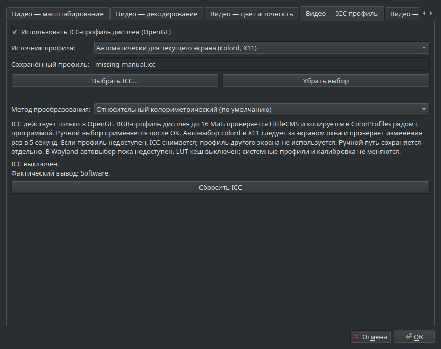


В 0.1.32 реализован пункт 16 — **свойства, диагностика и сохранение**.

- **Ctrl+Alt+I** — свойства текущего источника: контейнер, размер/длительность,
  разрешение/FPS, кодеки/битрейты, частота/каналы звука, таблица дорожек,
  теги/главы и состояние декодера/кеша в JSON. Окно не блокирует плеер;
  «Обновить» получает новый снимок сведений. JSON и отчёт копируются отдельно.
  По кнопке читается MediaInfo, при его отсутствии FFprobe. Только локальный
  файл, тайм-аут 10 секунд, отчёт до 1 МиБ. Сетевой источник не опрашивается
  дополнительной программой; его свойства берутся из уже открытого libmpv.
- **Ctrl+S** — сохранить кадр с выбором файла, **F12** — сохранить без диалога
  в настроенную папку (по умолчанию `Screenshots` рядом с программой),
  **Alt+C** — кадр в буфер. В меню «Файл» также снимок отображаемой области
  видео с полями, масштабом и Qt OSD. Функции доступны и в контекстном меню.
- **Настройки снимков и миниатюр**: PNG/JPEG/BMP и WebP при доступном плагине
  Qt, качество 1–100 (по умолчанию 90), субтитры. PNG/BMP без потерь;
  JPEG/WebP зависят от качества. По умолчанию PNG и субтитры включены.
  Отмена не сохраняет изменения, сброс возвращает значения по умолчанию.
- **Сохранить лист миниатюр**: от 1×1 до 6×10 кадров, ширина 80–480 пикселей
  (по умолчанию 4×4, 240). Равномерные моменты внутри длительности и подписи
  времени. FFmpeg читает выбранную внутреннюю видеодорожку локального файла;
  субтитры, фильтры плеера, ICC и шейдеры к листу не применяются. Генерация
  не перематывает плеер, показывает прогресс и поддерживает отмену.
- **Сохранить копию медиафайла**: побайтовая копия готового локального файла,
  без перекодирования. Прогресс, отмена, проверка размера/времени изменения
  источника. Запись через QSaveFile: отмена/ошибка сохраняют прежнее содержимое
  файла назначения. Заменять исходный файл копией или снимком нельзя.

Кадр запрашивается асинхронно в память через libmpv `screenshot-raw`, без
промежуточного файла; данные копируются до освобождения ответа libmpv.
Поддерживается layout bgr0 с положительным stride, до 33 554 432 пикселей; иной layout
возвращает ошибку. Затем Qt кодирует изображение через QSaveFile. Это снимок
видеокадра, а не физического цвета экрана после композитора/ICC монитора.
Снимок области — Qt widget grab и включает OSD; физический HDR/GPU этим не
подтверждается. Позиция, пауза и параметры воспроизведения не меняются.

Миниатюры и копирование не поддерживают незавершённый progressive-сеанс,
диски/устройства и сетевые адреса. Файл копируется небольшими блоками между
событиями Qt; медленная файловая система может задержать отдельную операцию
ввода/вывода. Копия относится к одному исходному файлу, без внешних дорожек.
Настройки хранятся в соседнем INI, результаты — в выбранных пользователем
папках. Личные файлы/профили в архив не входят; установленная копия не обновляется.

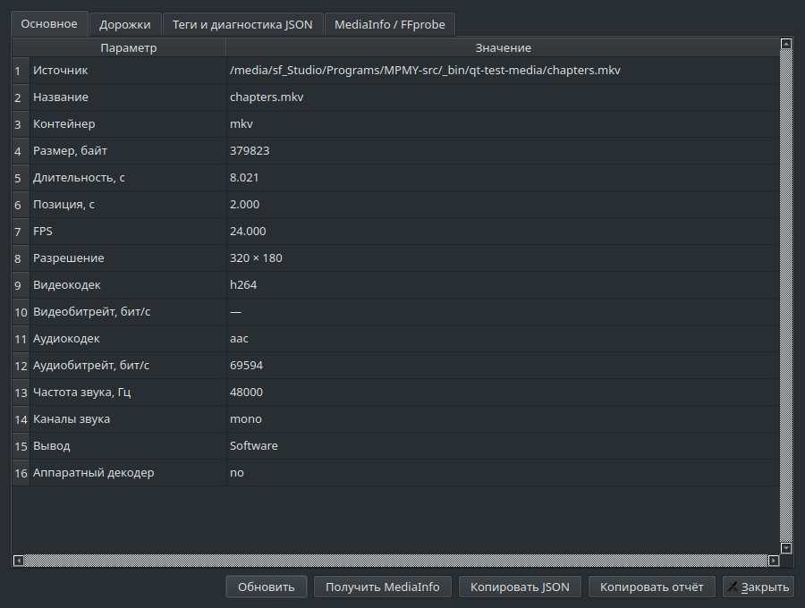
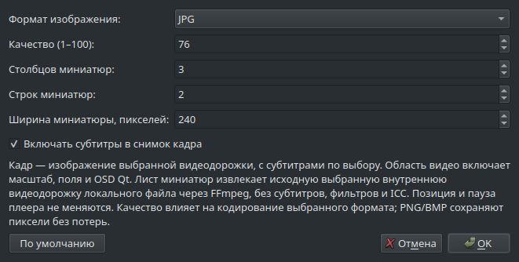
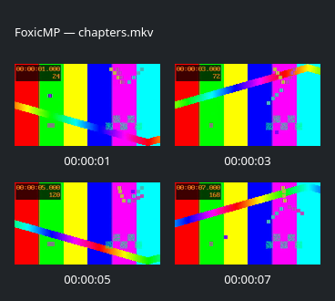


## Запуск и трей — 0.1.33

0.1.33 начинает пункт 17: **запуск, передача файлов и системный трей**.
В меню «Вид» → «Запуск и системный трей…» включаются повторное использование
первого окна текущего профиля, активация при передаче, значок, скрытие при
закрытии/сворачивании. По умолчанию сохраняются отдельные окна, трей выключен.
Ctrl+Q и «Выход», включая MPRIS, всегда завершают приложение. При отсутствии
или исчезновении трея окно остаётся доступным либо возвращается на экран.

CLI: `--reuse-instance` передаёт запрос первому зарегистрированному окну,
`--enqueue` добавляет файлы без смены воспроизведения (подразумевает reuse),
`--new-instance` открывает отдельное окно; `--no-activate` не показывает
существующее окно. Относительные пути вычисляются в каталоге отправителя.
`--profile <каталог>` выбирает папку настроек/истории/плейлистов; по умолчанию
они по-прежнему находятся рядом с программой. Разные папки профиля независимы,
символические ссылки на одну папку считаются одним профилем. Независимые окна
одного профиля используют общие настройки. При закрытии первого окна прочие
автоматически не становятся получателями: следующий запуск регистрирует новое.
Служебные сокет и блокировка временные, в runtime-каталоге пользователя;
личные настройки там не сохраняются. Help/version не создают профиль.

Это первая часть пункта 17. Ассоциации/плеер по умолчанию, экспорт/сброс
профиля, обслуживание, веб-управление и остальные CLI-команды ещё впереди.
Физический трей и ограничения активации окон в Cinnamon/Wayland требуют
проверки на рабочем столе. Установленная версия 0.1.26 не заменяется.


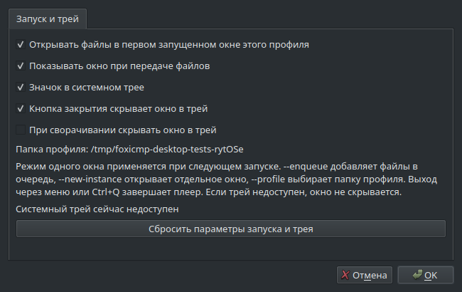
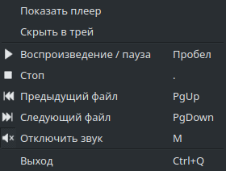

Проверка 0.1.33: OpenGL-запрос **27/27** (actual Software fallback);
Software **26/27**, повтор audio-encoding **1/1 успешно**.
Непостоянный сбой AC3/PCM на паузе зафиксирован в протоколе.
[Протокол запуска и трея](../docs/QtLinuxDesktopValidation-2026-10-16.txt),
[манифест 0.1.33](../docs/QtLinuxPackage-0.1.33-2026-10-16.json).

## Форматы и ассоциации — 0.1.34

0.1.34 продолжает пункт 17: **форматы и ассоциации Linux**.
Меню «Вид» → «Форматы и ассоциации Linux…», также кнопка в общих настройках.
Поиск по MIME/расширениям, наборы «Все видео», «Всё аудио», «Плейлисты».
Типы берутся из MIME-базы системы; один MIME может охватывать несколько
расширений. Это регистрация типов, а не обещание декодировать любой кодек.

«Зарегистрировать плеер» обновляет «Открыть с помощью» для текущей программы
и папки профиля, включая `--profile`; само по себе не назначает плеер основным.
«Назначить отмеченные» меняет только выбранные пользовательские defaults в
`$XDG_CONFIG_HOME/mimeapps.list` (обычно `~/.config/mimeapps.list`). Остальные
типы и разделы сохраняются; существующие приложения остаются в списке
fallback. Удаляется запрет именно FoxicMP из Removed Associations выбранного
типа. Изменения по кнопкам применяются сразу, закрытие окна их не отменяет.

«Откатить мои назначения» использует журнал в профиле FoxicMP и возвращает
прежние значения только там, где с момента назначения они не менялись.
Переезд профиля к другому пользователю/файлу ассоциаций блокирует такой откат.
Откат не удаляет ярлык плеера. Удаление пункта Nemo сохраняет ярлык, если
найдены ссылки на него в ассоциациях. Регистрация текущей копии заменяет
одноимённый глобальный пункт FoxicMP другой копии; независимых глобальных
ассоциаций на каждую папку профиля пока нет.

Таблица показывает первый пункт пользовательского файла. Desktop-specific
настройки могут иметь приоритет: «Проверить в системе» запрашивает действующее
назначение выделенной строки через `gio mime`, не открывая медиафайл.
Проверка асинхронна, с пределом 3 секунды и выводом до 64 КиБ. Требуется
`gio` из `libglib2.0-bin`. Системные ассоциации меняются только по кнопке,
проверка меню при старте исправляет пути, но не переназначает defaults.
Папки, URL-схемы, автозапуск/меню дисков не перехватываются.
Реальные Nemo/Cinnamon/Wayland требуют проверки на целевом рабочем столе.
Установленный плеер 0.1.26 и его профиль не обновляются.


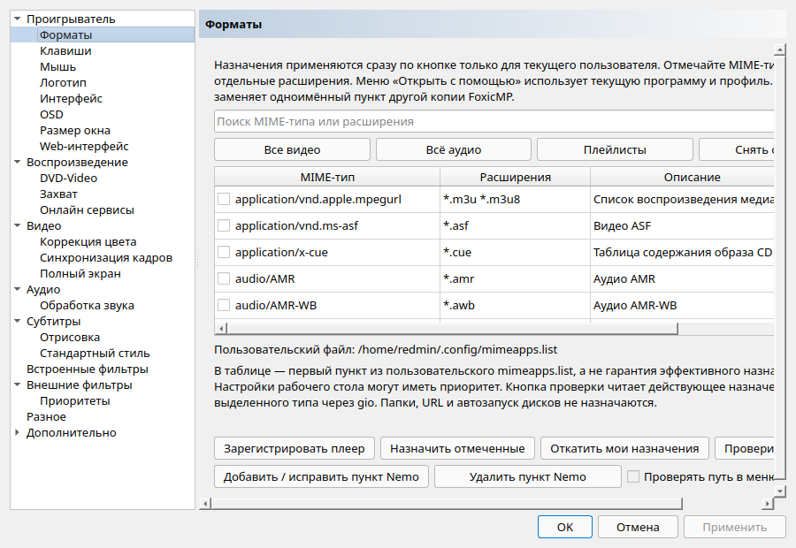

Проверка 0.1.34: **28/28 Software**; OpenGL-запрос **27/28** (actual Software fallback).
Повторы аудионабора: Software 4 успешных и 1 сбой, второй режим 5 успешных.
Непостоянный переход AC3/PCM на паузе остаётся нерешённым;
AssociationsTest **11/11** каждый. [Протокол](../docs/QtLinuxAssociationsValidation-2026-10-16.txt),
[манифест 0.1.34](../docs/QtLinuxPackage-0.1.34-2026-10-16.json).

## Перезапуск аудио — 0.1.35

0.1.35 исправляет перезапуск аудиодекодера при смене AC3 bitstream ↔ PCM
и параметров декодирования на паузе. Раньше дорожка выключалась и включалась
двумя отдельными обращениями, а фильтры применялись уже после перезапуска.
Повторные переключения могли оставлять декодер без выходных параметров;
новый тест также обнаружил сдвиг позиции 0,672 → 0,736 секунды на паузе.

Теперь все параметры фильтров/выхода устанавливаются до перезапуска.
Возврат выбранной дорожки выполняется одной последовательностью команд
libmpv; для источника с перемоткой восстанавливается запомненная позиция.
Пауза не снимается, выбранная дорожка/файл сохраняются. Уже выключенное аудио
не включается. Отложенных Qt-таймеров для перезапуска нет, поэтому смена
файла не получает запоздалый seek от предыдущего источника. Время команды
записывается десятичным числом: парсер mpv не принимает экспоненциальный вид.

Добавлена проверка повторных циклов для отдельного AC3 и MKV с видео/AC3,
сохранения позиции/паузы, быстрых последовательных настроек, смены файла и
выключенного аудио. Сравнение позиции допускает один AC3-пакет: менее 40 мс.
Это проверка программного перехода и данных IEC 61937; физический ресивер,
HDMI/S/PDIF, фактическая задержка и бесшовность вывода требуют проверки
на оборудовании. Для неперематываемого потока восстановить прошлую позицию
невозможно; точность позиции в live-источнике этим тестом не подтверждена.
Установленная версия 0.1.26 и личный профиль не обновляются.


Проверка 0.1.35: **28/28 CTest в обоих режимах**, actual Software fallback.
Аудионабор — **10 последовательных прогонов на режим**, всего **4000 переходов**
AC3/PCM с сохранением paused position <40 мс. [Протокол](../docs/QtLinuxAudioRestartValidation-2026-10-16.txt),
[манифест 0.1.35](../docs/QtLinuxPackage-0.1.35-2026-10-16.json).

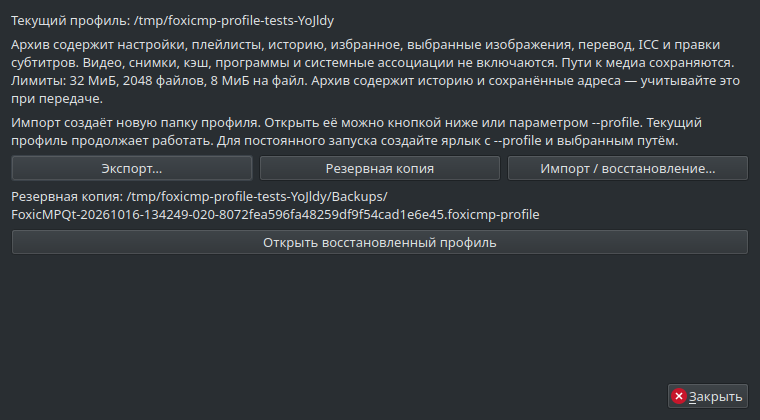

Проверка 0.1.36: **29/29 CTest в обоих режимах**, actual Software fallback.
ProfileArchiveTest: **20/20 каждый**. [Протокол](../docs/QtLinuxProfileValidation-2026-10-16.txt),
[манифест 0.1.36](../docs/QtLinuxPackage-0.1.36-2026-10-16.json).

## Сброс настроек — 0.1.37

В «Вид → Профиль и резервные копии…» добавлен «Сброс настроек…».
После подтверждения окно закрывается штатно: сохраняются текущее положение и
плейлисты, прекращается воспроизведение. Затем создаётся точная копия INI в
`Backups/before-reset-*.ini`, а настройки атомарно заменяются значениями по
умолчанию. Плеер следует открыть снова. Кнопка по умолчанию — «Отмена».

По умолчанию сохраняются плейлисты/вкладки, история, позиции и избранное.
Снятая галочка очищает эти записи в новом INI. Медиа, изображения, ICC,
правки субтитров и старые копии не удаляются. Системные ассоциации не меняются,
их журнал отката остаётся; проверка регистрации при запуске выключается.
Исчезнувший внешний ресурс не мешает сбросу, поскольку копируется INI,
а ресурсы не переносятся и не удаляются.

Для возврата точных прежних настроек закройте все окна данного профиля и
скопируйте нужный `before-reset-*.ini` на место `FoxicMPQt.ini`. Это обычный
INI, не архив `.foxicmp-profile`; он относится к прежней папке ресурсов.
Копия содержит сохранённые URL/историю и не шифруется.

Экземпляры 0.1.37 держат общую блокировку профиля; сброс требует исключительной.
Другие окна того же профиля (включая канонический путь через ссылку) препятствуют
сбросу. Новое окно не открывается во время замены INI. Старые версии такой
блокировки не знают: перед сбросом закройте и их. Временный lease находится
рядом с IPC в runtime-каталоге; настройки остаются в папке профиля.
Недоступная копия, INI-ссылка/спецфайл или слишком большой INI отменяют сброс.
Для файлов запрашиваются права0600; фактические права зависят от файловой системы.

Пункт17 продолжается: постоянное место/ярлык профиля, оформление заголовка,
обслуживание, веб и оставшиеся CLI. Физические устройства/дисковые меню/ТВ отложены.

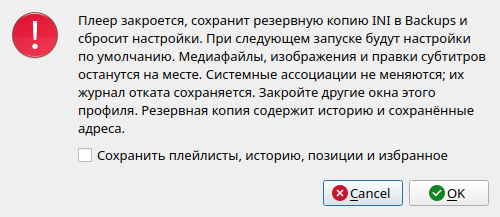

[Протокол сброса](../docs/QtLinuxProfileResetValidation-2026-10-16.txt).

Проверка0.1.37:Software29/29; requested OpenGL24+5/5послеперезапускаXvfb (исходный сбой сохранён); профиль30/30каждый; actual Software fallback. [Манифест](../docs/QtLinuxPackage-0.1.37-2026-10-16.json).

## Постоянный профиль и ярлык — 0.1.38

В «Вид → Профиль и резервные копии…» есть раздел «Профиль при запуске».
Выберите существующую папку (допускается пустая), затем нажмите
«Использовать при обычном запуске». Текущее воспроизведение и INI не меняются:
новый выбор действует при следующем запуске без явного `--profile`.
«Профиль рядом с программой» возвращает обычный переносимый запуск.

Рядом с исполняемым файлом хранится только `FoxicMPQt.launch.json` версии1;
сам профиль остаётся в выбранной папке. Вложенный в папку программы профиль
записывается относительным путём и переносится вместе с программой; внешняя
папка — абсолютным. `--profile /папка` имеет приоритет; `--portable` игнорирует
сохранённый выбор. Эти параметры нельзя сочетать. `--help`/`--version` не
создают профиль и работают даже при повреждённом файле выбора.

Если выбранная папка исчезла или JSON повреждён, запуск останавливается с
понятным сообщением; папка не создаётся заново и другой INI не подставляется.
Для исправления запустите с `--portable` или `--profile` и сохраните новый выбор.
Выбор не переносит и не копирует старые настройки. Для переноса используйте
экспорт/импорт профиля; файл выбора запуска в такой архив не входит.

«Создать ярлык…» сохраняет отдельный `.desktop` с явным `--profile`.
Файл создаётся по новому имени без замены существующего файла/ссылки.
MIME/defaults/Nemo/старый системный ярлык эта кнопка не меняет. Расположение
ярлыка выбирается пользователем; файловый менеджер может потребовать разрешить
его запуск. В ярлыке абсолютные пути: после переноса программы или внешней
папки создайте его заново. Команда использует экранирование Desktop Entry,
а не оболочку, и поддерживает пробелы/Unicode/$/%/кавычки/обратные кавычки.

Пункт17 продолжается: заголовок окна, обслуживание/обновления/приоритет,
веб-управление и оставшиеся команды. Меню дисков/физические устройства/ТВ отложены.

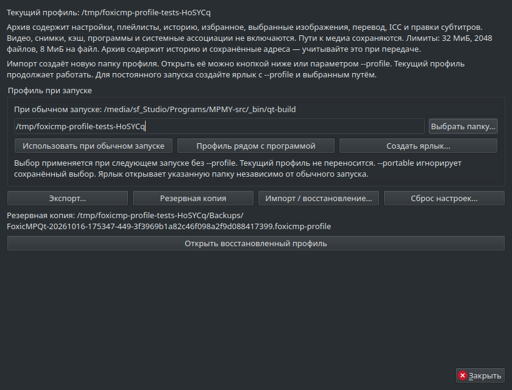

[Проверки запуска профиля](../docs/QtLinuxProfileLaunchValidation-2026-10-16.txt).

Проверка0.1.38:30группвкаждомрежиме с повторами (Software19+1+10, OpenGL15+15; исходные сбои сохранены), запускпрофиля18/18, архив/reset30/30каждый; actual Software fallback. [Манифест](../docs/QtLinuxPackage-0.1.38-2026-10-16.json).

## Заголовок окна — 0.1.39

Откройте **Настройки плеера → Заголовок окна**. Доступны название ролика из
метаданных, имя файла, полный путь, только название плеера и собственный
шаблон. Для готовых вариантов отдельно включаются состояние и позиция с
длительностью. По умолчанию остаётся название ролика с суффиксом FoxicMP Qt.
При отсутствии метаданных используется имя файла; после остановки и закрытия
показываются название и версия плеера.

Шаблон поддерживает `{name}`, `{path}`, `{title}`, `{state}`, `{position}`,
`{duration}` и `{app}`. Пример:
`{title} [{state}] [{position} / {duration}] — {app}`.
В режиме шаблона флажки состояния и времени не применяются: размещение
этих полей задаёт сам шаблон. `{{` и `}}` выводят фигурные скобки;
неизвестные поля остаются текстом. Скобки и `%1` внутри названия ролика
не интерпретируются как команды шаблона. Пустой результат возвращает
обычный заголовок; длина ограничена 2048 символами, управляющие символы
заменяются пробелами.

Предпросмотр показывает текущий ролик на момент открытия настроек или
пример, если воспроизведение остановлено. OK применяет изменения сразу,
Cancel сохраняет прежний заголовок и настройки. Ключи `ui/titleMode`,
`ui/titleTemplate`, `ui/titleState`, `ui/titlePosition` хранятся в текущем
`FoxicMPQt.ini`, переносятся обычным экспортом профиля и удаляются при
сбросе настроек. Положение и размер окна эта вкладка не меняет.

Для сетевого `{path}` скрыты учётные данные, строка запроса и фрагмент URL.
Без известной длительности выводится `—`. Состояние переводится на выбранный
язык интерфейса. Системный заголовок виден при обычной рамке; режим без рамки
и полный экран сохраняют свои настройки.

Пункт 17 продолжается: обслуживание, проверка обновлений, приоритет процесса,
отчёт об ошибках, веб-управление и оставшиеся команды запуска. Дисковые меню,
аналоговое ТВ и физические устройства остаются отложенными.

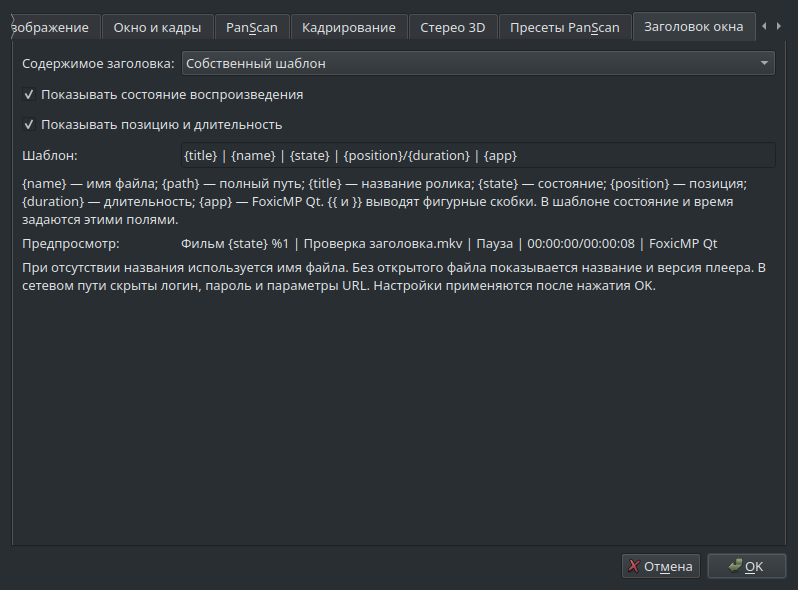

Проверка 0.1.39: 31/31 групп Software, 8/8 затронутых групп при запросе OpenGL;
новые тесты заголовка 7/7 в обоих режимах, архив и настоящий X11-заголовок проверены.
[Манифест](../docs/QtLinuxPackage-0.1.39-2026-10-16.json), [проверка](../docs/QtLinuxWindowTitleValidation-2026-10-16.txt).

## Обслуживание и диагностика — 0.1.40

**Справка → Обслуживание и диагностика…** открывает отдельное окно.
**Справка → Проверить обновления Linux/Qt…** открывает его и сразу запускает
проверку. Обычное открытие окна и запуск плеера сеть не опрашивают.

Проверка вручную читает последние 100 выпусков официального репозитория
`LiberVixer/FoxicMP` через GitHub API. Подходящим считается опубликованный
пакет `FoxicMPQt-X.Y.Z-linux-x64.tar.gz`; Windows-пакеты и черновики
исключены. Предварительные Qt-выпуски включены по умолчанию; флажок можно
сохранить в профиле. Версии сравниваются численно. Если Linux-пакетов нет,
плеер сообщает об этом отдельно, а не объявляет текущую версию последней.
Проверка ограничена 2 МиБ и 15 секундами; ошибки HTTP, сети и некорректный
ответ отображаются явно. Перенаправления не выполняются. Кнопка страницы
выпуска доступна только для более новой Qt-сборки и открывает проверенную
HTTPS-страницу этого репозитория в браузере. Автоматической загрузки,
установки, фоновой проверки и передачи отчётов нет.

Приоритет: обычный `nice 0`, выше обычного `nice -5`, ниже обычного `nice 5`.
Кнопка «Сохранить параметры обслуживания» записывает выбор в текущий профиль;
приоритет применяется со следующего запуска к уже созданным потокам Qt
перед созданием потоков libmpv, которые наследуют его. Права администратора не запрашиваются. Без разрешения
на уменьшение nice Linux может отказать повышению или возврату к обычному
приоритету у процесса, запущенного с пониженным приоритетом. Окно показывает
текущее значение и ошибку начального применения. Действующий процесс из окна
настроек не перенастраивается; закрытие без сохранения оставляет профиль прежним.

Диагностический JSON содержит версию приложения/Qt/libmpv/FFmpeg/libass,
систему и backend Qt, запрошенный/фактический видеовывод, статистику рендера,
кодеки, параметры видео/аудио, текущую позицию/паузу и приоритет. Неизвестные
свойства libmpv остаются `null`. Снимок отчёта обновляется по кнопке;
воспроизведение и пауза не меняются. Доступны просмотр, копирование и
атомарное сохранение JSON в выбранный файл; по умолчанию предлагается папка
профиля. Символические ссылки и специальные файлы как цель отклоняются.

По умолчанию исключены путь источника/профиля, имена аудиоустройств,
последняя ошибка и исходный текст сообщений. Флажок «Включить пути, имена
устройств и последние сообщения движка» добавляет эти поля для подробного
отчёта. Перед отправкой можно просмотреть весь текст. Журнал содержит до
100 предупреждений/ошибок libmpv и ошибок команды, каждое до 2048 символов,
только в памяти текущего запуска. Это отчёт работающего плеера; перехвата
аварийного завершения, дампов и восстановления журнала после падения нет.
Полный отладочный вывод `FOXICMP_MPV_LOG` остаётся отдельной возможностью.

Ключи `maintenance/priority` и `maintenance/updatePreviews` находятся в
`FoxicMPQt.ini`; экспорт профиля переносит их, сброс возвращает defaults.
Установленная Linux-копия и её профиль не обновлялись. Windows-плеер и
отключённая интеграция Harvester не изменялись.

Пункт 17 продолжается: веб-управление и оставшиеся команды запуска.
Автоматические обновления/установка и crash dump не реализованы.
Дисковые меню, аналоговое ТВ и физические устройства остаются отложенными.

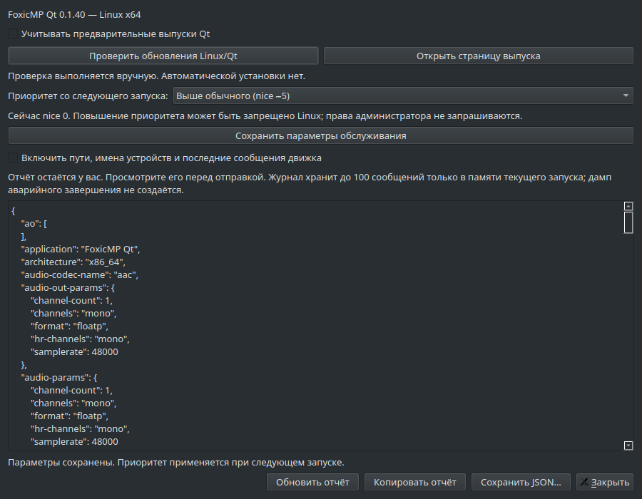

Проверка 0.1.40: 32/32 групп Software, 9/9 затронутых групп при запросе OpenGL;
обслуживание 8/8 в каждом режиме, настоящий GitHub, архив и nice потоков проверены.
[Манифест](../docs/QtLinuxPackage-0.1.40-2026-10-17.json), [протокол](../docs/QtLinuxMaintenanceValidation-2026-10-17.txt).

## Веб-управление — 0.1.41

**Настройки → Веб-управление…** открывает управление локальным HTTP-сервером.
По умолчанию он выключен. Выберите свободный порт 1024–65535 (стандартно
13579) и нажмите «Включить и сохранить». Затем откройте страницу кнопкой
«Открыть в браузере» или скопируйте ссылку. Сервер работает только на
`127.0.0.1`: управление с телефона/другого компьютера по сети пока не включено.

Пульт показывает название, состояние, позицию/длительность и очередь
(первые 500 записей). Доступны play/pause/stop, предыдущий/следующий файл,
абсолютная перемотка, громкость, mute и скорость. Применяются действующие
правила плеера, в том числе ограничения live/progressive и сохранение паузы
при переходах. Очередь показана для текущего проигрываемого списка; выбора
произвольной записи, удаления, открытия файлов/URL и команд завершения системы
в этом API нет. Страница на русском/английском обновляет состояние раз в секунду.

Для каждого запуска сервера создаётся случайный код 256 бит. Он передаётся
в браузер фрагментом ссылки `#код`, затем удаляется из адресной строки;
страница держит его только в памяти и отправляет API через Authorization Bearer.
Перезагрузка страницы требует заново открыть ссылку или ввести код из окна
плеера. Код не пишется в профиль, localStorage или cookie. При перезапуске
сервера/плеера старый код перестаёт работать. Кнопка «Выключить и сохранить»
закрывает сервер и активные соединения, отключая автозапуск с этим профилем.
Другие окна/профили требуют другого порта; занятый порт не перехватывается.
Закрытие диалога оставляет текущее состояние сервера, изменение числа порта
без кнопки включения в профиль не записывается.

HTTP API: `GET /api/state`, `POST /api/command` с JSON `{"command":"pause"}`;
для `seek`, `volume`, `rate` — числовое поле `value`. Ответ команды подтверждает
её принятие; состояние воспроизведения меняется асинхронно. Ошибки: 403 —
код/Host/Origin, 400 — формат/команда/значение, 409 — действие недоступно,
413 — слишком большой запрос. Разрешён только ограниченный список команд.
Проверяются Host и Origin, API требует код; CORS не включён. Лимит запроса
16 КиБ, одновременно до 8 соединений, время соединения 3 секунды. Chunked,
повторные заголовки, pipelining и путь к произвольному файлу не поддерживаются.
HTML/JS/CSS встроены в программу, внешние ресурсы не загружаются; текст
ролика/очереди вставляется через textContent. Ответы имеют no-store, nosniff,
Referrer-Policy и CSP. HTTP не предназначен для публикации через внешний прокси.

Профиль содержит только `web/enabled` и `web/port`. Экспорт переносит эти
параметры; сброс отключает сервер при следующем запуске. Отключённый MPRIS
не мешает веб-управлению. Установленная 0.1.40 и личный INI не заменяются.
Далее по пункту 17 — оставшиеся команды запуска. Дисковые меню, аналоговое
ТВ и физические устройства остаются отложенными.

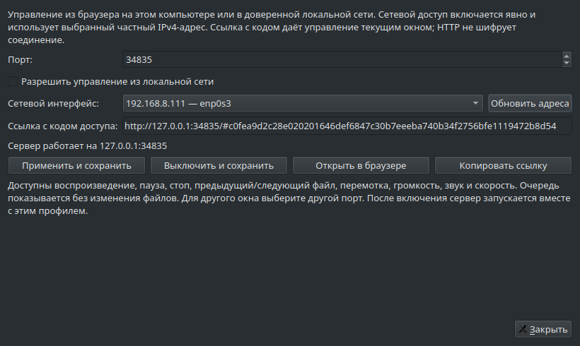

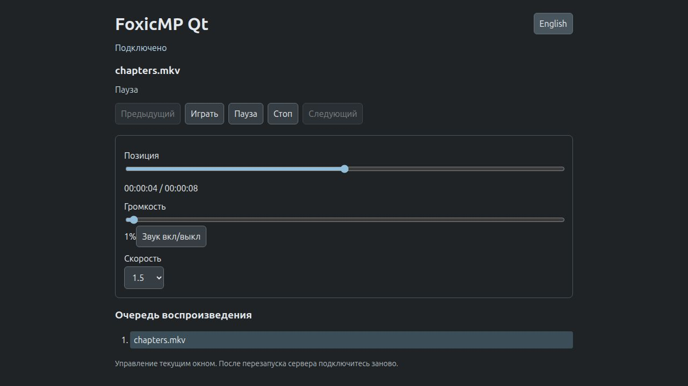

Проверка 0.1.41: все 33 группы Software проверены с повтором window-title
(исходно 32/33 PASS; повтор 7/7), 10/10 групп при запросе OpenGL;
веб-тесты 9/9 в каждом режиме, браузер и архив проверены.
[Манифест](../docs/QtLinuxPackage-0.1.41-2026-10-17.json), [протокол](../docs/QtLinuxWebControlValidation-2026-10-17.txt).

## Расширенные команды запуска — 0.1.42

`--start` задаёт секунды или `ЧЧ:ММ:СС[.доли]` (также `ММ:СС`),
`--pause` открывает на паузе. Начальная позиция 0–604800 секунд;
нулевая позиция отменяет сохранённое продолжение для этого открытия.
`--volume 0..100`, `--rate 0.125..16`, `--audio-track ID` и
`--subtitle-track ID` выбирают параметры воспроизведения; ID 0 отключает
соответствующую дорожку. ID берётся из меню дорожек, а не из её номера в файле.
`--audio-file` / `--subtitle-file` подключают и выбирают читаемый локальный файл;
путь разрешается относительно папки вызывающей команды. Файл и ID одной
дорожки одновременно не допускаются. Ограничения прямых входов, кэша
прогрессивного просмотра и блокировки встроенных субтитров сохраняются.

`--fullscreen`, `--minimized`, `--normal` задают состояние окна (взаимоисключающие).
`--window-size 960x540` задаёт размер обычного окна с интерфейсом, а не видеокадра;
допустимо 320×200–16384×16384, фактический минимум ограничивает Qt.
`--window-position=-10,40` задаёт абсолютные координаты Qt, включая отрицательные.
Оконный менеджер/Wayland может ограничивать положение окна. Размер и положение
устанавливаются перед выбранным состоянием окна и повторяются после
автоматического размера по видео. Отдельные ключи запуска не сохраняются;
громкость, геометрия и выбор дорожек запоминаются обычными правилами профиля.
Скорость также переходит к следующему файлу, если в профиле включено
сохранение скорости между файлами; в остальных случаях она сбрасывается.

Примеры:

```sh
./foxicmp-qt --pause --start 00:01:30.5 --rate 1.25 --fullscreen "фильм.mkv"
./foxicmp-qt --reuse-instance --audio-file "звук.mka" --subtitle-file "текст.srt" "фильм.mkv"
./foxicmp-qt --profile /путь/к/профилю --command pause
./foxicmp-qt --profile /путь/к/профилю --start 120 --volume 35
```

`--command play|pause|toggle|stop|next|previous|mute` направляется первому
работающему окну выбранного профиля без активации. `mute` переключает звук.
Команда не объединяется с источниками или другими новыми параметрами.
Параметры воспроизведения без источника также направляются работающему окну;
при отсутствии окна команда завершается ошибкой без создания нового профиля.
Код 0 подтверждает доставку запроса, а не доступность операции: например,
следующего файла может не быть, а запрошенная позиция может отсутствовать в кэше.

С файлами, URL, папкой или плейлистом параметры относятся к первому открытому
источнику. Загрузка на паузе и начальная позиция передаются в libmpv до открытия;
остальные параметры применяются после загрузки дорожек. Следующий файл не
наследует разовые ключи. `--enqueue` не объединяется с новыми параметрами;
параметры воспроизведения при `--dvd` / `--bluray` / `--cdda` /
`--harvester-session` не принимаются (параметры окна допустимы).
Некорректные диапазоны, повторённые значения и несовместимые ключи
отклоняются до создания профиля и отправки запроса.

Это очередная часть пункта 17. Полного соответствия всех ключей Classic нет;
отдельные проверки оборудования, Wayland и длительных сеансов остаются.
Меню дисков, аналоговое ТВ и физические устройства отложены пользователем.

Проверка 0.1.42: 34/34 группы CTest Software и 11/11 затронутых групп
при запросе OpenGL; новые тесты 7/7 в каждом режиме, архив проверен.
[Манифест](../docs/QtLinuxPackage-0.1.42-2026-10-17.json), [протокол](../docs/QtLinuxLaunchOptionsValidation-2026-10-17.txt).

Установленная Linux-копия обновлена до 0.1.42 по постоянному указанию
пользователя; INI и личные файлы сохранены, резервная копия создана.

## Дополнительные команды запуска — 0.1.43

`--monitor primary`, `--monitor 1` или `--monitor "имя"` выбирают экран
для текущего окна. Номера начинаются с 1, имена и геометрия доступны через
`--list-monitors`. Выбор сохраняется на время жизни окна и используется при
последующем входе в полный экран; постоянная настройка монитора в INI
не заменяется. При переносе обычное окно центрируется на выбранном экране;
явные `--window-position` / `--window-size` применяются после выбора экрана.
Wayland и оконный менеджер могут ограничить позиционирование.

`--audio-device auto` или точное имя из `--list-audio-devices` выбирают
основное устройство libmpv. Выбор сохраняется как при выборе через меню,
а настройки второго выхода остаются прежними. Внутренние временные устройства
`pulse/foxicmp_dual_*` не принимаются и не перечисляются.

`--panscan fit|fill|wide|crop169|crop235` выбирает встроенный пресет,
`--panscan "saved:Кино"` — сохранённый пресет текущего профиля с точным именем.
Преобразования сохраняются по обычному флагу «Запоминать преобразования».
`--shuffle` / `--no-shuffle` включают/выключают случайный порядок обхода списка
и сохраняются по правилам соответствующего пункта меню. Это режим обхода,
а не физическая перестановка строк плейлиста.

`--after none|exit|close|minimize|nextDirectory|loopDirectory|suspend|hibernate|shutdown|logout|lock`
задаёт **одно** действие при естественном окончании прохода списка.
Постоянный `playback/after` не меняется. `none` подавляет постоянное действие
на один проход, после чего постоянное правило снова действует. Стоп и ошибка
не расходуют назначенное действие. Системные действия используют существующую
проверку возможностей Linux и D-Bus; в тестах исполнитель подменяется.
В меню однократных действий теперь доступны также закрытие файла/сворачивание
и переход по каталогу.

Имена монитора, устройства и пресета проверяются получающим окном до изменения
очереди, громкости и настроек. Если ресурс недоступен, запрос не применяется;
причина видна в OSD и диагностическом отчёте. Код 0 при передаче означает приём
запроса, а не успешное применение всех ресурсов. Формат, диапазоны,
неизвестные действия и несовместимые ключи проверяются до открытия профиля.
При отсутствии файлов новые параметры воспроизведения направляются работающему
окну выбранного профиля; для параметра монитора одного используйте
`--reuse-instance`, если нужно выбрать уже открытое окно.
Ограничения 0.1.42 на `--enqueue` и запуск дискового/прогрессивного сеанса
с параметрами воспроизведения сохраняются.

`--list-monitors` и `--list-audio-devices` возвращают JSON. Их можно объединить
друг с другом и с `--profile` / `--portable`; профиль при этом не создаётся
и не изменяется. Файлы и управляющие ключи с запросом списка не объединяются.
Пример:

```sh
./foxicmp-qt --list-monitors --list-audio-devices
./foxicmp-qt --monitor 1 --fullscreen --panscan crop169 --shuffle --after close "фильм.mkv"
./foxicmp-qt --profile /путь/к/профилю --audio-device auto --no-shuffle
```

Пункт 17 остаётся частично открытым: буфер обмена, временный веб-порт,
сброс из CLI, внешняя аудиодорожка с задержкой, несколько внешних файлов
и stdin. Физические мониторы/GPU/аудиоустройства и Wayland требуют отдельной
проверки. Меню дисков, аналоговое ТВ и физические устройства отложены.

Проверка 0.1.43: 34/34 группы CTest Software и 14/14 затронутых групп
при запросе OpenGL; тесты команд запуска 10/10 в каждом режиме, архив проверен.
[Манифест](../docs/QtLinuxPackage-0.1.43-2026-10-17.json), [протокол](../docs/QtLinuxLaunchExtrasValidation-2026-10-17.txt).

Установленная Linux-копия обновлена до **0.1.43**; INI и ярлык сохранены,
предыдущая версия скопирована в резервную папку рядом с установленной.

## Буфер обмена, временный веб-порт и сброс из CLI — 0.1.44

`--clipboard` читает обычный буфер обмена вызывающего процесса: список URI
или текст с одним существующим файлом/папкой либо поддержанным URL на строку.
До открытия профиля проверяется весь список; пустой/неверный список отвергается
целиком. Максимум 256 записей и общий лимит запроса IPC 256 КиБ. Содержимое
превращается в обычный список источников до передачи другому окну: получатель
не перечитывает свой буфер. Можно сочетать с `--reuse-instance`, `--enqueue`
и допустимыми параметрами открытия. Как и для обычных файлов, при `--enqueue`
другие параметры окна/воспроизведения не принимаются. С позиционными источниками, дисковыми/
прогрессивными сеансами, `--command` и запросами списков не объединяется.

`--web-port 13580` включает существующий локальный веб-пульт на указанном
порту 1024–65535 для текущего окна. В новом окне заменяет сохранённый порт
ещё при создании сервера; `web/enabled` и `web/port` не меняются. Через
`--reuse-instance` меняет сервер работающего окна. При занятом порте сохраняются
старый сервер, его код доступа и воспроизведение; остальные параметры запроса
не применяются. При успешной смене порта старый сервер закрывается, код
обновляется. Повтор того же действующего порта сохраняет код и подключения.
Доступ по-прежнему только через 127.0.0.1; ссылка с кодом доступна в окне
«Веб-управление», где временный режим подписан. Кнопки «… и сохранить»
по-прежнему явно меняют профиль. Следующий запуск использует сохранённые настройки.
Код 0 при IPC подтверждает приём, а не успешное включение занятого порта;
причина отказа показывается в OSD/диагностике.

`--reset-settings` работает только с существующим закрытым профилем, сохраняет
точную резервную копию INI в `Backups/before-reset-*.ini`, сбрасывает настройки
и завершает процесс без открытия окна. Печатает JSON с `reset`, `profile`,
`backup`, `keptLibrary`. По умолчанию сохраняет историю, избранное, позиции и
плейлисты. Дополнительный `--reset-library` очищает также эти данные.
Файлы медиа, внешние активы и журнал отката системных ассоциаций не удаляются;
автопроверка интеграции отключается. Выбор папки профиля/ярлыки не сбрасываются.

Для сброса допустимы только `--profile` или `--portable` и `--reset-library`;
без явного пути действует сохранённый выбор профиля. Сброс не передаётся по
IPC: эксклюзивная lease-блокировка проверяется до чтения настроек. При открытом
окне того же профиля (включая другой путь через символьную ссылку), отсутствии
INI, повреждении INI, ссылке/FIFO вместо INI или невозможности резервной копии
команда завершается с ошибкой, не заменяя настройки. При запуске без дисплея
нужно задать `QT_QPA_PLATFORM=offscreen`; чтение системного буфера таким режимом
не проверялось. Отсутствующая папка
профиля не создаётся. GUI-сброс использует тот же механизм замены/резервирования.

```sh
./foxicmp-qt --clipboard --pause
./foxicmp-qt --reuse-instance --clipboard
./foxicmp-qt --web-port 13580 "фильм.mkv"
./foxicmp-qt --profile /путь/к/закрытому/профилю --reset-settings
```

Следующий остаток CLI: задержка внешнего аудио, несколько внешних дорожек/
субтитров и stdin. Расширения веб-пульта/LAN, GLSL и Wayland остаются в плане.
Меню дисков, аналоговое ТВ и физические устройства по-прежнему отложены.

Проверка 0.1.44: 34/34 групп Software, 7/7 затронутых групп при запросе OpenGL; архив проверен.
[Манифест](../docs/QtLinuxPackage-0.1.44-2026-10-17.json), [протокол](../docs/QtLinuxCliRecoveryValidation-2026-10-17.txt).

Установленная Linux-копия обновлена до **0.1.44**; INI и ярлык сохранены,
предыдущая версия скопирована в резервную папку рядом с установленной.

## Несколько внешних дорожек и задержка звука — 0.1.45

`--audio-file` и `--subtitle-file` теперь можно повторять до 32 раз для
каждого вида дорожек. Все файлы подключаются к первому открытому источнику;
последний указанный файл каждого вида выбирается для воспроизведения.
Это набор альтернативных дорожек, а не смешивание нескольких аудиофайлов
или одновременный показ всех субтитров. Файлы доступны в обычном меню дорожек.
Повтор одного абсолютного пути не создаёт дубликат: учитывается его последнее
упоминание. Уже подключённые дорожки повторно выбираются без дублирования.
Пути разрешаются относительно текущего каталога вызывающего процесса;
пробелы, запятые, кавычки и другие символы в имени передаются отдельным
аргументом, а не списком через запятую.

До создания профиля/передачи IPC проверяются все пути: только читаемые
существующие обычные локальные файлы, до 8192 байт на путь. Если хотя бы один
путь неверен, весь запрос отклоняется. Формат/декодирование файла проверяет
libmpv при открытии: наличие файла не гарантирует подходящую аудио/субтитровую
дорожку. Лимит всего IPC-запроса остаётся 256 КиБ. `--audio-track` несовместим
с `--audio-file`, `--subtitle-track` — с `--subtitle-file`. Старые одиночные
строковые поля IPC по-прежнему принимаются.

`--audio-delay -0.250` задаёт задержку звука в секундах, диапазон **−30…30**.
Ключ принимается только вместе с `--audio-file`; при нескольких внешних
аудиофайлах это одна задержка звука текущего источника, а не отдельная задержка
каждой дорожки. Положительное значение задерживает звук, отрицательное — видео.
При новом открытии задержка передаётся как file-local option до загрузки,
при команде существующему окну — применяется к текущему источнику. После
закрытия/смены/переоткрытия источника восстанавливается предыдущее значение
libmpv; задержка CLI не записывается в INI или плейлист.
[Семантика задержки и локальных параметров mpv](https://mpv.io/manual/stable/).

Подключения и выбор внешнего файла сохраняются по существующей настройке
«Запоминать дорожки» для записи плейлиста. При её отключении CLI не записывает
эти подключения в запись; следующий файл не наследует список внешних файлов.
При открытии папки/плейлиста параметры относятся к первой воспроизводимой
записи. Без источника они направляются работающему окну выбранного профиля.
Прежние ограничения `--enqueue`, начального дискового/progressive-сеанса,
закрытого/остановленного источника и кодов подтверждения IPC сохраняются.

```sh
./foxicmp-qt --audio-file "English.mka" --audio-file "Русский.mka" \
  --subtitle-file "English.srt" --subtitle-file "Русский.ass" \
  --audio-delay=-0.250 --pause "фильм.mkv"
./foxicmp-qt --profile /путь/к/профилю --audio-file "Дубляж.mka" --audio-delay 0.120
```

Следующий пункт списка — чтение медиапотока из stdin. LAN/расширенный веб-пульт,
GLSL и Wayland остаются в плане; меню дисков, аналоговое ТВ и физические
устройства по-прежнему отложены.

Проверка 0.1.45: 34/34 групп Software, 7/7 затронутых групп при запросе OpenGL; архив проверен.
[Манифест](../docs/QtLinuxPackage-0.1.45-2026-10-18.json), [протокол](../docs/QtLinuxExternalCliValidation-2026-10-18.txt).

Установленная Linux-копия обновлена до **0.1.45**; INI и ярлык сохранены,
предыдущая версия скопирована в резервную папку рядом с установленной.

## Последовательное подключение внешних дорожек — 0.1.46

Исправлена гонка быстрых повторных подключений: пока libmpv ещё открывал файл,
проверка `track-list` могла его не увидеть и отправить повторный `audio-add` или
`sub-add`. На прежнем коде 40 быстрых запросов дали 21 внешнюю аудиодорожку
вместо одной. В 0.1.46 подключение следующего файла ждёт ответа libmpv;
загруженная дорожка используется повторно. Последний запрос определяет выбор.

Очередь общая для восстановления плейлиста, CLI и ручного подключения.
Ошибка формата не блокирует следующие файлы. Открытие другого источника,
остановка и конец файла отменяют ожидающие подключения; запоздалый ответ
старой команды не двигает новую очередь. Очередь ограничена 256 запросами.
Все операции остаются асинхронными, интерфейс не ждёт чтения медиафайла.

Тест проверяет быстрые повторы аудио и субтитров, ошибку формата, конечный выбор,
отмену активной/ожидающей команды и отсутствие переноса в следующее видео.
Сценарий M3U8 из 0.1.45 остаётся в проверке: это воспроизведение связанной гонки,
а не отдельное доказательство точной последовательности прежнего единичного сбоя.
Поддержка stdin остаётся следующим самостоятельным пунктом плана.

Проверка 0.1.46: 34/34 групп Software, 8/8 при запросе OpenGL; пакет проверен.
[Манифест](../docs/QtLinuxPackage-0.1.46-2026-10-18.json), [протокол](../docs/QtLinuxExternalQueueValidation-2026-10-18.txt).

Установленная Linux-копия обновлена до **0.1.46**, INI и ярлык сохранены;
предыдущая версия скопирована в резервную папку рядом с установленной.

## Медиапоток из stdin — 0.1.47

```sh
cat '/путь/к/видео.mkv' | ./foxicmp-qt --stdin
ffmpeg -i '/путь/к/видео.mp4' -c copy -f matroska pipe:1 | ./foxicmp-qt -
./foxicmp-qt --stdin --after exit < '/путь/к/видео.mkv'
```

`--stdin` или единственный аргумент `-` открывает одноразовый поток в новом
окне, даже если профиль настроен на повторное использование окна. Канал stdin
не передаётся другому процессу через IPC; `--reuse-instance` не принимается.
Для файла с буквальным именем `-` используйте `./-`.

Поток не становится записью плейлиста, истории, позиций или избранного;
существующие списки сохраняются. Работают пауза, громкость, скорость,
полный экран и управление текущим окном. CLI принимает `--pause`, `--volume`,
`--rate`, `--after none|exit|close|minimize`, параметры размера/положения/режима
окна и выбора профиля. Окончание stdin не запускает сохранённый плейлист
или повтор; `--after exit` закрывает плеер после нормального EOF.

Ограничения первой реализации: перемотка, A–B, шаг назад, повтор и повторное
открытие отключены, в том числе при `< file`. Для нового просмотра нужно снова
запустить передающую программу. `--start`, `--enqueue`, `--clipboard`, команды
существующему окну, диски/прогрессивный сеанс, дополнительные позиционные
файлы и CLI-подключение внешних дорожек с этим режимом несовместимы.
Для длительного просмотра источник должен быть пригоден для последовательного
чтения: например Matroska, MPEG-TS, MP4 с заголовком в начале или fMP4.
MP4 с moov в конце и контейнеры, требующие byte-seek, могут не открыться.
libmpv определяет формат по заголовку; raw-потоки без описания формата не обещаются.

Принимаются читаемый обычный файл, pipe/FIFO или потоковый сокет, но не терминал
и не произвольное символьное/блочное устройство. Передачи в tmp-файл нет.
Чтение выполняется в callbacks libmpv; ожидание новых данных не блокирует Qt
и не считается EOF. Отмена проверяется каждые 100 мс. Закрытие, стоп и смена
источника освобождают канал, даже если передающая программа ещё не завершилась.
Считывание ограничено блоками 64 КиБ, demux-буфер — 16 МиБ; пауза может
приостановить отправителя за счёт обычного backpressure канала.
Пустой/повреждённый поток показывает ошибку; окно можно закрыть или открыть файл.

Проверка 0.1.47: 35/35 групп Software, 9/9 при запросе OpenGL; пакет проверен.
[Манифест](../docs/QtLinuxPackage-0.1.47-2026-10-18.json), [протокол](../docs/QtLinuxStdinValidation-2026-10-18.txt).

Установленная Linux-копия обновлена до **0.1.47**, INI и ярлык сохранены;
предыдущая версия скопирована в резервную папку рядом с установленной.

## Управление из локальной сети — 0.1.48

В **Настройки → Веб-управление…** включите «Разрешить управление из локальной
сети», выберите IPv4-адрес нужного сетевого интерфейса и нажмите
«Применить и сохранить». Откройте скопированную ссылку на другом компьютере
или телефоне в этой сети. Сервер привязывается к одному выбранному адресу;
доступ через 127.0.0.1 в этом режиме не включается дополнительно.
По умолчанию сетевой доступ выключен; обновление не включает его в вашем профиле.

Поддерживаются частные IPv4 10/8, 172.16/12, 192.168/16 и link-local 169.254/16
на активном интерфейсе. Публичные адреса, wildcard 0.0.0.0 и IPv6 не используются.
Входящие сетевые подключения принимаются только с частных IPv4 или loopback.
Плеер не изменяет брандмауэр или маршрутизатор. HTTP не шифрует соединение:
этот режим предназначен для доверенной локальной сети.

Ссылка содержит случайный код доступа: API требует Bearer-код, проверяет Host
и Origin. Код хранится только в памяти и меняется после перезапуска сервера;
в INI и ответе страницы его нет. Код передаётся браузеру во фрагменте ссылки,
после чего страница убирает его из адресной строки. Не передавайте эту ссылку
людям, которым не хотите давать управление текущим окном.

Неудачная смена порта/адреса оставляет работающий сервер, его код и сохранённые
настройки прежними. Если сохранённого адреса нет при запуске, сервер остаётся
выключенным и сообщает причину, не выбирая другой интерфейс автоматически.
После смены адреса DHCP обновите список адресов, выберите нужный и примените
настройки: автоматического переноса работающего сервера на новый IP нет.
Закрытие окна настроек без применения не сохраняет правки.

`--web-port PORT` по-прежнему включает временный сервер только на 127.0.0.1,
включая запуск с сохранённым сетевым профилем. Сохранённый LAN-режим возвращается
при следующем обычном запуске. Набор команд пульта прежний; изменение очереди,
открытие файлов/URL, TLS, CGI и пользовательские страницы сюда не входят.

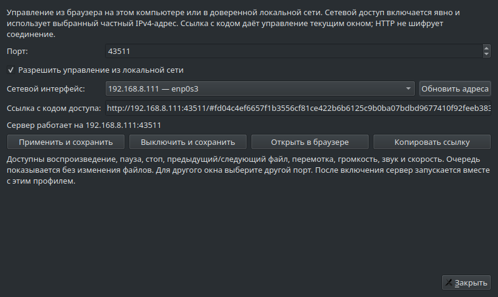

Проверка 0.1.48: 35/35 групп Software, 10/10 при запросе OpenGL;
LAN-клиент Windows и упакованный сервер проверены.
[Манифест](../docs/QtLinuxPackage-0.1.48-2026-10-18.json), [протокол](../docs/QtLinuxLanWebValidation-2026-10-18.txt).

Установленная Linux-копия обновлена до **0.1.48**, INI и ярлык сохранены;
предыдущая версия скопирована в резервную папку рядом с установленной.

## Очередь и открытие источников в веб-пульте — 0.1.50

Нажмите название записи, чтобы воспроизвести её; пауза при переходе сохраняется.
«Удалить» убирает только запись из очереди. Удаление проигрываемой записи закрывает
её воспроизведение, как в панели плеера; сам медиафайл остаётся на диске.
Пульт управляет проигрываемой очередью, даже если в GUI открыта другая вкладка.
Команды используют ID списка и записи: сортировка и смещение строк не подменяют
выбранный файл. Удалённая запись или прежняя очередь возвращают отказ 409.

В поле источника укажите один абсолютный путь **на компьютере с плеером** или
поддерживаемый сетевой URL. «Открыть и заменить очередь» заменяет проигрываемый
список одним источником и запускает его. «В очередь» добавляет источник в конец
проигрываемого списка, сохраняя текущий файл и паузу; пустая очередь не запускается
автоматически. Переключение вкладки в GUI не перенаправляет эти действия в другой
список. Файлы с телефона/компьютера браузера не загружаются на сервер.

Принимаются доступные обычные файлы, включая file:/// с локальным хостом,
и сетевые схемы существующего движка. Относительные пути, каталоги, устройства,
FIFO и локальные файлы плейлистов через это поле не принимаются. Локальные
плейлисты/папки по-прежнему открываются в GUI. Нет файлового браузера или выдачи
содержимого файлов через HTTP. Ответ 200 означает принятие команды: доступность
сети, формат и декодирование проверяются движком асинхронно.

Очередь разбита на страницы по 500 записей. Кнопки предыдущей/следующей страницы
позволяют добраться до остальных записей. После удаления последней страницы
сервер возвращает существующую страницу. Новые действия требуют того же кода
доступа и проверок Host/Origin, что и управление воспроизведением; LAN по умолчанию
выключен. Во время stdin выбор/удаление старой очереди и добавление отключены;
явное открытие обычного файла завершает stdin и возвращает обычный режим.

API: GET /api/state?offset=500 возвращает queueList, queueOffset, queueLimit,
queueTotal и элементы queue с id/title/current. Без offset возвращается начало.
POST /api/command: queuePlay и queueRemove принимают value={"list":"ID списка",
"id":"ID записи"}; open и enqueue — строковое value с одним путём/URL.
Размер источника до 4096 символов, управляющие символы не допускаются.
Неверная структура/тип/параметр — 400, нет кода — 403, устаревшая запись,
отклонённый источник или недоступное действие — 409. Лимит запроса остаётся 16 КиБ.

Проверка 0.1.50: 35/35 групп Software, 10/10 при запросе OpenGL;
веб-тесты 24/24, браузер и пакет проверены.
[Манифест](../docs/QtLinuxPackage-0.1.50-2026-10-18.json), [протокол](../docs/QtLinuxWebQueueValidation-2026-10-18.txt).

Установленная Linux-копия обновлена до **0.1.50**, INI и ярлык сохранены;
предыдущая версия скопирована в резервную папку рядом с установленной.

## Совместимость Classic Web — 0.1.50

Добавлен авторизованный JPEG-снимок текущего кадра через /api/snapshot.jpg; превью обновляется в браузере вместе с состоянием. Classic HTML, внешний webroot и CGI не копируются: они завязаны на Win32 MainFrame либо запускают внешние процессы/выдают файлы. Linux использует встроенные страницы, CSP и Bearer-код.
[Матрица совместимости](../docs/QtLinuxWebCompatibility-2026-10-18.txt).

Проверка 0.1.50: 35/35 групп Software, 10/10 при запросе OpenGL; WebControlTest 25/25; snapshot preview и Classic Web scope проверены.
[Манифест](../docs/QtLinuxPackage-0.1.50-2026-10-18.json), [матрица](../docs/QtLinuxWebCompatibility-2026-10-18.txt).

Установленная Linux-копия обновлена до **0.1.50**, INI и ярлык сохранены;
предыдущая версия скопирована в резервную папку рядом с установленной.

Установленная Linux-копия обновлена до **0.1.51** после проверки импорта многопроходных GLSL; INI и ярлык сохранены.


0.1.53: точная перемотка MPEG-PS/TS использует одну секунду предварительного декодирования. Параметр действует только до смены источника. Добавлена воспроизводимая медиаматрица кодеков и контейнеров (qt/tests/generate_media_matrix.py, media_matrix_test.cpp); результаты записаны в docs/QtLinuxMediaMatrix-2026-10-19.json.

Установленная Linux-копия обновлена до **0.1.53**: 35/35 CTest Software, 10/10 при запросе OpenGL, пакет и медиаматрица проверены. Текущий INI, лог и ярлык сохранены; прежняя копия находится в резервной папке.
